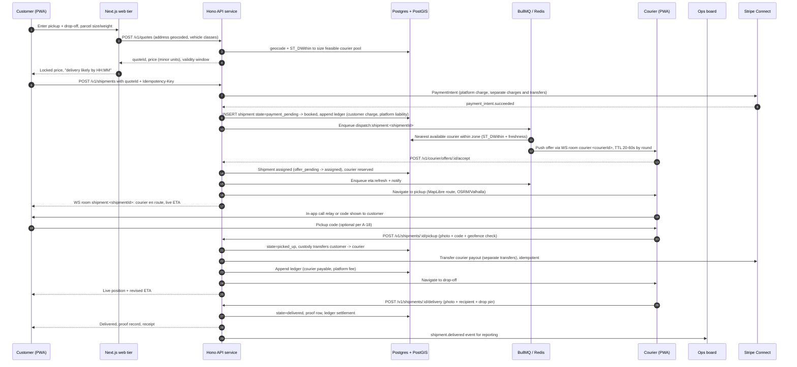
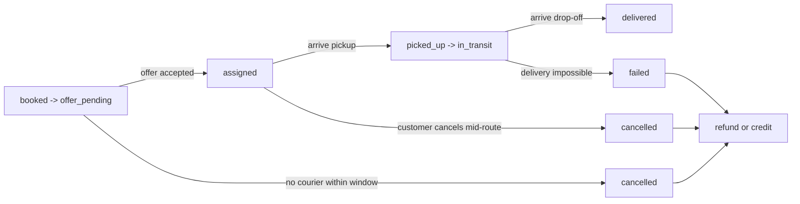
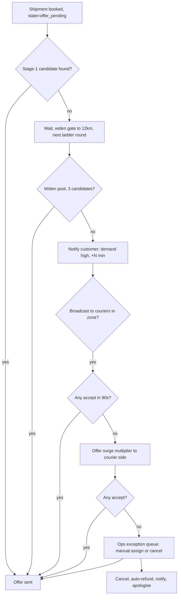
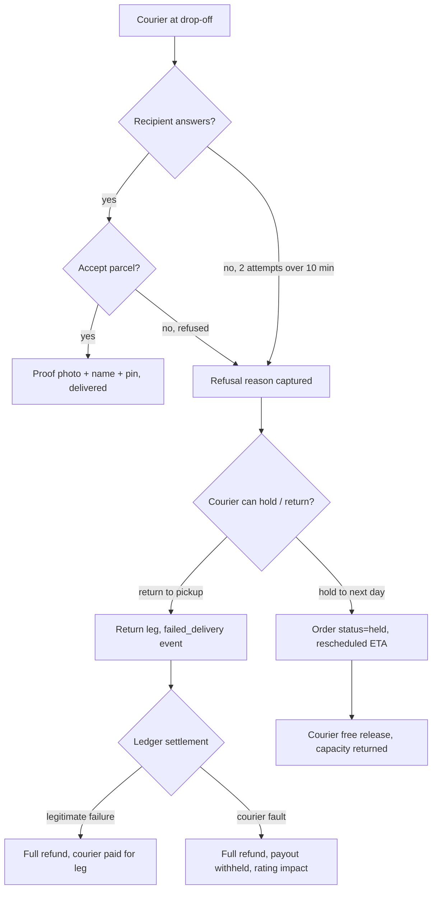

# QuickDrop — Product Brief

Status: **Approved for planning** · Date: 2026-10-05 · Owner: Product
Related: [01-tech-stack.md](./01-tech-stack.md) · [DECISIONS.md](./DECISIONS.md) · [README.md](./README.md) · research: [../stack_report.md](../stack_report.md)

### Vocabulary and normative ownership

| Term | Canonical form | Normative owner |
|---|---|---|
| The thing a customer books | **`shipment`** (`delivery` is the customer-facing word; this brief says "order" where plain English reads better — it is the same entity) | [03-data-model.md](./03-data-model.md) |
| Shipment lifecycle states | `draft`, `quoted`, `payment_pending`, `booked`, `offer_pending`, `assigned`, `picked_up`, `in_transit`, `arrived`, `delivered`, `cancelled`, `failed` | [03-data-model.md](./03-data-model.md) |
| Roles | `customer`, `courier`, `ops`, `admin` | [02-architecture.md](./02-architecture.md) |
| Dispatch ladder, offer TTL, candidate gates | Rounds with 20–60s TTL, widening gate up to 12 km | [02-architecture.md](./02-architecture.md) |
| Fare components, AOV, contribution margin | Worked model | [09-infrastructure-and-cost.md](./09-infrastructure-and-cost.md) |

Anything in this brief that appears to add to, rename, or contradict one of those is **not** normative. Where this brief needed a value the owning doc does not define, it is marked **placeholder** and the owning doc wins.

---

## 1. Assumptions

Every assumption below is load-bearing. Each carries an ID so other docs can cite it instead of re-arguing it. Assumptions marked **OPEN** are not decided; they are carried forward and must be resolved before the iteration that depends on them (see [Open questions carried forward](#11-open-questions-carried-forward)).

| ID | Assumption | Why we are assuming it | Impact if wrong |
|---|---|---|---|
| A-01 | **Single city at launch**, one timezone, one operating region. | Keeps dispatch a single-radius matching problem and avoids cross-region pricing/tax. | Multi-region forces per-region zones, pricing tables, and courier eligibility. |
| A-02 | **Independent couriers, not an owned fleet.** Couriers are individual contractors who sign up, upload documents, and set their own availability. | Avoids payroll, employment-law, and fleet-management burden; scales supply with demand. | If we employ couriers, payout/ledger model changes materially (payroll, liability insurance, tax withholding). |
| A-03 | **Address-based service only.** Customers enter a pickup address and a drop-off address. No "pin anywhere on the map" as the primary input. | Addresses are what couriers need to actually arrive; geo-pin-only causes failed pickups and refunds. | Dropping this reopens the map-first UX question and materially raises failed-pickup rate. |
| A-04 | **Prepaid only at launch. No cash on delivery (COD).** | COD breaks our double-entry ledger (we would hold customer funds we never saw) and creates dispute/shortage exposure. | COD would require a cash-reconciliation flow and a `cash_in_transit` account. Deferred, not rejected. |
| A-05 | **Small parcels and documents only** — fits in a standard backpack/box. Max envelope dimensions and weight per order are enforced at quote time. | Keeps vehicle classes simple and guarantees a courier can carry a single order without a van. | Large/heavy parcels force a vehicle-class and multi-package model. |
| A-06 | **Scheduled deliveries are v2.** v1 is on-demand only. | Keeps the matching engine to "now" and avoids idle-slot scheduling. | Scheduling becomes a distinct allocation problem with its own inventory model. |
| A-07 | **One live courier per shipment in v1.** No pooled/multi-courier handoff, no relay chains. | Proof-of-delivery and liability attribution get much harder with handoffs. | Relay requires custody ledger entries per handoff. |
| A-08 | **The courier chooses their own vehicle** (bike / motorcycle / car / van) and we match on vehicle capability, not assignment by ops. | Vehicle class is a courier attribute, not a dispatch decision, in v1. | Fleet dispatch by ops becomes an ops-console feature. |
| A-09 | **Live tracking means foreground tracking plus server-side staleness detection.** Guaranteed continuous background courier location on iOS Safari is not achievable in a browser. | Hard platform limit, not a design choice. iOS does not permit continuous background geolocation from a browser. ([WebKit Geolocation](https://developer.apple.com/documentation/webkitjs/geolocation)) | If continuous background tracking becomes a compliance requirement, v1 cannot meet it and we need a native app. See [DECISIONS.md ADR-0006](./DECISIONS.md#adr-0006--pwa-only-no-native-app-for-v1). |
| A-10 | **Web-first surfaces.** v1 ships as an installable PWA only. No native app, no app-store distribution. | One codebase serves customer, courier, and ops; iOS PWAs are installable via Add to Home Screen. (`beforeinstallprompt` is never fired on iOS, so install must be prompted in-product.) ([web.dev iOS install](https://web.dev/learn/pwa/installation/#ios-installation)) | App-store distribution would change release cadence, permissions UX, and background-location options. |
| A-11 | **English-only UI, single currency at launch.** | No i18n or FX in the ledger for v1. | FX introduces per-currency rounding and per-region ledger constraints. |
| A-12 | **Self-hosted auth and sessions** (Better Auth, sessions in our own Postgres). No social login at launch beyond email+phone OTP. | Keeps session control, role claims, and PWA-courier session lifetime under our control. | Social login is additive; it does not change the stack decision. |
| A-13 | **Base price is quoted and locked before the customer pays.** The quote never silently changes after payment. | Customers must be able to trust the amount they see. | Variable re-pricing at match time would need a consent step and would wreck trust. |
| A-14 | **Couriers are paid per completed delivery** via Stripe Connect transfers, not per hour. | Aligns courier incentive with completed work, not presence. | Hourly pay requires an attended-time clock and different ledger accounts. |
| A-15 | **Dispatch is automated matching first, human override always available.** | Ops is a small team at launch; automation with an escape hatch is the only workable model. | Fully manual dispatch is unscaleable; fully automated with no override produces unrecoverable failure states. |
| A-16 | **Cancellation is free before courier assignment; after assignment it is charged at a defined reduced rate.** | Both outcomes must be possible and priced without argument. | Needs the cancellation-fee schedule pinned before Iteration 2. **OPEN.** |
| A-17 | **Support contact is a masked call relay plus in-app messaging**, not direct phone-number exposure. | Courier safety and customer privacy both favour relay. | Direct numbers raise harassment/spam risk; adds no value to the core loop. |
| A-18 | **Proof of delivery is photo + recipient name + drop-off confirmation, plus an optional customer-supplied pickup code.** | Cheapest reliable evidence set; photo is accepted by most businesses and courts-adjacent processes. | PIN-only proof is cheaper but weak evidence for disputes. **OPEN:** whether customer pickup code is Must or Should. |
| A-19 | **Two-sided marketplace from day one: customers pay, couriers receive.** No subsidy-funded free deliveries. | Avoids negative unit economics and keeps the ledger clean. | Subsidy changes contribution-margin guardrail definitions. |
| A-20 | **Service zones are a convex-ish polygon/polygon-set or radius set per city, enforced at quote time.** | Cheap to implement on PostGIS and easy for ops to edit. | Complex zone geometry (islands, corridors) is a v2 problem. |

---

## 2. Problem statement

A person or small business in a dense city needs to move one small parcel or document from A to B **within a time window they care about**, and does not have a courier on staff, a vehicle, or the time to wait for a next-day shipping consolidation.

The existing options all fail on at least one axis:

- **Consumer courier apps** (food/parcel on-demand) are optimised for high-frequency, low-value, short-distance hops. They are excellent at moving a $12 meal across a street and poor at moving a document or a small parcel across a city with a proof-of-delivery and an itemised invoice requirement.
- **Traditional same-day couriers** are quote-and-phone based, priced per envelope with opaque surcharges, and offer no live visibility. The customer cannot tell whether the courier is 4 minutes out or 40.
- **Next-day postal/courier services** are cheap but structurally cannot meet a same-day window.
- **Rideshare / taxi freight** (where legal) is cheap and instant but provides no parcel chain of custody, no proof of delivery, and no recourse when the item is damaged.

### Value proposition

| For | Value |
|---|---|
| **Customer** | A door-to-door same-day parcel move with a price they see before paying, a live ETA they can trust, and an itemised proof-of-delivery record they can hand to someone else. |
| **Courier** | Flexible, self-scheduled earning opportunities with transparent per-job pay, immediate visibility of what they will be paid, and no dispatcher breathing down their neck. |
| **Ops** | One board where every order and every courier is visible, with the ability to fix any exception manually and an audit trail of who did what. |

### Why an on-demand courier/parcel model specifically

1. **It is a two-sided marketplace with a hard realtime loop.** The product is worthless without live position-to-ETA, and the ETA is worthless without map-matching. That realtime loop is the technical centre of gravity and the reason the stack is what it is. ([stack_report.md §3](../stack_report.md#3-tracking-architecture-consumerserver-fan-out))
2. **Unit economics are simple and verifiable.** Small parcel, single courier, no consolidation. Revenue minus courier payout minus payment fees is a number we can compute per order.
3. **The two-sided constraint is the hard part, not the mapping.** Matching, dispatch fairness, and courier supply are what kill on-demand marketplaces. Building the map is the easy 20%.
4. **It forces iOS-web honesty.** Because guaranteed background tracking is impossible in a browser ([WebKit Geolocation](https://developer.apple.com/documentation/webkitjs/geolocation)), the product must be designed around *foreground* tracking plus *server-side staleness detection* rather than pretending otherwise. That constraint shapes the courier UX, the customer promise, and the ops tooling. It is an advantage: competitors who promise background tracking on iOS web will disappoint their users.

---

## 3. Personas

### 3.1 Priya — Customer (primary)

| Attribute | Detail |
|---|---|
| Context | Freelance consultant. Needs to send a signed contract to a client and a forgotten laptop charger to a co-working space. Books 3–6 QuickDrop jobs a month, occasionally 2 in one morning. |
| Goals | Know the price up front. Know when it will arrive. Be able to prove it arrived. Not have to sign up for a courier relationship. |
| Pain points | Has been burned by courier apps that quote one price and charge another. Cannot tell if the courier is actually en route. Wasted a morning waiting for a "same-day" window that slipped. |
| Technical literacy | High. Comfortable with a web app, will not install anything for a 3x-a-month task. Will use Add to Home Screen if told it saves money. |
| Device | iPhone 15 (iOS 18/26), Safari, often on cellular. Secondary: Android Chrome. |
| Design implication | iOS PWA constraints are the primary case, not the edge case. Must degrade honestly rather than spin. |

### 3.2 Marcus — Courier

| Attribute | Detail |
|---|---|
| Context | Part-time, 20–30 hours a week, owns a motorcycle. Carries a thermal backpack for the grocery-box jobs and a small courier box for parcels. Two apps open at all times. |
| Goals | Clear pay per job before accepting. Route that does not waste his time. Get paid weekly without chasing anyone. Be able to go offline when it is quiet. |
| Pain points | Other apps give an offer with no distance, no pay breakdown, and a 5-second timer. Offers that send him across town for 3. He finds out about "customer cancelled" only when he arrives. |
| Technical literacy | Medium-high. Comfortable granting location permission, but will deny it if the app explains badly. Expects the app to work when his phone is hot, his screen is off, and his signal is one bar. |
| Device | Mid-range Android (Pixel-class) as primary — better battery and background behaviour than his iPhone. iPhone 13 as secondary. |
| Design implication | The courier app must be an **installed PWA**, must survive screen lock, must queue positions offline, and must show its own tracking health. Android-first courier experience, iOS-customer experience. |

### 3.3 Dana — Ops dispatcher

| Attribute | Detail |
|---|---|
| Context | On a laptop at a desk, 07:00–16:00, plus an on-call phone rotation. Handles 40–120 orders a day with 15–40 active couriers. |
| Goals | See every order and courier at once. Spot the stuck order before the customer does. Fix it in one action. Know exactly who did what. |
| Pain points | Status shown in one place and reality in another. No way to answer "where is order QD-4821?" without three tools. Manual reassignment with no audit trail. |
| Technical literacy | High but time-poor. Will learn a bespoke internal tool; will not read documentation. |
| Device | Desktop Chrome (1440p) primary; phone for on-call. |
| Design implication | The ops surface is the only place where density beats minimalism. It is a control surface, not a consumer surface. |

---

## 4. Golden-path journey

Customer books, courier is matched, parcel is picked up, parcel is delivered.

**Where the flow can be interrupted, by design:**

State names below are abbreviated for readability. The **normative** state machine and its legal transitions live in [03-data-model.md](./03-data-model.md); this diagram is a product view, not a contract.

---

## 5. The three unhappy paths

These are first-class product flows, not error states. Each needs its own UI, its own ops tooling, and its own ledger entries.

### 5.1 No courier available

Most common failure. Common in launch neighbourhoods, at shift change, and during surges.

- **Customer promise:** never a silent hang. A "we're finding you a courier" state with a live expectation, plus an explicit deadline at which we cancel and refund automatically.
- **Ops:** the exception queue is the primary control. Ops can widen the radius, broadcast, or cancel-with-refund without engineering help.
- **Ledger:** cancellation before assignment is a full refund. No courier payout.

### 5.2 Customer cancels mid-route

| Stage | Fee | Couriers affected | Actions |
|---|---|---|---|
| Before courier assigned | **0%** | None | Auto-cancel, auto-refund, shipment closed |
| Courier assigned, not yet at pickup | **50%** of quoted price (A-16, OPEN) | Assigned courier is released back to available | Refund remainder, courier paid a cancellation fee via ledger |
| Courier picked up | **100%** of quoted price | Courier completes or is instructed to return | No refund; courier paid in full |

- **Courier courtesy rule:** if the courier is already en route and the customer cancels with no reason, the courier still receives the cancellation fee. If the *courier* caused it (no show, vehicle failure), the customer is refunded in full.
- **Return-to-sender is explicitly out of scope for v1.** Cancelling after pickup does not reverse the parcel; ops records it as `cancelled_post_pickup` and the customer must arrange retrieval. See [Scope](#7-scope).
- **Ledger:** a `cancellation_fee` posting from platform revenue to courier payable, plus the customer refund posting. Both idempotent.

### 5.3 Delivery fails

Causes: recipient absent, address unreachable/wrong, customer refuses, parcel too large for the declared vehicle class, unsafe/physical access, customer unreachable.

- **Customer promise:** an explicit next step within 30 minutes of a failure, never a dead shipment.
- **Courier protection:** the courier is paid for the leg regardless of outcome unless the failure is attributable to them, and the determination is made by ops from evidence, not by the courier's self-report.
- **Ops:** every `failed_delivery` lands in the exception queue with photos, timeline, and both parties' last known statements.

---

## 6. Success metrics

### North Star

**Completed deliveries per active day (CD/AD).** A *completed delivery* is a shipment reaching `delivered` with a proof record and a settled ledger entry. An *active day* is a calendar day on which the platform was operational and at least one delivery completed. Tracked weekly, reported daily.

Rationale: it is simultaneously volume (demand), quality (completion, not cancellation), and marketplace health (a day with completed deliveries proves customers booked *and* couriers showed up). It cannot be inflated by discounting into unprofitable volume because the contribution-margin guardrail sits beside it.

### Guardrail metrics

| Metric | Definition | Target (placeholder — confirm in Iteration 0 analytics spike) | Alert |
|---|---|---|---|
| Cancellation rate | `cancelled / created`, split by pre-assign and mid-route | <= 12% pre-assign, <= 6% mid-route | > 15% pre-assign |
| Pickup ETA accuracy | P50 and P90 absolute error, minutes, between promised and actual arrival at pickup | P50 <= 4 min, P90 <= 12 min | P50 > 6 min |
| Delivery ETA accuracy | P50/P90 absolute error at drop-off | P50 <= 6 min, P90 <= 15 min | P50 > 10 min |
| Courier utilisation | `busy_minutes / online_minutes` per courier per day | 55–70% | < 40% for 7 days (oversupply) or > 85% (undersupply) |
| Contribution margin per delivery | customer revenue − courier payout − Stripe fees − refund leakage, in minor units | > 0 by contribution 3; target set after 500 settled orders | <= 0 for any week |
| First-offer acceptance | `offers accepted / offers sent` | 35–55% | < 25% (offer quality or pay problem) |
| Stale-tracking rate | active shipments where courier position is older than the staleness threshold, share of samples | < 5% | > 12% (iOS background reality) |
| Dispute rate | `disputes opened / delivered` | < 1.5% | > 3% |
| Matching latency | `assigned_at − created_at`, P50/P95 | P50 <= 3 min, P95 <= 9 min | P95 > 15 min |

Thresholds marked *placeholder* are operating assumptions, not validated numbers. They must be replaced with observed baselines after the first 200 completed deliveries.

---

## 7. Scope

### 7.1 In scope for v1

| Area | In scope |
|---|---|
| Surfaces | `/customer`, `/courier`, `/ops` role-routed surfaces in one Next.js App Router app; installable PWA |
| Auth | Email + phone OTP, self-hosted sessions, roles `customer` / `courier` / `ops` / `admin` (role set and authorisation matrix normative in [03-data-model.md](./03-data-model.md) and [02-architecture.md](./02-architecture.md)) |
| Ordering | Address-based pickup + drop-off, parcel dimensions/weight, vehicle-class capability check |
| Quoting | Distance-based quote with surge multiplier, validity window, price locked at payment |
| Payments | Stripe, card, prepaid only, separate charges and transfers, one currency |
| Matching | Radius + zone + freshness + vehicle-capability query on PostGIS, offer/countermodel with countdown |
| Tracking | Courier foreground position streaming over WebSocket, server-side fan-out to customer and ops, SSE fallback, staleness flag |
| ETA | Route-based ETA with map-matching fallback to velocity projection, smoothed |
| Execution | Navigate to pickup, pickup confirmation, proof-of-delivery capture, failure reporting |
| Communications | In-app message thread per order, masked call relay, email notifications, Web Push where available |
| Money | Integer minor units, hand-rolled double-entry ledger in Postgres, idempotency keys on all money writes |
| Payouts | Courier earnings statement, weekly Connect transfer schedule, adjustment trail |
| Ops | Live dispatch board, manual assign/reassign, exception queue, refund and payout adjustment, zone and pricing config, courier onboarding |
| Quality | Post-delivery rating, tip, dispute with evidence, refund workflow |
| Observability | Structured logs, request/job tracing, WebSocket connection and queue-depth metrics |

### 7.2 Out of scope for v1 (explicitly not built)

| Excluded | Reason |
|---|---|
| Native iOS/Android app | A-09/A-10. Not revisited unless background-tracking acceptance criteria change. |
| Cash on delivery | A-04. Breaks ledger integrity. |
| Scheduled / recurring deliveries | A-06. Needs a slot-allocation model. |
| Same-day multi-stop batching for one customer | A-07. Custody becomes ambiguous. |
| Courier-relay / handoff between couriers | A-07. Custody ledger per handoff. |
| International or multi-currency | A-11. |
| International expansion / multi-city | A-01. |
| Business invoicing, purchase orders, corporate accounts | v2. |
| Public REST API for third parties | v2. Requires API keys, quotas, versioning policy. |
| Automatic refund-on-failure without ops review | A-15. Silent refunds hide supply problems. |
| Full offline mode for couriers | Background Sync API is unavailable on iOS Safari ([caniuse](https://caniuse.com/background-sync)); courier is expected to be online during a job. |
| Route optimisation across multiple active jobs | v2. v1 courier holds one active job (A-07). |
| Rating-based dynamic pay | v2. |
| Loyalty points | v2. |

### 7.3 v2 deferred list

Ordered by expected value, not by ease:

1. **Scheduled deliveries** with courier slot bidding — the single largest demand unlock.
2. **Customer subscription** ("QuickDrop Pass"): monthly fee, waived base fee, priority matching, capped surge.
3. **Return-to-sender** as a first-class, courier-carried leg, priced and ledgered.
4. **Multi-stop orders** for customers (pickup A, B; drop-off A, B) with per-leg custody.
5. **Native courier app** for iOS, justified only by background-location acceptance criteria.
6. **Corporate/business accounts** with monthly invoicing, net terms, and SLAs.
7. **Public API** for merchants.
8. **Multi-vehicle-class enforcement** beyond capability filtering (ops-assigned vehicles).
9. **Cross-city zones** and intercity routes.
10. **Advanced demand forecasting** for proactive courier incentives.

---

## 8. User stories

Priority key: **Must** ships in v1 or v1 is not shippable · **Should** ships in v1 if the iteration has slack, otherwise slips to v1.1 · **Could** is explicitly a v1.2/v2 item · **Won't** is in the out-of-scope table above.

Each acceptance criterion is written to be directly convertible into a test.

### Customer stories

#### US-C1 — Must — Sign up and sign in as a customer

> As a **first-time sender** I want to **create an account with my phone number and verify it by OTP** so that **I can book a delivery without waiting on a sales call**.

- **AC** Given a new phone number, when I request an OTP, then a 6-digit code is delivered and expires after 5 minutes.
- **AC** Given an unverified session, when I attempt to place an order, then I am redirected to verification and my draft order is preserved.
- **AC** Given a session older than 30 days, when I load any `/customer` route, then I must re-authenticate; my active order, if any, is shown on re-entry.
- **AC** Rate limiting: no more than 5 OTP requests per number per hour, no more than 10 per IP per hour.

#### US-C2 — Must — Get an honest quote before committing

> As a **sender** I want to **enter a pickup address, a drop-off address, and my parcel's size and weight, and see the full price before I pay** so that **I never get charged more than I agreed to**.

- **AC** Given valid addresses and a parcel within A-05 limits, when I request a quote, then I see base fee, distance component, any surcharge, the current surge multiplier, the platform's courier-payout component at the standard (non-surge) rate, and the quote total in the user's currency — never a bare number.
- **AC** Given a parcel exceeding the size or weight limit for every available vehicle class, when I request a quote, then I am told which limit was exceeded and offered a split into multiple orders.
- **AC** Given a quote older than its validity window, when I attempt to pay, then the quote is rejected with `quote_expired` and I am shown a fresh quote for explicit re-confirmation.
- **AC** An address that cannot be geocoded or falls outside all active service zones produces a specific, actionable error, not a generic failure.
- **AC** Quote calculation is server-authoritative; the client never computes or displays a price it did not receive from `POST /v1/quotes`.

#### US-C3 — Must — Place and pay for a delivery

> As a **sender** I want to **pay by card and get an order number immediately** so that **I know the job is booked and can show someone the receipt**.

- **AC** Given a valid unexpired quote and an `Idempotency-Key`, when I submit the order, then exactly one shipment and one ledger transaction are created regardless of retries or double-taps.
- **AC** If payment fails, the shipment does not reach `booked`; it stays in `payment_pending` and the quote is held for 10 minutes.
- **AC** On success I receive a shipment reference, the locked price, the promised delivery window, and a shareable tracking link.
- **AC** The receipt shows: shipment reference, pickup and drop-off address, distance, component fees, surge multiplier if any, courier payout basis, and the timestamp of payment.
- **AC** Payment is taken by the platform (separate charges and transfers); the customer never sees a courier or a "Connect" affordance.

#### US-C4 — Must — Watch the courier and trust the ETA

> As a **sender** I want to **see the courier's live position, the current status, and an ETA that tells me when it is unreliable** so that **I can decide whether to wait or make other arrangements**.

- **AC** Once a courier is assigned, the tracking view opens automatically on both `/customer` and the shareable link.
- **AC** The view shows courier position, courier name/vehicle/rating, order status, distance remaining, and an ETA with a range, not a false-precision single time.
- **AC** Staleness is two-tier and server-authoritative. Past **60 s** with no position, the ETA is withdrawn (`etaConfidence: 'unavailable'`) and the view says "we have lost contact with your courier, we're on it" — never a frozen countdown. Past **120 s**, the assignment is revoked, the shipment returns to dispatch, and ops gets a flag. Thresholds are defined in [02-architecture.md](./02-architecture.md) and [03-data-model.md](./03-data-model.md); this story restates them, it does not own them.
- **AC** No UI path may render a stale dot as live.
- **AC** If the connection drops, the client reconnects with exponential backoff, renders cached last-known position with its timestamp, and marks the view as reconnecting.
- **AC** Status changes (courier assigned, en route to pickup, picked up, arriving now, delivered, failed, cancelled) each produce a timestamped entry in the visible order timeline.
- **AC** Updates arrive over WebSocket; if WebSocket cannot be established within 5s, the client transparently falls back to SSE and then to 5s polling, with no user-facing error.

#### US-C5 — Must — Cancel, and know exactly what it costs

> As a **sender** I want to **cancel a booking and be told the fee before I confirm** so that **I can stop paying for something I no longer want**.

- **AC** The cancel action always shows the stage (pre-assign / en route to pickup / post-pickup), the fee in minor units, and the resulting refund, before a confirmation is required.
- **AC** Pre-assign cancellation is free, refunds the full charge, and completes without ops involvement.
- **AC** Mid-route cancellation releases the courier to `available` immediately and pays the courier the cancellation fee defined by A-16.
- **AC** Post-pickup cancellation does not reverse the parcel; the UI states this in plain language and offers a contact route to ops.
- **AC** Cancellation is idempotent: a repeated cancel request returns the same result and does not double-refund.
- **AC** Every cancellation writes an immutable ledger entry with the actor (customer or ops), the stage, the fee, and the refund.

#### US-C6 — Should — Get notified without watching the app

> As a **sender** I want to **be notified when the courier is assigned, when they are close, and if the ETA slips** so that **I can do other work instead of refreshing**.

- **AC** Notification permission is requested with an in-app rationale explaining the exact triggers, at a moment of user intent (after order creation), never on first page load.
- **AC** Web Push is used when the browser supports it for an installed PWA (iOS 16.4+ only — [WebKit](https://webkit.org/blog/13878/web-push-for-web-apps-on-ios-and-ipados/)); otherwise fall back to email, and if email fails, to in-app + SMS.
- **AC** Notifications are deduplicated per order per event type; a reconnect storm cannot spam the user.
- **AC** A "quiet" class of event (e.g. courier moved) never produces a push notification.
- **AC** If push permission is denied, the app states plainly that it will fall back to email, and email actually works.

#### US-C7 — Should — Rate the delivery and leave a tip

> As a **sender** I want to **rate 1–5 after a successful delivery and optionally add a tip** so that **good couriers get more of the work and my feedback is visible to the platform**.

- **AC** Rating is available from `delivered` until 14 days after; it is not required to close the order.
- **AC** A rating of 1 or 2 requires selecting a reason from a fixed list (item not as described, late, courier no-show, damaged, wrong address, other) and offers an optional free-text comment.
- **AC** Tips are priced from a fixed set at quote currency and settle through the same ledger and Connect transfer path, never as an off-ledger adjustment.
- **AC** One rating per order, enforced by a unique constraint; a second attempt returns the existing rating.
- **AC** A tip added after a delivery is reflected in the courier's next payout statement within one settlement cycle.

#### US-C8 — Must — Raise a dispute and get a real outcome

> As a **sender whose parcel was damaged, lost, or delivered to the wrong place** I want to **file a dispute with evidence and see it resolved** so that **I can recover the value or get a replacement decision from the platform**.

- **AC** A dispute can be opened against any `delivered`, `failed`, or `cancelled` shipment within 30 days, including one cancelled after pickup.
- **AC** The form requires a category, a description, and at least one photo; pickup and delivery proof photos are pre-attached.
- **AC** Filing a dispute places the order's settlement on hold for courier payout but never freezes the customer's refund path.
- **AC** Every dispute enters the ops exception queue with an SLA clock, and the customer sees the state, the assigned owner, and the next update time.
- **AC** Resolution options are: full refund, partial refund, courier payout forfeiture, courier payout adjustment, or decline with a written reason. Each writes a balanced, idempotent ledger transaction.
- **AC** The customer receives the outcome and the ledger summary of every amount moved.

### Courier stories

#### US-R1 — Must — Control my availability

> As a **courier** I want to **go online and offline whenever I want, and see clearly whether the platform can see me** so that **I only work when I want to and I do not lose jobs to a technical fault**.

- **AC** One primary toggle: `available` / `unavailable`, plus a `break` state with an optional end time.
- **AC** Toggling to `available` requires a successful location fix; if the fix fails, I am told why and the toggle does not claim success.
- **AC** The courier header always shows one of: `Live — updated Ns ago`, `Tracking degraded — foreground only`, `Offline — N queued updates`, `Unavailable`.
- **AC** While tracking is degraded the courier app surfaces a one-tap "keep QuickDrop open" reminder and explains that iOS Safari does not report location while backgrounded ([WebKit Geolocation](https://developer.apple.com/documentation/webkitjs/geolocation)). No blame, no silent failure.
- **AC** Going offline with an active job is refused until the job is resolved or explicitly handed to ops.
- **AC** Availability changes and their timestamps are audit-logged and visible to ops.

#### US-R2 — Must — Evaluate and accept or decline offers

> As a **courier** I want to **see the pickup, the drop-off, the distance, the pay, and how long I have to decide** so that **I only accept jobs that are worth the trip**.

- **AC** An offer card shows pickup address, drop-off address, straight-line and routed distance, expected duration, payout in minor units with a breakdown (base + distance + surge), the customer/parcel class, and a countdown.
- **AC** The countdown is server-authoritative and rendered from a server timestamp, not a local decrement, so a clock change cannot extend or truncate it.
- **AC** Accepting is idempotent; the first acceptance wins and later attempts receive `409 offer_already_resolved`.
- **AC** An expired offer cannot be accepted.
- **AC** Offer payload is cached to IndexedDB so an offer list survives a brief network loss, clearly marked with its expiry.

#### US-R3 — Must — Navigate efficiently to pickup and drop-off

> As a **courier** I want **a route to the next stop that recalculates when I deviate** so that **I do not waste fuel or arrive after the promised window**.

- **AC** The map renders from self-hosted vector tiles via MapLibre GL JS with no third-party map API key or per-request billing. ([MapLibre](https://maplibre.org/))
- **AC** The route comes from the server (`/v1/shipments/:id/route`) using OSRM/Valhalla/GraphHopper, cached per leg; the client never calls a routing provider directly.
- **AC** Deviation beyond a threshold triggers a server recalculation; a fail-safe fallback shows the last good polyline and a straight-line bearing.
- **AC** The courier can switch to a "no navigation, keep tracking" mode — the tracking stream continues regardless of map state.
- **AC** Tile requests that fail degrade to a visible "map unavailable" panel while position streaming, ETA, and proof capture keep working.

#### US-R4 — Must — Confirm pickup with evidence

> As a **courier** I want to **confirm I have the parcel, with the customer's code and a photo, before I leave** so that **I can prove I did this job and get paid for it**.

- **AC** Pickup confirmation requires a photo, a location within a geofence radius of the pickup address, and the customer-supplied code when the order has one.
- **AC** If the courier is outside the geofence, the request is refused with the distance shown and an explicit "mark arrived at address" override that flags the order for ops review.
- **AC** A wrong or missing code offers limited retries with the attempt count shown; exhausting retries creates an ops exception rather than silently proceeding.
- **AC** On success, custody transfers (customer → courier) in the ledger and the customer is notified.
- **AC** Confirmation is idempotent and works from an IndexedDB queue when the network is unavailable, syncing in order when connectivity returns.

#### US-R5 — Must — Confirm delivery with proof of delivery

> As a **courier** I want to **submit proof — photo, recipient name, drop pin — that the platform will accept as final** so that **I get paid without disputes about whether I actually delivered**.

- **AC** Delivery requires: at least one photo, a recipient name or a `recipient_absent` flag with a reason, and a drop-off pin inside the drop-off geofence.
- **AC** Device metadata (timestamp, coarse accuracy) is attached to every proof record server-side; client-supplied timestamps are advisory only.
- **AC** Proof is immutable once accepted. Corrections are made through an ops adjustment with an audit entry, never by editing the record.
- **AC** Delivery confirmation is idempotent; a duplicate submission returns the original result.
- **AC** On acceptance, the courier payout is created in the ledger and the customer is notified with the proof record.

#### US-R6 — Must — Report a failed delivery with a reason

> As a **courier who cannot complete a drop-off** I want to **report the failure with a reason and photos and release the job** so that **I am not blocked and the customer gets help**.

- **AC** Failure reasons are a fixed enumerated set: `recipient_absent`, `address_unreachable`, `address_wrong`, `customer_refused`, `parcel_too_large`, `unsafe_access`, `vehicle_failure`, `other`.
- **AC** A photo is mandatory except for `vehicle_failure`, which requires a free-text note.
- **AC** The app attempts a customer relay call before allowing `recipient_absent` to be submitted, and records the attempt.
- **AC** On submission the courier's active job clears, their status returns to `available`, and the order enters the ops exception queue.
- **AC** The courier is told, before confirming, that their pay for the leg is not decided instantly and that ops makes the determination from evidence.

#### US-R7 — Must — See exactly what I am owed and when I am paid

> As a **courier** I want to **an itemised statement of every job, fee, adjustment, and the payout schedule** so that **I trust the platform and can plan my week**.

- **AC** A statement lists, per job: base pay, distance pay, surge pay, cancellation fee, tips, and adjustments, each as integer minor units with a signed direction.
- **AC** The running balance, the pending balance (not yet settled), and the next scheduled transfer date are visible at all times.
- **AC** Every line links to the order it came from.
- **AC** Payouts arrive on a fixed weekly schedule; the statement states the exact next date and the minimum threshold.
- **AC** Any discrepancy can be disputed in-app, which creates an ops task with an SLA; the courier can see its state.
- **AC** Transfer failures are surfaced the moment the provider reports them, with the retry status, never silently swallowed.

### Ops stories

#### US-O1 — Must — See the whole marketplace live

> As a **a dispatcher** I want to **one board showing every order, every courier, and every exception** so that **I can answer "where is QD-4821?" in seconds instead of minutes**.

- **AC** A single board lists active orders with status, age in current state, promised window, courier, ETA, and a flag set (late, stale tracking, unassigned, exception).
- **AC** Couriers are shown on the same map with status colour, vehicle class, and minutes since last position.
- **AC** Filters: status, zone, exception type, courier, time in state. Filters are URL-encoded and shareable.
- **AC** The board updates by WebSocket with a visible connection indicator; on disconnect it shows the age of the data rather than pretending to be live.
- **AC** Selecting an order opens a full timeline, ledger entries, proof media, messages, and the manual actions for that state.
- **AC** The board is usable at 1440x900 without horizontal scrolling and remains operable down to 1024x768.

#### US-O2 — Must — Assign and reassign couriers by hand, with an audit trail

> As a **a dispatcher** I want to **override automated matching and reassign a courier when the algorithm is wrong** so that **no customer is ever stuck because of a matching failure**.

- **AC** From an unassigned or stalled order, ops can see a ranked candidate list with distance, current load, acceptance rate, and active job count.
- **AC** Reassignment is permitted only when the courier has acknowledged release; an in-progress job requires an explicit forced-release reason.
- **AC** The courier is notified of assignment or release within 5 seconds; an assignment the courier declines loops back to the exception queue.
- **AC** Every manual action writes an append-only audit record with actor, timestamp, before/after state, and reason.
- **AC** Forced reassignment does not automatically penalise either courier.

#### US-O3 — Must — Work the exception queue

> As a **a dispatcher** I want **one prioritized queue for every order that needs a human** so that **nothing fails silently**.

- **AC** The queue contains: unassigned orders past threshold, stale-tracking orders, failed deliveries, customer cancellations, disputes, and payout anomalies.
- **AC** Each item shows age, SLA remaining (green/amber/red), and the evidence required to resolve it.
- **AC** Each item has a resolution path with a required reason; no item can be closed without one.
- **AC** The queue is claimable and reassignable; concurrent claims are prevented by a single-writer constraint, not by hope.
- **AC** SLA breach counts are reported daily.

#### US-O4 — Must — Move money correctly, and show what moved

> As a **a dispatcher with refund authority** I want to **refund or adjust from the ledger with an idempotent action** so that **no customer or courier is double-paid and every amount is explainable**.

- **AC** Refund actions specify order, amount in minor units, and reason code; the UI shows the resulting ledger effect before confirmation.
- **AC** Every action carries an idempotency key; a repeated submit returns the first result.
- **AC** A refund cannot be issued against an already fully refunded order.
- **AC** Ledger transactions must balance to zero across debits and credits, enforced by the database; an unbalanced insert is rejected.
- **AC** The order timeline shows every money movement with actor, amount, direction, and provider reference.
- **AC** A daily reconciliation report lists Stripe balance transactions against ledger entries and flags any mismatch.

---

## 9. Pricing and monetisation sketch

All figures are **illustrative planning numbers in USD minor units**, chosen to make the model coherent. They are not validated against competitor pricing and must be confirmed by the product owner before Iteration 2. The mechanical rules (componentisation, surge basis, payout ratio, refund semantics) are what the engineering plan should encode.

### 9.1 Customer-facing fee components

| Component | Basis | Illustrative | Charged when |
|---|---|---|---|
| Booking fee | Flat per order | 250 | At payment |
| Distance fee | Per km of routed pickup-to-dropoff distance | 85 | At payment (locked at quote) |
| Handling fee | Per parcel, covers first N km | 90 | At payment |
| Oversize surcharge | Per parcel above standard dimensions | 150 | At payment |
| Priority window surcharge | Customer selects a 60-minute window | 200 | At payment |
| After-hours surcharge | Outside 07:00–22:00 local | 250 | At payment |
| Cancellation fee | Stage-dependent, see [5.2](#52-customer-cancels-mid-route) | 0 / 50% / 100% | On cancellation |
| Tip | Customer-elected fixed amounts | 200 / 400 / 800 | After delivery, same ledger path |
| **Surge** | Multiplier applied to the **distance fee only** | 1.0x–2.0x | At payment (locked) |

Rules that must be honoured by the quoting service:

1. **The quote is the price.** No component may be added after payment without an explicit, separately-consented customer action.
2. **Surge is transparent and bounded.** The multiplier and its reason are shown in the quote breakdown; it is capped at 2.0x; it never applies to the booking fee.
3. **Surge is computed from server-side demand/supply**, never from client input: ratio of open orders to available couriers in the zone over a trailing window, with a hysteresis band so the multiplier does not oscillate. Exact thresholds are an open question for the pricing iteration.
4. **Distance is routed distance**, not straight-line, and is computed server-side once per quote and cached.

### 9.2 Courier payout and platform take

| Line | Share of customer charge | Illustrative (3500 base charge) |
|---|---|---|
| Courier payout | ~72% of the pre-surge charge, min floor per job | 2500 |
| Platform take | remainder: booking + handling + surcharge + the surge spread | 1000 |
| Payment cost | Stripe fee on the platform charge | Placeholder — confirm against Stripe pricing during Iteration 2; do not hard-code |
| **Contribution** | platform take − payment cost − refund leakage | Positive by construction; measured per the guardrail table |

Payout mechanics:

- **Courier pay is earned at delivery**, recorded as `courier_payable` in the ledger at proof acceptance, and **settled** on a weekly Connect transfer schedule (own transfer, idempotency key = `(courier_id, settlement_period)`).
- Surge above the standard payout basis flows to the courier as `surge_pay`, which is how supply is incentivised during shortage. If surge is not paid to the courier, the shortage has no economic signal.
- Payout floor per job prevents sub-economic micro-orders; it is a fixed minor-unit constant, not a percentage.
- The **cancellation fee** is a direct platform-to-courier ledger posting, not a component of any order charge.

### 9.3 Subscription option (v2, designed for now)

**QuickDrop Pass — 1900/month (illustrative)**

| Included | Effect |
|---|---|
| Booking fee waived | −250 per order |
| 5% off distance and handling fees | Applies before surge |
| Priority matching | Order inserted ahead of non-pass orders in the offer broadcast, without starving non-pass couriers of all work |
| Surge cap | Surge multiplier capped at 1.5x for pass orders |
| Free cancellation pre-assign | Already free for everyone; no change |

Accounting: the subscription is a recurring charge recognised as deferred revenue and released against delivery contribution as orders are completed, so that the contribution-margin guardrail is not flattered by pass orders whose acquisition cost sits elsewhere. Exact recognition is a question for the payments/ledger doc.

### 9.4 Unit-economics invariants to enforce in code

1. **Integer minor units everywhere.** No floats, no percentages applied to money, no client-side price arithmetic. Percentages are converted to integer basis points before any multiplication.
2. **Every mutating money operation carries an idempotency key**, and the key is unique in the database — not just checked in application code. ([Stripe idempotent requests](https://docs.stripe.com/api/idempotent_requests))
3. **Stripe is the source of truth for external movement**; the internal ledger is the source of truth for entitlement. They are reconciled, not conflated.
4. **Custody and money are separate ledgers.** A ledger entry for a handover is an operational fact; it may carry no money at all.
5. **Refund never exceeds capture** minus prior refunds, enforced by a `CHECK` constraint and a transaction, not by application logic.

---

## 10. Cross-cutting product requirements

These are not user stories but they constrain every story above.

| Requirement | Detail |
|---|---|
| **Honest tracking** | Any displayed live position carries its age. Staleness is a first-class UI state, never hidden. ([WebKit Geolocation](https://developer.apple.com/documentation/webkitjs/geolocation)) |
| **Installability** | Manifest with `name`, `short_name`, `start_url`, `display: standalone`, multiple icon sizes including maskable, `theme_color`, `background_color`, `scope`, `lang`, `description`. ([MDN Web App Manifest](https://developer.mozilla.org/en-US/docs/Web/Manifest)) |
| **iOS install honesty** | No `beforeinstallprompt` on iOS; the app must show a manual Add to Home Screen walkthrough for the courier surface, because courier tracking degrades badly when the PWA runs in a Safari tab. ([web.dev iOS install](https://web.dev/learn/pwa/installation/#ios-installation)) |
| **Offline resilience** | Courier position and proof writes queue in IndexedDB and replay in order. Background Sync is unavailable on iOS Safari ([caniuse](https://caniuse.com/background-sync)), so replay is driven by foreground reconnect, an `online`/`visibilitychange` trigger, and a manual "sync now" affordance. |
| **Storage eviction resilience** | iOS may evict PWA storage. The app treats IndexedDB as a cache: the server holds the truth for order state, and every critical read is server-authoritative on cold start. ([Apple Web Storage](https://developer.apple.com/documentation/webkitjs/working_with_web_storage)) |
| **Aggressive SW termination** | Service workers are terminated aggressively on iOS ([WebKit](https://webkit.org/blog/8090/workers-at-your-service/)); no correctness may depend on the SW staying alive. |
| **Accessibility** | All live-tracking states are exposed as text, not colour alone; ETA ranges are announced; proof capture is keyboard-reachable on ops. |
| **Localisation of numbers** | Prices formatted with `Intl.NumberFormat` in the user's locale while stored as integers. |
| **Data retention** | Courier positions older than a defined window are deleted or downsampled; proof media is retained per dispute window. Retention periods are an open question for the privacy doc. |

---

## 11. Open questions carried forward

These are deliberately unresolved. Each names the doc that must close it.

| # | Question | Blocks | Owner |
|---|---|---|---|
| Q1 | Cancellation fee schedule by stage (A-16) | Iteration 2 (quoting/pricing) | Product + Finance |
| Q2 | Whether the customer pickup code is Must or Should (A-18) | Iteration 3 (execution) | Product + Ops |
| Q3 | Surge multiplier thresholds, hysteresis, and per-zone overrides | Iteration 2 | Product + Engineering |
| Q4 | Return-to-sender as a priced courier leg in v1.1 | v1.1 planning | Product |
| Q5 | Proof-media retention and dispute window | Iteration 3 | Legal/Privacy |
| Q6 | **iOS background-tracking acceptance criteria** — what product promise is acceptable given that continuous background location is impossible on iOS Safari | Everything courier-side; see [DECISIONS.md ADR-0006](./DECISIONS.md#adr-0006--pwa-only-no-native-app-for-v1) | Product + Courier Ops |
| Q7 | Whether couriers see customer names/addresses before acceptance (privacy vs. navigation need) | Iteration 3 | Product + Legal |
| Q8 | Multi-stop route optimisation priority vs. one-job-per-courier (A-07) | v2 | Product |
| Q9 | Ops refund authority limits (per-order cap, daily cap) | Iteration 5 | Finance + Ops |
| Q10 | Whether ops can see and edit pricing/surge live, or only zone configuration | Iteration 5 | Product |

---

## 12. Definition of done for the product plan

This brief is complete when:

- Every Must story has at least one acceptance criterion that can be automated as a test.
- Every assumption with an **OPEN** marker has an owner and a target iteration.
- The North Star and every guardrail has a named source table or event that will populate it.
- The unhappy paths are specified with ledger consequences, not only UI states.
- The 5 ADRs in [01-tech-stack.md](./01-tech-stack.md) have no unresolved contradiction with this brief.