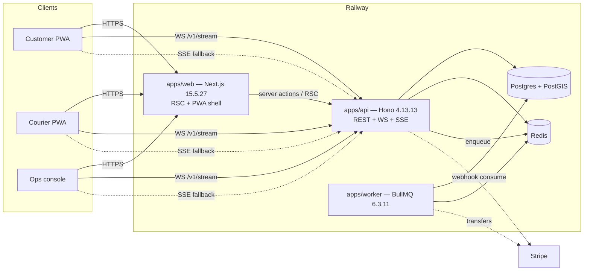
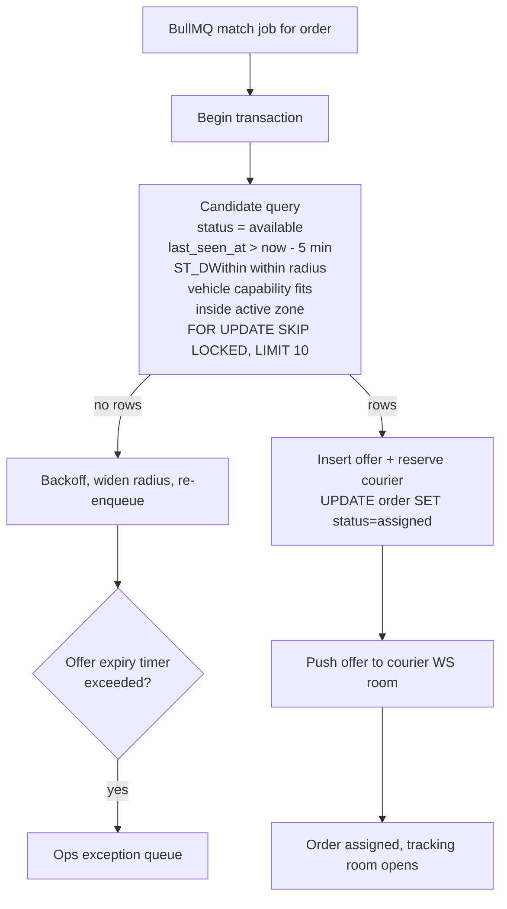

# QuickDrop — Technology Stack and Architecture Decisions

Status: **Approved** · Date: 2026-10-05 · Owner: Engineering
Research input: [../stack_report.md](../stack_report.md) — versions below are **taken from that report and are not re-researched here.**
Product context: [00-product-brief.md](./00-product-brief.md) · Log entries: [DECISIONS.md](./DECISIONS.md)

> Version discipline: every version in §1 and §2 is pinned verbatim from [stack_report.md §1](../stack_report.md#1-pinned-stack-table). Anything not in that report is marked **pin at Iteration 0** and is explicitly *not* a decision this document makes. Do not upgrade a pinned version without a new entry in [DECISIONS.md](./DECISIONS.md).

---

## 1. Pinned stack

| Component | Exact version | Why this, and not the alternative |
|---|---|---|
| **Node.js (LTS)** | **v24.19.0** (Active LTS "Krypton", EOL 2028-04-30) | Current Active LTS with a ~19-month support runway ([release schedule](https://nodejs.org/en/blog/announcements/evolving-the-nodejs-release-schedule/)). Node 26 exists but only enters LTS on **2026-10-28**, i.e. three weeks after this plan's date, so it is untested as an LTS target. ([previous releases](https://nodejs.org/en/about/previous-releases/)) Node 26 is tracked as an open upgrade, not a launch dependency. |
| **TypeScript** | **7.0.2** | TS 7.0 is the native Go port and current stable, with large compiler speedups ([announcement](https://devblogs.microsoft.com/typescript/announcing-typescript-7-0/), [releases](https://github.com/microsoft/TypeScript/releases)). Gives fast whole-repo type-check in CI, which matters with three role surfaces in one repo. **Open risk:** tools depending on the *programmatic* TS API may lag 7.0; verify `tsc --noEmit` and any build plugin before commit. |
| **Next.js (App Router)** | **15.5.27** | Current stable 15.5 line including the September 2026 security patches ([Next 15.5](https://nextjs.org/blog/next-15-5), [Sept 2026 security release](https://nextjs.org/blog/september-2026-security-release)). 16.x is available but 15.5.x is the stability choice. Chosen over API-routes-only because the three surfaces share layout, auth session reading, and Tailwind; see [ADR-1](#adr-1--nextjs-web-tier-plus-a-separate-hono-api-service-not-nextjs-api-routes-only). |
| **React / React DOM** | **19.3.0** | Latest stable React 19 with View Transitions and Fragment Refs stable ([React 19.3](https://react.dev/blog/2026/09/09/react-19-3), [versions](https://react.dev/versions)). Needed for view transitions in the delivery-status timeline and for cheap list reconciliation on the ops board. |
| **Tailwind CSS** | **4.3.3** | Current stable v4 line; CSS-first config means one token source shared by the three surfaces ([v4.3 blog](https://tailwindcss.com/blog/tailwind-v4-3)). Chosen over component libraries because the courier and ops surfaces need very different density and a design-system dependency would fight both. |
| **Backend API / realtime tier** | **Hono 4.13.13** (separate Node service) | Runtime-agnostic, small, first-class WebSocket support ([Hono](https://hono.dev/), [npm](https://www.npmjs.com/package/hono)). Chosen over Next.js API routes for long-lived WebSocket connections and over Fastify/NestJS for a much smaller surface; see [ADR-1](#adr-1--nextjs-web-tier-plus-a-separate-hono-api-service-not-nextjs-api-routes-only) and [ADR-4](#adr-4--websocket-primary-tracking-with-sse-fallback). |
| **Database** | **PostgreSQL + PostGIS** | Only correct answer for "find nearest available courier filtered by status, vehicle class, zone, and freshness" while staying transactional with the order table. `ST_DWithin` is index-assisted ([PostGIS](https://postgis.net/), [ST_DWithin](https://postgis.net/docs/ST_DWithin.html)); see [ADR-2](#adr-2--postgresql--postgis-not-a-hosted-geo-database). |
| **ORM** | **Drizzle ORM 0.45.3** | SQL-first and type-safe without hiding the SQL we need for geospatial and ledger work ([Drizzle](https://orm.drizzle.team/)). Prisma is rejected because 8.0.0-rc is pre-stable and its query layer fights `geography(Point,4326)` and partial `CHECK`-heavy schemas. |
| **Postgres driver** | **postgres.js 3.4.9** | ESM-first, good streaming support, native tagged-template SQL which is exactly the Drizzle idiom we need for `ST_DWithin` queries ([postgres.js](https://github.com/porsager/postgres)). Chosen over `pg` for modern TS/ESM ergonomics. |
| **Queue / background jobs** | **BullMQ 6.3.11 + Redis** | Mature worker model with retries, concurrency control, and scaling, and portable across the PaaS we are on ([BullMQ](https://docs.bullmq.io/), [npm](https://www.npmjs.com/package/bullmq)). Chosen over Inngest and Trigger.dev because our workers are long-lived Node processes on Railway, not serverless invocations; see [§2](#2-rejected-alternatives). |
| **Validation** | **Zod 4.6.5** | Current v4 stable, strongest schema DX inside Next.js/TS, and one schema can drive the Hono route validator, the client form, and the generated OpenAPI types ([Zod](https://zod.dev/)). |
| **Auth** | **Better Auth 1.7.7** | Self-hosted sessions in our own Postgres with roles/plugins, MIT licensed, actively developed ([Better Auth](https://www.better-auth.com/)). Chosen so the three role-routed surfaces and courier long-lived sessions stay under our control; see [§2](#2-rejected-alternatives) for Clerk and Auth.js v5, and [DECISIONS.md](./DECISIONS.md) for the Vercel-acquisition watch item. |
| **Maps SDK** | **MapLibre GL JS 6.12.0** | OSS, self-hostable vector tiles, works offline and in a PWA, no per-request billing and no key embedded in client code ([MapLibre](https://maplibre.org/), [npm](https://www.npmjs.com/package/maplibre-gl)). See [§2](#2-rejected-alternatives) for Leaflet and Google Maps JS. |
| **Routing** | OSRM / Valhalla / GraphHopper (self-hosted) | Needed for routed distance at quote time and map-matched ETAs; must be reachable server-side. Valhalla is the default candidate because its trace-point matching is what we need for position→route projection; OSRM is the fallback. **Which binary ships is unverified — see [DECISIONS.md](./DECISIONS.md) open questions.** |
| **Payments** | `@stripe/stripe-js` 10.0.0, `stripe` 23.0.0 | Current SDKs ([npm stripe-js](https://www.npmjs.com/package/@stripe/stripe-js)) and the only realistic choice for marketplace payouts at this scale. **Pin the Stripe API version explicitly** and build against Connect **Accounts v2** guidance ([Accounts v2 changelog](https://docs.stripe.com/changelog/clover/2025-12-15/accounts-v2)); see [ADR-3](#adr-3--stripe-connect-separate-charges-and-transfers). |
| **Service worker** | Hand-rolled **Workbox** SW (pin at Iteration 0) | ext-pwa is limiting with App Router/Turbopack, and we need precise control over which routes are cached versus streamed; see [ADR-5](#adr-5--hand-rolled-workbox-service-worker-not-ext-pwa). ([Next.js PWA guide](https://nextjs.org/docs/app/guides/progressive-web-apps), [Workbox](https://developer.chrome.com/docs/workbox/)) |
| **Hosting** | **Railway**: web service + worker service + managed Postgres + managed Redis | Supports long-lived WebSocket connections and background workers as separate services with the least operational overhead ([Railway](https://railway.app/)). Roughly ~$105/mo at ~5k orders/month. See [§2](#2-rejected-alternatives) for Render, Fly.io, AWS. |
| **Money representation** | Integer minor units + hand-rolled minimal double-entry ledger | No double-entry ledger library dominates; the patterns are well understood and we need exact control over `CHECK` constraints and idempotency keys. See [DECISIONS.md ADR-0004](./DECISIONS.md#adr-0004--integer-minor-units-with-a-hand-rolled-double-entry-ledger-in-postgres). |

---

## 2. Rejected alternatives

Each entry states the real reason and cites its source. "Rejected" means *not for v1* — several are reasonable and belong in the v2 list of [00-product-brief.md §7.3](./00-product-brief.md#73-v2-deferred-list).

### 2.1 Authentication

| Alternative | Verdict | Reason |
|---|---|---|
| **Auth.js v5** | Rejected | In maintenance mode since September 2025; no meaningful feature velocity, and it is Next.js-coupled in exactly the way that blocks running auth checks inside a standalone Hono service. ([comparisons](https://wolf-tech.io/blog/nextjs-authentication-frameworks-2025-2026-authjs-v5-clerk-better-auth-lucia-b2b-saas), [stack_report §1](../stack_report.md#1-pinned-stack-table)) |
| **Clerk** | Rejected | Managed and good DX, but it puts our user directory, session store, and role claims behind a vendor and an outbound dependency on every request. Courier long-lived PWA sessions and self-hosted recovery are worth more to us than the saved setup time. Self-hosting was the decisive factor. ([comparisons](https://wolf-tech.io/blog/nextjs-authentication-frameworks-2025-2026-authjs-v5-clerk-better-auth-lucia-b2b-saas)) |
| **Lucia** | Rejected | Deprecated; treated as a learning resource, not a dependency. ([stack_report §1](../stack_report.md#1-pinned-stack-table)) |
| **Hand-rolled JWT/session system** | Rejected | Session invalidation, rotation, and CSRF are not worth authoring when Better Auth is MIT, self-hosted, and does them. |

**Watch item:** Better Auth was acquired by Vercel in July 2026; licence and self-hosted DB ownership are unchanged as of the report date, but roadmap control may move ([Vercel acquires Better Auth](https://vercel.com/blog/vercel-acquires-better-auth)). Mitigation: the session table is ours in Postgres, so a migration path exists. Tracked in [DECISIONS.md](./DECISIONS.md).

### 2.2 Data access and migrations

| Alternative | Verdict | Reason |
|---|---|---|
| **Prisma** | Rejected | 8.0.0-rc is pre-stable at the report date ([stack_report §1](../stack_report.md#1-pinned-stack-table)). Beyond maturity, Prisma's abstraction is a liability for this domain: geospatial queries (`ST_DWithin` over `geography(Point,4326)`) and a ledger with `CHECK (balance)` constraints and deferred constraints want raw SQL with Drizzle's escape hatch, not a schema DSL. |
| **Kysely / raw SQL only** | Rejected | Excellent SQL fidelity but no schema-diff-driven migrations, so schema drift becomes a review problem. We get both from Drizzle. |
| **TypeORM** | Rejected | Decorator-based and heavier; no advantage here. |

### 2.3 Backend framework

| Alternative | Verdict | Reason |
|---|---|---|
| **Next.js API routes only** | Rejected | Long-lived WebSocket upgrade on a serverless-style route handler is a poor fit, and a single Node process owning both HTTP and WebSocket fan-out couples web-tier deploys to realtime uptime. See [ADR-1](#adr-1--nextjs-web-tier-plus-a-separate-hono-api-service-not-nextjs-api-routes-only). |
| **Fastify** | Rejected | Solid, but barebones for realtime (no built-in WebSocket story comparable to Hono), so we would hand-build more. Hono is runtime-agnostic which also lets the same code run in a worker. ([Hono](https://hono.dev/)) |
| **NestJS** | Rejected | A framework-on-a-framework: DI containers, decorators, and a large dependency surface for a service with a handful of route groups. Disproportionate to the problem. |
| **tRPC-only / no HTTP contract** | Rejected | We need a stable, documented, versioned HTTP surface for the ops console and a non-JS client shape (Stripe webhooks, worker processes). Zod schemas over plain HTTP satisfy all callers. |

### 2.4 Queue and background work

| Alternative | Verdict | Reason |
|---|---|---|
| **Inngest** | Rejected | Serverless-function-first; our matching, ETA refresh, and settlement jobs are long-lived Node processes on Railway, where an external durable-execution service adds a hop and a second failure domain for no gain. ([stack_report §1](../stack_report.md#1-pinned-stack-table)) |
| **Trigger.dev** | Rejected | Same reasoning: excellent if the compute model is serverless, which it is not. |
| **Postgres-only job queue** (`FOR UPDATE SKIP LOCKED`) | Rejected for now | Genuinely viable and would remove Redis. Rejected because BullMQ gives us retries with backoff, delayed jobs, rate limiting, flow dependencies, and dashboard-grade inspection immediately, and Redis is already paid for on Railway. Revisit if queue volume ever makes Redis unjustifiable. |
| **Server cron inside the web tier** | Rejected | A cron in the web service ties periodic correctness to web-tier deploys and restart timing. BullMQ repeatable jobs are first-class. |

### 2.5 Maps and geospatial

| Alternative | Verdict | Reason |
|---|---|---|
| **Leaflet 1.9.4** | Rejected | Simpler and mature, but raster-tile-first, which costs mobile bandwidth and visual quality on the tracking map where pan/zoom smoothness is the whole point. MapLibre renders self-hosted vector tiles and is the better PWA citizen. ([MapLibre](https://maplibre.org/)) |
| **Google Maps JS** | Rejected | Restrictive licensing plus per-request billing and a client-visible API key, all of which conflict with self-hosted tiles and a predictable cost line. ([stack_report §1](../stack_report.md#1-pinned-stack-table)) |
| **Mapbox GL JS** | Rejected | Closest technical fit but proprietary and billable; same objection as Google. |
| **Supabase / hosted Postgres for geo** | Rejected | Supabase *does* run Postgres + PostGIS and would be a fine managed Postgres. Rejected as the *primary* datastore because it splits our database across two vendors alongside Stripe and Railway, and because the connection model is optimised for client-direct access rather than a private service talking to its own ledger. ([stack_report §5](../stack_report.md#5-hostingdeployment)) |
| **Turbopuffer for geo** | Rejected | A vector database. Our query is a transactional availability filter — status, vehicle capability, zone, freshness, radius — joined against the order table. That is a relational job; a vector index would add a consistency problem, not solve one. ([stack_report §4](../stack_report.md#4-geospatial-find-nearest-available-courier)) |
| **Redis GEO / geohash only** | Rejected as source of truth | Fast, but cannot express our composite filter or join with orders atomically, and it cannot be the system of record. Use it as a cache of courier positions if profiling demands it; PostGIS remains authoritative. ([stack_report §4](../stack_report.md#4-geospatial-find-nearest-available-courier)) |

### 2.6 Hosting

| Alternative | Verdict | Reason |
|---|---|---|
| **Render** | Rejected | Comparable ballpark and reasonable fit, but no decisive advantage over Railway for our shape and cold-start behaviour on free/entry tiers is a distraction. ([Render](https://render.com/)) |
| **Fly.io** | Rejected for now | Strong option — VMs close to users, real separation of processes — but demands more operational fluency for a small team. Revisit if we need multi-region latency or run outside a single region (A-01 is currently single-city). ([Fly.io](https://fly.io/)) |
| **AWS (ECS/Fargate/App Runner)** | Rejected | Correct at scale and wrong at 5k orders/month: significantly more operational surface (VPCs, IAM, RDS, ElastiCache) for no benefit at this size. ([stack_report §5](../stack_report.md#5-hostingdeployment)) |
| **Vercel for the web tier** | Rejected | Excellent for Next.js, but the realtime tier and the long-lived WebSocket connections are the constraint, not SSR. Splitting web onto Vercel and API onto Railway adds a cross-vendor hop on every API call for no gain. |

### 2.7 Observability and testing (secondary)

| Alternative | Verdict | Reason |
|---|---|---|
| **Sentry** | Deferred | Strong default for error tracking; not pinned in the report. Pin at Iteration 0 alongside `@sentry/node` and `@sentry/nextjs`. |
| **PostHog / Amplitude** | Deferred | Product analytics for the guardrail metrics in [00-product-brief.md §6](./00-product-brief.md#6-success-metrics). Prefer a first-party event table over day one so the North Star is not vendor-gated. |
| **Playwright** | Deferred | E2E for the three surfaces. Pin at Iteration 0; it is the only practical way to test install-PWA and WebSocket behaviour end to end. |
| **Jest** | Rejected | Heavier than needed for unit/integration on an ESM/TS7 codebase; Vitest shares Vite's transform pipeline with Next.js. Pin at Iteration 0. |

---

## 3. Architecture Decision Records

### ADR-1 — Next.js web tier plus a separate Hono API service, not Next.js API routes only

**Context.** The product needs two very different runtime profiles. The web tier is a mobile-first PWA: SSR, static-ish shells, session reading, Tailwind, installable manifest. The API tier must hold long-lived WebSocket connections, fan out courier positions to customers and the ops board, stream server-sent events as a fallback, and accept position batches from couriers at a steady rate with heartbeat/reconnect handling. Both tiers talk to one Postgres and one Redis. Courier position write volume is small in bytes but extremely latency-sensitive and connection-durable.

**Decision.** Ship two deployable services from one repo.

- `apps/web` — Next.js 15.5.27 App Router, React 19.3.0, Tailwind 4.3.3. Serves `/customer`, `/courier`, `/ops`, the manifest, and the service worker.
- `apps/api` — Hono 4.13.13 on Node 24.19.0. Serves `/v1/*` REST, `/v1/stream` WebSocket, and `/v1/stream/sse`.
- `apps/worker` — BullMQ 6.3.11 consumers: matching, ETA refresh, notifications, settlement.
- Shared packages: `packages/db` (Drizzle + schema + migrations), `packages/contracts` (Zod schemas + error model + event names), `packages/auth`, `packages/geo`, `packages/money`.



**Consequences.** Positive: WebSocket uptime and web deploys are fully independent; scaling the realtime path does not scale React; the API tier can be tested without a browser; runtime is replaceable (Hono runs on workers); the web tier can be cached and served from a CDN while the API tier cannot. Negative: two services to deploy, observe, and secure; cross-service auth must be explicit (shared session verification against Postgres, not a Next.js-only helper); a browser round trip for internal web→API calls; two sets of environment variables and two CORS/auth surfaces; local dev needs a second process (solved with `pnpm dev` running both plus docker-compose Postgres/Redis). One team owns both, so the cost is process overhead, not coordination overhead.

**Alternatives considered.** Next.js API routes only (rejected: long-lived WS + tier coupling). One NestJS service for everything (rejected: heavy DI framework for three route groups). Microservices per domain (rejected: three surfaces and one marketplace do not justify service-per-entity; a modular monolith plus a realtime tier is the correct granularity).

---

### ADR-2 — PostgreSQL + PostGIS, not a hosted geo database

**Context.** The core read is "find available couriers near the pickup address", filtered simultaneously by: status (`available`), freshness of last known position, vehicle capability for the parcel class, active service zone, and currently-unassigned. That read must be consistent with the order write that reserves a courier — two couriers cannot be assigned the same job, and the reservation must be transactional with the order status change. The same database also holds the immutable double-entry ledger, proof-of-delivery records, and the immutable audit trail.

**Decision.** One Postgres with PostGIS as the single source of truth for all state, including courier positions.

- Courier position stored as `geography(Point, 4326)` — metres-native, correct for distance ([PostGIS](https://postgis.net/)).
- GiST index on the position column plus a composite index on `(status, last_seen_at)` ([ST_DWithin](https://postgis.net/docs/ST_DWithin.html)).
- Matching uses `ST_DWithin` in the `WHERE` clause, not `ST_Distance`, so the index is used; distance is selected only for ordering ([stack_report §4](../stack_report.md#4-geospatial-find-nearest-available-courier)).



**Consequences.** Positive: one transaction guarantees no double-assignment; the ledger, orders, and positions can be joined and reconciled in SQL; a backup restores everything; PostGIS is mature and cheap on Railway's managed Postgres. Negative: at large courier counts the raw candidate query needs care (hence the index shape and `SKIP LOCKED`); Redis GEO may be added later purely as a read-through cache for "who is nearby right now" dashboards; PostGIS upgrades are an operational concern for a small team.

**Alternatives considered.** Turbopuffer / a vector DB (rejected: transactional composite filter, not similarity search). Redis geohash as source of truth (rejected: cannot express the composite filter or join atomically with orders). MongoDB geospatial (rejected: we need double-entry `CHECK` constraints and relational proof/order joins far more than we need a document model). Supabase-hosted Postgres+PostGIS (rejected as primary store: multi-vendor split for no capability gain). Firebase Firestore GeoQuery (rejected: no multi-document transactions spanning reservation + ledger in the shape we need).

---

### ADR-3 — Stripe Connect: separate charges and transfers

**Context.** Two parties to each delivery: the customer pays, and an independent courier (A-02) must be paid. Payments must be card-prepaid only (A-04). Money must be auditable, idempotent, and reconcilable, and we need a *courier-facing* payout statement that is honest to the minor unit. Courier payouts are earned at delivery but settled weekly, so there is a real interval between earning and payment.

**Decision.** Stripe Connect with **separate charges and transfers**, built against **Accounts v2** guidance with an **explicitly pinned API version**.

- The customer pays the **platform**. The platform is the merchant of record; the customer sees one charge, one receipt, one VAT/invoice line, and never a courier or a Connect affordance.
- Courier earnings are booked as a **payable in our internal ledger** at proof-of-delivery acceptance, then settled by a **separate transfer** to the courier's connected account on a weekly schedule.
- Every Stripe call that moves money carries an `Idempotency-Key`; the key is stored in our DB with a `UNIQUE` constraint *and* passed to Stripe, so a retry can never double-move ([idempotent requests](https://docs.stripe.com/api/idempotent_requests)).
- Webhooks are the authority for external state; every event id is recorded and processed exactly once.
- The internal ledger — integer minor units, balanced transactions, `CHECK` constraints — is the source of truth for *entitlement*, not for Stripe's balance. A scheduled three-way reconciliation compares Stripe balance transactions, Stripe payout events, and our ledger. ([Connect](https://docs.stripe.com/connect/))

```mermaid
sequenceDiagram
    participant C as Customer
    participant A as Hono API
    participant L as Ledger (Postgres)
    participant S as Stripe

    C->>A: POST /v1/orders (Idempotency-Key)
    A->>L: BEGIN; create order payment_pending
    A->>S: PaymentIntent create (platform charge, idem key = order id)
    S-->>A: payment_intent.succeeded
    A->>L: order=searching; POST customer_charge<br/>debit cash_provider, credit customer_payable
    Note over C,A: Customer is charged once, by the platform only
    A->>L: order delivered; proof accepted
    A->>L: POST courier_payable<br/>debit delivery_service_expense, credit courier_payable(courier_id)
    Note over L: Earned, not yet paid
    loop Weekly settlement
        L->>L: Aggregate courier_payable per courier for period
        L->>S: transfer create (idem key = courier_id + period)
        S-->>L: transfer.paid
        L->>L: debit courier_payable, credit payout_clearing
    end
    C->>A: Dispute opened
    A->>S: refund create (idem key = dispute id)
    A->>L: POST dispute_refund (balanced, references order)
```

**Consequences.** Positive: single charge to the customer means clean receipts, one refund surface, and no per-order Connect onboarding interruption; we never hold funds in a platform balance that belongs to couriers; courier onboarding is a Connect account link independent of any particular order; the weekly payable/transfer split gives an accurate statement for US-R7. Negative: we absorb Stripe fees and refund risk; we are the merchant of record and therefore bear chargebacks and dispute liability; Connect onboarding (identity verification, bank account) adds a real flow to courier signup that ops must help with; if courier earnings outpace settlement there is a genuine working-capital obligation that the ledger must make visible; Accounts v2 is in transition, so legacy account-type shapes must not leak into our code. **Do not hold courier funds longer than the stated weekly schedule** — this is the trust anchor for US-R7.

**Alternatives considered.** **Direct charges** (rejected: the customer would see a Connect charge per job, breaking the single-receipt UX and exposing the courier's account to the customer). **Destination charges with `application_fee_amount`** (rejected for v1: it requires the connected account to be ready *before* the charge, coupling order creation to courier onboarding and failing the whole order if onboarding is incomplete — unacceptable when matching is already the fragile step). **Payments outside Stripe** (rejected: worse fraud tooling and worse reconciliation). **Platform holds and pays couriers manually** (rejected: not scalable, and it turns US-R7 into an accounting exercise).

---

### ADR-4 — WebSocket-primary tracking with SSE fallback

**Context.** Courier → server is bidirectional and bursty: position batches every few seconds or on movement thresholds, plus heartbeat, plus reconnect. Server → consumer is mostly unidirectional fan-out: courier position, ETA revision, and status transitions to the customer view and the ops board. Consumers are browsers on mobile networks, including iOS Safari where connections drop on screen lock, tab switch, and network handover, and where service workers are terminated aggressively ([WebKit on service workers](https://webkit.org/blog/8090/workers-at-your-service/)). Background Sync is unavailable on iOS Safari ([caniuse](https://caniuse.com/background-sync)), so replay must be driven by foreground events. Guaranteed continuous background courier tracking is **not possible** in a browser ([WebKit Geolocation](https://developer.apple.com/documentation/webkitjs/geolocation)), so the system must be honest about staleness instead of pretending.

**Decision.** WebSocket is the primary transport for both directions, with SSE as an automatic fallback for one-way consumers and short-interval polling as the last resort.

- **Courier → server:** `POST /v1/courier/positions` batches (simpler than multiplexed upgrade for writes, and survives a mid-route reconnect cleanly) OR a WebSocket room if profiling justifies it — **decision deferred to Iteration 4 with a spike**; default is batched HTTP POST.
- **Server → consumer:** WebSocket room per `order:<orderId>` and `courier:<courierId>`, single upgrade at `/v1/stream`. Rooms are joined only after server-side session + role + order-participation check.
- **Server-side smoothing and validation:** the API rejects out-of-order and implausible points (speed > threshold, impossible jumps), map-matches to the active route where one exists, and stores last-known position **with its timestamp**. ([stack_report §3](../stack_report.md#3-tracking-architecture-consumerserver-fan-out))
- **Staleness is a first-class state.** Every emitted position carries `observedAt`; the UI renders age. When `now - observedAt` exceeds the threshold, the server emits an explicit `tracking_degraded` event and consumers show "last update N min ago". Ops sees the same signal as a board flag.
- **Fallback ladder, client-driven:** WebSocket → SSE (unidirectional, `text/event-stream`, reconnect via `Last-Event-ID`) → polling every 5s. The ladder is invisible to the user; the connection indicator is visible.
- **Offline queue:** courier positions and proof writes queue in IndexedDB and replay in order on foreground reconnect, `online`, and `visibilitychange`. No Background Sync dependency.
- **Rate limiting:** outbound fan-out is coalesced to at most 1 message per second per room; position updates below a movement threshold are not broadcast at all.

**Consequences.** Positive: lowest latency and battery cost on the happy path; SSE degrades without a client library; the staleness design is honest and testable, and it is a genuine differentiator against apps that promise background tracking on iOS web. Negative: two real-time transports to build and test plus a third polling path; connection state management is a persistent source of bugs and must be covered by tests, not assumptions; room fan-out needs backpressure; a WebSocket that "looks open" while the browser has frozen the tab is a real failure mode that only staleness detection catches. Ops load testing must include many concurrent room members, not just courier count.

**Alternatives considered.** **SSE only** (rejected: acceptable for server→consumer, which is why it is the fallback, but SSE-only couples courier writes to an awkward out-of-band path and SSE connections have infrastructure limits). **Polling only** (rejected: 5s polling for a live-tracking product is a visible product failure, and it multiplies server load by polling-interval frequency per viewer). **Firebase Realtime Database / Firestore listeners** (rejected: vendor-gated, no transactional join to our Postgres order/ledger state, and position data is exactly the kind of data we want under our own retention rules). **MQTT/WebSocket broker** (rejected: an additional broker and auth surface for a fan-out we already have Redis and Node for; MQTT's client/broker split maps badly onto browser consumers). **Long-polling only** (rejected: header/payload overhead and proxy timeouts).

---

### ADR-5 — Hand-rolled Workbox service worker, not ext-pwa

**Context.** All three surfaces are installable PWAs. The courier surface in particular needs a shell that opens fast, survives spotty connectivity, and can queue writes. The Next.js build output and the service worker must be versioned together so a deploy never pairs a stale SW with a new app. ext-pwa is commonly used with Next.js but is limiting with the App Router and Turbopack, and its caching defaults are not the ones this product needs: we need precise control over which routes are precached, which are network-only, and which are runtime-cached, plus full control of update semantics.

**Decision.** Hand-roll the service worker on Workbox, build it as a separate step, and version it against the app build.

- `apps/web/public/sw.js` source lives at `apps/web/src/service-worker/`; compiled by `workbox-build` (`injectManifest` mode) in a **prebuild step**, not by a webpack plugin.
- `next.config.ts` sets `output: 'standalone'`; the SW is served from `/sw.js` with `Service-Worker-Allowed` and registered from a client component after `load`.
- **Caching policy by route class:** app shell precached (small, versioned, `revision`-keyed); `/customer`, `/courier`, `/ops` **routes** network-first with cache fallback to the cached shell; **API** `/v1/quotes` and `/v1/orders` network-only, never cached; **telemetry and position endpoints** network-only; **map tiles and sprites** cache-first with a bounded LRU (they are the actual bandwidth hog on mobile and are safe to cache); images cache-first.
- **Never cache:** anything carrying an `Authorization` or session cookie in a response we might replay, any 4xx/5xx, and any HTML shell served to the ops console beyond a single cached fallback copy.
- **Update semantics:** SW updates are applied on next navigation, never mid-job. The courier app suppresses the "new version available" prompt while a job is active.
- **Installability:** manifest with `name`, `short_name`, `start_url`, `display: standalone`, multiple icon sizes including maskable, `theme_color`, `background_color`, `scope`, `lang`, `description` ([MDN Web App Manifest](https://developer.mozilla.org/en-US/docs/Web/Manifest)). No `beforeinstallprompt` reliance — iOS requires a manual Add to Home Screen walkthrough, shown to couriers because tracking degrades in a Safari tab ([web.dev iOS install](https://web.dev/learn/pwa/installation/#ios-installation)).
- **No correctness depends on the SW.** iOS terminates service workers aggressively ([WebKit](https://webkit.org/blog/8090/workers-at-your-service/)) and may evict storage ([Apple Web Storage](https://developer.apple.com/documentation/webkitjs/working_with_web_storage)). The SW is a performance and offline-UX layer only; the server holds truth and every critical read is server-authoritative on cold start.

**Consequences.** Positive: exact control of precache list, route classes, and update timing; no build-plugin/Turbopack coupling; the SW is small enough to review in a code diff; caching policy is a testable artefact. Negative: we own the SW bugs, the cache-invalidation discipline, and the interaction with Next.js asset hashing; a hand-rolled SW is a place where "works in Chrome" hides iOS problems, so the SW test matrix must include a real iOS device, not only emulation; a bad `injectManifest` revision can serve a stale shell indefinitely, which needs an explicit build-time assertion.

**Alternatives considered.** **ext-pwa** (rejected: limiting with App Router/Turbopack per [stack_report §2](../stack_report.md#2-pwa--ios-constraints), and its default caching strategy does not match the route classes above). **Serwist** (rejected as the primary choice, not on merit: Workbox is the more battle-documented runtime, and Serwist remains a reasonable swap if Workbox's `injectManifest` integration proves painful — decide during Iteration 0, not later). **No service worker at all** (rejected: loses offline queueing and installability; not viable for the courier surface). **A custom native wrapper** (rejected: reintroduces the app-store and native-toolchain cost that [ADR-6 in DECISIONS.md](./DECISIONS.md#adr-0006--pwa-only-no-native-app-for-v1) exists to avoid).

---

## 4. Tooling

Versions for tools **not covered by [stack_report.md](../stack_report.md)** are deliberately unpinned here and must be pinned at Iteration 0 with an exact version in `package.json` (no `^`, no `latest`) plus an entry in [DECISIONS.md](./DECISIONS.md). Rationale for each choice is what matters at this stage.

| Concern | Tool | Version | Notes |
|---|---|---|---|
| Package manager | **pnpm** via Corepack | pin at Iteration 0 | Single lockfile across `apps/*` and `packages/*`, strict node_modules, cheap workspace scripts, and `pnpm why` for dependency forensics during audits. `corepack enable` in the README so every developer gets the same pnpm. |
| Node runtime pin | `.nvmrc` + `package.json#engines` | **24.19.0** | `"engines": { "node": ">=24.19.0 <25" }`. CI uses the exact version; Railway sets `NODE_VERSION=24.19.0` explicitly so the deploy does not silently ride a Node 26 default. |
| Type check | **`tsc --noEmit`** | **7.0.2** | Runs in CI as its own job, separate from build, so a type error never surfaces as a confusing build failure. **Risk to verify in Iteration 0:** TS 7.0 programmatic-API compatibility with any build plugin ([stack_report §7](../stack_report.md#7-open-questions)). |
| Formatter | **Prettier** | pin at Iteration 0 | Opinionated, zero-config, and CI-checkable with `--check`. Chosen over letting the linter own formatting because two tools with overlapping opinions cause merge conflicts in a three-surface repo. |
| Linter | **ESLint 9 (flat config) + typescript-eslint** | pin at Iteration 0 | Flat config only. Rules that matter for this codebase and must be enabled: no floating promises (courier position batching), no unchecked indexed access on ledger rows, exhaustive switch on order-status and failure-reason enums, and an import-boundary rule keeping `apps/web` free of direct `postgres.js` usage. Biome was considered as a single-tool formatter+linter and rejected for now because Next.js plugin support is less settled than ESLint's. |
| Unit / integration tests | **Vitest** | pin at Iteration 0 | Shares Vite's transform with Next.js, native ESM, fast. Jest rejected: heavier on an ESM + TS 7 codebase for no benefit here. |
| E2E | **Playwright** | pin at Iteration 0 | The only practical way to test install-PWA behaviour, WebSocket reconnect, and the ops board at real browser scale. Must include a WebKit project (iOS/macOS) in CI — `chromium` alone will hide the iOS failures that matter most here. |
| Migrations | **Drizzle Kit** | 0.45.3 (same release train as the ORM) | `drizzle-kit generate` for SQL diffs, `drizzle-kit migrate` in deploy, `drizzle-kit studio` locally. Generated SQL is committed and reviewed — the ledger schema must be inspectable in a diff. |
| Migrations in production | expand/contract, no destructive step in a deploy | — | Every migration is backward-compatible for one release: add nullable column → backfill → add constraint → drop old. Postgres `CHECK`/deferred-constraint additions on large tables use `NOT VALID` + `VALIDATE CONSTRAINT`. |
| Seed data | **SQL seed script** (`db/seed/`) + `drizzle-seed` | pin at Iteration 0 | Deterministic: same seed produces the same couriers, orders, and ledger. Ops needs a believable demo city, not random data. |
| Local infra | **docker compose** — `postgis/postgis`, `redis` | pin at Iteration 0 | PostGIS image, not vanilla Postgres, so local and Railway behave identically. |
| CI | **GitHub Actions** | n/a | Jobs: `lint` → `typecheck` → `test` (unit+integration with service containers) → `e2e` (chromium + webkit) → `build` → `migrate` dry-run against a snapshot. Deploy to Railway is manual from `main` for v1; CD comes with the release iteration. |
| Pre-commit | **husky + lint-staged** | pin at Iteration 0 | Runs Prettier and ESLint on staged files only, to keep the pre-commit hook under a second. Full type-check stays in CI, not in the hook. |
| Commit format | **Commitlint (Conventional Commits)** | pin at Iteration 0 | Enables generated changelogs and semantic release notes per service. |
| Secrets | **`.env` locally, Railway environment variables in prod** | — | `.env.example` is committed with every key present and no values. No secrets in the repo, ever. |
| Observability | **pino** structured JSON + OpenTelemetry-ready request/job ids | pin at Iteration 0 | One `requestId`/`jobId`/`orderId` propagated through Hono middleware, BullMQ jobs, and Stripe webhook handlers, so an ops complaint can be traced end to end in one log query. Sentry pinned at Iteration 0 for error tracking. |

---

## 5. Developer experience summary

### 5.1 One command to a working stack

```bash
corepack enable
pnpm install
cp .env.example .env.local          # every key present, no secrets
docker compose up -d                # postgis/postgis + redis
pnpm db:push                        # apply schema to local Postgres
pnpm db:seed                        # deterministic demo city: couriers, orders, ledger
pnpm dev                            # web (3000) + api (8787) + worker, all watching
```

`pnpm dev` runs all three processes concurrently with prefixed, colour-coded logs. No developer should ever need to start a service by hand.

### 5.2 Command surface

| Command | Does |
|---|---|
| `pnpm dev` | All three services in watch mode |
| `pnpm dev:web` / `pnpm dev:api` / `pnpm dev:worker` | One service only |
| `pnpm typecheck` | `tsc --noEmit` across the workspace |
| `pnpm lint` / `pnpm lint:fix` | ESLint 9 flat config |
| `pnpm format` / `pnpm format:check` | Prettier |
| `pnpm test` | Vitest unit + integration |
| `pnpm test:e2e` | Playwright (chromium + webkit) |
| `pnpm db:generate` | Drizzle Kit diff → reviewable SQL |
| `pnpm db:migrate` | Apply pending migrations |
| `pnpm db:seed` | Deterministic seed |
| `pnpm db:studio` | Drizzle Studio |
| `pnpm sw:build` | Compile the Workbox service worker |
| `pnpm contracts:check` | Fails if `packages/contracts` exports diverge from the OpenAPI snapshot |
| `pnpm verify` | `format:check && lint && typecheck && test` — the pre-push gate |

### 5.3 DX principles

1. **One repo, three services, explicit boundaries.** `packages/*` are shared libraries with no service-specific imports; the ESLint import-boundary rule fails the build if `apps/web` imports `apps/api` internals or reaches for `postgres.js` directly. This is what keeps the split from eroding.
2. **Contracts first.** Zod schemas in `packages/contracts` are the single source of truth for request validation, WebSocket event payloads, BullMQ job payloads, and the generated API types. A drifted contract fails CI, not a customer's browser.
3. **Type-safe environment.** Environment variables are parsed by a Zod schema at process start; a missing or malformed variable crashes the service immediately with the variable name, not at the first request.
4. **Fast, deterministic tests.** Integration tests run against the real PostGIS in a service container — spatial queries and ledger constraints are exactly what a mocked DB would not catch. Seed data is deterministic, so failures are reproducible.
5. **WebKit in CI from day one.** The single most expensive defect class in this product is an iOS-only tracking or SW failure. CI runs the Playwright WebKit project against the courier tracking flow from Iteration 0.
6. **Migrations are reviewable artefacts.** Generated SQL is committed and diffed; the ledger schema is never a mystery in review.
7. **No hidden global state.** No module-level singletons holding connections in the API service; connections are created per process and closed on shutdown so Railway restarts do not leak.

### 5.4 Known DX risks to retire in Iteration 0

| Risk | Retiring action |
|---|---|
| TypeScript 7.0 programmatic-API compat with build plugins ([stack_report §7](../stack_report.md#7-open-questions)) | Stand up `tsc --noEmit` and a production `next build` in CI in week one; if a plugin fails, pin the plugin, do not downgrade TypeScript |
| Workbox `injectManifest` + Next.js 15.5 output hash agreement | `pnpm sw:build` runs in CI and asserts every precache revision matches a real asset; a mismatch fails the build |
| Turbopack vs. custom SW integration ([stack_report §7](../stack_report.md#7-open-questions)) | Build with the same bundler in dev and CI; if Turbopack breaks the SW step, use webpack for `apps/web` and record it |
| Hono WebSocket upgrade behaviour behind Railway's proxy | Test a real WebSocket connection against a Railway staging URL before building features on it |
| Postgres.js + serverless-style reconnects under Railway | Load-test connection churn; enable a pooler if `last_seen_at` writes start timing out |
| Better Auth session lookup from a separate service | Prove session verification works from `apps/api`, not only from Next.js middleware, in week one |