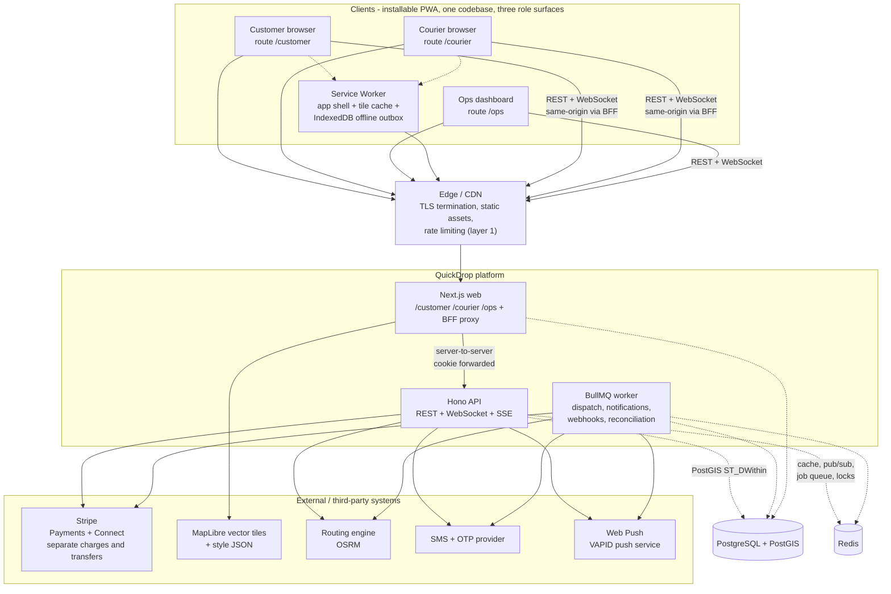
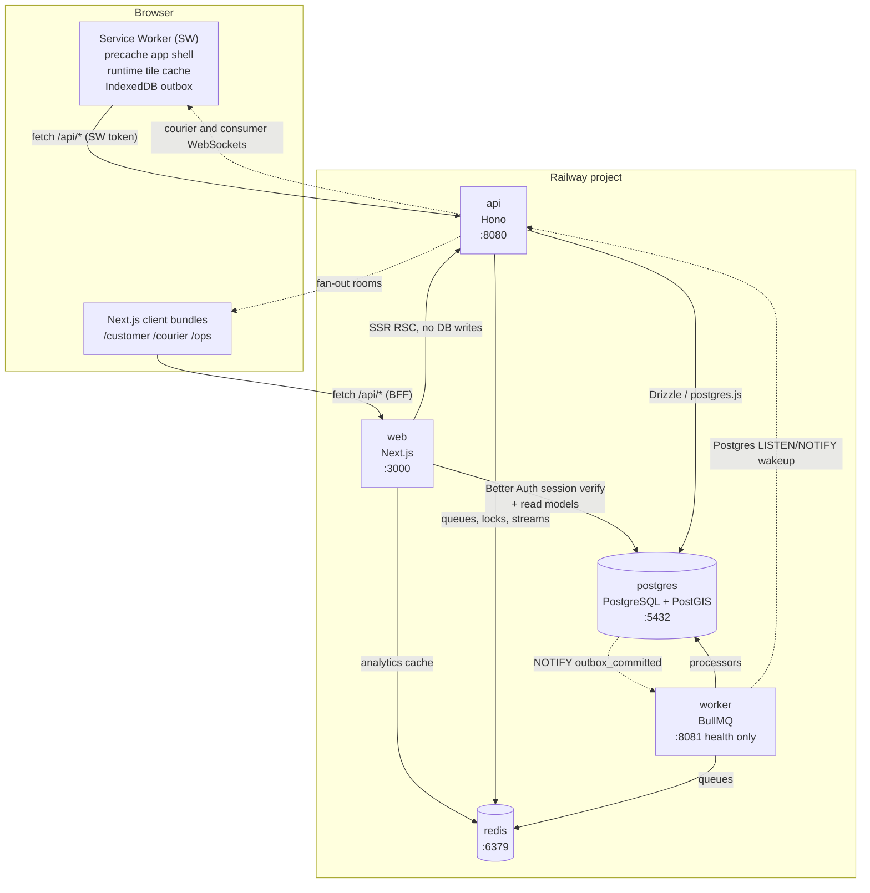
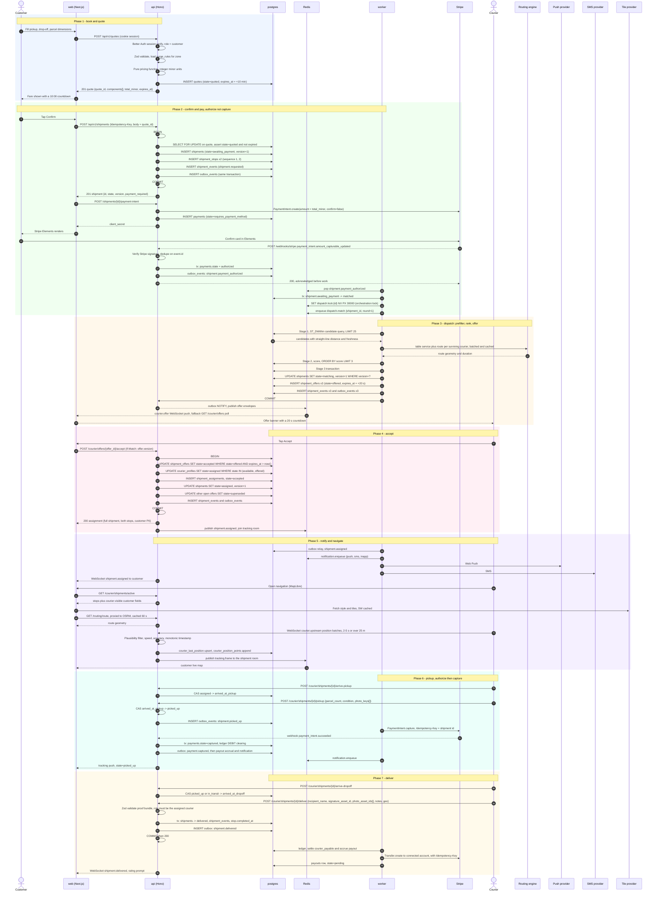
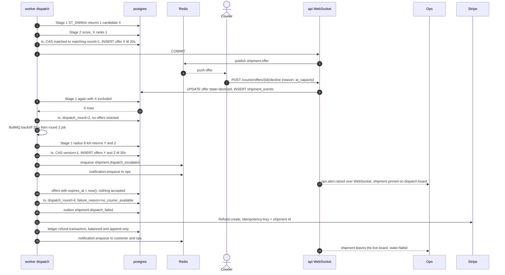
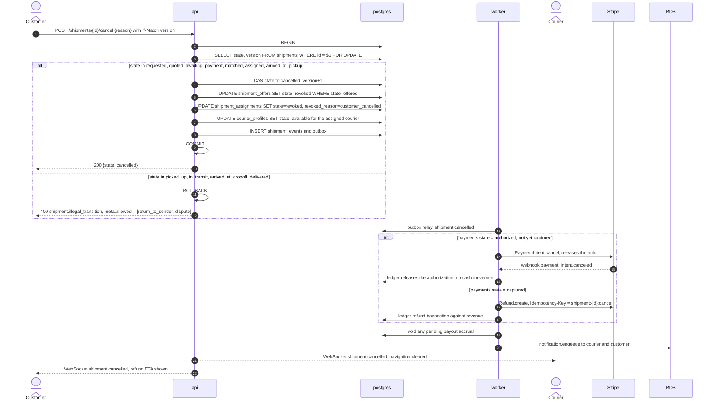
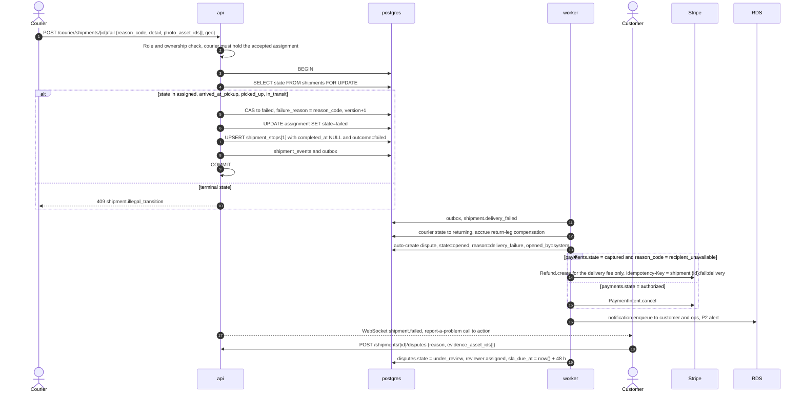
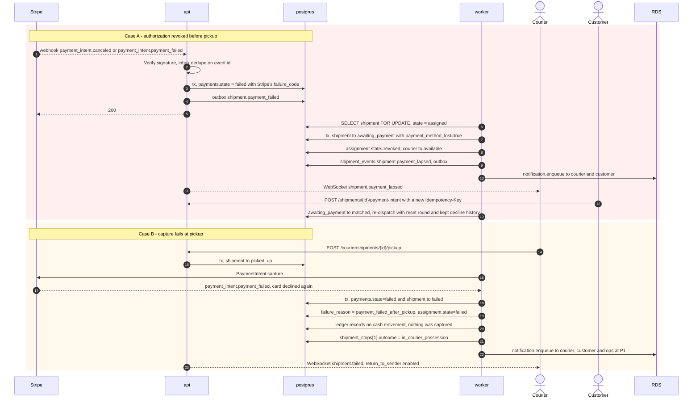
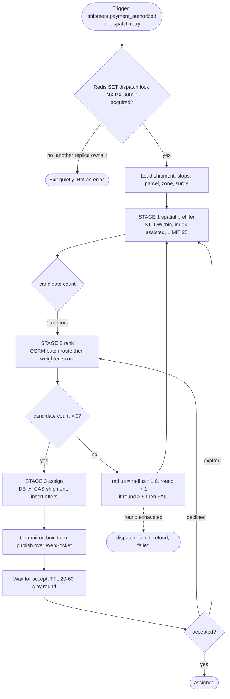
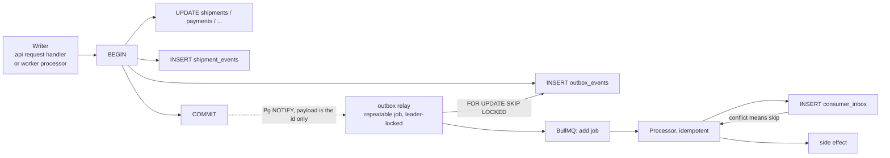
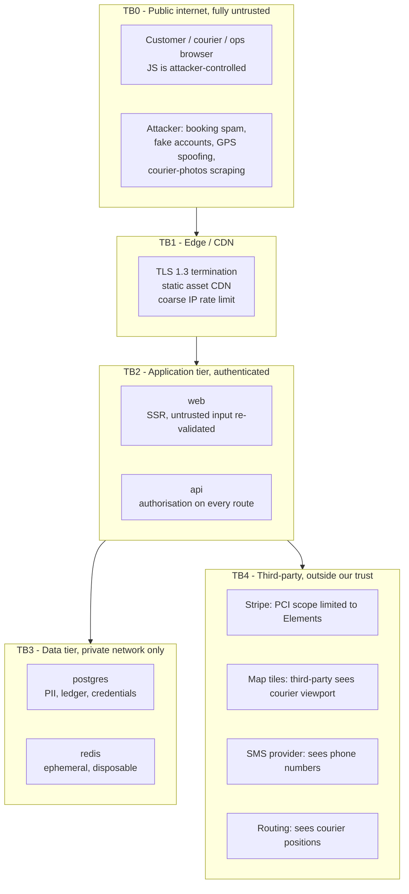

# QuickDrop — System Architecture

Status: pre-implementation, planning only.
Scope: system context, deployable containers, request/event flows, trust boundaries, courier dispatch algorithm, event catalogue.
Stack is pinned in [`../stack_report.md`](../stack_report.md); this document does not restate versions.

Related documents:

| Document | Owns |
| --- | --- |
| [`00-product-brief.md`](./00-product-brief.md) | Scope, personas, success metrics, product-level open questions |
| [`03-data-model.md`](./03-data-model.md) | Schema, state machines, pricing model, the double-entry ledger |
| [`04-api-contract.md`](./04-api-contract.md) | HTTP routes, authN/authZ, error envelope, rate limits, OpenAPI |
| [`08-testing-strategy.md`](./08-testing-strategy.md) | Test pyramid, deterministic testing of dispatch, load targets, CI gating |
| [`../stack_report.md`](../stack_report.md) | Version pinning, PWA and iOS constraint research, hosting comparison |

Open-question identifiers (`OQ-1` through `OQ-11`) are defined once, in Section 9 of this document. Other docs reference those identifiers rather than restating them.

Conventions used throughout:

- **IDs** are `uuid` (v4, application-generated). Every list-ordered or streamed table also carries `seq bigint GENERATED ALWAYS AS IDENTITY`, which is the sort/cursor key. ULIDs are a viable swap (lexicographically sortable, [ulid/spec](https://github.com/ulid/spec)) but need a different ordering plan; see Open Questions.
- **Money** is always an integer count of minor units, never a float. See [`03-data-model.md`](./03-data-model.md#7-money-correctness-rules).
- **Time** is `timestamptz`, stored UTC, serialised as RFC 3339 with a `Z` suffix.
- **Geospatial columns** are `geography(Point, 4326)`, so all distance maths is in metres ([PostGIS geography type](https://postgis.net/docs/using_postgis.html)).
- **`request_id`** is a ULID, accepted from `X-Request-Id` or generated, echoed on every response and every log line ([ULID spec](https://github.com/ulid/spec)).

---

## 1. System context



Reading the diagram:

- The browser **never** talks to the API cross-origin. Next.js rewrites `/api/*` to the API origin ([Next.js rewrites](https://nextjs.org/docs/app/api-reference/config/next-config-js/rewrites)), so session cookies are first-party and SameSite protections actually work. See [`04-api-contract.md`](./04-api-contract.md#5-authn-and-authz).
- **Stripe is the source of truth for external money movement**; our ledger is the source of truth for internal positions. The two are reconciled ([Stripe idempotent requests](https://docs.stripe.com/api/idempotent_requests)).
- **The routing engine is an external dependency, not one of the pinned deployables.** If we self-host OSRM it becomes a seventh Railway service; that is a deployment decision, not a design change. The client is stateless against its HTTP shape ([OSRM API](https://docs.project-osrm.org/docs/v5.24.0/api/)).
- **Tile hosting is an open question.** MapLibre is OSS ([maplibre.org](https://maplibre.org/)) and can be self-hosted, but the tile source (self-hosted versus a commercial vector provider) has cost and terms-of-service implications. Development uses the public demo style ([demotiles.maplibre.org](https://demotiles.maplibre.org/style.json)); that is explicitly not production-safe.
- **The SMS/OTP provider is unselected.** Better Auth needs a phone/email OTP flow; the concrete vendor and its delivery SLA are an open question. The architecture only assumes a `NotificationChannel` abstraction with an `sms` adapter.
- **Web Push on iOS requires an installed PWA on iOS 16.4+** ([WebKit](https://webkit.org/blog/13878/web-push-for-web-apps-on-ios-and-ipados/)). Push is therefore a best-effort channel; SMS and in-app notification are the guaranteed fallbacks.

---

## 2. Containers



### 2.1 Responsibilities

| Container | Owns | Explicitly does not own |
| --- | --- | --- |
| **Service Worker** | Precache of app shell and versioned static chunks; `CacheFirst` runtime cache for vector tile JSON and glyph/sprite ranges with a bounded entry count; `NetworkFirst` for shipment read models; the IndexedDB outbox for offline courier position batches and status reports; cache cleanup on `activate`; install-prompt copy for iOS. | Anything that mutates money. The SW is a retry buffer, not an authority. The API remains the only writer. ([Service Worker API](https://developer.mozilla.org/en-US/docs/Web/API/Service_Worker_API), [IndexedDB](https://developer.mozilla.org/en-US/docs/Web/API/Storage_API/IndexedDB_API)) |
| **web** | Next.js App Router rendering for the three role surfaces; BFF proxy under `/api/*`; Better Auth sign-in and OTP entry; MapLibre map components; Stripe Elements mount point (`@stripe/stripe-js`); React Server Component fetching for read-only views; signed upload-URL minting for proof photos. | Business rules for dispatch or money. It reads; it does not write shipment or ledger state. No direct BullMQ access. |
| **api** | The single synchronous write path: authorisation, Zod validation, state-machine guards, idempotency, transactional outbox writes, PostGIS queries, Stripe calls from the request path, and the **WebSocket servers** (courier upstream, consumer and ops downstream) plus the SSE fallback. | Long-running work. No request handler may block on more than 5 seconds of downstream I/O; anything slower is enqueued. |
| **worker** | BullMQ processors: dispatch orchestration and offer fan-out, ETA and route computation, Web Push and SMS delivery, Stripe webhook processing, payout execution, reconciliation, retention and erasure jobs, surge recomputation, and the outbox relay. | Serving business HTTP. It exposes a bare health server only. |
| **postgres** | System of record. Users, shipments, courier state, positions, offers, assignments, quotes, payments, payouts, the double-entry ledger, the outbox, the consumer inbox, and the audit trail. PostGIS does candidate search. | Session affinity, ephemeral position broadcasts, queue state. |
| **redis** | BullMQ backing store; the short-lived dispatch orchestration lock; live-tracking pub/sub and per-shipment replay streams; the courier presence cache (a fast pre-filter in front of PostGIS); API rate-limit buckets. | Anything that must survive a Redis flush without a rebuild path. Redis is treated as **disposable**: every datum in it is reconstructible from Postgres. |

### 2.2 Scaling axis per container

| Container | Scales on | Must be true when scaling |
| --- | --- | --- |
| **web** | Requests per second and RSS. Fully stateless: session is a signed cookie, read data comes from Postgres, and no in-process cache is authoritative. | Safe at N replicas with zero coordination. |
| **api** | Concurrent WebSocket sessions **and** CPU. | WebSocket state must live entirely in Redis so any replica can serve any connection. **No sticky sessions required**; Railway's load balancer does not guarantee affinity. On reconnect the client replays from a `last_event_seq` cursor served by a Redis Stream ([Redis Streams](https://redis.io/docs/latest/develop/data-types/streams/)). A client landing on a different replica after reconnect is a normal handled case, not an incident. |
| **worker** | Queue depth. `dispatch` and `notification` processors scale with `getJobCounts('waiting')`; `webhook` and `ledger` processors scale independently and stay at low concurrency because they are write-sensitive. | Repeatable jobs (outbox relay, surge recompute, staleness sweeps) take a Redis leader lock so only one replica runs them ([BullMQ workers](https://docs.bullmq.io/guide/workers)). |
| **postgres** | Vertical first. At launch scale, PostGIS GIST build cost and cache hit rate matter more than replicas. Read replicas for ops dashboards and reporting. | Connection budget is the binding constraint, not CPU. See the pooling note in Section 3. |
| **redis** | Vertical. | `maxmemory-policy` **must** be `noeviction`. BullMQ keys cannot be evicted without losing or duplicating jobs ([Redis eviction](https://redis.io/docs/latest/develop/reference/eviction/), [BullMQ install guide](https://docs.bullmq.io/guide/install)). OOM is handled by raising memory, never by eviction. |
| **Service Worker** | Not applicable; per-device, one instance. | The offline buffer is bounded by age as well as size. |

---

## 3. Deployable units

Resource profiles are stated as the container request. **Railway's exact SKU naming and the managed Postgres/Redis versions must be confirmed at deploy time** (Open Question OQ-6).

| Name | Runtime | Port | Resource profile (request) | Scaling strategy | Health check |
| --- | --- | --- | --- | --- | --- |
| `web` | Node.js v24.19.0, `next start` with `output: 'standalone'` ([Next.js output](https://nextjs.org/docs/app/api-reference/config/next-config-js/output)) | `3000` | 0.5 vCPU / 512 MB | Horizontal, stateless, scale on RPS | `GET /healthz` returns `200 {"status":"ok"}`; `GET /readyz` runs `SELECT 1` |
| `api` | Node.js v24.19.0, `node dist/server.js` (Hono on `@hono/node-server` with the `ws` WebSocket adapter) | `8080` | 1 vCPU / 1 GB | Horizontal, stateless-in-Redis, scale on WebSocket sessions plus CPU | `GET /healthz` liveness, no dependencies; `GET /readyz` checks DB, Redis and presence of the Stripe key |
| `worker` | Node.js v24.19.0, BullMQ Workers plus a `node:http` health server | `8081` health only, no business traffic | 1 vCPU / 1 GB | Horizontal, scale on queue depth; singleton for repeatable jobs | `GET /healthz` returns `200` with `{queues:{...},event_loop_lag_ms}`; the worker reports unhealthy if event-loop lag exceeds 2000 ms or if there has been no outbox progress for 60 s |
| `postgres` | PostgreSQL 16 or later with `postgis` and `pgcrypto` | `5432` | Managed, 1 vCPU / 2 GB / 20 GB SSD | Vertical, then read replicas | `SELECT 1` plus a Railway-level check. **Unverified:** whether Railway's managed Postgres exposes the PostGIS extension. This must be confirmed before schema work starts. |
| `redis` | Redis 7 or later | `6379` | Managed, 256 MB, `noeviction` | Vertical | `PING` |
| `browser-service-worker` | Per-device JavaScript | not applicable | not applicable | not applicable | No endpoint. Version handshake: the SW posts `{type:'SW_VERSION', version}` to controlled clients, and the client calls `GET /api/v1/app/version` and hard-reloads on mismatch |

Operational notes:

- **Connection pooling.** The API and worker both use `postgres.js`. Under a transaction-mode pooler, prepared statements break; the safe configuration is `prepare: false` with `max` sized for the pooler ([pgbouncer configuration](https://www.pgbouncer.org/config.html), [libpq prepared statements](https://www.postgresql.org/docs/current/libpq-connect.html)). **Unverified:** whether Railway fronts managed Postgres with pgbouncer and in which mode. This changes driver configuration, not design.
- **Railway health checks** are configured per service and must name a reachable port; the HTTP-path versus TCP mechanism is version dependent. **Unverified:** see OQ-6.
- **Migrations** run as a one-shot Railway service using Drizzle Kit, before `api` and `worker` promote. `web` tolerates being one revision behind because it does not write.

---

## 4. Golden-path request and event flow

`book → quote → pay → dispatch → match → assign → notify → navigate → pickup → deliver`



Four ordering rules are encoded above and are non-negotiable:

1. **Commit, then notify.** The outbox row is written in the same transaction as the state change; the WebSocket or push notification is emitted only after commit. A notification about rolled-back state is the most damaging class of bug in this system.
2. **Acknowledge webhooks before processing.** The Stripe handler verifies the signature, writes the inbox row and returns `200` synchronously; expensive work is enqueued. Stripe retries on non-2xx ([Stripe webhooks](https://docs.stripe.com/webhooks)), so a slow handler causes duplicate deliveries.
3. **No network I/O inside a database transaction.** OSRM and Stripe calls happen before or after, never inside. A transaction holds row locks and a connection slot for its full duration.
4. **Payments are authorized at confirm and captured at pickup.** Section 5.4 covers the consequences when that capture fails.

---

## 5. Failure-path flows

### 5.1 No courier available - escalation ladder

Escalation is driven by the `dispatch` job's own retry and backoff schedule, not by a timer polling the database. Each round has a distinct `round` number recorded on every offer, so the audit trail shows the whole ladder.

| Round | Trigger | Radius | Candidate pool | Offer TTL | Additional action |
| --- | --- | --- | --- | --- | --- |
| 1 | `shipment.payment_authorized` | 5 000 m | top 3 by score | 20 s | none |
| 2 | all round 1 offers expired | 5 000 m | next 5, excluding decline or expire history for 10 min | 25 s | none |
| 3 | round 2 exhausted | 8 000 m (times 1.6) | top 5, vehicle substitutions allowed, `zone_penalty` relaxed to 1.0 | 30 s | `shipment.dispatch_escalated` to ops |
| 4 | round 3 exhausted | 12 000 m cap | all eligible in the service zone | 40 s | SMS to the customer with a revised ETA and "we are finding a courier" |
| 5 | round 4 exhausted | 12 000 m | broadcast on the ops dispatch board; re-broadcast to couriers inside the zone in `available` state who fall outside the 12 km gate | 60 s | `ops.alert.raised` at severity P1 |
| terminal | round 5 exhausted, or 15 min wall clock | not applicable | not applicable | not applicable | `shipment.dispatch_failed` → auto-refund → `shipments.state='failed'`, `failure_reason='no_courier_available'` |



`decline` is first-class telemetry. A courier who declines is excluded from that shipment for 10 minutes and their `decline_count_30d` rises, which lowers `accept_rate` in Stage 2. Repeated decline of nearby offers is a signal ops reviews manually.

### 5.2 Customer cancels mid-route

Cancellation is legal only before pickup. After pickup the customer cannot cancel; the available actions are `return_to_sender` (courier-initiated) and `dispute`.



The same handler path serves cancellation before assignment; the only difference is that the `shipment_assignments` and `courier_profiles` updates are no-ops. One code path, guarded by row count, never by branching on a request flag.

### 5.3 Delivery failed



Delivery failure never silently re-enters dispatch. A failed delivery is terminal, requiring a human or a customer-initiated reship, because re-dispatching a parcel we cannot account for is how a marketplace loses chain of custody.

### 5.4 Payment fails after assignment

The dangerous case is an authorization that is revoked, or a capture that fails, after a courier is already en route to the parcel. Two rules govern it: payment failure never leaves a live shipment without a funded payment plan, and it never leaves a courier holding an assignment for an unfunded shipment.



Case B is a hard customer-experience problem and is the reason capture-on-pickup is a deliberate trade-off rather than an oversight. The mitigation is that `payment_intent.payment_method` was a successfully authorized method moments earlier, so this outcome means a Radar rule, an issuer reversal, or an insufficient-balance check. Operations treats it as P1 because the parcel is physically with a courier and unfunded. Mitigations in order of preference:

1. Retry capture on the same PaymentIntent. A retried authorization on the same method can succeed.
2. Fall back to a saved secondary method held with `setup_future_usage: 'off_session'` at authorization time.
3. Only then fail the shipment, and pay the courier a flat `return_to_sender` compensation from the expense account, because the courier executed correctly.

Which of these is automatic and which requires an operator is **Open Question OQ-4**.

---

## 6. The courier dispatch algorithm

This is the core of the product. The design goal is: **one courier, one shipment, one decision, no double-booking, and a bounded worst-case time to a terminal outcome.**

### 6.0 Shape of the algorithm



### 6.1 Stage 1 - geospatial prefilter

Candidates come from a deliberately narrow table, `courier_last_position`, holding one row per courier: `position_geog`, `last_seen_at`, `accuracy_m`, `position_seq`. Keeping it separate from the wide `courier_profiles` row improves index locality, which matters more than clever SQL at this data size.

Hard filters disqualify and are never scored:

| Filter | Value | Why |
| --- | --- | --- |
| `c.state` | `= 'available'` | The state machine already excludes `offered`, `assigned` and `suspended`. |
| `l.last_seen_at` | `> now() - interval '90 seconds'` | 90 s is three times the 30 s client heartbeat budget. A courier unheard from for 90 s is presumed gone. |
| `ST_DWithin(l.position_geog, pickup, radius)` | radius per round | Index-assisted. |
| vehicle capability | weight, volume, refrigeration, `vehicle_type` | Some mismatches are impossible rather than merely suboptimal, such as a refrigerated parcel to a bicycle courier. |
| open offer | none | Enforced by a partial unique index in Section 6.3, so this is belt and braces. |
| compliance | no unresolved blocking dispute, daily assignment cap not hit, shift not ended | Business gates. |

```sql
-- Stage 1: geospatial prefilter.
-- $1 pickup geography(Point,4326)
-- $2 drop-off geography(Point,4326), second looser gate
-- $3 search radius in metres, round dependent
-- $4 max drop-off detour metres, usually $3 * 2.5
-- $5 required vehicle types text[], empty array means no constraint
-- $6 service zone id
-- $7 max rows
WITH params AS (
  SELECT $1::geography AS pickup, $2::geography AS dropoff
)
SELECT
  c.id                                                        AS courier_id,
  c.state,
  c.vehicle_type,
  c.current_assignment_id,
  c.accept_rate_ema_100,
  c.last_assigned_at,
  c.available_since,
  c.daily_assignment_count,
  c.home_zone_id,
  -- straight-line metres, used for reporting and as the OSRM seed
  ST_Distance(l.position_geog, p.pickup)                      AS straight_pickup_m,
  ST_Distance(l.position_geog, p.dropoff)                     AS straight_dropoff_m,
  -- freshness in seconds, drives the stale-position penalty
  EXTRACT(EPOCH FROM (now() - l.last_seen_at))::int           AS position_age_s,
  l.accuracy_m,
  l.position_seq
FROM courier_last_position l
JOIN courier_profiles c ON c.id = l.courier_id
CROSS JOIN params p
WHERE c.state = 'available'
  -- FRESHNESS GATE
  AND l.last_seen_at > now() - interval '90 seconds'
  -- SPATIAL GATE: index-assisted. NEVER put ST_Distance in WHERE.
  AND ST_DWithin(l.position_geog, p.pickup, $3)
  AND ST_DWithin(l.position_geog, p.dropoff, $4)
  -- CAPABILITY GATE
  AND (cardinality($5::text[]) = 0 OR c.vehicle_type = ANY ($5::text[]))
  -- ZONE GATE
  AND (c.home_zone_id = $6 OR c.accepts_cross_zone)
  -- NO CONCURRENT OFFER
  AND NOT EXISTS (
        SELECT 1 FROM shipment_offers o
        WHERE o.courier_id = c.id AND o.state = 'offered'
      )
  -- COMPLIANCE GATES
  AND c.daily_assignment_count < c.daily_assignment_cap
  AND NOT EXISTS (
        SELECT 1 FROM disputes d
        WHERE d.courier_id = c.id AND d.severity = 'blocking' AND d.state <> 'closed'
      )
ORDER BY ST_Distance(l.position_geog, p.pickup)   -- sort over an already-bounded set
LIMIT $7;
```

Supporting DDL and the reasoning behind it:

```sql
-- geography, so ST_DWithin takes metres directly.
ALTER TABLE courier_last_position
  ADD COLUMN position_geog geography(Point, 4326) NOT NULL;

-- GiST is what makes ST_DWithin index-assisted.
CREATE INDEX courier_last_position_geog_gist
  ON courier_last_position USING gist (position_geog);

-- Cheap btree pre-filter that avoids touching the spatial index when nobody is online.
CREATE INDEX courier_last_position_seen_idx
  ON courier_last_position (last_seen_at DESC)
  WHERE position_geog IS NOT NULL;
```

Two performance rules, both from the PostGIS guidance ([performance tips](https://postgis.net/docs/performance_tips.html), [indexes](https://postgis.net/docs/indexes.html)):

- `ST_DWithin` is index-assisted; `ST_Distance(...) < N` is **not** ([`ST_DWithin`](https://postgis.net/docs/ST_DWithin.html)). The `ORDER BY ST_Distance` above is safe *only* because `ST_DWithin` has already bounded the candidate set to at most `$7` rows.
- A bounding-box pre-filter using `&&` against a `geometry` column is the documented optimisation for very large tables. At launch scale (hundreds to low thousands of online couriers) it is unnecessary. **Deferred** until `courier_last_position` exceeds roughly 10^5 rows, at which point measure with `EXPLAIN (ANALYZE, BUFFERS)` before adding it.

**Open question OQ-5.** The `&&` operator and the KNN operator `<->` are documented for `geometry`, not `geography` ([KNN distance operators](https://postgis.net/docs/geometry_distance.html)). Two candidate optimisations therefore need measurement before adoption:

1. `ORDER BY l.position_geog::geometry <-> $1::geometry`, trading a sort for a KNN index scan.
2. A `geometry`-column mirror alongside `geography` for a coarse pre-pass.

Both are strictly optimisations. Correctness depends on neither.

### 6.2 Stage 2 - candidate ranking

Inputs per surviving candidate `i`:

| Symbol | Source | Notes |
| --- | --- | --- |
| `eta_s_i` | OSRM route duration from courier position to pickup, plus a service factor and a traffic factor | Computed **before** the database write, batched in one `table` service call per geographic cluster |
| `dist_m_i` | OSRM route distance for the same leg | Deadhead cost |
| `dropoff_eta_s_i` | OSRM route pickup to drop-off, **independent of the courier** | Constant across candidates. Computed once. Used for the customer-facing ETA and to reject candidates whose zone membership makes the total shift impossible |
| `load_i` | count of active assignments for this courier | 0 is empty |
| `acc_i` | blended acceptance rate | `0.7 * accept_rate_ema_100 + 0.3 * (accepted_30 / greatest(offered_30, 1))` |
| `idle_min_i` | `now() - coalesce(last_assigned_at, available_since)` | Starvation input |
| `zone_pen_i` | home zone versus shipment zone | 0 same, 0.5 adjacent, 1.0 any |
| `veh_pen_i` | vehicle versus parcel requirement | 0 exact, 0.4 safe substitution, hard gate if infeasible |

`eta_s_i` is derived, not raw. OSRM duration is multiplied by factors reflecting real service work rather than just driving time:

```
eta_s_i = osrm_duration_s
        * traffic_factor            -- 1.0 baseline, range 1.0 to 1.8, refreshed every 5 min
        + dwell_pickup_s            -- median seconds a courier spends per stop, currently 420
        + park_penalty_s            -- 0 within 150 m of pickup, otherwise 90
```

The two non-routing terms are why a courier 2 km away correctly loses to a courier 4 km away who has already stopped. Ranking on raw distance is the classic mistake; ranking on raw driving time alone ignores that a pickup is a service event, not a waypoint.

**The formula.** Cost, ascending, lower is better:

```
min_eta  = min over candidates of eta_s_i
max_eta  = max over candidates of eta_s_i
min_dist = min over candidates of dist_m_i
max_dist = max over candidates of dist_m_i

eta_norm_i  = (max_eta  - eta_s_i)  / max(1, max_eta  - min_eta)
dist_norm_i = (max_dist - dist_m_i) / max(1, max_dist - min_dist)
load_norm_i = load_i / 3
starv_i     = clamp(idle_min_i / 45, 0, 1)

cost_i = 0.42 * eta_norm_i          -- customer wait dominates
      + 0.18 * dist_norm_i         -- courier deadhead, the real cost driver
      + 0.14 * load_norm_i         -- protect couriers from stacking
      + 0.10 * (1 - acc_i)         -- stop offering to couriers who bounce
      + 0.10 * (1 - starv_i)       -- fairness, idle time discounts cost
      + 0.06 * zone_pen_i          -- home-zone preference
```

The weights sum to 1.00 and are versioned in code as `DISPATCH_SCORE_VERSION = 1`, recorded on every `shipment_offers` row, so a bad weighting can be identified and rolled back without archaeology. `starv_i` uses a 45-minute reference: a courier idle for 45 minutes receives the maximum fairness discount. This is a deliberately blunt, explainable fairness term; an explanation a support agent can read aloud beats a learned model at this scale.

Selection is `ORDER BY cost_i ASC, c.id ASC LIMIT 3`. The `c.id ASC` tie-break is deterministic, which makes the whole function reproducible from a snapshot and therefore testable.

**Worked example.** Five candidates, radius 5 000 m, shipment zone 2, parcel 3.4 kg and 24 dm3, not refrigerated.

| | `eta_s` | `dist_m` | `load` | `acc` | `idle_min` | `zone_pen` |
| --- | --- | --- | --- | --- | --- | --- |
| A | 540 | 3 100 | 0 | 0.92 | 6 | 0.0 |
| B | 780 | 4 200 | 1 | 0.61 | 31 | 0.0 |
| C | 610 | 2 900 | 2 | 0.88 | 2 | 0.0 |
| D | 900 | 5 000 | 0 | 0.55 | 44 | 0.5 |
| E | 495 | 3 600 | 1 | 0.97 | 11 | 0.0 |

Normalisation ranges: `eta` 495 to 900 (span 405), `dist` 2 900 to 5 000 (span 2 100).

| | `eta_norm` | `dist_norm` | `load_norm` | `1 - acc` | `1 - starv` | **`cost`** | rank |
| --- | --- | --- | --- | --- | --- | --- | --- |
| A | 0.1111 | 0.0952 | 0.000 | 0.08 | 0.8667 | **0.1585** | **1** |
| E | 0.0000 | 0.3333 | 0.333 | 0.03 | 0.7556 | **0.1852** | 2 |
| C | 0.2840 | 0.0000 | 0.667 | 0.12 | 0.9556 | **0.3202** | 3 |
| B | 0.7037 | 0.6190 | 0.333 | 0.39 | 0.3111 | **0.5238** | 4 |
| D | 1.0000 | 1.0000 | 0.000 | 0.45 | 0.0222 | **0.6772** | 5 |

Three things this demonstrates:

1. **E has the best ETA at 495 s and still loses to A.** A is 45 s worse on ETA but nearly empty (`load=0`) and has been idle longer. A 45-second ETA difference is noise; a courier who finishes their current job and starts the next immediately is not noise.
2. **C is the closest courier at 2 900 m and ranks third.** It has two active shipments and has been available for two minutes. Piling onto a busy courier degrades both deliveries.
3. **B and D are penalised mainly on reliability**, with `acc` of 0.61 and 0.55. Offering to low-acceptance couriers first produces a longer time-to-assignment, which is worse for the customer than offering to a slightly farther, more reliable one.

Offers go to ranks 1 to 3, which are A, E and C. B and D become the round-2 pool.

**Weight tuning.** The weights are not sacred. The tuning signals are, in order: median time from `payment_authorized` to `assigned`; courier earnings per active hour; and 7-day courier retention. A `shipment_dispatch_decisions` table records the candidate set, per-candidate inputs and the chosen rank for every dispatch, so A/B evaluation over historical snapshots is possible without shadow deployment. This table is the single most valuable piece of dispatch observability and is specified in [`03-data-model.md`](./03-data-model.md).

### 6.3 Stage 3 - assignment (the critical section)

Everything below happens in **one** short transaction. The transaction contains no network I/O, so it should complete in single-digit milliseconds.

```sql
BEGIN;
SET LOCAL lock_timeout = '2s';

-- (1) COMPARE-AND-SWAP on the shipment. Exactly one caller can win this.
UPDATE shipments
   SET state                  = 'matching',
       dispatch_round         = dispatch_round + 1,
       dispatch_score_version = $2,
       version                = version + 1,
       updated_at             = now()
 WHERE id = $1
   AND state = 'matched'           -- legal predecessor only
   AND version = $3                -- the version the caller read
RETURNING id, state, version, dispatch_round;
-- 0 rows means another dispatcher already advanced this shipment. ROLLBACK, exit quietly.
-- A unique-violation or serialization failure means ROLLBACK, retry once, then exit.

-- (2) EXCLUSIVE LOCK on each candidate courier row, in ascending id order.
--     Ascending order is mandatory: it prevents deadlock between two rankers
--     whose candidate sets overlap in a different order.
SELECT id, state, version FROM courier_profiles
 WHERE id = ANY ($4::uuid[])
 ORDER BY id
 FOR UPDATE NOWAIT;         -- NOWAIT: fail fast rather than queue behind a slow txn

-- (3) Verify none changed state while the spatial query result sat open.
--     If one did, drop it from the offer set rather than aborting the whole round.
SELECT id FROM courier_profiles
 WHERE id = ANY ($4::uuid[]) AND state <> 'available';

-- (4) Insert offers. The partial unique index is the double-offer guard.
INSERT INTO shipment_offers
  (id, shipment_id, courier_id, round, rank, score, eta_s, dist_m,
   score_version, state, offered_at, expires_at, version)
VALUES
  ($5,  $1, $6, $7, 1, $8,  $9,  $10,  $2, 'offered', now(), now() + interval '20 seconds', 1),
  ($5b, $1, $7, $7, 2, $8b, $9b, $10b, $2, 'offered', now(), now() + interval '20 seconds', 1),
  ($5c, $1, $8, $7, 3, $8c, $9c, $10c,$2, 'offered', now(), now() + interval '20 seconds', 1);
-- A 23505 on offers_single_open_per_courier means this courier took an offer for
-- another shipment between Stage 1 and now. Skip that courier, keep the round.

-- (5) Audit and outbox, in the same transaction. Never publish from inside a txn.
INSERT INTO shipment_events
  (id, shipment_id, event_type, actor_type, actor_id, data, occurred_at)
VALUES ...;

INSERT INTO outbox_events
  (id, aggregate_type, aggregate_id, event_type, payload, occurred_at, available_at)
VALUES ...;   -- one row per offer, plus shipment.dispatch_started

COMMIT;   -- only now may any notification be emitted
```

The uniqueness constraints doing the real work:

```sql
-- A courier can hold at most ONE open offer at a time, across all shipments.
CREATE UNIQUE INDEX offers_single_open_per_courier
  ON shipment_offers (courier_id)
  WHERE state = 'offered';

-- A shipment has at most ONE accepted assignment at a time.
CREATE UNIQUE INDEX assignments_one_accepted_per_shipment
  ON shipment_assignments (shipment_id)
  WHERE state = 'accepted';

-- A courier has at most ONE accepted assignment at a time.
CREATE UNIQUE INDEX assignments_one_accepted_per_courier
  ON shipment_assignments (courier_id)
  WHERE state = 'accepted';

-- Exactly one terminal state per shipment.
CREATE UNIQUE INDEX shipments_one_terminal_state
  ON shipments (id)
  WHERE state IN ('delivered', 'cancelled', 'failed', 'returned');
```

The accept path, which is the other side of the same coin:

```sql
BEGIN;
-- (a) Claim the offer. This single UPDATE is both the "cannot accept twice" guard
--     and the "cannot accept an expired offer" guard.
UPDATE shipment_offers
   SET state = 'accepted', responded_at = now(), version = version + 1
 WHERE id = $1
   AND state = 'offered'
   AND expires_at > now()
RETURNING *;
-- 0 rows means 409 offer.expired_or_already_answered. Do not continue.

-- (b) Claim the courier. CAS on the state machine.
UPDATE courier_profiles
   SET state = 'assigned', current_assignment_id = $2, version = version + 1, updated_at = now()
 WHERE id = $3 AND state IN ('available', 'offered');
-- 0 rows means 409 courier.not_available. Roll back; the (a) update is undone.

-- (c) Claim the shipment. CAS on the state machine.
UPDATE shipments
   SET state = 'assigned', assigned_courier_id = $3, version = version + 1, updated_at = now()
 WHERE id = $2 AND state = 'matched';
-- 0 rows means 409 shipment.illegal_transition.

INSERT INTO shipment_assignments (id, shipment_id, courier_id, offer_id, state, ...)
VALUES ($4, $2, $3, $1, 'accepted', ...);
-- 23505 on assignments_one_accepted_per_courier means this courier was already
-- taken for another shipment. ROLLBACK; the courier is told to take the new one.

UPDATE shipment_offers SET state = 'superseded'
 WHERE shipment_id = $2 AND state = 'offered' AND id <> $1;

INSERT INTO shipment_events (...), outbox_events (...);
COMMIT;
```

**Transaction boundary summary.**

| Inside the transaction | Outside the transaction |
| --- | --- |
| CAS on `shipments` | OSRM route calls |
| `FOR UPDATE NOWAIT` on candidate `courier_profiles` rows | Stripe PaymentIntent, Transfer and Refund calls |
| Insert offers and assignment | WebSocket and push publish |
| `shipment_events` append | Redis lock release |
| `outbox_events` insert | BullMQ follow-up enqueue |

**Lock ordering discipline.** Everywhere in the codebase, rows are locked in this order: `shipments`, then `courier_profiles` ascending by id, then `shipment_offers`, then `shipment_assignments`. Two transactions following the same order cannot deadlock. Any code that locks `courier_profiles` before `shipments` is a bug; this is enforced in code review and by a comment on every transaction ([PostgreSQL explicit locking](https://www.postgresql.org/docs/current/explicit-locking.html), [transaction isolation](https://www.postgresql.org/docs/current/transaction-iso.html)).

### 6.4 Race conditions and their guards

Every row below is a real, reachable interleaving. "Symptom without the guard" is what a user would actually see.

| # | Race | Guard | Symptom without the guard |
| --- | --- | --- | --- |
| 1 | **Two dispatchers, or two worker replicas, rank the same shipment concurrently.** The Redis lock is only the fast path; both could pass it if the lock expired mid-computation. | *Correctness* comes from the CAS `UPDATE shipments ... WHERE state='matched' AND version=$3`. Exactly one caller gets a row back. *Efficiency* comes from Redis `SET dispatch:lock:{id} <token> NX PX 30000`, so the second caller exits in 1 ms instead of burning an OSRM call. | Two courier phones buzz the same offer set; four couriers drive to one pickup; the shipment shows two `assigned` rows and ops has no idea which is real. |
| 2 | **A courier accepts while already holding an accepted assignment for a different shipment**, for example by accepting on a second device before the first assignment propagated. | Partial unique index `assignments_one_accepted_per_courier`, plus the CAS `UPDATE courier_profiles ... WHERE state IN ('available','offered')` in the same transaction. `23505` or 0 rows returns 409 and rolls back fully. | One courier is assigned to two live shipments, both counted as `in_transit`. Customer A's parcel is delivered by a courier the system believes is driving to customer B. |
| 3 | **A courier accepts an offer at the exact moment ops force-assigns that same courier to a different shipment.** | Both paths funnel through the same two CAS statements and the same unique index. One wins; the loser gets 409. There is deliberately no separate ops-assign code path that writes `courier_profiles.state` directly. | A courier is handed two jobs simultaneously. Both customers see "your courier is on the way". One parcel is unaccounted for. |
| 4 | **Payment settles after the shipment was cancelled**, because the customer cancels and the in-flight `payment_intent.succeeded` webhook then arrives. | The webhook handler is **not** trusted to be ordered. It reads `shipments.state` inside the transaction and applies a state guard: a `payment.*` transition on a shipment in `cancelled` is recorded but performs **no** ledger posting, and instead emits `payment.orphan_settlement`, which P1-alerts ops for manual refund. The second guard is `ledger_transactions.idempotency_key` being unique, so a second attempt to post the same charge fails rather than double-posting. | Money taken for a parcel nobody will deliver, with the customer believing they were refunded, and the ledger showing both a charge and a refund for a single order. |
| 5 | **A courier goes offline mid-assignment** because the battery dies, they enter a tunnel, or the app is killed. | Three layers. First, the offer TTL in Redis is authoritative, so a dead courier's offer expires and the ladder advances. Second, a `courier.staleness` repeatable job marks couriers with no position for 120 s as `available` again and revokes the assignment, returning the shipment to `matched`. Third, the customer-facing ETA switches to "we have lost contact with your courier" rather than showing a frozen pin. | A parcel is assigned to a courier who is not coming. The customer watches a static pin for 30 minutes with no explanation, and the shipment never reaches a terminal state. Ops has no queue of stuck shipments. |
| 6 | **A courier reports pickup for a shipment that ops cancelled 200 ms earlier.** | `POST /courier/shipments/{id}/pickup` performs `SELECT state FROM shipments FOR UPDATE` then a CAS against the legal predecessor set. Cancellation wins the lock first; the pickup write gets 0 rows and returns `409 shipment.illegal_transition`. The courier client must treat a 409 on a status write as "discard this queued mutation locally", never as "retry". | A cancelled shipment resurrects itself into `picked_up`. The parcel is physically gone but the system says it is cancelled, so nobody refunds and nobody is assigned. |
| 7 | **Duplicate `POST .../deliver`**, from a courier double-tap, or from the IndexedDB outbox replaying a batch after an iOS storage eviction and reconnect. | The client sends the **same `Idempotency-Key`** on every retry of a given action, persisted alongside the queued mutation in IndexedDB. Server side, `idempotency_keys` stores a SHA-256 fingerprint of method, path and canonical body; a repeat with an identical fingerprint replays the stored response, and a repeat with a *different* fingerprint is `409 idempotency_key_conflict`. Independently, the CAS `arrived_at_dropoff → delivered` means only the first request can win even with a brand-new key. | Double ledger posting, a double Stripe refund, a second rating prompt, and a payout exceeding the delivery's revenue. The ledger's balanced-transaction constraint would not catch it, because both transactions are individually valid. |
| 8 | **Two courier tabs, or two devices, stream position for the same courier simultaneously.** | `courier_last_position.position_seq` is a per-courier monotonic counter bumped inside the upsert, and the upsert carries `WHERE EXCLUDED.position_seq > courier_last_position.position_seq`. The narrower tab's later write is rejected as stale. | The customer's live map jumps between two real positions, ETAs swing wildly, and a legitimate courier looks like they are teleporting, which is precisely the signal that triggers GPS-spoofing review. |
| 9 | **Out-of-order or implausible GPS points**, such as an iOS backgrounded tab flushing a 20-minute-old buffer on returning to the foreground. | The server-side plausibility filter rejects the whole batch if implied speed exceeds 55 m/s (198 km/h) outside a highway context, if the timestamp is not strictly greater than the last accepted timestamp, or if a fix has `accuracy_m > 250` while the courier is otherwise moving. Rejected batches are counted, not stored as positions. When more than half of a session's batches are rejected, the account is flagged for GPS-spoofing review. | A spoofed position places the courier next to every pickup in the city and wins every dispatch. Alternatively, a backgrounded-tab buffer teleports the courier across the map and triggers a false spoofing flag against an honest courier. |
| 10 | **Stripe redelivers a webhook**, which it guarantees it will do (at-least-once). | `consumer_inbox` has primary key `(consumer_name, event_id)`. The handler's first statement inside the transaction is `INSERT INTO consumer_inbox ... ON CONFLICT DO NOTHING RETURNING 1`; 0 rows means already processed, so return `200` immediately. | Duplicate capture, duplicate transfer to the courier's connected account, duplicate SMS notification, and a ledger that disagrees with Stripe until someone reconciles by hand. |
| 11 | **Ops force-assign races with auto-dispatch's offer acceptance.** Same guards as race 3, but with a different visible symptom: the ops UI shows the assignment succeeding while the courier's phone shows a decline. | Same guards, plus `If-Match: <shipment.version>` on the force-assign request so a stale ops screen gets 412 rather than silently overwriting. | Ops believes they fixed a stuck shipment and it goes out to a second courier anyway. The dispatch board lies. |
| 12 | **A refund is issued after the payout for that delivery has already reached the courier's bank.** | The ledger invariant is that `courier_payable` for a shipment is checked for sufficiency before a payout is created, and `payouts` rows stay `pending` until the `transfer.paid` webhook. A refund arriving while `payouts.state='pending'` is netted against the next payout; if there is no future payout, a `negative_payable` recovery task creates an `asset.receivable_from_courier` entry and ops pursues it. The ledger is a ledger: it does not silently ignore a debit it cannot place. | The platform eats the refund, or a courier keeps money for a delivery that was refunded, and the books only reveal it at month end. |
| 13 | **Two concurrent cancel requests**, from a double-tap on Cancel. | The first `SELECT ... FOR UPDATE` serialises them; the second sees `state='cancelled'` and gets 409. The refund itself is guarded by `ledger_transactions.idempotency_key = 'refund:shipment:{id}'`, so even a race that somehow passed would not double-refund. | Two refunds for one shipment. This is the most common real-world marketplace payment incident. |
| 14 | **The outbox relay crashes after publishing to BullMQ but before marking rows dispatched.** | Standard at-least-once outbox: rows are claimed `FOR UPDATE SKIP LOCKED`, published, then marked `dispatched_at`. A crash between publish and mark re-publishes on restart. Every consumer is idempotent (Section 7), so the duplicate is a no-op. | If any consumer is not idempotent this race produces duplicates. There is no exactly-once transport; the design assumes at-least-once everywhere and pushes idempotency into handlers. |

Advisory-lock usage is precisely scoped. PostgreSQL advisory locks are used for exactly two things, both performance rather than correctness:

- `pg_try_advisory_lock(hashtext('qd:dispatch:' || $1))` inside the worker's dispatch routine, held for the whole rank-and-offer cycle, to reduce wasted OSRM calls when multiple replicas wake on the same event.
- `pg_advisory_xact_lock(hashtext('qd:shipment:' || $1))` inside cancellation and delivery handlers, to make those operations queue rather than fail fast. Users should not see a spurious 500 while a dispatch transaction is mid-flight.

Neither replaces the CAS or the unique index. Deleting the advisory locks degrades throughput slightly and changes nothing about correctness. Deleting the CAS breaks the product.

### 6.5 What the dispatcher deliberately does not do

- **No machine-learned matching.** With hundreds of couriers, the score above is explainable, tunable and testable. A learned model needs a labelling strategy we do not have, and it produces decisions no support agent can explain. Revisit when `shipment_dispatch_decisions` shows the heuristics are leaving measurable money on the table.
- **No cross-region dispatch in v1.** Single-region deployment, so a service zone is a hard gate. Multi-region is a PostGIS-partitioning and data-residency project, not a config change.
- **No bid or offer marketplace.** Couriers do not bid on shipments in v1. That changes the courier state machine and the fairness term fundamentally.
- **No auto-assignment without an accept.** A courier auto-assigned a parcel they did not accept will decline it, and time-to-delivery will be worse than the time saved.

---

## 7. Event catalogue

### 7.1 Transport and delivery semantics

There is exactly one way an event leaves the database, and it is not "call the broker from inside the request".



- A trigger on `outbox_events` issues `pg_notify('qd_outbox', <id>)` so the relay wakes immediately instead of polling ([`NOTIFY`](https://www.postgresql.org/docs/current/sql-notify.html)). The payload is **only** the row id. Payloads go to every listening session, including sessions that will not use them.
- The relay is a repeatable BullMQ job with a Redis leader lock at 250 ms, plus a 5 s safety sweep for rows where `available_at <= now() AND dispatched_at IS NULL`.
- The relay claims rows with `FOR UPDATE SKIP LOCKED` ([`SELECT`](https://www.postgresql.org/docs/current/sql-select.html)), so multiple relay replicas are safe without coordination.
- `event_id` is a UUIDv4 generated at insert, globally unique, and is the sole dedup key downstream.

**Delivery semantics: at-least-once, everywhere, without exception.** There is no exactly-once transport in this stack, so correctness is achieved by making every handler idempotent rather than by pretending delivery is unique.

### 7.2 Idempotency requirements, per handler

| Handler class | Must be idempotent because | Mechanism |
| --- | --- | --- |
| All outbox consumers | The relay is at-least-once by construction (race 14) | `consumer_inbox (consumer_name, event_id)` PK, inserted first inside the handler's transaction; on conflict, return immediately |
| Money handlers: `payment.captured`, `payment.refunded`, `transfer.*`, `payout.*`, `ledger.transaction_posted` | Stripe webhooks are at-least-once (race 10) and `Refund`/`Transfer` calls are retried | `ledger_transactions.idempotency_key` UNIQUE, plus `consumer_inbox`. A duplicate insert raises `23505`, which the handler treats as "already done", not as an error |
| Notification handlers: `notification.enqueue`, push, SMS | Same, plus the operator manually re-running a failed job from the ops UI | `notifications (dedupe_key)` UNIQUE where `dedupe_key = '<event_id>:<channel>:<recipient>'` |
| State-transition handlers: `shipment.picked_up`, `shipment.delivered`, `offer.accepted` | Same | The state CAS itself is the idempotency check. A duplicate finds 0 rows, returns 409, and emits no second event |
| Analytics and rollup handlers | Same | Upserts on natural keys (`courier_id, stat_date`); recomputation is cheaper than correctness here |
| Read-model projectors | Same | `projections` table keyed by `(projector, aggregate_id)` storing `last_event_seq`; a projector at or behind the stored sequence exits early |
| Explicitly **not** required to be idempotent | Anything that only reads. Read-side caches, dashboards, search indexes rebuilt from scratch, and the `shipment_dispatch_decisions` snapshot writer (which writes a new immutable row per dispatch attempt and is never retried) | n/a |

### 7.3 Domain events

Payload column notation: `snake_case` in transport, matching the database column names so a payload is directly insertable as an event's `data` jsonb. All payloads carry `event_id`, `occurred_at`, `schema_version` and `request_id`.

#### Shipment lifecycle

| Event | Key payload fields | Producer | Consumers | Delivery |
| --- | --- | --- | --- | --- |
| `shipment.requested` | `shipment_id`, `customer_id`, `quote_id`, `pickup_address_id`, `dropoff_address_id`, `parcel {weight_kg, length_cm, width_cm, height_cm, quantity, special_flags[]}`, `quoted_total_minor`, `currency`, `service_zone_id` | api, `POST /shipments` | quote-audit, analytics, notification "order placed", fraud-scoring | at-least-once; fraud-scoring idempotent by `(shipment_id, 'fraud_score')`; notification idempotent by dedupe key |
| `shipment.quoted` | `shipment_id`, `quote_id`, `components[]`, `total_minor`, `currency`, `expires_at`, `surge_multiplier`, `distance_m`, `route_duration_s` | api, `POST /quotes` | analytics, promotions audit | at-least-once; analytics upsert on `(quote_id)` |
| `shipment.payment_authorized` | `shipment_id`, `payment_id`, `payment_intent_id`, `amount_minor`, `authorized_at` | api, Stripe webhook processor | dispatch matcher, notification, ledger reservation | at-least-once; **dispatch matcher idempotent by `shipment_id` plus the Redis lock plus the CAS**; ledger idempotent by `idempotency_key='reserve:{shipment_id}'` |
| `shipment.payment_failed` | `shipment_id`, `payment_id`, `failure_code`, `failure_message`, `payment_method_lost` (bool) | api, Stripe webhook processor | dispatch (unassign or fail), notification, ops alert if post-assignment | at-least-once; dispatch handler idempotent by `(shipment_id, payment_id)`; P1 alert deduped so one alert per shipment per 10 min |
| `shipment.cancelled` | `shipment_id`, `reason_code`, `cancelled_by_role`, `cancelled_by_id`, `was_assigned` (bool), `partial_capture_minor` | api, `POST /cancel` | ledger refund, courier notification, customer notification, analytics | at-least-once; refund idempotent by `idempotency_key='refund:shipment:{id}'` |
| `shipment.dispatch_started` | `shipment_id`, `round`, `radius_m`, `candidate_count`, `score_version` | worker, dispatch matcher | dispatch decision snapshot, metrics | at-least-once; one row per attempt in `shipment_dispatch_decisions`, keyed by `(shipment_id, round)` |
| `shipment.offer_sent` | `shipment_id`, `offer_id`, `courier_id`, `round`, `rank`, `score`, `eta_s`, `dist_m`, `expires_at` | worker, after commit | courier realtime, push/SMS/in-app notification, analytics | at-least-once; notification deduped by `<offer_id>:<channel>:<courier_id>` |
| `shipment.offer_accepted` | `shipment_id`, `offer_id`, `courier_id`, `assignment_id`, `responded_at`, `ms_to_respond` | api, `POST /courier/offers/{id}/accept` | realtime fan-out, notification, ledger intent, metrics | at-least-once; the accept CAS is the guard; a duplicate accept returns 409 and emits nothing |
| `shipment.offer_declined` | `shipment_id`, `offer_id`, `courier_id`, `reason_code`, `ms_to_respond` | api | dispatch matcher (10 min exclusion), courier analytics | at-least-once; matcher idempotent by `(offer_id)` |
| `shipment.offer_expired` | `shipment_id`, `offer_id`, `courier_id`, `round`, `expires_at` | worker, expiry sweep | dispatch matcher (next round), metrics | at-least-once; sweep is itself idempotent by `WHERE state='offered' AND expires_at < now()` |
| `shipment.assigned` | `shipment_id`, `courier_id`, `assignment_id`, `offer_id`, `eta_pickup_s`, `eta_delivery_s`, `route_geometry_ref` | api, accept handler | customer realtime and notification, courier navigation prefetch, dispatch board | at-least-once; realtime publish deduped by `event_id`, safe to redeliver |
| `shipment.eta_changed` | `shipment_id`, `previous_eta_s`, `eta_s`, `delta_s`, `reason` (`traffic`, `reassigned`, `stale_position`, `delay_reported`) | worker, ETA job | customer realtime and notification (only if `abs(delta_s) >= 120`) | at-least-once; notification threshold check plus dedupe key caps spam |
| `shipment.arrived_at_pickup` | `shipment_id`, `courier_id`, `geo {lat, lng, accuracy_m, recorded_at}`, `waited_s` | api, courier status write | customer realtime, ops board, metrics | at-least-once; CAS is the guard |
| `shipment.picked_up` | `shipment_id`, `courier_id`, `parcel_count`, `condition` (`good`, `damaged`, `partial`), `photo_asset_ids[]`, `geo`, `waited_s` | api, courier status write | **payment capture**, customer realtime, ledger, notifications | at-least-once; **critical**: capture idempotent by `Idempotency-Key: shipment:{id}:capture`; ledger idempotent by `idempotency_key='capture:{shipment_id}'` |
| `shipment.in_transit` | `shipment_id`, `courier_id`, `leg` (`to_dropoff`, `returning`) | api / worker | customer realtime, ops board | at-least-once; CAS guard |
| `shipment.arrived_at_dropoff` | `shipment_id`, `courier_id`, `geo`, `waited_s` | api | customer realtime, ops board | at-least-once; CAS guard |
| `shipment.delivered` | `shipment_id`, `courier_id`, `recipient_name`, `recipient_relation`, `signature_asset_id`, `photo_asset_ids[]`, `notes`, `geo`, `delivery_duration_s`, `waited_at_dropoff_s` | api, `POST /deliver` | **ledger settlement and payout accrual**, customer notification, rating prompt, analytics | at-least-once; **critical**: ledger idempotent by `idempotency_key='settle:{shipment_id}'`; transfer idempotent by `Idempotency-Key: shipment:{id}:transfer` |
| `shipment.delivery_failed` | `shipment_id`, `courier_id`, `reason_code`, `detail`, `photo_asset_ids[]`, `geo` | api, `POST /fail` | dispute auto-open, refund, return-leg compensation, ops P2 | at-least-once; refund idempotent by `idempotency_key='refund:shipment:{id}:fail:{reason_code}'` |
| `shipment.returned_to_sender` | `shipment_id`, `courier_id`, `return_geo`, `return_photo_asset_ids[]`, `days_held` | api, `POST /return` | refund, ledger return-leg accrual, notification | at-least-once; idempotent by shipment and return sequence |
| `shipment.dispute_opened` | `shipment_id`, `dispute_id`, `opened_by_role`, `reason_code`, `amount_in_dispute_minor` | api | ops dispute queue, notification, ledger freeze of payout | at-least-once; ops queue insert idempotent by `dispute_id` |
| `shipment.dispute_resolved` | `shipment_id`, `dispute_id`, `resolution_code`, `refund_minor`, `payout_adjustment_minor`, `resolved_by_id` | api, ops | ledger, notification, analytics | at-least-once; ledger idempotent by `idempotency_key='dispute:{dispute_id}:resolve'` |
| `shipment.force_assigned` | `shipment_id`, `courier_id`, `operator_id`, `reason_code`, `previous_round`, `offer_bypassed` (bool) | api, ops force-assign | notification to courier and customer, dispatch decision snapshot, audit log | at-least-once; audit log insert idempotent by `request_id` |
| `shipment.payment_lapsed` | `shipment_id`, `payment_id`, `previous_assignment_id`, `state_returned_to` | worker, payment-failure handler | courier realtime and notification, customer notification, ops P1 | at-least-once; idempotent by `(shipment_id, payment_id)` |
| `tracking.frame` | `shipment_id`, `courier_id`, `lat`, `lng`, `heading_deg`, `speed_mps`, `accuracy_m`, `recorded_at`, `seq`, `eta_delivery_s` | api, position ingest | customer realtime, ops board, `courier_position_points` append | at-least-once to realtime consumers, **effectively-once to storage** because the upsert carries `position_seq`; not persisted to the outbox (volume), instead written directly in the same request |
| `courier.location_offline` | `courier_id`, `last_seen_at`, `silence_s` | worker, staleness sweep | dispatch (revoke and re-dispatch), courier notification, ops | at-least-once; sweep idempotent by `WHERE state NOT IN ('available','offline')` |

#### Courier, payment and platform events

| Event | Key payload fields | Producer | Consumers | Delivery |
| --- | --- | --- | --- | --- |
| `courier.registered` | `courier_id`, `user_id`, `vehicle_type`, `home_zone_id`, `country`, `phone_e164` | api, courier onboarding | KYC/KYB pipeline, fraud scoring, welcome notification | at-least-once; onboarding steps idempotent by `(courier_id, step)` |
| `courier.document_submitted` | `courier_id`, `document_id`, `document_type`, `storage_key`, `sha256` | api | verification queue, fraud scoring | at-least-once; queue insert idempotent by `document_id` |
| `courier.verified` | `courier_id`, `verified_document_ids[]`, `stripe_account_id`, `payouts_enabled` | ops or Stripe webhook | courier notification, availability unlock | at-least-once; idempotent by `courier_id` and verification version |
| `courier.suspended` | `courier_id`, `operator_id`, `reason_code`, `until_at`, `severity` | api, ops | courier notification, assignment revocation, dispatch re-run, audit log | at-least-once; assignment revocation idempotent by `(courier_id, shipment_id)` |
| `courier.availability_changed` | `courier_id`, `from_state`, `to_state`, `reason_code`, `shift_id` | api, `PUT /courier/availability` | presence cache update, dispatch matcher (wake early), analytics | at-least-once; presence cache writes are last-write-wins by `(courier_id, availability_version)` |
| `payment.captured` | `shipment_id`, `payment_id`, `payment_intent_id`, `charge_id`, `amount_minor`, `tip_minor`, `fees_minor`, `net_minor`, `currency`, `captured_at` | api, Stripe webhook | **ledger posting**, payout accrual, notification, reconciliation | at-least-once; **critical**: ledger idempotent by `idempotency_key='capture:{payment_id}'`; webhook-level dedupe by Stripe `event.id` in `consumer_inbox` |
| `payment.refunded` | `payment_id`, `shipment_id`, `refund_id`, `amount_minor`, `reason_code`, `refunded_at` | api, Stripe webhook | **ledger refund posting**, notification, reconciliation | at-least-once; **critical**: idempotent by `idempotency_key='refund:{refund_id}'` |
| `payment.failed` | `payment_id`, `shipment_id`, `failure_code`, `decline_code`, `attempted_at` | api, Stripe webhook | `shipment.payment_failed` emitter, metrics | at-least-once; idempotent by `payment_id` and attempt number |
| `transfer.created` | `shipment_id`, `courier_id`, `transfer_id`, `destination_account`, `amount_minor`, `payout_id` | worker, delivery settlement | **ledger**, courier notification, reconciliation | at-least-once; **critical**: ledger idempotent by `idempotency_key='transfer:{transfer_id}'`; Stripe call idempotent by `Idempotency-Key: shipment:{id}:transfer` |
| `transfer.failed` | `transfer_id`, `shipment_id`, `courier_id`, `failure_code` | api, Stripe webhook | payout state to `failed`, ops alert, retry scheduling | at-least-once; retry scheduled once per `(transfer_id, attempt)` |
| `payout.paid` | `payout_id`, `courier_id`, `amount_minor`, `arrival_date`, `bank_last4` | api, Stripe webhook | ledger external-custody memo, courier notification | at-least-once; idempotent by `payout_id` |
| `payout.failed` | `payout_id`, `courier_id`, `failure_code`, `retry_scheduled_at` | api, Stripe webhook | courier notification, ops alert | at-least-once; idempotent by `payout_id` and attempt |
| `ledger.transaction_posted` | `ledger_transaction_id`, `event_ref`, `currency`, `line_count`, `debit_total_minor`, `credit_total_minor` | ledger writer | reconciliation, financial reporting, ops audit | at-least-once; projections upsert by `ledger_transaction_id` |
| `ledger.imbalance_detected` | `ledger_transaction_id`, `debit_total_minor`, `credit_total_minor`, `delta_minor` | ledger validator job | ops P1 alert | **at-most-once by construction**: this event fires only from the deferred balance trigger and only inside a transaction that is about to abort, so it is emitted to an alerting sink, never queued |
| `dispute.opened` | `dispute_id`, `shipment_id`, `opened_by_role`, `reason_code`, `evidence_asset_ids[]`, `sla_due_at` | api | ops dispute queue, payout freeze, notification | at-least-once; queue idempotent by `dispute_id` |
| `dispute.resolved` | `dispute_id`, `resolution_code`, `refund_minor`, `payout_adjustment_minor`, `operator_id`, `note` | api, ops | ledger, notification, ratings adjustment | at-least-once; ledger idempotent by `idempotency_key='dispute:{dispute_id}:resolve'` |
| `rating.submitted` | `shipment_id`, `rater_id`, `ratee_id`, `ratee_role`, `stars`, `tags[]`, `comment` | api | courier/customer reputation, dispatch `acc_i` inputs | at-least-once; reputation upsert by `(rater_id, ratee_id, shipment_id)` |
| `user.registered` | `user_id`, `role`, `auth_provider`, `phone_verified`, `email_verified`, `invite_code` | Better Auth hook | welcome notification, fraud scoring, analytics | at-least-once; all consumers idempotent by `user_id` |
| `device.registered` | `user_id`, `device_id`, `platform`, `push_enabled`, `push_subscription_hash`, `app_version` | api | push targeting, PWA analytics | at-least-once; upsert by `device_id` |
| `notification.dispatched` | `notification_id`, `channel`, `provider`, `provider_message_id`, `status`, `latency_ms` | worker | delivery metrics, ops notification log | at-least-once; metrics upsert by `notification_id` |
| `notification.failed` | `notification_id`, `channel`, `failure_code`, `will_retry`, `retry_count` | worker | escalation (SMS if push fails), ops | at-least-once; escalation idempotent by `(notification_id, 'escalated')` |
| `promotion.redeemed` | `promotion_id`, `code`, `customer_id`, `shipment_id`, `discount_minor` | api, confirm handler | ledger, promo budget tracking, fraud scoring | at-least-once; **one redemption per `(promotion_id, customer_id)`** enforced by a unique index; fraud scoring checks per-customer redemption velocity |
| `subscription.renewed` | `subscription_id`, `user_id`, `plan_code`, `amount_minor`, `period_start`, `period_end` | worker, Stripe webhook | ledger, entitlements, notification | at-least-once; idempotent by `subscription_id` and `period_start` |
| `subscription.past_due` | `subscription_id`, `user_id`, `grace_until` | worker | entitlement downgrade, notification | at-least-once; idempotent by `subscription_id` |
| `ops.alert.raised` | `alert_code`, `severity` (`P1`..`P4`), `shipment_id`, `courier_id`, `message`, `runbook_url` | any worker or api | ops WebSocket, pager for P1, audit log | at-least-once; alert dedupe by `(alert_code, coalesce(shipment_id, courier_id), 10 min bucket)` |

### 7.4 Event versioning

Every payload carries `schema_version` (integer, currently 1). Producers **add** optional fields without a version bump; consumers must ignore unknown fields. Removing or renaming a field requires a new `schema_version` and a dual-read window in consumers. Events are retained in `outbox_events` for 7 days and in `event_archive` (compressed jsonb, partitioned monthly) for 400 days so historical dispatch decisions can be replayed.

---

## 8. Trust boundaries and security posture

### 8.1 Boundary map



Key properties:

- **`postgres` and `redis` are on Railway private networking only.** No public port. Application roles are split: `web` connects as a read-mostly role with **no** access to `ledger_*` or `sessions`; `api` connects as the application role; `worker` connects as the processor role with write access to job bookkeeping but no raw payment-intent secrets. A compromised `web` process cannot read the ledger or the session table.
- **No PCI data touches our servers.** Card data goes from Stripe Elements directly to Stripe over an iframe or origin-scoped element. We store only `payment_method_id`, brand, last4, expiry and fingerprint ([Stripe payment methods](https://docs.stripe.com/api/payment_methods)). This keeps QuickDrop out of SAQ-D scope, which is a large operational saving.
- **The browser is treated as hostile.** Every field is re-validated with Zod at the API even if the web tier validated it. The web tier is a convenience, not a security control.

### 8.2 Role-based access

Roles are stored on `users.role` (`customer`, `courier`, `ops`, `admin`) and mirrored into the session claims. A user may hold more than one role; the API resolves the effective role per request from the route's declared role plus a row-level ownership check. The full authorisation matrix is normative and lives in [`04-api-contract.md`](./04-api-contract.md#56-authorisation-matrix); the summary is:

| Capability | customer | courier | ops | admin |
| --- | --- | --- | --- | --- |
| Read own shipments, addresses, payments | yes | no | all | all |
| Create quote, shipment, pay, cancel own shipment | yes | no | on behalf | on behalf |
| Read assigned shipment, customer contact for that shipment | no | yes | all | all |
| Update own availability, vehicles, documents | no | yes | on behalf | on behalf |
| Accept or decline own offers | no | yes | no | no |
| Report pickup, transit, arrival, delivery, failure, return | no | yes, only assigned | force, only via `force-assign` | yes |
| Stream own live position | no | yes | receive | receive |
| Read any courier's KYC, earnings, ledger | no | own only | yes | yes |
| Force-assign, suspend courier, resolve dispute, adjust ledger | no | no | yes | yes |
| Edit service zones, surge rules, pricing weights | no | no | no | yes |
| Read raw audit log, run reconciliation | no | no | yes | yes |

The critical structural rule: **couriers never see a customer's full address, phone number, notes or contact details until they have an accepted assignment**, and only the fields on the shipment they are carrying. Before acceptance a courier sees `pickup.geocode_label` and an approximate `pickup.geog` rounded to 1 km for ranking display, never the exact point. This is enforced in the API's response projector, not in the client.

### 8.3 PII handling

| Data | Class | Where it lives | Controls |
| --- | --- | --- | --- |
| Customer name, email, phone | Direct PII | `users`, `addresses` | Column-level encryption for `email` and `phone` using AES-256-GCM with a per-environment data key held in Railway Variables; a blind-index HMAC column (`email_bidx`) supports exact-match lookup without decrypting. Contact fields are projected out of courier-facing responses. |
| Pickup and drop-off addresses | Direct PII, high risk | `addresses` | Same encryption for `line1`, `line2`, `access_notes`. `lat`/`lng` stored as `geography` and **encrypted at rest** via disk encryption plus a column-level overlay for `addresses.geocode_label`. Courier access is gated on an accepted assignment. |
| Precise live courier position | Behavioural PII | `courier_position_points` | Only for the shipment's assigned courier and customer, plus ops. TTL: raw points pruned after 90 days; the per-shipment polyline is downsampled and retained for 180 days; last-known position retained only while the courier is online. |
| Proof photos and signatures | Direct PII, high risk | Object storage | Private bucket, per-asset signed URLs with 5 min expiry, no public ACL, content-type and size validation on upload, EXIF stripped on ingest, and a signed access audit row for every fetch. |
| Identity documents (KYC) | Highly sensitive PII | Object storage, separate bucket | Private bucket with a separate key, access limited to a named ops role, every access logged to `audit_log` with `resource_type='courier_document'`, self-service deletion on request after the statutory retention window. |
| Payment identifiers | PCI-adjacent, not PCI | `payments` | No PAN, no CVC. Only Stripe IDs and display-safe card metadata. |
| Free-text fields (`notes`, `dispute.comment`, `courier.notes`) | Unstructured, unbounded PII risk | Various | Length-capped at 1000 characters, rendered as plain text with no HTML, excluded from logs, and subject to the same retention schedule as structured PII. |

**What is encrypted at rest:** Railway's managed Postgres and Redis volumes are encrypted at rest by the platform (**unverified** for the specific plan; confirm in OQ-6). On top of that, application-level AES-256-GCM column encryption covers `users.email`, `users.phone_e164`, `courier_profiles.legal_name`, `courier_profiles.date_of_birth_enc`, `addresses.line1`, `addresses.line2`, `addresses.access_notes`, `courier_documents.full_name`, and all object storage is server-side encrypted with customer-managed keys. TLS 1.3 in transit everywhere, with HSTS `max-age=63072000; includeSubDomains; preload`.

The design deliberately does **not** encrypt `courier_position_points.lat/lng`. Column-level encryption would defeat the spatial index, and live position is protected by access control and TTL instead. This is a documented, conscious trade-off.

### 8.4 Rate limiting and abuse controls

Distributed token buckets in Redis, enforced at the API in a single middleware ahead of routing, with a coarser IP-based layer at the edge. Limit buckets are keyed `rl:{scope}:{identifier}:{window_start}`. Response headers follow the IETF draft ([rate limit headers](https://datatracker.ietf.org/doc/draft-ietf-httpapi-ratelimit-headers/)): `RateLimit-Limit`, `RateLimit-Remaining`, `RateLimit-Reset`, plus `Retry-After` on 429. The full per-endpoint table is normative in [`04-api-contract.md`](./04-api-contract.md#6-rate-limiting); the abuse-specific controls are:

**Booking spam.**
- Per customer: max 10 shipments per rolling 24 h, max 3 in `requested`/`quoted`/`awaiting_payment` at once. Exceeding returns `429 shipment.quota_exceeded`, never a silent failure.
- Per IP: max 20 `POST /quotes` per 10 min and max 5 `POST /shipments` per hour. A residential NAT can hit this legitimately, so the IP limit triggers a CAPTCHA-like OTP re-verification prompt rather than a hard block for accounts older than 7 days.
- Per device fingerprint: max 3 distinct accounts per 7 days from one device. Derived from a non-invasive fingerprint (UA, screen, timezone, language, hardware concurrency) hashed server-side; raw fingerprint material is never stored.
- Every `POST /quotes` without a valid session is charged against a stricter anonymous bucket, because an unauthenticated quote is pure scraping surface.

**Fake accounts and courier fraud.**
- Phone OTP verification is required before a courier can go `available`; a customer can browse and quote without it but must verify before paying.
- Email verification is required for `ops` and `admin` roles, with a domain allowlist for ops addresses.
- KYC (`courier_documents`) plus a Stripe Connect onboarding flow with `payouts_enabled` is required before first payout. No payout is ever made to an unverified identity.
- `daily_assignment_cap` and a rolling 30-day earnings cap limit earnings laundering: a courier cannot accumulate unbounded `courier_payable` without `payouts_enabled`.
- Manual review queue for couriers whose decline rate is above 80% over 50 offers, or whose GPS-plausibility rejection rate is above 40% over 200 batches.

**GPS spoofing.**
- Server-side plausibility filter (race 9) is the primary control: max implied speed, strict timestamp monotonicity, accuracy-circle plausibility, and a check that consecutive fixes are not exactly identical for a moving courier.
- A static "teleport" heuristic: a courier reporting a position within 50 m for more than 20 minutes while holding an assignment is flagged for a delivery-time heartbeat prompt.
- Because there is no browser-level device attestation available in a PWA, the platform cannot cryptographically prove a position came from a real device. **This is a residual risk that is accepted, monitored and documented, not solved.** Mitigation is behavioural: ratings, customer complaints, and payout clawback on confirmed spoofing.
- iOS-specific mitigation: because a backgrounded PWA cannot stream reliably ([WebKit geolocation](https://developer.apple.com/documentation/webkitjs/geolocation)), the server requires a **foreground heartbeat** every 30 s. A courier who has not checked in for 120 s is treated as offline (race 5). This makes spoofing harder to sustain, because a spoofing device must also keep a foreground session alive.

**Enforcement on breach:** `429` with `Retry-After` for rate limits; `403` with `abuse.review_required` for accounts under manual review (the shipment or offer is held, not cancelled, so a false positive does not destroy revenue); automatic `429` escalation to a 24 h block after 10 distinct limit breaches in 7 days.

### 8.5 Audit logging

Two distinct logs, because they have different retention and different readers.

| Log | Contents | Mutability | Retention | Reader |
| --- | --- | --- | --- | --- |
| `shipment_events` | Every shipment state transition, offer, assignment, status report. Actor type and id, reason code, and a `data` jsonb with the diff. | Append-only; `BEFORE UPDATE OR DELETE` trigger raises | 2 years | Support, ops, engineering |
| `audit_log` | Privileged actions by `ops`/`admin`: force-assign, suspend courier, verify KYC, resolve dispute, adjust ledger, change pricing weights or surge rules, export PII, view courier documents. Actor, action, resource, before/after jsonb, `request_id`, IP, user-agent. | Append-only; `BEFORE UPDATE OR DELETE` trigger raises | 7 years, aligned to financial retention | Compliance, security, ops leads |
| `ledger_transactions` / `ledger_entries` | All money movement, and the reason event linking to it. | `ledger_entries` fully append-only via trigger plus revoked privileges. `ledger_transactions` is append-only for every business column; the app role's `UPDATE` grant is narrowed to the five columns the database maintains itself (`debit_total_minor`, `credit_total_minor`, `balanced`, `line_count`, `reversed_by_id`) | 7 years | Finance, ops |
| `payment_events` | Raw Stripe event payloads received, with `event_id`, HTTP delivery attempt, and processing outcome. | Append-only | 400 days | Engineering, reconciliation |
| `access_log` (application) | Every authenticated request: `request_id`, `user_id`, method, path template, status, latency. Never request bodies on money or PII routes. | Rolling to object storage | 30 days | Engineering, security |

Every money-changing and status-changing operation carries the `request_id` that caused it, all the way from the HTTP request through the ledger transaction and into Stripe's idempotency key namespace. That single thread is what makes a disputed charge reconstructable in minutes rather than days.

### 8.6 Threat assumptions that are explicitly accepted

| Assumption | Why accepted | Compensating control |
| --- | --- | --- |
| A PWA client can be fully compromised on a courier's device | No attestation is available in a browser; a determined courier can patch the JS bundle | Server-side plausibility filter, ratings, dispute clawback, courier can be suspended without platform impact |
| Precise courier positions are visible to the tile and routing providers | Routing a courier requires sending their position to a router | Use a self-hosted OSRM if the terms of service become unacceptable; rotate route seeds so the tile provider never receives a courier-identifiable request pattern; see OQ-3 |
| Stripe is the source of truth for external money | No alternative is cheaper or safer at this scale | Daily three-way reconciliation between Stripe balance, Stripe payouts and the internal ledger, with `ledger.imbalance_detected` paging a human |
| A courier is alone with the parcel between pickup and delivery | Physical world | Proof-of-delivery bundle, GPS trail, signature for high-value parcels, disputes and clawback, and revenue share as the economic deterrent |

---

## 9. Open questions carried forward

These are open, not resolved. They are recorded here and in [`04-api-contract.md`](./04-api-contract.md#10-open-questions-this-contract-blocks-on) so the sibling docs do not diverge.

| ID | Question | Blocks | Owner suggestion |
| --- | --- | --- | --- |
| OQ-1 | **Node 26 LTS enters on 2026-10-28.** Do we deploy on v24.19.0 (Active LTS, EOL 2028-04-30) or wait and target Node 26? | Final container base image | Re-evaluate at deploy time; the design is version-agnostic |
| OQ-2 | **TypeScript 7.0 programmatic-API compatibility.** Drizzle Kit and any build plugin using the TS compiler API may not be ready. Do we pin `typescript@5.9` for tooling while shipping 7.0 for type checking? | `next build`, `drizzle-kit generate` | Verify both tools against 7.0 before committing |
| OQ-3 | **Routing and tiles.** Self-host OSRM on Railway, or use a hosted routing provider? Which vector tile source, under what terms? | Unit economics of `distance` pricing and ETA accuracy | Cost model plus a terms-of-service review |
| OQ-4 | **iOS foreground-only tracking acceptance criteria.** If a courier backgrounds the app on iOS, we lose the position stream and the courier is treated as offline after 120 s. Is that acceptable to operations, and what is the customer-facing copy? Does it require a native wrapper? | Courier retention, the whole tracking feature on iOS | Product plus engineering, before courier recruitment |
| OQ-5 | **PostGIS KNN and bounding-box optimisation** on a `geography` column: is the `<->` cast and `&&` pre-filter measurably better at our data size? | Nothing; correctness is unaffected | Defer until `courier_last_position` exceeds 10^5 rows, then measure |
| OQ-6 | **Railway specifics**: managed Postgres PostGIS availability and version, whether a pooler is in front of it and in which mode, health-check mechanism per service, and the exact resource SKUs | Connection pooling config, migration tooling, deploy runbook | Day-zero infra spike |
| OQ-7 | **SMS/OTP provider.** Which vendor, what delivery SLA, what is the fallback when the OTP does not arrive within 60 s? | Sign-up completion rate, courier activation | Vendor evaluation |
| OQ-8 | **Better Auth post-acquisition.** License (MIT) and self-hosted DB ownership unchanged as of July 2026, but roadmap and plugin availability may shift. Do we vendor our own session table schema so a migration off is cheap? | Session and role model details | Mirror the schema, own the migrations |
| OQ-9 | **Stripe Accounts v2 transition.** New Connect integrations should follow Accounts v2 guidance while Accounts v2 and the legacy `type` shape coexist. Which shape do we build against, and what is the migration path for existing connected accounts? | `courier_profiles.stripe_account_id` handling, onboarding, payouts | Read the changelog, prototype onboarding against both shapes |
| OQ-10 | **Proof-of-delivery retention vs. privacy.** Signature images and delivery photos are highly sensitive PII. Does a customer have a right to request erasure of their own signature image, and what does the dispute window require us to keep? | Asset lifecycle, `asset` table purge policy | Legal review before launch, not after |
| OQ-11 | **Tax handling.** Do we compute and remit sales tax ourselves, or does Stripe Tax do it? The worked example in [`03-data-model.md`](./03-data-model.md#6-pricing-and-earnings-model) assumes self-computed tax in `tax_payable`. | `tax_payable` account semantics, checkout UI line items | Finance decision |
