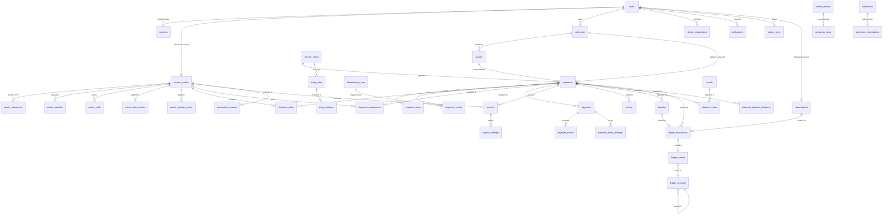
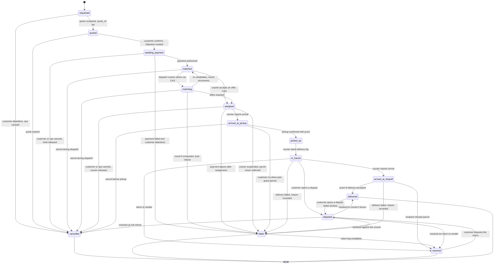
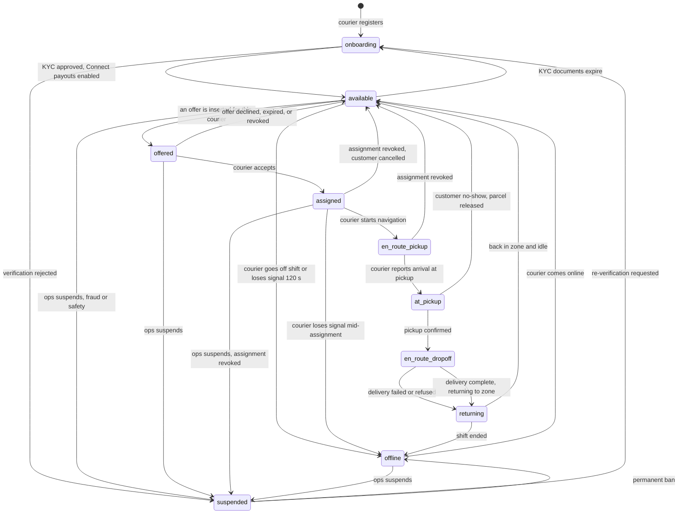
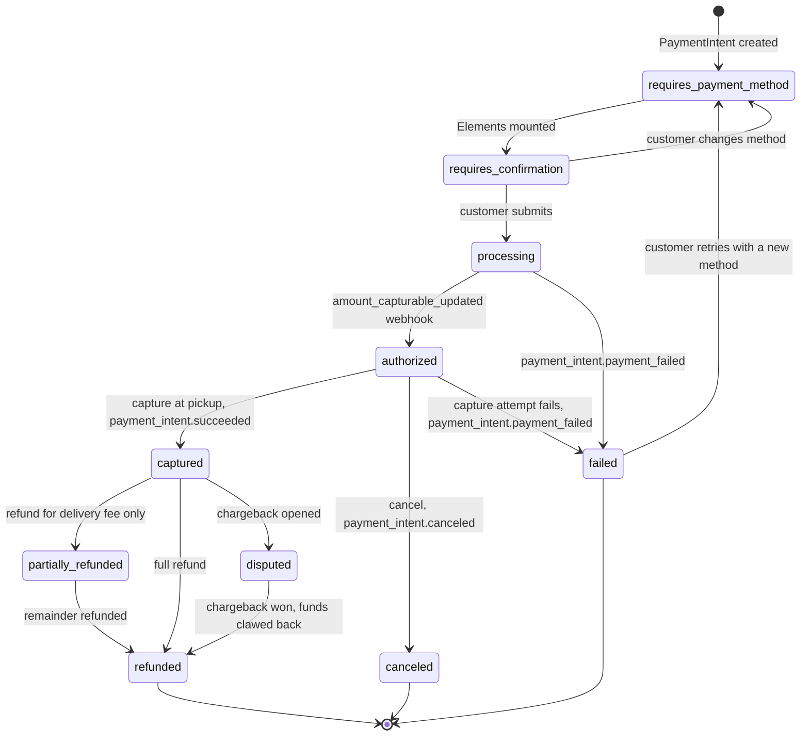
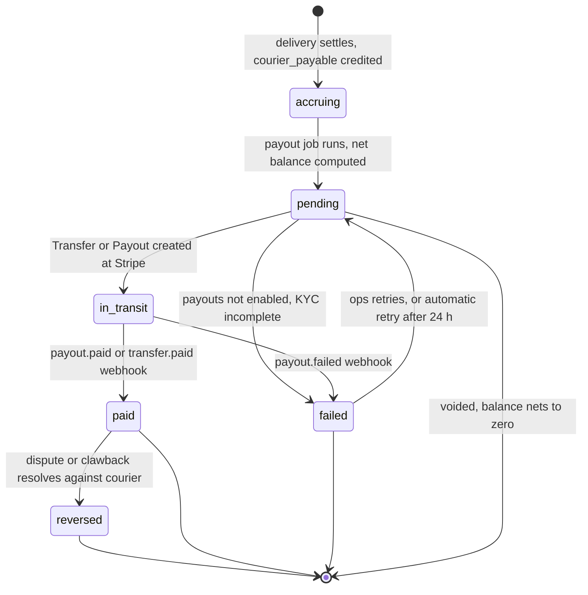

# QuickDrop - Data Model

Status: pre-implementation, planning only.
Scope: entity relationships, state machines, field-level schema, indexes, pricing and earnings, money correctness, retention and privacy.

| Document | Owns |
| --- | --- |
| [`00-product-brief.md`](./00-product-brief.md) | Scope, personas, success metrics |
| [`02-architecture.md`](./02-architecture.md) | Containers, flows, trust boundaries, **the dispatch algorithm**, the event catalogue, and `OQ-1` to `OQ-11` |
| [`04-api-contract.md`](./04-api-contract.md) | HTTP routes, payloads, auth, errors, rate limits |
| [`08-testing-strategy.md`](./08-testing-strategy.md) | How the state machines and ledger are verified |
| [`../stack_report.md`](../stack_report.md) | Version pinning |

Notation used in every table:

- **PK** primary key, **FK** foreign key, **UQ** unique, **NN** not null.
- Types are PostgreSQL. `timestamptz` is always UTC. `bigint` money columns are named `<something>_minor` and hold an integer count of the currency's minor unit.
- `geography(Point, 4326)` everywhere for coordinates ([PostGIS geography](https://postgis.net/docs/using_postgis.html)).
- Enums are native PostgreSQL `enum` types unless stated; the full enum definitions are in Section 3.
- `seq bigint GENERATED ALWAYS AS IDENTITY` on every table that is list-paginated or streamed. It is the keyset-pagination sort key and the Redis-stream cursor source. `uuid` PKs are v4, generated in the application.

---

## 1. ER diagram



---

## 2. State machines

All transitions below are enforced server-side in one place: a table-driven guard in the API and worker that takes `(entity, from_states, to_state, actor_role)` and returns allow or `409`. The database enforces the *result* with `CHECK` constraints on the enum and partial unique indexes; it cannot enforce the *transition*, which is why the guard exists and why it must be the only writer path.

### 2.1 Shipment



Terminal states are `cancelled`, `failed`, `returned`, `delivered`. `delivered` is terminal **except** for `disputed`, which is itself terminal. Terminal states never leave; the only permitted successor of a terminal state is `disputed`, and only within the dispute window.

| Transition | Authorisation | Notes |
| --- | --- | --- |
| `requested → quoted`, `quoted → awaiting_payment` | `customer` (owner), `ops` | |
| `awaiting_payment → matched` | `system` (payment webhook handler) | Not callable by any user role directly. Requires `payments.state='authorized'` |
| `matched → matching → assigned` | `system` (dispatch worker), or `ops` for force-assign via a separate audit path | Force-assign also records `shipment.force_assigned` |
| `assigned → arrived_at_pickup`, `arrived_at_pickup → picked_up` | `courier` with an **accepted** assignment for this shipment | |
| `picked_up → in_transit` | `courier` with an accepted assignment | |
| `arrived_at_dropoff → delivered` | `courier` with an accepted assignment, **and** a valid proof bundle | The only path that settles money |
| `→ cancelled` | `customer` (owner) or `ops`; `courier` **cannot** cancel | Legal only before `picked_up` |
| `→ failed` | `system`, `ops`, or `courier` (with reason code) | |
| `→ returned` | `courier` with an accepted assignment, or `system` | Requires `picked_up` |
| `→ disputed` | `customer` (owner) or `ops`; `courier` may open a non-monetary dispute | Requires `in_transit`, `arrived_at_dropoff`, `delivered`, `returned` |

### 2.2 Courier



Terminal states are `suspended` and, effectively, `offline` (a rest state, not an error). `suspended → onboarding` is a re-verification path and is the only backward edge.

Guard rules:

- `available → offered` is performed by the dispatch worker in the same transaction that inserts the offer. The partial unique index `offers_single_open_per_courier` makes a second concurrent `offered` impossible.
- `offered → assigned` requires the offer to be `state='offered' AND expires_at > now()`. Anything else is `409 offer.expired_or_already_answered`.
- Every edge out of `assigned`, `en_route_pickup`, `at_pickup`, `en_route_dropoff` requires an accepted assignment row. Losing the assignment forces the courier back to `available`.
- `returning → available` requires `last_position_geog` inside the courier's `home_zone_id` polygon, so the courier pool reflects couriers actually on the ground.

### 2.3 Payment



Guards:

- **Only the Stripe webhook handler may advance `payments.state`.** No API request handler writes it. This is what makes state ordering irrelevant to correctness; the handler reads `payments.state` inside its transaction and applies the legal successor set.
- `authorized → captured` additionally requires `shipments.state = 'picked_up'` for the capture to be considered on time. A capture that arrives after the shipment has been cancelled is recorded but posts no ledger movement, and raises `payment.orphan_settlement` (see race 4 in [`02-architecture.md`](./02-architecture.md#64-race-conditions-and-their-guards)).
- `captured → disputed` is driven by `charge.dispute.created`, and creates a `disputes` row plus freezes any pending payout for that shipment.
- `partially_refunded` exists specifically for `delivery_failed` with `reason_code='recipient_unavailable'`, where the platform refunds the delivery fee but not the courier's return-leg compensation.
- Refunds are never performed by mutating `payments`. They are a new ledger transaction plus an immutable `payment_events` row.

### 2.4 Payout



Guards:

- `accruing → pending` requires `connected_accounts.payouts_enabled = true`. This is the single most important payout guard; it is what prevents an unverified identity from receiving money.
- `pending → in_transit` requires the Stripe call to have returned an id. The Stripe call carries `Idempotency-Key: payout:{courier_id}:{period_start}` ([Stripe idempotency](https://docs.stripe.com/api/idempotent_requests)).
- `paid → reversed` never moves money through the payout row. It posts a **new** ledger transaction debiting `courier_payable` (or an `asset.receivable_from_courier` if already netted) and credits `recovery_income` or `refund_expense`. Ledger rows are immutable, so a reversal is an equal-and-opposite entry, never an update.
- `failed → pending` automatic retry is capped at 3 attempts with exponential backoff, after which ops is paged. Every retry uses the **same** Stripe idempotency key so a successful-but-unacknowledged attempt cannot double-pay.

### 2.5 Illegal transitions, and what happens

Every row below must be rejected server-side with `409` and the envelope in [`04-api-contract.md`](./04-api-contract.md#3-error-envelope). None of these are `500`, and none may be handled by "log and ignore".

| Attempt | `code` | `meta.allowed` |
| --- | --- | --- |
| `POST /shipments/{id}/cancel` on a `picked_up` shipment | `shipment.illegal_transition` | `["return_to_sender","dispute"]` |
| `POST /courier/shipments/{id}/deliver` on an `assigned` shipment | `shipment.illegal_transition` | `["arrive_at_pickup","pickup"]` |
| `POST /courier/shipments/{id}/pickup` on an `in_transit` shipment | `shipment.illegal_transition` | `["arrive_at_dropoff","deliver","fail"]` |
| `POST /courier/shipments/{id}/arrive-dropoff` on a `picked_up` shipment with no `in_transit` yet | `shipment.illegal_transition` | `["in_transit"]` |
| `POST /courier/shipments/{id}/fail` on a `delivered` shipment | `shipment.illegal_transition` | `["dispute"]` |
| `POST /courier/offers/{id}/accept` after `expires_at` | `offer.expired_or_already_answered` | `[]` |
| `POST /courier/offers/{id}/accept` on an offer this courier did not receive | `offer.not_yours` | `[]` |
| `POST /courier/offers/{id}/accept` when the courier already holds an accepted assignment | `courier.not_available` | `[]` |
| `PUT /courier/availability` to `available` without `payouts_enabled` | `courier.verification_incomplete` | `["offline","onboarding"]` |
| `POST /shipments/{id}/disputes` on an `awaiting_payment` shipment | `dispute.not_allowed_in_state` | `[]` |
| `POST /ops/shipments/{id}/force-assign` on a `delivered` shipment | `shipment.illegal_transition` | `[]` |
| `POST /ops/shipments/{id}/force-assign` to a courier who already has an accepted assignment | `courier.not_available` | `[]` |
| Any `If-Match` version mismatch on a mutating request | `version_conflict` | `[]` |
| Repeat `Idempotency-Key` with a different request body | `idempotency_key_conflict` | `[]` |
| `POST /webhooks/stripe` with an invalid signature | `webhook.signature_invalid` | `[]` |

The rule in one sentence: **any request whose `(current_state, target_state)` pair is not in the guard table is a `409`, and the response tells the client which transitions were legal at that instant**, so a client can reconcile instead of guessing. The two distinct statuses are deliberate: `409` means "the resource's state forbids this", `412` means "your `If-Match` precondition is stale".

---

## 3. Enumerations

```sql
CREATE TYPE user_role           AS ENUM ('customer','courier','ops','admin');
CREATE TYPE courier_state       AS ENUM ('offline','onboarding','available','offered',
                                         'assigned','en_route_pickup','at_pickup',
                                         'en_route_dropoff','returning','suspended');
CREATE TYPE shipment_state      AS ENUM ('requested','quoted','awaiting_payment','matched','matching',
                                         'assigned','arrived_at_pickup','picked_up','in_transit',
                                         'arrived_at_dropoff','delivered','cancelled','failed',
                                         'returned','disputed');
CREATE TYPE payment_state       AS ENUM ('requires_payment_method','requires_confirmation','processing',
                                         'authorized','captured','partially_refunded','refunded',
                                         'disputed','failed','canceled');
CREATE TYPE payout_state        AS ENUM ('accruing','pending','in_transit','paid','failed','reversed');
CREATE TYPE offer_state         AS ENUM ('offered','accepted','declined','expired','revoked','superseded');
CREATE TYPE assignment_state    AS ENUM ('offered','accepted','declined','expired','revoked',
                                         'completed','failed');
CREATE TYPE vehicle_type        AS ENUM ('bicycle','ebike','bicycle_cargo','motorcycle','car','van');
CREATE TYPE document_type       AS ENUM ('government_id','drivers_license','passport','selfie_with_id',
                                         'vehicle_registration','insurance');
CREATE TYPE document_state      AS ENUM ('submitted','in_review','approved','rejected','expired');
CREATE TYPE address_kind        AS ENUM ('pickup','dropoff','both');
CREATE TYPE dispute_state       AS ENUM ('opened','under_review','awaiting_customer','awaiting_courier',
                                         'resolved_customer','resolved_courier','closed');
CREATE TYPE dispute_severity    AS ENUM ('blocking','high','normal');
CREATE TYPE ledger_account_type AS ENUM ('asset','liability','revenue','contra_revenue','expense','equity');
CREATE TYPE normal_balance      AS ENUM ('debit','credit');
CREATE TYPE entry_direction     AS ENUM ('debit','credit');
CREATE TYPE notification_channel AS ENUM ('push','sms','email','inapp');
CREATE TYPE notification_status AS ENUM ('queued','sent','delivered','failed','suppressed');
CREATE TYPE asset_kind          AS ENUM ('proof_photo','signature','kyc_document','dispute_evidence',
                                         'parcel_condition_photo');
CREATE TYPE subscription_state  AS ENUM ('trialing','active','past_due','canceled','unpaid');
CREATE TYPE shift_state         AS ENUM ('planned','active','ended','no_show');
```

Enum values are **appended, never renamed or removed**, because a rename is a data migration that would silently change historical meaning. Deprecating a value means adding a new one and a `CHECK`-guarded data migration.

---

## 4. Field-level tables

### 4.1 Identity and access

#### `users`

| Column | Type | Null | Default | Constraints | Notes |
| --- | --- | --- | --- | --- | --- |
| `id` | `uuid` | no | gen | PK | v4, app-generated |
| `seq` | `bigint` | no | identity | | keyset sort key |
| `email` | `bytea` | no | | | AES-256-GCM ciphertext. Ciphertext in the column so the `=` lookup still works for dedupe |
| `email_bidx` | `bytea` | no | | UQ | HMAC-SHA256 blind index, `UNIQUE`, for exact-match login |
| `email_verified_at` | `timestamptz` | yes | null | | Required for `ops`/`admin` |
| `phone_e164` | `bytea` | yes | null | | AES-256-GCM |
| `phone_bidx` | `bytea` | yes | null | UQ | HMAC blind index |
| `phone_verified_at` | `timestamptz` | yes | null | | Required before a courier may be `available` |
| `display_name` | `text` | no | | `CHECK (char_length(display_name) BETWEEN 1 AND 80)` | Not encrypted; shown in UI |
| `role` | `user_role` | no | `'customer'` | | Primary role. Additional roles in `user_roles` |
| `status` | `text` | no | `'active'` | `CHECK (status IN ('active','shadow_banned','deleted'))` | `shadow_banned` writes succeed but never dispatch; see abuse controls |
| `country` | `char(2)` | no | | `CHECK (country ~ '^[A-Z]{2}$')` | ISO 3166-1 alpha-2 |
| `locale` | `text` | no | `'en-US'` | | |
| `timezone` | `text` | no | `'UTC'` | IANA zone | Drives `expires_at` display, never storage |
| `accepted_terms_at` | `timestamptz` | yes | null | | |
| `accepted_tos_version` | `text` | yes | null | | Retained for consent evidence |
| `analytics_consent_at` | `timestamptz` | yes | null | | Null means declined; GDPR Art. 7(1) requires demonstrable consent ([EUR-Lex GDPR](https://eur-lex.europa.eu/eli/reg/2016/679/oj)) |
| `deleted_at` | `timestamptz` | yes | null | | Soft delete; PII erasure job nulls the PII columns, it does not drop the row |
| `created_at` | `timestamptz` | no | `now()` | | |
| `updated_at` | `timestamptz` | no | `now()` | | Trigger-maintained |
| `version` | `integer` | no | `1` | `CHECK (version > 0)` | `If-Match` target |

#### `sessions`

Better Auth's own table ([Better Auth](https://www.better-auth.com/docs)). We mirror and own the migrations so a library swap is cheap (OQ-8).

| Column | Type | Null | Default | Constraints | Notes |
| --- | --- | --- | --- | --- | --- |
| `id` | `uuid` | no | gen | PK | |
| `seq` | `bigint` | no | identity | | |
| `user_id` | `uuid` | no | | FK `users(id)` `ON DELETE CASCADE` | |
| `token_hash` | `bytea` | no | | UQ | SHA-256 of the cookie token. The raw token never touches the database |
| `expires_at` | `timestamptz` | no | | | Sliding 30 days |
| `ip_hash` | `bytea` | yes | null | | HMAC, truncated. Raw IPs are not retained in sessions |
| `user_agent_hash` | `bytea` | yes | null | | |
| `created_at` | `timestamptz` | no | `now()` | | |
| `last_seen_at` | `timestamptz` | no | `now()` | | |

#### `user_roles`

| Column | Type | Null | Default | Constraints | Notes |
| --- | --- | --- | --- | --- | --- |
| `user_id` | `uuid` | no | | PK part, FK `users(id)` | |
| `role` | `user_role` | no | | PK part | Secondary role, e.g. an ops user who also dispatches |
| `granted_by_id` | `uuid` | yes | null | FK `users(id)` | |
| `granted_at` | `timestamptz` | no | `now()` | | |
| `revoked_at` | `timestamptz` | yes | null | | Revoked rows stay for audit |

#### `device_registrations`

| Column | Type | Null | Default | Constraints | Notes |
| --- | --- | --- | --- | --- | --- |
| `id` | `uuid` | no | gen | PK | |
| `user_id` | `uuid` | no | | FK `users(id)` `ON DELETE CASCADE` | |
| `device_id` | `uuid` | no | | UQ with `user_id` | Generated on first load, persisted in localStorage |
| `platform` | `text` | no | | `CHECK (platform IN ('ios','android','desktop','unknown'))` | |
| `pwa_standalone` | `boolean` | no | `false` | | From `display-mode: standalone` |
| `app_version` | `text` | no | | | Drives forced-refresh prompts |
| `sw_version` | `text` | yes | null | | Compared against the SW handshake |
| `push_enabled` | `boolean` | no | `false` | | False on iOS before 16.4, or when permission is denied |
| `push_subscription` | `jsonb` | yes | null | | Raw VAPID subscription; deleted 30 days after logout ([Push API](https://www.w3.org/TR/push-api/)) |
| `push_subscription_hash` | `bytea` | yes | null | UQ | For dedupe without reading jsonb |
| `last_seen_at` | `timestamptz` | no | `now()` | | |
| `created_at` | `timestamptz` | no | `now()` | | |
| `revoked_at` | `timestamptz` | yes | null | | Set on logout or push unsubscribe |

### 4.2 Courier

#### `courier_profiles`

| Column | Type | Null | Default | Constraints | Notes |
| --- | --- | --- | --- | --- | --- |
| `id` | `uuid` | no | gen | PK | |
| `seq` | `bigint` | no | identity | | |
| `user_id` | `uuid` | no | | UQ, FK `users(id)` `ON DELETE CASCADE` | |
| `state` | `courier_state` | no | `'onboarding'` | | The state machine in Section 2.2 |
| `legal_name` | `bytea` | yes | null | | AES-256-GCM; required before `available` |
| `legal_name_bidx` | `bytea` | yes | null | | Blind index for duplicate-identity detection |
| `date_of_birth_enc` | `bytea` | yes | null | | AES-256-GCM ciphertext. **Not** a `date` column: a native `date` cannot hold ciphertext, and a `text` ISO date would be plaintext PII that a disk snapshot exposes. Decrypted in the application layer for age verification only |
| `age_at_verification` | `smallint` | yes | null | `CHECK (age_at_verification BETWEEN 16 AND 120)` | Derived from `date_of_birth_enc` at KYC and frozen. This is what age-gating, the payout tax form and the ops dashboard actually read, so the ciphertext is decrypted on the rare path rather than every read |
| `home_zone_id` | `uuid` | no | | FK `service_zones(id)` | Drives `zone_penalty_i` in dispatch |
| `accepts_cross_zone` | `boolean` | no | `false` | | |
| `rating_avg` | `numeric(3,2)` | no | `0` | `CHECK (rating_avg BETWEEN 0 AND 5)` | Recomputed from `ratings` |
| `rating_count` | `integer` | no | `0` | `CHECK (rating_count >= 0)` | |
| `accept_rate_ema_100` | `numeric(5,4)` | no | `1` | `CHECK (accept_rate_ema_100 BETWEEN 0 AND 1)` | `acc_i` in the dispatch formula; EMA over the last 100 offers |
| `offered_30` | `integer` | no | `0` | | Denominator of the 30-day blend |
| `accepted_30` | `integer` | no | `0` | `CHECK (accepted_30 <= offered_30)` | |
| `decline_count_30d` | `integer` | no | `0` | | Fraud-review signal |
| `gps_reject_count_30d` | `integer` | no | `0` | | Spoofing signal |
| `gps_batches_30d` | `integer` | no | `0` | `CHECK (gps_batches_30d >= gps_reject_count_30d)` | Spoofing rate denominator |
| `daily_assignment_count` | `integer` | no | `0` | | Reset by the `courier.daily_reset` job at local midnight |
| `daily_assignment_cap` | `integer` | no | `12` | `CHECK (daily_assignment_cap > 0)` | Earnings-laundering brake |
| `earnings_30d_minor` | `bigint` | no | `0` | `CHECK (earnings_30d_minor >= 0)` | Rolling accrual |
| `accept_rate_ema_version` | `integer` | no | `1` | | Bumped when the formula changes, so history is comparable |
| `suspended_at` | `timestamptz` | yes | null | | |
| `suspended_until` | `timestamptz` | yes | null | | Null means indefinite |
| `suspension_reason` | `text` | yes | null | | |
| `available_since` | `timestamptz` | yes | null | | Starvation clock start when no prior assignment |
| `last_assigned_at` | `timestamptz` | yes | null | | Starvation clock, coalesced with `available_since` |
| `current_assignment_id` | `uuid` | yes | null | FK `shipment_assignments(id)` | Denormalised for the courier lock |
| `realtime_token_hash` | `bytea` | yes | null | | Hash of the short-lived SW/realtime token |
| `realtime_token_expires_at` | `timestamptz` | yes | null | | |
| `created_at` | `timestamptz` | no | `now()` | | |
| `updated_at` | `timestamptz` | no | `now()` | | |
| `version` | `integer` | no | `1` | | `If-Match` target for availability and profile writes |

#### `courier_last_position`

Narrow, hot, one row per courier. Deliberately separate from `courier_profiles` for index locality in the dispatch query ([`02-architecture.md`](./02-architecture.md#61-stage-1---geospatial-prefilter)).

| Column | Type | Null | Default | Constraints | Notes |
| --- | --- | --- | --- | --- | |
| `courier_id` | `uuid` | no | | PK, FK `courier_profiles(id)` `ON DELETE CASCADE` | |
| `position_geog` | `geography(Point,4326)` | yes | null | | GiST indexed |
| `lat` | `double precision` | yes | null | `CHECK (lat BETWEEN -90 AND 90)` | Plain mirror for cheap projections |
| `lng` | `double precision` | yes | null | `CHECK (lng BETWEEN -180 AND 180)` | |
| `heading_deg` | `smallint` | yes | null | `CHECK (heading_deg BETWEEN 0 AND 359)` | |
| `speed_mps` | `real` | yes | null | `CHECK (speed_mps >= 0)` | |
| `accuracy_m` | `real` | yes | null | `CHECK (accuracy_m >= 0)` | |
| `recorded_at` | `timestamptz` | yes | null | | Device clock; never trusted for ordering |
| `received_at` | `timestamptz` | no | `now()` | | Server clock; authoritative for staleness |
| `position_seq` | `bigint` | no | `0` | `CHECK (position_seq >= 0)` | Monotonic per courier; upsert guard |
| `source` | `text` | no | `'gps'` | `CHECK (source IN ('gps','manual','network'))` | |
| `updated_at` | `timestamptz` | no | `now()` | | |

#### `courier_position_points`

Append-only trail. Partitioned by month on `recorded_at`.

| Column | Type | Null | Default | Constraints | Notes |
| --- | --- | --- | --- | --- | --- |
| `id` | `bigint` | no | identity | PK | |
| `courier_id` | `uuid` | no | | FK `courier_profiles(id)` `ON DELETE CASCADE` | |
| `shipment_id` | `uuid` | yes | null | FK `shipments(id)` | Null while idle |
| `position_geog` | `geography(Point,4326)` | no | | | |
| `heading_deg` | `smallint` | yes | null | | |
| `speed_mps` | `real` | yes | null | | |
| `accuracy_m` | `real` | yes | null | | |
| `recorded_at` | `timestamptz` | no | | | Device clock |
| `received_at` | `timestamptz` | no | `now()` | | Server clock |
| `position_seq` | `bigint` | no | | `UQ (courier_id, position_seq)` | Guarantees exactly one stored row per accepted fix |
| `batch_id` | `uuid` | no | | | Client-generated per batch, aids offline replay idempotency |

#### `courier_documents`

| Column | Type | Null | Default | Constraints | Notes |
| --- | --- | --- | --- | --- | --- |
| `id` | `uuid` | no | gen | PK | |
| `seq` | `bigint` | no | identity | | |
| `courier_id` | `uuid` | no | | FK `courier_profiles(id)` `ON DELETE CASCADE` | |
| `document_type` | `document_type` | no | | | |
| `state` | `document_state` | no | `'submitted'` | | |
| `storage_key` | `text` | no | | UQ | Private bucket. No URL is ever stored |
| `sha256` | `bytea` | no | | | Content hash for tamper evidence |
| `mime_type` | `text` | no | | `CHECK (mime_type IN ('image/jpeg','image/png','application/pdf'))` | |
| `byte_size` | `integer` | no | | `CHECK (byte_size BETWEEN 0 AND 10485760)` | 10 MB cap |
| `full_name` | `bytea` | yes | null | | AES-256-GCM as printed on the document |
| `document_number_bidx` | `bytea` | yes | null | | HMAC blind index for duplicate-KYC detection across couriers |
| `expires_on` | `date` | yes | null | | Triggers `expired` and returns the courier to `onboarding` |
| `reviewed_by_id` | `uuid` | yes | null | FK `users(id)` | Must hold `ops` |
| `reviewed_at` | `timestamptz` | yes | null | | |
| `rejection_reason` | `text` | yes | null | | |
| `stripe_verification_session_id` | `text` | yes | null | | If Stripe Identity is used ([Connect verification](https://docs.stripe.com/connect/required-verification-information)) |
| `created_at` | `timestamptz` | no | `now()` | | |
| `deleted_at` | `timestamptz` | yes | null | | Erasure sets this; the object is deleted by the purge job |

#### `courier_vehicles`

| Column | Type | Null | Default | Constraints | Notes |
| --- | --- | --- | --- | --- | --- |
| `id` | `uuid` | no | gen | PK | |
| `seq` | `bigint` | no | identity | | |
| `courier_id` | `uuid` | no | | FK `courier_profiles(id)` `ON DELETE CASCADE` | |
| `vehicle_type` | `vehicle_type` | no | | | Matched against parcel requirements in dispatch |
| `is_primary` | `boolean` | no | `false` | | Partial unique index enforces one primary per courier |
| `max_payload_kg` | `numeric(6,2)` | no | | `CHECK (max_payload_kg > 0)` | |
| `max_volume_dm3` | `numeric(8,2)` | no | | `CHECK (max_volume_dm3 > 0)` | |
| `refrigerated` | `boolean` | no | `false` | | Hard dispatch gate for chilled parcels |
| `plate_encrypted` | `bytea` | yes | null | | AES-256-GCM; null for bicycles |
| `plate_bidx` | `bytea` | yes | null | | |
| `make` | `text` | yes | null | | |
| `model` | `text` | yes | null | | |
| `year` | `smallint` | yes | null | `CHECK (year BETWEEN 1990 AND 2100)` | |
| `insurance_expires_on` | `date` | yes | null | | Triggers `suspended` on expiry |
| `created_at` | `timestamptz` | no | `now()` | | |
| `version` | `integer` | no | `1` | | |

#### `courier_shifts`

| Column | Type | Null | Default | Constraints | Notes |
| --- | --- | --- | --- | --- | --- |
| `id` | `uuid` | no | gen | PK | |
| `courier_id` | `uuid` | no | | FK `courier_profiles(id)` `ON DELETE CASCADE` | |
| `state` | `shift_state` | no | `'planned'` | | |
| `planned_start_at` | `timestamptz` | no | | | |
| `planned_end_at` | `timestamptz` | no | | `CHECK (planned_end_at > planned_start_at)` | |
| `actual_start_at` | `timestamptz` | yes | null | | |
| `actual_end_at` | `timestamptz` | yes | null | | |
| `zone_id` | `uuid` | yes | null | FK `service_zones(id)` | Overrides `home_zone_id` for the shift |

### 4.3 Addresses, quotes and shipments

#### `addresses`

| Column | Type | Null | Default | Constraints | Notes |
| --- | --- | --- | --- | --- | --- |
| `id` | `uuid` | no | gen | PK | |
| `seq` | `bigint` | no | identity | | |
| `user_id` | `uuid` | no | | FK `users(id)` `ON DELETE CASCADE` | |
| `kind` | `address_kind` | no | | | |
| `label` | `text` | no | | `CHECK (char_length(label) BETWEEN 1 AND 60)` | "Home", "Office" |
| `recipient_name` | `text` | no | | `CHECK (char_length(recipient_name) BETWEEN 1 AND 120)` | |
| `recipient_phone_bidx` | `bytea` | yes | null | | Courier sees this **only after accepting an assignment** |
| `recipient_phone_enc` | `bytea` | yes | null | | AES-256-GCM |
| `line1_enc` | `bytea` | no | | | AES-256-GCM |
| `line2_enc` | `bytea` | yes | null | | |
| `city` | `text` | no | | | Not encrypted; needed for zone geocoding |
| `region` | `text` | yes | null | | |
| `postal_code` | `text` | yes | null | | |
| `country` | `char(2)` | no | | | |
| `geocode_label` | `text` | no | | | Human-readable one-line label, shown to couriers pre-acceptance |
| `geog` | `geography(Point,4326)` | no | | | GiST indexed for validation against zone polygons |
| `is_default` | `boolean` | no | `false` | | |
| `access_notes_enc` | `bytea` | yes | null | | AES-256-GCM. Buzzer codes, gate codes. Courier-visible post-acceptance |
| `delivery_instructions_enc` | `bytea` | yes | null | | AES-256-GCM |
| `service_zone_id` | `uuid` | no | | FK `service_zones(id)` | Resolved at write time from `geog` |
| `deleted_at` | `timestamptz` | yes | null | | |
| `created_at` | `timestamptz` | no | `now()` | | |
| `version` | `integer` | no | `1` | | |

#### `quotes`

| Column | Type | Null | Default | Constraints | Notes |
| --- | --- | --- | --- | --- | --- |
| `id` | `uuid` | no | gen | PK | |
| `seq` | `bigint` | no | identity | | |
| `user_id` | `uuid` | yes | null | FK `users(id)` | Null for anonymous rate-limited quotes |
| `pickup_address_id` | `uuid` | no | | FK `addresses(id)` | |
| `dropoff_address_id` | `uuid` | no | | FK `addresses(id)` | |
| `service_zone_id` | `uuid` | no | | FK `service_zones(id)` | |
| `surge_window_id` | `uuid` | yes | null | FK `surge_windows(id)` | Null when multiplier is 1.0 |
| `route_distance_m` | `integer` | no | | `CHECK (route_distance_m >= 0)` | From OSRM, not `ST_Distance` |
| `route_duration_s` | `integer` | no | | `CHECK (route_duration_s >= 0)` | |
| `parcel_weight_kg` | `numeric(6,3)` | no | | `CHECK (parcel_weight_kg > 0 AND parcel_weight_kg <= 100)` | |
| `parcel_volume_dm3` | `numeric(9,3)` | no | | `CHECK (parcel_volume_dm3 > 0)` | |
| `parcel_quantity` | `smallint` | no | `1` | `CHECK (parcel_quantity BETWEEN 1 AND 50)` | |
| `special_flags` | `text[]` | no | `'{}'` | | `fragile`, `refrigerated`, `hazardous`, `bulky`, `signature_required` |
| `currency` | `char(3)` | no | `'USD'` | `CHECK (currency ~ '^[A-Z]{3}$')` | ISO 4217. Single-currency at launch |
| `base_fare_minor` | `bigint` | no | | `CHECK (>= 0)` | |
| `distance_minor` | `bigint` | no | | `CHECK (>= 0)` | |
| `weight_minor` | `bigint` | no | | `CHECK (>= 0)` | |
| `volume_minor` | `bigint` | no | | `CHECK (>= 0)` | |
| `zone_minor` | `bigint` | no | | `CHECK (>= 0)` | |
| `toll_minor` | `bigint` | no | `0` | `CHECK (>= 0)` | |
| `accessorial_minor` | `bigint` | no | `0` | `CHECK (>= 0)` | Fragile, refrigerated surcharge |
| `surge_multiplier` | `integer` | no | `10000` | `CHECK (surge_multiplier BETWEEN 10000 AND 30000)` | **Basis points**, not a float. 10000 = 1.00x |
| `surge_minor` | `bigint` | no | `0` | `CHECK (>= 0)` | `base + distance + weight + volume + zone` times `(mult - 10000) / 10000`, floored |
| `subtotal_minor` | `bigint` | no | | `CHECK (>= 0)` | Pre-discount, pre-tax |
| `promotion_id` | `uuid` | yes | null | FK `promotions(id)` | |
| `discount_minor` | `bigint` | no | `0` | `CHECK (>= 0)` | Platform-funded. See Section 6 |
| `tax_rate_bp` | `integer` | no | | `CHECK (tax_rate_bp >= 0)` | Basis points of the discounted subtotal |
| `tax_minor` | `bigint` | no | | `CHECK (>= 0)` | |
| `total_minor` | `bigint` | no | | `CHECK (total_minor > 0)` | The customer charge |
| `tip_minor` | `bigint` | no | `0` | `CHECK (tip_minor >= 0)` | Added after quote, separate charge line |
| `platform_fee_minor` | `bigint` | no | | `CHECK (>= 0)` | Denormalised for ops reporting only; authoritative value lives in the ledger |
| `courier_delivery_earnings_minor` | `bigint` | no | | `CHECK (>= 0)` | `surged_subtotal + tip_minor - platform_fee_minor`, denormalised for ops reporting only. Named for the amount, not for the transfer, because no transfer exists yet; the quote's JSON field name is identical |
| `pricing_version` | `integer` | no | `1` | | Bumped whenever the pricing function changes |
| `route_geometry_ref` | `text` | yes | null | | Cache key for the OSRM geometry, not the geometry itself |
| `state` | `text` | no | `'quoted'` | `CHECK (state IN ('quoted','consumed','expired','abandoned'))` | |
| `expires_at` | `timestamptz` | no | | `now() + 10 minutes` at insert | |
| `created_at` | `timestamptz` | no | `now()` | | |

#### `shipments`

The central aggregate. Every money and status change touches this row.

| Column | Type | Null | Default | Constraints | Notes |
| --- | --- | --- | --- | --- | --- |
| `id` | `uuid` | no | gen | PK | |
| `seq` | `bigint` | no | identity | | Keyset sort key for all shipment lists |
| `public_ref` | `text` | no | | UQ | Short human reference, e.g. `QD-7F3K9Q`. Shown to customers and couriers; avoids leaking sequential ids |
| `state` | `shipment_state` | no | `'requested'` | | State machine, Section 2.1 |
| `customer_id` | `uuid` | no | | FK `users(id)` | |
| `quote_id` | `uuid` | yes | null | FK `quotes(id)` | Null only for ops-created shipments |
| `service_zone_id` | `uuid` | no | | FK `service_zones(id)` | |
| `assigned_courier_id` | `uuid` | yes | null | FK `courier_profiles(id)` | Denormalised for read paths |
| `pickup_address_id` | `uuid` | no | | FK `addresses(id)` | |
| `dropoff_address_id` | `uuid` | no | | FK `addresses(id)` | |
| `pickup_geog` | `geography(Point,4326)` | no | | | Snapshot at booking. Not read from `addresses`, so an address edit cannot move a live shipment |
| `dropoff_geog` | `geography(Point,4326)` | no | | | |
| `route_distance_m` | `integer` | no | | `CHECK (>= 0)` | |
| `route_duration_s` | `integer` | no | | `CHECK (>= 0)` | |
| `parcel_weight_kg` | `numeric(6,3)` | no | | `CHECK (> 0)` | |
| `parcel_volume_dm3` | `numeric(9,3)` | no | | `CHECK (> 0)` | |
| `parcel_quantity` | `smallint` | no | `1` | | |
| `special_flags` | `text[]` | no | `'{}'` | | |
| `currency` | `char(3)` | no | `'USD'` | | |
| `quoted_total_minor` | `bigint` | no | | `CHECK (> 0)` | Snapshot of `quotes.total_minor` |
| `discount_minor` | `bigint` | no | `0` | `CHECK (>= 0)` | Snapshot of `quotes.discount_minor` |
| `tax_minor` | `bigint` | no | `0` | `CHECK (>= 0)` | |
| `tip_minor` | `bigint` | no | `0` | `CHECK (>= 0)` | |
| `charged_total_minor` | `bigint` | no | `0` | `CHECK (>= 0)` | Denormalised from `payments` |
| `refunded_total_minor` | `bigint` | no | `0` | `CHECK (>= 0)` | |
| `courier_earning_minor` | `bigint` | no | `0` | `CHECK (>= 0)` | Denormalised from the ledger |
| `dispatch_round` | `smallint` | no | `0` | `CHECK (dispatch_round BETWEEN 0 AND 5)` | Escalation ladder position |
| `dispatch_score_version` | `integer` | yes | null | | Which weighting produced the winning offer |
| `match_started_at` | `timestamptz` | yes | null | | Drives the stuck-shipment ops query |
| `assigned_at` | `timestamptz` | yes | null | | |
| `pickup_arrived_at` | `timestamptz` | yes | null | | |
| `picked_up_at` | `timestamptz` | yes | null | | |
| `dropoff_arrived_at` | `timestamptz` | yes | null | | |
| `delivered_at` | `timestamptz` | yes | null | | |
| `cancelled_at` | `timestamptz` | yes | null | | |
| `cancel_reason_code` | `text` | yes | null | | |
| `cancelled_by_role` | `user_role` | yes | null | | |
| `cancelled_by_id` | `uuid` | yes | null | | |
| `failure_reason` | `text` | yes | null | | Includes `no_courier_available`, `payment_failed_after_pickup`, `recipient_unavailable` |
| `dispatch_deadline_at` | `timestamptz` | yes | null | | `match_started_at + 15 min`; the sweep job fails the shipment past this |
| `eta_pickup_s` | `integer` | yes | null | `CHECK (>= 0)` | Latest computed, denormalised for cheap reads |
| `eta_delivery_s` | `integer` | yes | null | `CHECK (>= 0)` | |
| `eta_computed_at` | `timestamptz` | yes | null | | Staleness check |
| `tracking_frozen` | `boolean` | no | `false` | | Set when the courier is considered lost |
| `dispute_window_ends_at` | `timestamptz` | yes | null | | `delivered_at + 72 h`; the only window in which `delivered → disputed` is legal |
| `created_at` | `timestamptz` | no | `now()` | | |
| `updated_at` | `timestamptz` | no | `now()` | | |
| `version` | `integer` | no | `1` | `CHECK (version > 0)` | `If-Match` target |

```sql
-- Terminal states are mutually exclusive and enforced at the database level.
CREATE UNIQUE INDEX shipments_one_terminal_state
  ON shipments (id)
  WHERE state IN ('delivered', 'cancelled', 'failed', 'returned');

-- A cancelled or failed shipment must carry a reason. Not a CHECK, because the
-- reason is set in the same UPDATE that sets the state and the check must be
-- deferred-safe; expressed as a trigger instead.
```

#### `shipment_stops`

| Column | Type | Null | Default | Constraints | Notes |
| --- | --- | --- | --- | --- | --- |
| `id` | `uuid` | no | gen | PK | |
| `shipment_id` | `uuid` | no | | FK `shipments(id)` `ON DELETE CASCADE` | |
| `sequence` | `smallint` | no | | `CHECK (sequence IN (1,2))`, `UQ (shipment_id, sequence)` | 1 pickup, 2 drop-off |
| `role` | `text` | no | | `CHECK (role IN ('pickup','dropoff'))` | |
| `address_id` | `uuid` | no | | FK `addresses(id)` | |
| `geog` | `geography(Point,4326)` | no | | | |
| `arrived_at` | `timestamptz` | yes | null | | |
| `completed_at` | `timestamptz` | yes | null | | |
| `waited_s` | `integer` | yes | null | `CHECK (>= 0)` | `completed_at - arrived_at`, courier-performance metric |
| `outcome` | `text` | yes | null | `CHECK (outcome IS NULL OR outcome IN ('completed','failed','no_show','refused','in_courier_possession'))` | |
| `contact_name_snapshot` | `text` | no | | | Frozen at assignment so a later address edit cannot change history |
| `contact_phone_enc` | `bytea` | yes | null | | AES-256-GCM, courier-visible post-acceptance only |
| `notes_enc` | `bytea` | yes | null | | AES-256-GCM |

#### `shipment_events`

Append-only audit trail. Referenced by every `ledger_transactions.event_ref`.

| Column | Type | Null | Default | Constraints | Notes |
| --- | --- | --- | --- | --- | --- |
| `id` | `uuid` | no | gen | PK | |
| `seq` | `bigint` | no | identity | | Total order within the table |
| `shipment_id` | `uuid` | no | | FK `shipments(id)` `ON DELETE RESTRICT` | |
| `event_type` | `text` | no | | | `shipment.*`, `payment.*`, `dispatch.*`, `assignment.*` |
| `actor_type` | `text` | no | | `CHECK (actor_type IN ('customer','courier','ops','admin','system','stripe','worker'))` | |
| `actor_id` | `uuid` | yes | null | | Null for `system` and `stripe` |
| `data` | `jsonb` | no | `'{}'` | | Diff and context. Never contains PII plaintext |
| `from_state` | `shipment_state` | yes | null | | |
| `to_state` | `shipment_state` | yes | null | | |
| `request_id` | `text` | no | | | Threads the HTTP request through to the ledger |
| `occurred_at` | `timestamptz` | no | `now()` | | |
| `schema_version` | `integer` | no | `1` | | |

#### `shipment_offers`

| Column | Type | Null | Default | Constraints | Notes |
| --- | --- | --- | --- | --- | --- |
| `id` | `uuid` | no | gen | PK | |
| `seq` | `bigint` | no | identity | | |
| `shipment_id` | `uuid` | no | | FK `shipments(id)` `ON DELETE CASCADE` | |
| `courier_id` | `uuid` | no | | FK `courier_profiles(id)` `ON DELETE CASCADE` | |
| `round` | `smallint` | no | | `CHECK (round BETWEEN 1 AND 5)` | |
| `rank` | `smallint` | no | | `CHECK (rank BETWEEN 1 AND 10)` | Position in this round's ranking |
| `score` | `numeric(10,6)` | no | | `CHECK (score >= 0)` | `cost_i` from the dispatch formula |
| `score_version` | `integer` | no | | | `DISPATCH_SCORE_VERSION` |
| `eta_s` | `integer` | no | | `CHECK (>= 0)` | Customer-facing pickup ETA at offer time |
| `dist_m` | `integer` | no | | `CHECK (>= 0)` | Deadhead metres |
| `deadhead_minor` | `integer` | yes | null | `CHECK (>= 0)` | What the platform pays to get this courier to the pickup. Owed even if the offer is declined and re-assigned |
| `state` | `offer_state` | no | `'offered'` | | |
| `offered_at` | `timestamptz` | no | `now()` | | |
| `expires_at` | `timestamptz` | no | | | 20 to 60 s by round |
| `responded_at` | `timestamptz` | yes | null | | |
| `decline_reason_code` | `text` | yes | null | | `at_capacity`, `too_far`, `wrong_vehicle`, `app_error`, `other` |
| `version` | `integer` | no | `1` | | `If-Match` target |

#### `shipment_assignments`

The accepted owner of a shipment. Immutable history, one accepted row at a time.

| Column | Type | Null | Default | Constraints | Notes |
| --- | --- | --- | --- | --- | --- |
| `id` | `uuid` | no | gen | PK | |
| `seq` | `bigint` | no | identity | | |
| `shipment_id` | `uuid` | no | | FK `shipments(id)` `ON DELETE CASCADE` | |
| `courier_id` | `uuid` | no | | FK `courier_profiles(id)` `ON DELETE CASCADE` | |
| `offer_id` | `uuid` | yes | null | FK `shipment_offers(id)` | Null for an ops force-assign |
| `state` | `assignment_state` | no | `'accepted'` | | |
| `assigned_at` | `timestamptz` | no | `now()` | | |
| `assigned_by` | `text` | no | | `CHECK (assigned_by IN ('courier_accept','ops_force','system_recovery'))` | |
| `operator_id` | `uuid` | yes | null | FK `users(id)` | Set when `assigned_by='ops_force'` |
| `accepted_eta_pickup_s` | `integer` | yes | null | | |
| `deadhead_minor` | `integer` | no | `0` | `CHECK (>= 0)` | Paid to the courier on delivery |
| `completed_at` | `timestamptz` | yes | null | | |
| `revoked_at` | `timestamptz` | yes | null | | |
| `revoked_reason` | `text` | yes | null | | `customer_cancelled`, `courier_offline`, `courier_suspended`, `payment_lapsed`, `superseded` |
| `version` | `integer` | no | `1` | | |

#### `shipment_dispatch_decisions`

Immutable snapshot of one dispatch attempt. The most valuable dispatch observability artefact in the system: it makes the ranking reproducible after the fact and enables A/B evaluation of new weights against historical candidate sets without shadow deployment.

| Column | Type | Null | Default | Constraints | Notes |
| --- | --- | --- | --- | --- | --- |
| `id` | `uuid` | no | gen | PK | |
| `shipment_id` | `uuid` | no | | FK `shipments(id)` `ON DELETE CASCADE` | |
| `round` | `smallint` | no | | `UQ (shipment_id, round)` | |
| `attempted_at` | `timestamptz` | no | `now()` | | |
| `radius_m` | `integer` | no | | | |
| `score_version` | `integer` | no | | | |
| `dispatcher` | `text` | no | | | Worker replica identity; reveals race 1 if two rows share a `round` |
| `candidate_count` | `integer` | no | | `CHECK (>= 0)` | |
| `candidates` | `jsonb` | no | | | Array of `{courier_id, eta_s, dist_m, load, acc, idle_min, zone_pen, veh_pen, eta_norm, dist_norm, load_norm, starv, cost, rank, gate_reject_reason}` |
| `offered_courier_ids` | `uuid[]` | no | | | |
| `chosen_courier_id` | `uuid` | yes | null | | Null if no offer was accepted in this round |
| `outcome` | `text` | no | | `CHECK (outcome IN ('accepted','declined','expired','empty','aborted'))` | |
| `total_latency_ms` | `integer` | yes | null | | Stage 1 to stage 3 commit |

#### `shipment_notes`

Free-text, length-capped, PII-bearing, ops and courier visible depending on visibility.

| Column | Type | Null | Default | Constraints | Notes |
| --- | --- | --- | --- | --- | --- |
| `id` | `uuid` | no | gen | PK | |
| `shipment_id` | `uuid` | no | | FK `shipments(id)` `ON DELETE CASCADE` | |
| `author_id` | `uuid` | no | | FK `users(id)` | |
| `author_role` | `user_role` | no | | | |
| `body_enc` | `bytea` | no | | | AES-256-GCM. Never rendered as HTML |
| `visibility` | `text` | no | | `CHECK (visibility IN ('internal','courier','customer','all'))` | |
| `created_at` | `timestamptz` | no | `now()` | | |

### 4.4 Money

#### `payments`

One row per customer charge attempt for a shipment. A shipment may have several rows (a retried authorization).

| Column | Type | Null | Default | Constraints | Notes |
| --- | --- | --- | --- | --- | --- |
| `id` | `uuid` | no | gen | PK | |
| `seq` | `bigint` | no | identity | | |
| `shipment_id` | `uuid` | no | | FK `shipments(id)` `ON DELETE RESTRICT` | |
| `customer_id` | `uuid` | no | | FK `users(id)` | |
| `attempt_no` | `smallint` | no | `1` | `CHECK (attempt_no > 0)`, `UQ (shipment_id, attempt_no)` | |
| `state` | `payment_state` | no | `'requires_payment_method'` | | State machine, Section 2.3 |
| `currency` | `char(3)` | no | `'USD'` | | |
| `amount_minor` | `bigint` | no | | `CHECK (amount_minor > 0)` | The charge attempt amount |
| `tip_minor` | `bigint` | no | `0` | `CHECK (tip_minor >= 0)` | Charged as part of the same PaymentIntent |
| `authorized_minor` | `bigint` | no | `0` | `CHECK (>= 0)` | |
| `captured_minor` | `bigint` | no | `0` | `CHECK (>= 0)`, `CHECK (captured_minor <= amount_minor + tip_minor)` | |
| `refunded_minor` | `bigint` | no | `0` | `CHECK (>= 0)`, `CHECK (refunded_minor <= captured_minor)` | |
| `payment_intent_id` | `text` | no | | UQ | Stripe PaymentIntent ([PaymentIntents](https://docs.stripe.com/payments/payment-intents)) |
| `charge_id` | `text` | yes | null | | Set on capture |
| `payment_method_id` | `text` | yes | null | | Stripe id only. No PAN, ever |
| `card_brand` | `text` | yes | null | | `visa`, `mastercard`, `amex`, `discover`, `other` |
| `card_last4` | `char(4)` | yes | null | `CHECK (card_last4 ~ '^[0-9]{4}$')` | Display only |
| `card_exp_month` | `smallint` | yes | null | `CHECK (BETWEEN 1 AND 12)` | |
| `card_exp_year` | `smallint` | yes | null | | |
| `card_fingerprint` | `text` | yes | null | | Stripe fingerprint for card-on-file reuse |
| `three_ds_status` | `text` | yes | null | | `authenticated`, `attempted`, `not_supported`, `failed` |
| `failure_code` | `text` | yes | null | | Stripe `error.code` |
| `failure_message` | `text` | yes | null | | Sanitised; never contains PAN |
| `decline_code` | `text` | yes | null | | `do_not_honor`, `insufficient_funds`, `expired_card`, and so on |
| `authorized_at` | `timestamptz` | yes | null | | |
| `captured_at` | `timestamptz` | yes | null | | |
| `canceled_at` | `timestamptz` | yes | null | | |
| `refund_reason_code` | `text` | yes | null | | `customer_cancelled`, `delivery_failed`, `dispute`, `goodwill`, `duplicate` |
| `created_at` | `timestamptz` | no | `now()` | | |
| `updated_at` | `timestamptz` | no | `now()` | | |
| `version` | `integer` | no | `1` | | |

#### `payment_intent_attempts`

Append-only retry log, so a support agent can explain a decline without reading Stripe's dashboard.

| Column | Type | Null | Default | Constraints | Notes |
| --- | --- | --- | --- | --- | --- |
| `id` | `uuid` | no | gen | PK | |
| `payment_id` | `uuid` | no | | FK `payments(id)` `ON DELETE CASCADE` | |
| `attempt_no` | `integer` | no | | `UQ (payment_id, attempt_no)` | |
| `payment_method_id` | `text` | yes | null | | |
| `result` | `text` | no | | `CHECK (result IN ('succeeded','requires_action','declined','error'))` | |
| `failure_code` | `text` | yes | null | | |
| `network_txn_id` | `text` | yes | null | | Stripe's `latest_charge` network reference |
| `latency_ms` | `integer` | yes | null | | |
| `request_id` | `text` | no | | | |
| `created_at` | `timestamptz` | no | `now()` | | |

#### `payment_events`

Raw Stripe events received. Append-only. This is the external truth for reconciliation.

| Column | Type | Null | Default | Constraints | Notes |
| --- | --- | --- | --- | --- | --- |
| `id` | `uuid` | no | gen | PK | |
| `stripe_event_id` | `text` | no | | UQ | **The webhook dedupe key.** Stripe guarantees at-least-once ([webhooks](https://docs.stripe.com/webhooks)) |
| `type` | `text` | no | | | `payment_intent.*`, `charge.*`, `transfer.*`, `payout.*`, `account.*` |
| `api_version` | `text` | no | | | Pinned Stripe API version; a mismatch with our pinned version is an alert |
| `payload` | `jsonb` | no | | | Full payload, encrypted at rest by disk encryption |
| `livemode` | `boolean` | no | | | `false` must never post a ledger entry |
| `signature_valid` | `boolean` | no | | | `false` rows are logged and dropped, never processed ([signature verification](https://docs.stripe.com/webhooks/signature)) |
| `delivery_attempt` | `integer` | no | `1` | | |
| `processed_at` | `timestamptz` | yes | null | | |
| `processing_outcome` | `text` | yes | null | | `processed`, `duplicate`, `ignored`, `failed` |
| `failure_detail` | `text` | yes | null | | |
| `received_at` | `timestamptz` | no | `now()` | | |

#### `connected_accounts`

| Column | Type | Null | Default | Constraints | Notes |
| --- | --- | --- | --- | --- | --- |
| `id` | `uuid` | no | gen | PK | |
| `courier_id` | `uuid` | no | | UQ, FK `courier_profiles(id)` `ON DELETE CASCADE` | |
| `stripe_account_id` | `text` | no | | UQ | Accounts v2 shape pending OQ-9 |
| `account_api_version` | `text` | yes | null | | Pinned per account |
| `charges_enabled` | `boolean` | no | `false` | | |
| `payouts_enabled` | `boolean` | no | `false` | | **Hard gate on `accruing → pending`** |
| `details_submitted` | `boolean` | no | `false` | | |
| `requirements_due` | `jsonb` | no | `'[]'` | | Stripe's `requirements` for the dashboard |
| `default_currency` | `char(3)` | no | `'USD'` | | |
| `country` | `char(2)` | no | | | |
| `onboarded_at` | `timestamptz` | yes | null | | |
| `last_synced_at` | `timestamptz` | no | `now()` | | Refreshed by a nightly `account.updated` fetch |

#### `payouts`

| Column | Type | Null | Default | Constraints | Notes |
| --- | --- | --- | --- | --- | --- |
| `id` | `uuid` | no | gen | PK | |
| `seq` | `bigint` | no | identity | | |
| `courier_id` | `uuid` | no | | FK `courier_profiles(id)` | |
| `shipment_id` | `uuid` | yes | null | FK `shipments(id)` | Non-null only for single-delivery payouts |
| `state` | `payout_state` | no | `'accruing'` | | State machine, Section 2.4 |
| `currency` | `char(3)` | no | `'USD'` | | |
| `gross_earnings_minor` | `bigint` | no | `0` | `CHECK (>= 0)` | Sum of `courier_earning_minor` across the period |
| `deadhead_minor` | `bigint` | no | `0` | `CHECK (>= 0)` | Paid for driving to a pickup |
| `bonus_minor` | `bigint` | no | `0` | `CHECK (>= 0)` | Peak, surge bonus, rating bonus |
| `compensation_minor` | `bigint` | no | `0` | `CHECK (>= 0)` | Return-leg, no-show, goodwill |
| `adjustment_minor` | `bigint` | no | `0` | | Can be negative: dispute clawback, negative payable recovery |
| `fee_minor` | `bigint` | no | `0` | `CHECK (>= 0)` | Platform payout fee |
| `net_minor` | `bigint` | no | | `CHECK (net_minor > 0)` | `gross + deadhead + bonus + compensation + adjustment - fee` |
| `period_start` | `timestamptz` | no | | `UQ (courier_id, period_start)` | Payout batching key |
| `period_end` | `timestamptz` | no | | | |
| `stripe_payout_id` | `text` | yes | null | | Stripe Payout when the courier uses Stripe-managed payouts ([Payouts](https://docs.stripe.com/api/payouts)) |
| `stripe_transfer_id` | `text` | yes | null | | Transfer under separate charges and transfers ([Connect separate charges and transfers](https://docs.stripe.com/connect/separate-charges-and-transfers)) |
| `bank_last4` | `char(4)` | yes | null | | Display only |
| `arrival_date` | `date` | yes | null | | |
| `attempt_count` | `integer` | no | `0` | `CHECK (>= 0)` | Capped at 3 before ops paging |
| `paid_at` | `timestamptz` | yes | null | | |
| `failure_code` | `text` | yes | null | | |
| `idempotency_key` | `text` | no | | UQ | `payout:{courier_id}:{period_start}` |
| `created_at` | `timestamptz` | no | `now()` | | |
| `version` | `integer` | no | `1` | | |

#### `payout_attempts`

| Column | Type | Null | Default | Constraints | Notes |
| --- | --- | --- | --- | --- | --- |
| `id` | `uuid` | no | gen | PK | |
| `payout_id` | `uuid` | no | | FK `payouts(id)` `ON DELETE CASCADE` | |
| `attempt_no` | `integer` | no | | `UQ (payout_id, attempt_no)` | |
| `stripe_idempotency_key` | `text` | no | | UQ | **Same key on every retry** |
| `result` | `text` | no | | `CHECK (result IN ('succeeded','failed'))` | |
| `failure_code` | `text` | yes | null | | |
| `latency_ms` | `integer` | yes | null | | |
| `created_at` | `timestamptz` | no | `now()` | | |

### 4.5 Ledger

Full rules in Section 7.

#### `ledger_accounts`

| Column | Type | Null | Default | Constraints | Notes |
| --- | --- | --- | --- | --- | --- |
| `id` | `uuid` | no | gen | PK | |
| `code` | `text` | no | | UQ, `CHECK (code ~ '^[0-9]{4}:[a-z_]+$')` | Stable, human, never reused after deletion |
| `name` | `text` | no | | `UNIQUE` | |
| `type` | `ledger_account_type` | no | | | |
| `normal_balance` | `normal_balance` | no | | | `debit` for asset/expense, `credit` for liability/revenue/equity; `contra_revenue` is `credit` |
| `currency` | `char(3)` | no | `'USD'` | | |
| `parent_id` | `uuid` | yes | null | FK `ledger_accounts(id)` | For statement grouping |
| `is_postable` | `boolean` | no | `true` | | `false` on group headers |
| `statement_side` | `text` | yes | null | `CHECK (statement_side IN ('balance_sheet','income_statement'))` | |
| `created_at` | `timestamptz` | no | `now()` | | |

Rows are seeded by migration and thereafter **never** updated or deleted. A retired account gets `is_postable = false`; that is the closest thing to deletion the ledger permits.

#### `ledger_transactions`

| Column | Type | Null | Default | Constraints | Notes |
| --- | --- | --- | --- | --- | --- |
| `id` | `uuid` | no | gen | PK | |
| `seq` | `bigint` | no | identity | | |
| `occurred_at` | `timestamptz` | no | | | Economic timestamp. Stripe's timestamp, not ours |
| `recorded_at` | `timestamptz` | no | `now()` | | Insertion timestamp |
| `description` | `text` | no | | `CHECK (char_length(description) BETWEEN 1 AND 200)` | Must be readable by a human auditor |
| `event_type` | `text` | no | | | `payment.captured`, `refund.issued`, and so on |
| `event_ref` | `text` | no | | | `payment_id`, `shipment_id`, `refund_id`, `payout_id` |
| `shipment_id` | `uuid` | yes | null | FK `shipments(id)` | |
| `currency` | `char(3)` | no | `'USD'` | | |
| `debit_total_minor` | `bigint` | no | `0` | `CHECK (debit_total_minor >= 0)` | Maintained by trigger, not by the caller |
| `credit_total_minor` | `bigint` | no | `0` | `CHECK (credit_total_minor >= 0)` | |
| `balanced` | `boolean` | no | | | **Set by the deferred constraint trigger.** Not trusted from the caller |
| `line_count` | `smallint` | no | `0` | `CHECK (line_count >= 2)` | A one-line transaction cannot balance, so this is free protection |
| `idempotency_key` | `text` | no | | UQ | `capture:{payment_id}`, `refund:{refund_id}`, `settle:{shipment_id}`, `transfer:{transfer_id}`, `payout:{id}` |
| `posted_by` | `text` | no | | `CHECK (posted_by IN ('api','worker','ops_reversal','system_migration'))` | |
| `operator_id` | `uuid` | yes | null | FK `users(id)` | Set for manual corrections |
| `reversal_of_id` | `uuid` | yes | null | FK `ledger_transactions(id)` | A correction is a new transaction pointing at its original |
| `reversed_by_id` | `uuid` | yes | null | FK `ledger_transactions(id)` `UNIQUE` | At most one reversal per transaction. This is the **only** mutable column on this table, and it is written by a `SECURITY DEFINER` function owned by the migration role, not by the app role. The forward pointer `reversal_of_id` is what callers read; this back pointer exists so "show me everything reversed today" is one indexed query instead of a correlated subquery |
| `request_id` | `text` | no | | | Threads from the originating HTTP request |
| `locked_at` | `timestamptz` | yes | null | | Set while a dispute freezes settlement on this transaction |

```sql
-- The balancing guarantee. A CONSTRAINT TRIGGER is the only correct way to enforce
-- a cross-row aggregate in PostgreSQL; a CHECK constraint cannot see other rows.
CREATE OR REPLACE FUNCTION ledger_assert_balanced() RETURNS trigger AS $$
DECLARE d bigint; c bigint; n smallint;
BEGIN
  SELECT COALESCE(SUM(amount_minor),0), COUNT(*)
    INTO d, n
    FROM ledger_entries
   WHERE transaction_id = NEW.transaction_id
     AND direction = 'debit';
  IF n < 2 OR d <> COALESCE((SELECT SUM(amount_minor) FROM ledger_entries
                             WHERE transaction_id = NEW.transaction_id
                               AND direction = 'credit'), 0) THEN
    RAISE EXCEPTION 'ledger transaction % is unbalanced: debits % <> credits %',
      NEW.transaction_id, d,
      COALESCE((SELECT SUM(amount_minor) FROM ledger_entries
                 WHERE transaction_id = NEW.transaction_id
                   AND direction = 'credit'), 0);
  END IF;
  UPDATE ledger_transactions
     SET debit_total_minor = d,
         credit_total_minor = COALESCE((SELECT SUM(amount_minor) FROM ledger_entries
                                         WHERE transaction_id = NEW.transaction_id
                                           AND direction = 'credit'), 0),
         balanced = true,
         line_count = (SELECT COUNT(*) FROM ledger_entries
                        WHERE transaction_id = NEW.transaction_id)
   WHERE id = NEW.transaction_id;
  RETURN NULL;
END;
$$ LANGUAGE plpgsql;

CREATE CONSTRAINT TRIGGER ledger_entries_must_balance
  AFTER INSERT ON ledger_entries
  DEFERRABLE INITIALLY DEFERRED
  FOR EACH ROW EXECUTE FUNCTION ledger_assert_balanced();
```

#### `ledger_entries`

Append-only, immutable, two rows minimum per transaction.

| Column | Type | Null | Default | Constraints | Notes |
| --- | --- | --- | --- | --- | --- |
| `id` | `uuid` | no | gen | PK | |
| `seq` | `bigint` | no | identity | | |
| `transaction_id` | `uuid` | no | | FK `ledger_transactions(id)` `ON DELETE RESTRICT` | |
| `line_no` | `smallint` | no | | `CHECK (line_no > 0)`, `UQ (transaction_id, line_no)` | |
| `account_id` | `uuid` | no | | FK `ledger_accounts(id)` `ON DELETE RESTRICT` | |
| `direction` | `entry_direction` | no | | | `debit` or `credit`. Deliberately **not** typed as `normal_balance`: the two share a value set but not a meaning. `normal_balance` says which side an account normally sits on, `entry_direction` says which side this line touches. Using one type for both is how a query ends up filtering `direction = 'debit'` against an account whose normal balance is credit and getting nothing back |
| `amount_minor` | `bigint` | no | | `CHECK (amount_minor > 0)` | **Strictly positive.** Zero-amount lines are meaningless and are rejected |
| `currency` | `char(3)` | no | `'USD'` | | Must equal the transaction's currency |
| `memo` | `text` | yes | null | `CHECK (char_length(memo) <= 200)` | |
| `shipment_id` | `uuid` | yes | null | FK `shipments(id)` | Denormalised for per-shipment statements |
| `posted_at` | `timestamptz` | no | `now()` | | |

```sql
-- Immutability, enforced by the database and not merely by convention.
CREATE OR REPLACE FUNCTION ledger_entries_are_immutable() RETURNS trigger AS $$
BEGIN
  RAISE EXCEPTION 'ledger_entries is append-only; % is prohibited', TG_OP
    USING ERRCODE = 'restrict_violation';
END;
$$ LANGUAGE plpgsql;

CREATE TRIGGER ledger_entries_no_update
  BEFORE UPDATE ON ledger_entries
  FOR EACH ROW EXECUTE FUNCTION ledger_entries_are_immutable();

CREATE TRIGGER ledger_entries_no_delete
  BEFORE DELETE ON ledger_entries
  FOR EACH ROW EXECUTE FUNCTION ledger_entries_are_immutable();

-- Belt and braces: the application role has no DML grant it does not need.
REVOKE UPDATE, DELETE ON ledger_entries FROM quickdrop_app;

-- ledger_transactions is *not* fully immutable. The balancing trigger above UPDATEs
-- debit_total_minor, credit_total_minor, balanced and line_count, and the reversal
-- routine UPDATEs reversed_by_id. Revoking UPDATE wholesale would break the trigger.
-- Instead, restrict it to the columns the database itself maintains, so the app role
-- cannot rewrite occurred_at, idempotency_key or shipment_id after the fact.
REVOKE UPDATE, DELETE ON ledger_transactions FROM quickdrop_app;
GRANT UPDATE (debit_total_minor, credit_total_minor, balanced, line_count, reversed_by_id)
  ON ledger_transactions TO quickdrop_app;
REVOKE DELETE ON ledger_transactions FROM quickdrop_app;
```

#### `idempotency_keys`

Guards every money and shipment-creating request ([`04-api-contract.md`](./04-api-contract.md#45-idempotency)).

| Column | Type | Null | Default | Constraints | Notes |
| --- | --- | --- | --- | --- | --- |
| `idempotency_key` | `text` | no | | PK | Client-supplied `Idempotency-Key` header, or a derived key |
| `user_id` | `uuid` | no | | | Scopes the key to the actor, so two users cannot collide |
| `request_id` | `text` | no | | | The `X-Request-Id` of the original attempt. Propagated from the API middleware, so a replay can be tied to the request that produced it and the whole chain reaches the ledger |
| `method` | `text` | no | | | |
| `path` | `text` | no | | | Route template, not the concrete path |
| `request_fingerprint` | `bytea` | no | | `UNIQUE (user_id, method, path, request_fingerprint)` | SHA-256 of canonical JSON body. A same-key different-body replay is `409 idempotency_key_conflict` |
| `request_body_enc` | `bytea` | no | | | Retained 30 days for dispute forensics |
| `state` | `text` | no | `'in_progress'` | `CHECK (state IN ('in_progress','completed','failed'))` | |
| `response_status` | `integer` | yes | null | | |
| `response_body_enc` | `bytea` | yes | null | | Replayed verbatim on a duplicate |
| `resource_id` | `uuid` | yes | null | | The created or mutated resource |
| `locked_at` | `timestamptz` | no | `now()` | | An `in_progress` row older than 60 s is treated as abandoned |
| `completed_at` | `timestamptz` | yes | null | | |
| `expires_at` | `timestamptz` | no | | | `now() + 24 h`; the key is reusable afterwards |

### 4.6 Messaging, ratings, disputes and platform config

#### `notifications`

| Column | Type | Null | Default | Constraints | Notes |
| --- | --- | --- | --- | --- | --- |
| `id` | `uuid` | no | gen | PK | |
| `seq` | `bigint` | no | identity | | |
| `user_id` | `uuid` | no | | FK `users(id)` `ON DELETE CASCADE` | |
| `shipment_id` | `uuid` | yes | null | FK `shipments(id)` | |
| `channel` | `notification_channel` | no | | | |
| `template_code` | `text` | no | | | `shipment.assigned`, `offer.received`, `payment.failed` |
| `dedupe_key` | `text` | no | | `UNIQUE (user_id, channel, dedupe_key)` | `<event_id>:<channel>:<recipient>`. **The idempotency mechanism** |
| `status` | `notification_status` | no | `'queued'` | | |
| `payload` | `jsonb` | no | `'{}'` | | Template variables. Never raw PII |
| `provider` | `text` | yes | null | | `apns`, `fcm`, `twilio`, `ses`, `inapp` |
| `provider_message_id` | `text` | yes | null | | |
| `attempt_count` | `integer` | no | `0` | `CHECK (>= 0)` | |
| `next_attempt_at` | `timestamptz` | no | `now()` | | Backoff target |
| `suppressed_reason` | `text` | yes | null | | `push_unavailable`, `user_opted_out`, `duplicate` |
| `sent_at` | `timestamptz` | yes | null | | |
| `delivered_at` | `timestamptz` | yes | null | | Best-effort; push provides no delivery receipt on iOS |
| `failed_at` | `timestamptz` | yes | null | | |
| `created_at` | `timestamptz` | no | `now()` | | |

#### `outbox_events`

The single egress path for domain events ([`02-architecture.md`](./02-architecture.md#71-transport-and-delivery-semantics)).

| Column | Type | Null | Default | Constraints | Notes |
| --- | --- | --- | --- | --- | --- |
| `id` | `uuid` | no | gen | PK | The `event_id` in every payload |
| `aggregate_type` | `text` | no | | | `shipment`, `payment`, `payout`, `courier`, `user`, `dispute` |
| `aggregate_id` | `uuid` | no | | | |
| `aggregate_version` | `bigint` | no | | | The aggregate's `version` at emit time; ordered delivery detection |
| `event_type` | `text` | no | | | |
| `schema_version` | `integer` | no | `1` | | |
| `payload` | `jsonb` | no | | | Contains `event_id`, `occurred_at`, `schema_version`, `request_id` |
| `occurred_at` | `timestamptz` | no | `now()` | | |
| `available_at` | `timestamptz` | no | `now()` | | Delayed events land here |
| `published_at` | `timestamptz` | yes | null | | Null means unpublished |
| `publish_attempts` | `integer` | no | `0` | `CHECK (>= 0)` | |
| `last_error` | `text` | yes | null | | |

#### `consumer_inbox`

| Column | Type | Null | Default | Constraints | Notes |
| --- | --- | --- | --- | --- | --- |
| `consumer_name` | `text` | no | | PK part | `payment.processor`, `dispatch.matcher`, and so on |
| `event_id` | `uuid` | no | | PK part | |
| `aggregate_id` | `uuid` | yes | null | | For debugging |
| `processed_at` | `timestamptz` | no | `now()` | | |
| `outcome` | `text` | no | | | `applied`, `skipped_noop`, `failed` |

#### `ratings`

| Column | Type | Null | Default | Constraints | Notes |
| --- | --- | --- | --- | --- | --- |
| `id` | `uuid` | no | gen | PK | |
| `shipment_id` | `uuid` | no | | FK `shipments(id)` `ON DELETE CASCADE` | |
| `rater_id` | `uuid` | no | | FK `users(id)` | |
| `ratee_id` | `uuid` | no | | FK `users(id)` | |
| `ratee_role` | `user_role` | no | | | |
| `stars` | `smallint` | no | | `CHECK (stars BETWEEN 1 AND 5)` | |
| `tags` | `text[]` | no | `'{}'` | | `on_time`, `careful`, `friendly`, `late`, `damaged` |
| `comment_enc` | `bytea` | yes | null | | AES-256-GCM. Excluded from logs |
| `reason_code` | `text` | yes | null | | Required when `stars <= 2` |
| `created_at` | `timestamptz` | no | `now()` | | |
| `updated_at` | `timestamptz` | no | `now()` | | |

```sql
-- One rating per rater per shipment per ratee. Double-submit protection.
CREATE UNIQUE INDEX ratings_one_per_rater
  ON ratings (shipment_id, rater_id, ratee_id, ratee_role);
```

#### `ratings_given`

A denormalised rollup of `ratings` for the ops dashboard and for the `ratings` reference in the ER diagram.

| Column | Type | Null | Default | Constraints | Notes |
| --- | --- | --- | --- | --- | --- |
| `rater_id` | `uuid` | no | | PK part | |
| `ratee_id` | `uuid` | no | | PK part | |
| `window` | `text` | no | | PK part | `30d`, `90d`, `all` |
| `rating_count` | `integer` | no | | `CHECK (>= 0)` | |
| `rating_sum` | `integer` | no | | `CHECK (>= 0)` | |
| `low_star_count` | `integer` | no | `0` | | |
| `updated_at` | `timestamptz` | no | `now()` | | Refreshed by the rollup job |

#### `disputes`

| Column | Type | Null | Default | Constraints | Notes |
| --- | --- | --- | --- | --- | --- |
| `id` | `uuid` | no | gen | PK | |
| `seq` | `bigint` | no | identity | | |
| `shipment_id` | `uuid` | no | | FK `shipments(id)` `ON DELETE RESTRICT` | |
| `opened_by_id` | `uuid` | yes | null | FK `users(id)` | Null when `opened_by='system'` |
| `opened_by_role` | `user_role` | no | | | |
| `against_courier_id` | `uuid` | yes | null | FK `courier_profiles(id)` | |
| `state` | `dispute_state` | no | `'opened'` | | |
| `severity` | `dispute_severity` | no | `'normal'` | | `blocking` freezes dispatch eligibility |
| `reason_code` | `text` | no | | | `damaged`, `not_received`, `late`, `wrong_address`, `lost`, `overcharge` |
| `detail_enc` | `bytea` | yes | null | | AES-256-GCM |
| `evidence_asset_ids` | `uuid[]` | no | `'{}'` | | FK to `assets` |
| `amount_in_dispute_minor` | `bigint` | no | `0` | `CHECK (>= 0)` | |
| `refund_minor` | `bigint` | no | `0` | `CHECK (>= 0)` | |
| `payout_adjustment_minor` | `bigint` | no | `0` | | Can be negative |
| `assigned_reviewer_id` | `uuid` | yes | null | FK `users(id)` | Must hold `ops` |
| `sla_due_at` | `timestamptz` | no | | `now() + 48 h` at open | |
| `resolution_code` | `text` | yes | null | | |
| `resolution_note_enc` | `bytea` | yes | null | | |
| `resolved_at` | `timestamptz` | yes | null | | |
| `created_at` | `timestamptz` | no | `now()` | | |
| `version` | `integer` | no | `1` | | |

#### `assets`

| Column | Type | Null | Default | Constraints | Notes |
| --- | --- | --- | --- | --- | --- |
| `id` | `uuid` | no | gen | PK | |
| `kind` | `asset_kind` | no | | | |
| `storage_key` | `text` | no | | UQ | Private bucket |
| `mime_type` | `text` | no | | `CHECK (mime_type IN ('image/jpeg','image/png','application/pdf'))` | |
| `byte_size` | `integer` | no | | `CHECK (byte_size BETWEEN 0 AND 10485760)` | |
| `sha256` | `bytea` | no | | | |
| `width_px` | `integer` | yes | null | | |
| `height_px` | `integer` | yes | null | | |
| `exif_stripped_at` | `timestamptz` | no | `now()` | | GPS EXIF must be stripped on ingest |
| `uploaded_by_id` | `uuid` | no | | FK `users(id)` | |
| `shipment_id` | `uuid` | yes | null | FK `shipments(id)` | |
| `retention_ends_at` | `timestamptz` | no | | | Dispute window plus buffer |
| `deleted_at` | `timestamptz` | yes | null | | |

#### `service_zones`

| Column | Type | Null | Default | Constraints | Notes |
| --- | --- | --- | --- | --- | --- |
| `id` | `uuid` | no | gen | PK | |
| `code` | `text` | no | | UQ | `ZONE_2_EAST` |
| `name` | `text` | no | | | |
| `city` | `text` | no | | | |
| `country` | `char(2)` | no | | | |
| `boundary` | `geography(Polygon,4326)` | no | | | GiST indexed. Couriers must return inside their zone |
| `centroid` | `geography(Point,4326)` | no | | | For distance-to-zone-centre pricing |
| `base_fare_minor` | `bigint` | no | | `CHECK (>= 0)` | |
| `zone_surcharge_minor` | `bigint` | no | `0` | `CHECK (>= 0)` | |
| `per_km_minor` | `bigint` | no | | `CHECK (>= 0)` | |
| `min_charge_minor` | `bigint` | no | | `CHECK (> 0)` | Floor price regardless of distance |
| `active` | `boolean` | no | `true` | | |
| `version` | `integer` | no | `1` | | `If-Match` target; ops edits are audited |

#### `surge_rules`

| Column | Type | Null | Default | Constraints | Notes |
| --- | --- | --- | --- | --- | --- |
| `id` | `uuid` | no | gen | PK | |
| `service_zone_id` | `uuid` | no | | FK `service_zones(id)` | |
| `name` | `text` | no | | | Human label for the ops board |
| `driver` | `text` | no | | `CHECK (driver IN ('fixed','demand_ratio','time_of_day','manual'))` | |
| `multiplier_bp` | `integer` | no | `10000` | `CHECK (multiplier_bp BETWEEN 10000 AND 30000)` | Basis points, hard-capped at 3x |
| `min_active_couriers` | `integer` | yes | null | | For `demand_ratio` |
| `max_active_couriers` | `integer` | yes | null | | |
| `time_of_day` | `tstzrange` | yes | null | | `[start, end)` in the zone's local time |
| `weekdays` | `smallint[]` | no | `'{}'` | | 0 Sunday to 6 Saturday |
| `priority` | `integer` | no | `0` | | Highest priority match wins |
| `active` | `boolean` | no | `true` | | |
| `starts_at` | `timestamptz` | yes | null | | For `manual` |
| `ends_at` | `timestamptz` | yes | null | | |
| `version` | `integer` | no | `1` | | |

#### `surge_windows`

Materialised resolution of `surge_rules`, recomputed every 5 minutes by a worker job. Storing the resolution means a quote created 9 minutes ago can still be explained after the surge has moved.

| Column | Type | Null | Default | Constraints | Notes |
| --- | --- | --- | --- | --- | --- |
| `id` | `uuid` | no | gen | PK | |
| `service_zone_id` | `uuid` | no | | FK `service_zones(id)` | |
| `surge_rule_id` | `uuid` | no | | FK `surge_rules(id)` | |
| `window_start` | `timestamptz` | no | | `UQ (service_zone_id, window_start)` | |
| `window_end` | `timestamptz` | no | | | |
| `multiplier_bp` | `integer` | no | | `CHECK (BETWEEN 10000 AND 30000)` | |
| `active_couriers` | `integer` | no | | `CHECK (>= 0)` | At resolution time |
| `open_shipments` | `integer` | no | | `CHECK (>= 0)` | At resolution time |
| `computed_at` | `timestamptz` | no | `now()` | | |

#### `promotions`

| Column | Type | Null | Default | Constraints | Notes |
| --- | --- | --- | --- | --- | --- |
| `id` | `uuid` | no | gen | PK | |
| `code` | `text` | no | | UQ | Case-insensitive; stored upper-cased |
| `description` | `text` | no | | | |
| `discount_type` | `text` | no | | `CHECK (discount_type IN ('fixed_minor','percent_bp','free_delivery'))` | |
| `discount_value` | `bigint` | no | | | Minor units, or basis points |
| `max_discount_minor` | `bigint` | yes | null | `CHECK (>= 0)` | Cap for percentage discounts |
| `funded_by` | `text` | no | | `CHECK (funded_by IN ('platform','partner'))` | `partner` creates a `partner_payable` liability |
| `min_subtotal_minor` | `bigint` | no | `0` | `CHECK (>= 0)` | |
| `max_redemptions` | `integer` | yes | null | `CHECK (>= 0)` | Null means unlimited |
| `max_redemptions_per_customer` | `integer` | no | `1` | `CHECK (>= 0)` | Abuse control |
| `starts_at` | `timestamptz` | no | | | |
| `ends_at` | `timestamptz` | no | | `CHECK (ends_at > starts_at)` | |
| `service_zone_ids` | `uuid[]` | no | `'{}'` | | Empty means all zones |
| `active` | `boolean` | no | `true` | | |
| `created_at` | `timestamptz` | no | `now()` | | |

#### `promotion_redemptions`

| Column | Type | Null | Default | Constraints | Notes |
| --- | --- | --- | --- | --- | --- |
| `id` | `uuid` | no | gen | PK | |
| `promotion_id` | `uuid` | no | | FK `promotions(id)` | |
| `customer_id` | `uuid` | no | | FK `users(id)` | |
| `shipment_id` | `uuid` | no | | FK `shipments(id)` | |
| `discount_minor` | `bigint` | no | | `CHECK (>= 0)` | As actually applied |
| `redeemed_at` | `timestamptz` | no | `now()` | | |
| `reversed_at` | `timestamptz` | yes | null | | Set if the shipment is cancelled |

```sql
-- One redemption per promotion per customer, forever. The primary abuse brake.
CREATE UNIQUE INDEX promotions_one_per_customer
  ON promotion_redemptions (promotion_id, customer_id);
```

#### `subscriptions`

| Column | Type | Null | Default | Constraints | Notes |
| --- | --- | --- | --- | --- | --- |
| `id` | `uuid` | no | gen | PK | |
| `user_id` | `uuid` | no | | FK `users(id)` `ON DELETE CASCADE` | |
| `plan_code` | `text` | no | | | `qd_plus_monthly`, `business_annual` |
| `state` | `subscription_state` | no | `'active'` | | |
| `stripe_subscription_id` | `text` | yes | null | UQ | |
| `stripe_customer_id` | `text` | yes | null | | |
| `amount_minor` | `bigint` | no | `0` | `CHECK (>= 0)` | |
| `currency` | `char(3)` | no | `'USD'` | | |
| `period_start` | `timestamptz` | yes | null | | |
| `period_end` | `timestamptz` | yes | null | | |
| `discount_bp` | `integer` | no | `0` | `CHECK (BETWEEN 0 AND 5000)` | Entitlement, applied at quote time, not a ledger discount |
| `free_deliveries_per_month` | `integer` | no | `0` | `CHECK (>= 0)` | |
| `cancelled_at` | `timestamptz` | yes | null | | |
| `grace_until` | `timestamptz` | yes | null | | Set on `past_due` |
| `created_at` | `timestamptz` | no | `now()` | | |
| `version` | `integer` | no | `1` | | |

#### `audit_log`

| Column | Type | Null | Default | Constraints | Notes |
| --- | --- | --- | --- | --- | --- |
| `id` | `bigint` | no | identity | PK | |
| `actor_id` | `uuid` | yes | null | FK `users(id)` | Null for `system` |
| `actor_role` | `user_role` | yes | null | | |
| `action` | `text` | no | | | `ops.shipment.force_assign`, `ops.courier.suspend`, `ops.ledger.reverse` |
| `resource_type` | `text` | no | | | |
| `resource_id` | `uuid` | yes | null | | |
| `before` | `jsonb` | yes | null | | Diff before |
| `after` | `jsonb` | yes | null | | Diff after |
| `request_id` | `text` | no | | | |
| `ip_hash` | `bytea` | yes | null | | HMAC. Raw IPs are not retained beyond the security log |
| `user_agent` | `text` | yes | null | | |
| `reason_code` | `text` | yes | null | | Required for privileged actions |
| `created_at` | `timestamptz` | no | `now()` | | Append-only, 7-year retention |

---

## 5. Indexes

Every index, its type, and the query it serves. Anything not listed here does not exist.

### 5.1 Dispatch and live tracking

| Index | Table | Type | Columns | Query served |
| --- | --- | --- | --- | --- |
| `courier_last_position_pkey` | `courier_last_position` | btree | `(courier_id)` | Join from `courier_profiles` in the Stage 1 prefilter |
| `courier_last_position_geog_gist` | `courier_last_position` | gist | `(position_geog)` | `ST_DWithin` in the Stage 1 prefilter and `ST_DWithin` for zone containment checks |
| `courier_last_position_seen_idx` | `courier_last_position` | btree partial | `(last_seen_at DESC) WHERE position_geog IS NOT NULL` | The freshness gate; lets Postgres prove no online courier exists without touching the GiST index |
| `courier_profiles_state_seen_idx` | `courier_profiles` | btree | `(state, last_assigned_at DESC)` | Ops courier list filtered by state; starvation query for the escalation sweep |
| `courier_profiles_home_zone_state_idx` | `courier_profiles` | btree partial | `(home_zone_id, state) WHERE state IN ('available','offered')` | Zone-scoped courier counts for surge computation and the ops dispatch board |
| `courier_position_points_pkey` | `courier_position_points` | btree | `(id)` | Partition-local ordering for trail reads |
| `courier_position_points_courier_seq_uq` | `courier_position_points` | btree | `(courier_id, position_seq)` | **Upsert idempotency** for streaming writes and the `Returning` guard |
| `courier_position_points_shipment_time_idx` | `courier_position_points` | btree | `(shipment_id, recorded_at)` | Customer tracking snapshot; the ops breadcrumb trail |
| `courier_position_points_courier_time_idx` | `courier_position_points` | btree | `(courier_id, recorded_at DESC)` | "Last known position" and dispute trail review |

### 5.2 Shipment reads and the offer/assignment machine

| Index | Table | Type | Columns | Query served |
| --- | --- | --- | --- | --- |
| `shipments_seq_idx` | `shipments` | btree | `(seq DESC)` | Default keyset pagination for every shipment list |
| `shipments_customer_seq_idx` | `shipments` | btree | `(customer_id, seq DESC)` | Customer's shipment history |
| `shipments_courier_state_seq_idx` | `shipments` | btree partial | `(assigned_courier_id, seq DESC) WHERE state IN ('assigned','arrived_at_pickup','picked_up','in_transit','arrived_at_dropoff')` | `GET /courier/shipments/active` |
| `shipments_state_updated_idx` | `shipments` | btree | `(state, updated_at)` | The stuck-shipment sweep; ops board buckets by state |
| `shipments_dispatch_deadline_idx` | `shipments` | btree partial | `(dispatch_deadline_at) WHERE state IN ('matched','matching')` | Finds shipments past their dispatch deadline. Must be a partial index; this is a hot query and the predicate is stable |
| `shipments_courier_eta_idx` | `shipments` | btree partial | `(assigned_courier_id, eta_delivery_s) WHERE state = 'in_transit'` | ETA recomputation sweep |
| `shipments_one_terminal_state` | `shipments` | btree partial | `(id) WHERE state IN ('delivered','cancelled','failed','returned')` | **Correctness constraint**, not a performance index |
| `shipments_dispute_window_idx` | `shipments` | btree partial | `(dispute_window_ends_at) WHERE state = 'delivered'` | Dispute-window expiry sweep |
| `shipments_public_ref_uq` | `shipments` | btree | `(public_ref)` | Human-reference lookup |
| `shipment_offers_open_per_courier` | `shipment_offers` | btree partial | `(courier_id) WHERE state = 'offered'` | **Correctness constraint**: at most one open offer per courier |
| `shipment_offers_shipment_state_idx` | `shipment_offers` | btree | `(shipment_id, state, round)` | Accept handler lookup; "supersede the losers" update; audit of a shipment's full ladder |
| `shipment_offers_courier_state_idx` | `shipment_offers` | btree | `(courier_id, state, offered_at DESC)` | `GET /courier/offers` polling fallback and the courier's offer history |
| `shipment_offers_expiry_idx` | `shipment_offers` | btree partial | `(expires_at) WHERE state = 'offered'` | The expiry sweep that drives the escalation ladder. Every 2 s |
| `assignments_one_accepted_per_shipment` | `shipment_assignments` | btree partial | `(shipment_id) WHERE state = 'accepted'` | **Correctness constraint** |
| `assignments_one_accepted_per_courier` | `shipment_assignments` | btree partial | `(courier_id) WHERE state = 'accepted'` | **Correctness constraint** |
| `assignments_courier_state_idx` | `shipment_assignments` | btree | `(courier_id, state, assigned_at DESC)` | Active-assignment count for `load_i`; courier assignment history |
| `shipment_events_shipment_seq_idx` | `shipment_events` | btree | `(shipment_id, seq)` | `GET /shipments/{id}/events`; the full audit trail |
| `shipment_events_type_time_idx` | `shipment_events` | btree | `(event_type, occurred_at DESC)` | Ops analytics over event types |
| `shipment_dispatch_decisions_shipment_round_uq` | `shipment_dispatch_decisions` | btree | `(shipment_id, round)` | Weight A/B evaluation over historical candidate sets |
| `shipment_stops_shipment_seq_uq` | `shipment_stops` | btree | `(shipment_id, sequence)` | Stop lookup |

### 5.3 Money

| Index | Table | Type | Columns | Query served |
| --- | --- | --- | --- | --- |
| `payments_seq_idx` | `payments` | btree | `(seq DESC)` | Payment list pagination |
| `payments_shipment_state_idx` | `payments` | btree | `(shipment_id, state)` | "What is the current payment for this shipment?"; refund decisions |
| `payments_payment_intent_uq` | `payments` | btree | `(payment_intent_id)` | Webhook resolution from a Stripe PaymentIntent id |
| `payments_customer_seq_idx` | `payments` | btree | `(customer_id, seq DESC)` | Customer receipt history |
| `payment_events_stripe_event_uq` | `payment_events` | btree | `(stripe_event_id)` | **The webhook dedupe key** |
| `payment_events_type_time_idx` | `payment_events` | btree | `(type, received_at DESC)` | Reconciliation queries |
| `payouts_courier_period_uq` | `payouts` | btree | `(courier_id, period_start)` | Payout batching; prevents duplicate payout rows for a period |
| `payouts_state_idx` | `payouts` | btree partial | `(state, period_start) WHERE state IN ('accruing','pending','in_transit')` | The payout runner's work set |
| `payouts_courier_state_idx` | `payouts` | btree | `(courier_id, state, period_end DESC)` | `GET /courier/payouts` |
| `payouts_stripe_payout_idx` | `payouts` | btree | `(stripe_payout_id)` | Webhook resolution |
| `ledger_accounts_code_uq` | `ledger_accounts` | btree | `(code)` | Code-based account lookup when posting |
| `ledger_transactions_seq_idx` | `ledger_transactions` | btree | `(seq DESC)` | Statement pagination |
| `ledger_transactions_shipment_idx` | `ledger_transactions` | btree | `(shipment_id, occurred_at)` | "Every journal entry for this shipment" |
| `ledger_transactions_event_ref_idx` | `ledger_transactions` | btree | `(event_type, event_ref)` | Reconciliation from a Stripe object to its entries |
| `ledger_transactions_occurred_idx` | `ledger_transactions` | btree | `(occurred_at, id)` | Period-end statements and the balance validator |
| `ledger_transactions_idem_uq` | `ledger_transactions` | btree | `(idempotency_key)` | **Correctness constraint**: exactly one posting per business operation |
| `ledger_transactions_reversed_by_uq` | `ledger_transactions` | btree | `(reversal_of_id) WHERE reversal_of_id IS NOT NULL` | At most one reversal per original |
| `ledger_transactions_locked_idx` | `ledger_transactions` | btree partial | `(locked_at) WHERE locked_at IS NOT NULL` | Disputed-shipment hold report |
| `ledger_entries_tx_line_uq` | `ledger_entries` | btree | `(transaction_id, line_no)` | Line ordering within a transaction |
| `ledger_entries_account_seq_idx` | `ledger_entries` | btree | `(account_id, seq)` | **Account statement and balance.** The only index that must never be missed |
| `ledger_entries_shipment_idx` | `ledger_entries` | btree partial | `(shipment_id) WHERE shipment_id IS NOT NULL` | Per-shipment journal |
| `idempotency_keys_pkey` | `idempotency_keys` | btree | `(idempotency_key)` | Duplicate-request detection. Note the PK is **not** scoped to `user_id`, which is deliberate: a key is globally unique, so one user cannot read another's replayed response |
| `idempotency_keys_fingerprint_uq` | `idempotency_keys` | btree | `(user_id, method, path, request_fingerprint)` | Same key with a different body |
| `idempotency_keys_expiry_idx` | `idempotency_keys` | btree | `(expires_at)` | Purge job |

### 5.4 Messaging, identity, platform

| Index | Table | Type | Columns | Query served |
| --- | --- | --- | --- | --- |
| `outbox_events_pending_idx` | `outbox_events` | btree partial | `(available_at, seq) WHERE published_at IS NULL` | **The outbox relay's hot query.** Partial because published rows vastly outnumber pending ones |
| `outbox_events_aggregate_idx` | `outbox_events` | btree | `(aggregate_type, aggregate_id, aggregate_version)` | Per-aggregate ordering and gap detection |
| `consumer_inbox_pkey` | `consumer_inbox` | btree | `(consumer_name, event_id)` | **Handler idempotency** |
| `notifications_user_seq_idx` | `notifications` | btree | `(user_id, seq DESC)` | Notification inbox |
| `notifications_pending_idx` | `notifications` | btree partial | `(next_attempt_at) WHERE status = 'queued'` | The notification dispatcher's work set |
| `notifications_dedupe_uq` | `notifications` | btree | `(user_id, channel, dedupe_key)` | **Notification idempotency** |
| `sessions_user_idx` | `sessions` | btree | `(user_id)` | "Sign out everywhere"; session listing |
| `sessions_expires_idx` | `sessions` | btree | `(expires_at)` | Session purge job |
| `users_email_bidx_uq` | `users` | btree | `(email_bidx)` | Login lookup without decryption |
| `device_registrations_user_idx` | `device_registrations` | btree | `(user_id) WHERE revoked_at IS NULL` | Push fan-out |
| `courier_documents_courier_state_idx` | `courier_documents` | btree | `(courier_id, state)` | KYC checklist UI |
| `courier_documents_docnum_uq` | `courier_documents` | btree partial | `(document_number_bidx) WHERE document_number_bidx IS NOT NULL` | Duplicate-identity detection across couriers |
| `courier_documents_expiry_idx` | `courier_documents` | btree partial | `(expires_on) WHERE state = 'approved'` | Document-expiry sweep |
| `courier_vehicles_primary_uq` | `courier_vehicles` | btree partial | `(courier_id) WHERE is_primary` | One primary vehicle per courier |
| `courier_shifts_active_idx` | `courier_shifts` | btree partial | `(courier_id) WHERE state = 'active'` | Current-shift lookup |
| `quotes_user_seq_idx` | `quotes` | btree | `(user_id, seq DESC)` | Quote history |
| `quotes_expiry_idx` | `quotes` | btree partial | `(expires_at) WHERE state = 'quoted'` | Quote-expiry sweep |
| `quotes_zone_created_idx` | `quotes` | btree | `(service_zone_id, created_at)` | Demand analytics per zone |
| `addresses_user_kind_idx` | `addresses` | btree partial | `(user_id, kind) WHERE deleted_at IS NULL` | Address picker |
| `addresses_geog_gist` | `addresses` | gist | `(geog)` | Validate that an address falls inside its claimed service zone |
| `service_zones_boundary_gist` | `service_zones` | gist | `(boundary)` | Point-in-polygon zone resolution |
| `surge_rules_zone_active_idx` | `surge_rules` | btree partial | `(service_zone_id, priority DESC) WHERE active` | Surge resolution |
| `surge_windows_zone_window_uq` | `surge_windows` | btree | `(service_zone_id, window_start)` | Surge upsert, idempotent recompute |
| `promotions_code_uq` | `promotions` | btree | `(code)` | Code redemption |
| `promotions_active_window_idx` | `promotions` | btree partial | `(starts_at, ends_at) WHERE active` | Active-promotion list |
| `promotion_redemptions_promo_customer_uq` | `promotion_redemptions` | btree | `(promotion_id, customer_id)` | **Abuse control** |
| `promotion_redemptions_customer_time_idx` | `promotion_redemptions` | btree | `(customer_id, redeemed_at DESC)` | Redemption-velocity fraud scoring |
| `disputes_shipment_state_idx` | `disputes` | btree | `(shipment_id, state)` | Shipment detail projection |
| `disputes_reviewer_sla_idx` | `disputes` | btree partial | `(sla_due_at) WHERE state NOT IN ('closed','resolved_customer','resolved_courier')` | The ops dispute SLA queue |
| `ratings_one_per_rater` | `ratings` | btree | `(shipment_id, rater_id, ratee_id, ratee_role)` | Double-submit protection |
| `ratings_ratee_time_idx` | `ratings` | btree | `(ratee_id, ratee_role, created_at DESC)` | Reputation recompute |
| `assets_shipment_kind_idx` | `assets` | btree | `(shipment_id, kind)` | Proof bundle retrieval |
| `assets_retention_idx` | `assets` | btree | `(retention_ends_at) WHERE deleted_at IS NULL` | **The erasure purge job** |
| `audit_log_actor_time_idx` | `audit_log` | btree | `(actor_id, created_at DESC)` | "What has this operator done?" |
| `audit_log_resource_idx` | `audit_log` | btree | `(resource_type, resource_id, created_at DESC)` | Per-resource audit view |
| `subscriptions_one_live_per_user` | `subscriptions` | btree partial | `(user_id) WHERE state IN ('trialing','active','past_due')` | One live subscription per user. Matches the `users \|\|--o\| subscriptions` cardinality in the ER diagram, and prevents a double-entitlement bug from two overlapping purchases |
| `subscriptions_user_idx` | `subscriptions` | btree | `(user_id)` | Entitlement lookup for all states, including cancelled history |
| `subscriptions_state_idx` | `subscriptions` | btree partial | `(state) WHERE state IN ('trialing','active','past_due')` | Billing sweep |

---

## 6. Pricing and earnings model

All amounts are integers in the currency's minor unit. The launch currency is USD, so minor unit = cent. Every rate is stored as **basis points** (integer, `10000` = 100%) or as an integer minor-unit amount. There is no `float` and no `numeric` with a fractional scale in any money or rate column. `surge_multiplier` and `tax_rate_bp` are both integers by construction.

### 6.1 Fee components

| Component | Source column | Formula | Applied to |
| --- | --- | --- | --- |
| Base fare | `base_fare_minor` | Zone lookup | Once |
| Distance | `distance_minor` | `per_km_minor * ceil(route_distance_m / 1000)` | Once |
| Weight | `weight_minor` | Tier table, banded on `ceil(weight_kg)` | Once |
| Volume | `volume_minor` | `15 * ceil(volume_dm3 / 10)` | Once |
| Zone surcharge | `zone_minor` | Zone lookup | Once |
| Tolls | `toll_minor` | OSRM or a toll table, per route | Once, may be 0 |
| Accessorials | `accessorial_minor` | Flat surcharge per `special_flags` entry: `fragile` 100, `refrigerated` 400, `hazardous` 900, `bulky` 250, `signature_required` 50 | Per flag |
| Surge | `surge_minor` | `mulMinor(surgeable_subtotal, multiplier_bp - 10000, 10000)` | On the surgeable subtotal |
| Promotion | `discount_minor` | Promotion rules, capped by `max_discount_minor` | On the surged subtotal |
| Tax | `tax_minor` | `mulMinor(discounted_subtotal, tax_rate_bp, 10000)` | On the discounted subtotal |
| Customer total | `total_minor` | `surged_subtotal - discount_minor + tax_minor` | What Stripe charges |
| Tip | `tip_minor` | Chosen by the customer | Added at payment, not part of `total_minor` |
| Platform fee | `platform_fee_minor` | `mulMinor(surged_subtotal + tip_minor, platform_fee_bp, 10000)` | Platform revenue |
| Courier delivery earnings | `courier_delivery_earnings_minor` | `surged_subtotal + tip_minor - platform_fee_minor` | Courier earning, net of the platform fee. This is the amount the platform owes at delivery, before the Stripe transfer exists. Deadhead is added separately at assignment, because it depends on which courier was matched |

`surgable_subtotal = base_fare + distance + weight + volume + zone + toll + accessorial`. Surge applies to the whole customer-facing subtotal, not just the distance component, because the extra demand that justifies surge applies to the whole job.

**The rounding rule, stated once and applied everywhere.** All arithmetic is integer. A single helper implements it:

```ts
// All money is integer minor units. There is no other representation.
type Minor = bigint;

const MAX_SAFE_MINOR: bigint = 9_007_199_254_740_991n; // Number.MAX_SAFE_INTEGER

// Multiply a minor-unit amount by a rational rate, rounding half away from zero.
// Never use parseFloat, never use a float intermediate.
function mulMinor(amount: Minor, numerator: bigint, denominator: bigint): Minor {
  if (denominator <= 0n) throw new Error('denominator must be positive');
  const product = amount * numerator;
  const rounded = (product + denominator / 2n) / denominator; // integer division: half away from zero for positive inputs
  if (rounded > MAX_SAFE_MINOR) throw new Error('money overflow');
  return rounded;
}

// Rates are basis points. 10000 bp = 1.00x. 12500 bp = 1.25x.
const BP = 10_000n;

// Distance is billed per started kilometre, never per fraction. This is a product
// decision, not an accident: it makes the customer-facing quote stable and exactly
// reproducible at payment time, which a distance-derived price is not.
const distanceMinor = (perKm: Minor, distanceMetres: number): Minor =>
  perKm * BigInt(Math.ceil(distanceMetres / 1000));

// Weight bands are on integer kilograms, ceil.
const weightBandMinor = (weightKg: number): Minor => {
  const kg = BigInt(Math.ceil(weightKg));
  if (kg <= 2n) return 0n;
  if (kg <= 5n) return 100n;
  if (kg <= 10n) return 200n;
  if (kg <= 20n) return 400n;
  return 700n;
};

// Volume is billed per started 10 dm3.
const volumeMinor = (volumeDm3: number): Minor =>
  15n * BigInt(Math.ceil(volumeDm3 / 10));
```

Three consequences worth stating explicitly:

1. **`ceil` on distance and weight bands means the quote a customer sees is the amount they are charged.** The pricing function is a pure function of its inputs, so a re-run with the same inputs produces a bit-identical result. If a re-quote is needed, only `surge` may have changed, and the customer is shown the new total before confirming.
2. **Half away from zero, applied at each step, never at the end.** Rounding once at the end would make the component breakdown not sum to the total, and a customer who adds up the lines would be right. Rounding each component and summing gives an internally consistent receipt.
3. **Amounts are `bigint`.** Stripe amounts and `JSON.stringify` both handle integers well below `2^53`, but a `number` would be a latent defect the first time a currency with a minor unit of 3 digits appears. The API contract in [`04-api-contract.md`](./04-api-contract.md) therefore specifies integers, and the client parses with a bigint-safe path.

### 6.2 Worked example

Shipment: 3.4 kg, 24 dm3, 4 200 m by road, zone `ZONE_2_EAST`, one `fragile` flag, surge window at 1.25x, promotion `WELCOME5` for 150 off, tax rate 8.875% (887 bp), tip 200. Platform fee 15% (1500 bp).

| Step | Calculation | Result (minor) |
| --- | --- | --- |
| Base fare | zone lookup | 299 |
| Distance | `85 * ceil(4200/1000)` = `85 * 5` | 425 |
| Weight | 3.4 kg → ceil 4 kg → band 2 to 5 kg | 100 |
| Volume | `15 * ceil(24/10)` = `15 * 3` | 45 |
| Zone surcharge | zone lookup | 75 |
| Tolls | none on this route | 0 |
| Accessorial | `fragile` | 100 |
| **Surgable subtotal** | 299 + 425 + 100 + 45 + 75 + 0 + 100 | **1044** |
| Surge | `mulMinor(1044, 12500 - 10000, 10000)` = `mulMinor(1044, 2500, 10000)` = `1044 * 2500 / 10000` = 2610 000 / 10000 = **261** | 261 |
| **Surged subtotal** | 1044 + 261 | **1305** |
| Promotion | `WELCOME5`, fixed 150 off, under the 400 cap | −150 |
| **Discounted subtotal** | 1305 − 150 | **1155** |
| Tax | `mulMinor(1155, 887, 10000)` = 1 024 485 / 10000 = **102** | 102 |
| **Customer total** | 1155 + 102 | **1257** |
| Tip | customer-chosen | 200 |
| **Total charged to card** | 1257 + 200 | **1457** |
| Platform fee | `mulMinor(surged_subtotal, platform_fee_bp, 10000)` = `mulMinor(1305, 1500, 10000)` = 1 957 500 / 10000 = **196** | 196 |
| **Courier delivery earnings** | `surged_subtotal + tip_minor - platform_fee_minor` = 1305 + 200 − 196 | **1309** |
| Deadhead | `per_km_minor` for the matched courier's drive to the pickup. **Not quotable**, because it depends on which courier is matched, so it is absent from this table by design | quoted at match time |
| Promotion funded by | platform | 150 |

The platform fee is computed on `surged_subtotal` and deliberately **not** on the tip. Tipping a courier must not shrink what the platform takes, or a tip would become a way for a customer to move revenue around after the fact.

Sanity checks that must hold for every quote, asserted in code:

```ts
assert(components.surgeable === sum(base, distance, weight, volume, zone, toll, accessorial));
assert(total === surged - discount + tax);
assert(charged === total + tip);
assert(platformFee === mulMinor(surged, platformFeeBp, 10000n)); // never on the tip
assert(courierEarnings === surged + tip - platformFee);
assert(platformFee < surged);            // the platform never takes the whole fare
assert(courierEarnings > 0n);             // a shipment must always be worth delivering
assert(discount <= maxDiscountMinor);     // promotion caps are enforced, not assumed
assert(deadhead >= 0n);                   // not quotable, but never negative once matched
```

### 6.3 What the courier actually receives

The courier's earnings screen shows the same integers with these lines:

| Line | Value | Source |
| --- | --- | --- |
| Delivery earnings | 1109 | `surged_subtotal_minor - platform_fee_minor` = 1305 − 196. The `fragile` handling fee of 100 is already inside the surged subtotal and is not added again |
| Deadhead payment | 85 | `shipment_offers.deadhead_minor`, from `per_km_minor` for the leg from the courier to the pickup. Accrued at assignment, paid at delivery |
| Tip | 200 | Passed through at 100%, never platform-retained |
| Bonus | 0 | Peak or streak bonus, if any |
| **Earnings this delivery** | 1394 | 1109 + 85 + 200 |
| Payout fee | −50 | Platform payout fee, disclosed before the courier accepts the payout terms |
| **Net payout** | 1344 | |

The rule that matters commercially: **the tip is never platform revenue.** It credits `1400:courier_payable` in full and passes through in the same `transfer`. Any other treatment is a support incident.

---

## 7. Money correctness rules

### 7.1 Integer minor units, always

- No `float`, no `real`, no `double`, no `numeric` with a fractional scale in any money column. The only money-typed numeric columns in the schema are the deliberately fractional, non-money ones: `courier_profiles.rating_avg`, `quotes.parcel_weight_kg`, `quotes.parcel_volume_dm3`, `shipment_offers.score`.
- Rates are integers: `surge_multiplier` and `tax_rate_bp` and `discount_value` are basis points. A "1.25x surge" is `12500`, never `1.25`.
- The single arithmetic choke point is `mulMinor`. It is imported wherever money is combined, and lint rules forbid `+`/`*` on money outside it. This is enforceable with a typescript-eslint rule restricting arithmetic operators on the `Minor` branded type.
- Every amount crossing the API boundary is a JSON integer, and `04-api-contract.md` specifies `format: int64` so no OpenAPI client will round it.

### 7.2 Double-entry design

Chart of accounts. Seeded by migration, immutable thereafter.

| Code | Name | Type | Normal | Statement |
| --- | --- | --- | --- | --- |
| `1000` | `stripe_clearing` | asset | debit | balance_sheet |
| `1100` | `stripe_balance` | asset | debit | balance_sheet |
| `1200` | `gateway_fees_receivable` | asset | debit | balance_sheet |
| `1300` | `tax_payable` | liability | credit | balance_sheet |
| `1400` | `courier_payable` | liability | credit | balance_sheet |
| `1500` | `refunds_payable` | liability | credit | balance_sheet |
| `1600` | `receivable_from_courier` | asset | debit | balance_sheet |
| `2000` | `delivery_revenue` | revenue | credit | income_statement |
| `2100` | `platform_fee_revenue` | revenue | credit | income_statement |
| `2200` | `subscription_revenue` | revenue | credit | income_statement |
| `2300` | `recovery_income` | revenue | credit | income_statement |
| `3000` | `promotions` | contra_revenue | credit | income_statement |
| `4000` | `payment_processing_expense` | expense | debit | income_statement |
| `4100` | `payout_fees_expense` | expense | debit | income_statement |
| `4200` | `refund_expense` | expense | debit | income_statement |
| `4300` | `promotions_expense` | expense | debit | income_statement |
| `4400` | `courier_compensation_expense` | expense | debit | income_statement |
| `4500` | `dispute_writeoff_expense` | expense | debit | income_statement |
| `5000` | `fixed_assets_cash` | asset | debit | balance_sheet |
| `5100` | `operating_expense` | expense | debit | income_statement |
| `6000` | `equity_retained_earnings` | equity | credit | balance_sheet |

Group headers `0000:assets`, and so on, exist with `is_postable = false` for statement grouping.

The design intent, stated so nobody re-derives it wrongly: **revenue is recognised gross of the courier's share.** The platform does not book a 1305-cent delivery as 196 cents of revenue with 1109 cents of expense. It books 196 of platform fee revenue and carries 1109 as a liability to the courier. This is the correct treatment for a marketplace that controls the customer relationship and settles with couriers as a contract, and it makes `1400:courier_payable` a real, queryable number: "what do we owe every courier" is a single indexed sum.

### 7.3 Invariants

1. **Every transaction balances to zero.** Enforced by a `DEFERRABLE INITIALLY DEFERRED` constraint trigger, because a `CHECK` constraint cannot aggregate across rows ([`CREATE TRIGGER`](https://www.postgresql.org/docs/current/sql-createtrigger.html), [constraint triggers](https://www.postgresql.org/docs/current/sql-createtrigger.html)). Deferred means the caller inserts all lines then commits; the guarantee is checked exactly once, at commit.
2. **At least two lines per transaction.** `line_count >= 2` is a `CHECK`. A single line cannot balance, so this is free protection against a half-written transaction.
3. **Every amount is strictly positive.** `CHECK (amount_minor > 0)`. Direction carries the sign, never the amount. This eliminates an entire class of sign bugs.
4. **One currency per transaction.** A checked equality between `ledger_entries.currency` and `ledger_transactions.currency`, enforced in the same trigger. Cross-currency transactions would require an exchange-rate account and are explicitly out of scope for v1.
5. **Entries are append-only and immutable.** `BEFORE UPDATE` and `BEFORE DELETE` triggers raise, and privileges are revoked. A correction is a new transaction with `reversal_of_id` pointing at the original, and at most one reversal exists per transaction (unique index).
6. **One posting per business operation.** `ledger_transactions.idempotency_key` is unique. This is what makes duplicate webhook delivery and client retries harmless: the second insert raises `23505` and the handler treats it as "already done".
7. **Account balances may go negative only where explicitly allowed.** `1400:courier_payable` and `1600:receivable_from_courier` are the only accounts permitted a negative balance, and that is by design (race 12). Enforced by a nightly validator rather than a `CHECK`, since a balance is an aggregate.
8. **A transaction's `shipment_id` must match every line's `shipment_id`.** Enforced in the balancing trigger. Otherwise per-shipment statements would silently misstate.

### 7.4 Balanced journal entry for one delivery

The worked example from Section 6.2, continued. Customer charged 1457 (1257 fare + 200 tip). Courier delivery earnings 1109, tip 200, deadhead 85, total 1394. Platform fee 196. Promotion funded by the platform at 150. Tax 102.

Every transaction below balances. Verify each row's debit total against its credit total. They are in the order they actually post: the deadhead accrual lands at assignment, long before the capture at pickup.

**Transaction 1** - `shipment.assigned`, accruing the deadhead the platform owes the courier for driving to the pickup. `idempotency_key = 'accrual:deadhead:{shipment_id}:{assignment_id}'`

| Line | Account | Direction | Amount |
| --- | --- | --- | --- |
| 1 | `5100:operating_expense` | debit | 85 |
| 2 | `1400:courier_payable` | credit | 85 |

**Balanced: 85 = 85.**

This is an accrual, not a payment. The cash has not moved and will not move until transaction 4. What happens at assignment is the platform admitting a liability, which is exactly when the obligation arises: the courier has taken the job and is driving. Recognising it at assignment, rather than at delivery, is what makes `1400:courier_payable` answerable at any instant, including for a courier who is mid-drive to a pickup that has not happened yet. Deferring it to delivery would leave an unrecorded real obligation sitting in the gap, and it is the gap where a cancellation lands, which is the worst place to discover an unaccrued 85.

Note also that the deadhead obligation survives a failed assignment. If the courier drives to the pickup and the parcel is not there, the platform still owes the drive; that is `shipment_offers.deadhead_minor` being described as "owed even if the offer is declined and re-assigned", and it posts to `5100` rather than `2000` because no delivery revenue was earned.

**Transaction 2** - `payment.captured`, `occurred_at` = Stripe's charge timestamp, `idempotency_key = 'capture:{payment_id}'`

| Line | Account | Direction | Amount |
| --- | --- | --- | --- |
| 1 | `1000:stripe_clearing` | debit | 1457 |
| 2 | `4300:promotions_expense` | debit | 150 |
| 3 | `1300:tax_payable` | credit | 102 |
| 4 | `1400:courier_payable` | credit | 1109 |
| 5 | `2000:delivery_revenue` | credit | 196 |
| 6 | `1400:courier_payable` | credit | 200 |

Debits 1457 + 150 = 1607. Credits 102 + 1109 + 196 + 200 = 1607. **Balanced.**

Four things to notice, because each is a mistake people make:

- **`4300:promotions_expense` carries a 150 debit.** The promotion was platform-funded, so the platform gave away 150 of value it would otherwise have recognised. Without that line the entry is short by exactly 150. A discount is an expense here, not a reduction of `2000:delivery_revenue`.
- **`1400:courier_payable` appears on two credit lines** (1109 earnings and 200 tip). Two lines for the same account in one transaction is normal and is why `line_no` is required to be unique within a transaction. The tip is credited to the courier's liability in full: it is never platform revenue.
- **`2000:delivery_revenue` is 196, the platform fee only.** The platform does not book a 1305-cent delivery as 196 of revenue against 1109 of expense. It books 196 of revenue and carries 1109 as a liability to the courier, which is what makes "what do we owe every courier" a single indexed sum on `1400`.
- `3000:promotions` (contra revenue) is deliberately unused. Recognising gross and expensing the discount keeps `2000` equal to the "platform take" the ops dashboard shows, with no reconciling adjustment.

**Transaction 3** - `settlement.to_bank`, moving the cleared receivable into the Stripe balance. `idempotency_key = 'settle:{payment_id}'`

| Line | Account | Direction | Amount |
| --- | --- | --- | --- |
| 1 | `1100:stripe_balance` | debit | 1457 |
| 2 | `1000:stripe_clearing` | credit | 1457 |

**Transaction 4** - `transfer.created`, paying the courier. `idempotency_key = 'transfer:{stripe_transfer_id}'`, and the Stripe call carries `Idempotency-Key: shipment:{shipment_id}:transfer`

| Line | Account | Direction | Amount |
| --- | --- | --- | --- |
| 1 | `1400:courier_payable` | debit | 1394 |
| 2 | `1100:stripe_balance` | credit | 1394 |

This is the three-source release that trips people up, and it is correct: line 1 debits the courier earning (1109, credited in transaction 2), the tip (200, credited in transaction 2) and the deadhead (85, accrued in transaction 1). `1400:courier_payable` stands at 85 + 1109 + 200 − 1394 = **exactly 0**. The liability is extinguished by the transfer rather than left as a residual for a nightly job to paper over, which is the whole reason the accrual was posted at assignment.

**Transaction 5** - `fee.stripe_processing`, 2.9% + 30c on 1457 = 42.253 + 0.30 = 42.553, floored to 42. `idempotency_key = 'fee:charge:{charge_id}'`

| Line | Account | Direction | Amount |
| --- | --- | --- | --- |
| 1 | `4000:payment_processing_expense` | debit | 42 |
| 2 | `1100:stripe_balance` | credit | 42 |

**State after five transactions**, by account:

| Account | Debit | Credit | Balance (signed in normal direction) |
| --- | --- | --- | --- |
| `1000:stripe_clearing` | 1457 | 1457 | 0 |
| `1100:stripe_balance` | 1457 | 1436 | 21 debit |
| `1300:tax_payable` | 0 | 102 | 102 credit owed to the tax authority |
| `1400:courier_payable` | 1394 | 1394 | **0, fully extinguished** |
| `2000:delivery_revenue` | 0 | 196 | 196 credit |
| `4300:promotions_expense` | 150 | 0 | 150 debit |
| `4000:payment_processing_expense` | 42 | 0 | 42 debit |
| `5100:operating_expense` | 85 | 0 | 85 debit |

Net debit balances: `1100` 21 + `4300` 150 + `4000` 42 + `5100` 85 = **298**.
Net credit balances: `1300` 102 + `2000` 196 = **298**.

**298 = 298.** The books balance, `1400` is flat for this shipment, and the only open items are the tax we owe the authority and the platform's 21 cents of remaining Stripe balance. That is the entire business of one delivery, expressed in integers.

**Cancellation after capture** is the same discipline in reverse. Transaction 6, `refund.issued` with `idempotency_key = 'refund:{stripe_refund_id}'`:

| Line | Account | Direction | Amount |
| --- | --- | --- | --- |
| 1 | `4200:refund_expense` | debit | 1257 |
| 2 | `1500:refunds_payable` | credit | 1257 |

Then when Stripe confirms the refund has left the balance, transaction 7:

| Line | Account | Direction | Amount |
| --- | --- | --- | --- |
| 1 | `1500:refunds_payable` | debit | 1257 |
| 2 | `1100:stripe_balance` | credit | 1257 |

And if the courier had already been paid, transaction 8 claws it back, `idempotency_key = 'clawback:{refund_id}'`:

| Line | Account | Direction | Amount |
| --- | --- | --- | --- |
| 1 | `1600:receivable_from_courier` | debit | 1394 |
| 2 | `1400:courier_payable` | credit | 1394 |

`1600` exists solely so that a clawback has somewhere to go when `1400` is already at zero. It is the ledger admitting that it owes someone rather than pretending otherwise. Ops pursues it as a debt; the escalation ladder in [`02-architecture.md`](./02-architecture.md#52-customer-cancels-mid-route) nets it against the next payout where possible.

**Deadhead note, restated precisely**, because transaction 4's line 1 is a single 1394 debit against three separate credits and it can read as an arithmetic error. It is not: 85 (transaction 1) + 1109 + 200 (transaction 2) = 1394. Every debit of `1400:courier_payable` in this document has a matching credit elsewhere, which is what invariant 7 depends on. A reader verifying the ledger will find no residual on `1400` for this shipment, and the nightly validator that checks for residual `1400` balances will find nothing to clean up.

The accrual belongs at assignment rather than at delivery, and that placement is deliberate for three reasons: the obligation arises when the courier commits and starts driving, not when the parcel arrives; a cancellation between assignment and delivery still owes the drive, so an accrual posted at delivery would have nothing to post; and `1400:courier_payable` must be answerable at every instant for the "what do we owe every courier" query, which is used by the payout scheduler to decide whether a courier can be paid out today.

### 7.5 Idempotency for payment and payout operations

Three independent layers, each catching what the others miss.

| Layer | Mechanism | Catches | Does not catch |
| --- | --- | --- | --- |
| Client | `Idempotency-Key` header, persisted with the queued mutation in IndexedDB, reused on every retry | Network failure, iOS storage eviction and replay, double-tap | A client bug that generates a fresh key each attempt |
| HTTP | `idempotency_keys` table: PK on the key, plus `UNIQUE (user_id, method, path, request_fingerprint)` | Duplicate requests, and same-key-different-body attacks | Different keys for the same logical action |
| Business | `ledger_transactions.idempotency_key` unique; Stripe's own `Idempotency-Key` on every outbound call | Duplicate webhooks, relay redelivery, worker retries, two workers racing | Nothing further needed; this is the last line |

The derived keys, which are deterministic functions of the business operation rather than of the request, are what make the business layer work:

| Operation | Key |
| --- | --- |
| Authorize | `auth:{shipment_id}:{attempt_no}` |
| Capture | `capture:{payment_id}` |
| Refund | `refund:{stripe_refund_id}` |
| Transfer to courier | `transfer:{stripe_transfer_id}`, outbound header `shipment:{shipment_id}:transfer` |
| Payout | `payout:{courier_id}:{period_start}` |
| Stripe fee | `fee:charge:{stripe_charge_id}` |
| Dispute resolution | `dispute:{dispute_id}:resolve` |
| Settlement to bank | `settle:{payment_id}` |

Every Stripe outbound call also carries Stripe's own idempotency key, which Stripe honours for 24 hours ([Stripe idempotent requests](https://docs.stripe.com/api/idempotent_requests)). Our database key is the durable one; Stripe's is the fast one.

---

## 8. Retention and privacy

### 8.1 PII inventory and controls

| Table | PII columns | Encryption | Access control | Erasure mechanism |
| --- | --- | --- | --- | --- |
| `users` | `email`, `phone_e164`, `display_name` | AES-256-GCM on `email` and `phone_e164`; blind-index HMAC for lookup | Self, plus `ops` read-only via audited export | `users.deleted_at` set; PII columns replaced with a random ciphertext and `email_bidx`/`phone_bidx` set to null; row retained for FK integrity |
| `addresses` | `line1`, `line2`, `access_notes`, `delivery_instructions`, `recipient_phone`, `recipient_name` | AES-256-GCM on all but `city`/`region`/`postal_code`/`geocode_label` | Owner; courier only for an assigned shipment; ops on audited access | Row hard-deleted once no live shipment references it and the retention window has passed |
| `shipments` | `pickup_geog`, `dropoff_geog` | Disk-level only (spatial index must remain queryable) | Owner, assigned courier, ops | Coordinates replaced with the zone centroid after the retention window |
| `courier_profiles` | `legal_name`, `date_of_birth_enc` | AES-256-GCM | Courier self, `ops` for KYC, audited | Erased with the user, except the `legal_name_bidx` needed for duplicate-identity detection, which is retained in a separate salted space. `age_at_verification` is retained for the statutory record of the age check, since proving a check happened outlives the data it checked |
| `courier_documents` | Scanned IDs, selfies, `full_name`, `document_number` | AES-256-GCM in-column; separate object-storage bucket with customer-managed keys | Named `ops` role only, every access audited | Object deleted and `deleted_at` set at the end of the statutory window |
| `courier_position_points` | Behavioural, precise | Disk-level only | Assigned customer, courier self, ops | Pruned after 90 days; per-shipment polyline downsampled and retained to 180 days |
| `shipment_notes`, `disputes.detail_enc`, `ratings.comment_enc`, `payment_events.payload` | Free text and raw third-party payloads | AES-256-GCM | Role-scoped | Purged on schedule |
| `assets` | Photos and signatures of people and property | Server-side object encryption, private bucket, EXIF stripped on ingest | Assigned shipment participants, `ops`, every fetch audited | Object and row deleted at `retention_ends_at` |
| `audit_log` | `ip_hash`, `user_agent` | HMAC on IP | `admin`, ops leads | Never erased within the retention window |
| `payment_events.payload` | Third-party PII inside Stripe's payload | Disk-level | Engineering | Purged at 400 days |

### 8.2 Anonymisation and erasure strategy

**Erasure is not deletion, and the ledger is why.** Two different obligations meet here. A data-subject erasure request under GDPR Article 17 requires erasure, but Article 17(3)(b) preserves the right to comply with a legal obligation requiring retention, and Article 17(3)(e) preserves establishment, exercise or defence of legal claims ([GDPR Article 17](https://gdpr-info.eu/art-17-gdpr/)). Financial records have exactly that obligation: US tax rules require records to be kept at least 3 years, and 6 years where they are needed to substantiate 1099 information ([IRS recordkeeping](https://www.irs.gov/businesses/small-businesses-self-employed/recordkeeping)).

So the strategy is **pseudonymise, keep the shape, drop the identity**:

| Data class | Erasure action | Retention |
| --- | --- | --- |
| Session and notification rows | Hard delete | On request, or 30 days after logout |
| Address PII | Hard delete once unreferenced by a live shipment | 30 days after last use |
| Proof photos and signatures | Hard delete of the object and row | `delivered_at + 90 days`, extended to 2 years if a dispute was opened |
| Live position points | Hard delete | 90 days |
| Shipment rows | Retain; replace coordinates with the zone centroid, null out the denormalised contact snapshots | 2 years from terminal state |
| `shipment_events` | Retain; the actor id remains but the user's PII columns are gone, so the event is pseudonymous | 2 years |
| `audit_log` | Retain entirely | 7 years |
| `ledger_transactions` and `ledger_entries` | **Never touched.** Fully immutable by trigger and by privilege. The `shipment_id` and `event_ref` remain, which is pseudonymous, not identifying | 7 years, statutory |
| `payment_events.payload` | Strip to metadata only: keep `stripe_event_id`, `type`, `livemode`, `signature_valid`, `received_at`; drop `payload` | 400 days |

The ledger entries are deliberately **not** anonymised. A journal entry with no counterparty cannot be audited, cannot be defended against a tax authority, and cannot be reconciled against Stripe. The identifiable fields are removed from the surrounding rows instead, which is what actually reduces the data to a pseudonym. This is a documented decision, not an oversight, and it is the kind of decision that needs sign-off from counsel before launch.

**Data-subject access** is served by a self-service export that returns every row across all tables where `user_id` equals the requester, decrypted, as a JSON or CSV bundle. The export itself is rate-limited and logged.

**Aggregates for analytics.** Reporting runs on `shipment_dispatch_decisions`, `surge_windows`, `ratings_given` and daily rollups in object storage, none of which contain PII. A `customer_hash` column (`HMAC(user_id, rotating_salt)`) exists only on those rollups and the salt rotates annually, which breaks long-term linkage by design.

### 8.3 Retention schedule

| Table | Hot | Archive | Delete | Driver |
| --- | --- | --- | --- | --- |
| `courier_position_points` | 90 days | none | 90 days | Volume; operational value expires |
| `assets` | 90 days after terminal | none | 90 to 1800 days (dispute-dependent) | Dispute window, then privacy |
| `outbox_events` | 7 days | `event_archive`, compressed, 400 days | 7 days | Replay and debugging |
| `payment_events` | 90 days | 400 days, payload stripped | 400 days | Stripe reconciliation window |
| `audit_log` | 400 days | none | 7 years | Compliance and security |
| `shipment_events` | 2 years | none | 2 years | Support and dispute |
| `ledger_transactions`, `ledger_entries` | 7 years | none | **never** within 7 years | Tax and legal |
| `idempotency_keys` | 30 days | none | 30 days | Replay window |
| `consumer_inbox` | 30 days | none | 30 days | Dedupe window must exceed max relay retry window |
| `notifications` | 90 days | none | 1 year | User-visible history |
| `users` | forever while active | none | Never; pseudonymised | FK integrity and fraud prevention |
| `addresses` | forever while referenced | none | 30 days after last reference | FK integrity |
| `sessions`, `device_registrations` | 30 days | none | On logout, plus 30 days | Security |

Every one of these is implemented by a scheduled worker job that runs with `FOR UPDATE SKIP LOCKED` in batches, is idempotent, and emits a count to `audit_log` so a silent failure in the purge path is detectable. A retention policy that is not verified by a job that reports its own deletions is a policy nobody has implemented.

---

## 9. Open questions specific to this document

The full list, `OQ-1` through `OQ-11`, is in [`02-architecture.md`](./02-architecture.md#9-open-questions-carried-forward). The ones that bear directly on the schema:

| ID | Schema impact if answered differently |
| --- | --- |
| OQ-9 | `connected_accounts.stripe_account_id` handling and whether we need a second column for the Accounts v2 identifier |
| OQ-10 | `assets.retention_ends_at` policy for signature images, and whether a customer can demand erasure of their own signature |
| OQ-11 | Whether `1300:tax_payable` is real (self-computed tax, as the worked example assumes) or replaced by Stripe Tax, in which case `tax_rate_bp` becomes a pass-through and `2000` grows |
| OQ-4 | Whether `courier_position_points` needs a longer retention on iOS, where foreground-only tracking means fewer points and less recoverable evidence |