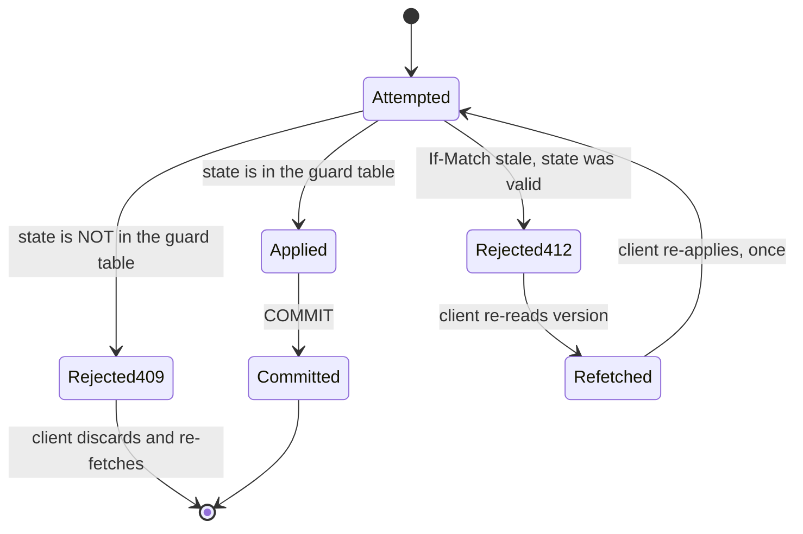

# QuickDrop - API Contract

Status: pre-implementation, planning only.
Scope: route map, request and response shapes, error envelope, conventions, authN/authZ, rate limits, OpenAPI 3.1.

| Document | Owns |
| --- | --- |
| [`00-product-brief.md`](./00-product-brief.md) | Scope and personas behind these routes |
| [`02-architecture.md`](./02-architecture.md) | Containers, flows, the dispatch algorithm, the event catalogue, `OQ-1` to `OQ-11` |
| [`03-data-model.md`](./03-data-model.md) | Schemas, enums, state machines, pricing, ledger, and the field-name source of truth |
| [`08-testing-strategy.md`](./08-testing-strategy.md) | Contract testing and end-to-end coverage of these routes |

Transport rules, in full:

- Base path `/api/v1`. JSON in, JSON out, UTF-8. No XML, no SOAP, no form encoding except at the Stripe webhook.
- The API service is Hono on `@hono/node-server` ([Hono](https://hono.dev/)).
- Timestamps are RFC 3339 UTC with a `Z` suffix: `2026-09-14T08:31:07.412Z`.
- Money fields are JSON **integers** in minor units, named `*_minor`, with a sibling `currency` string. Never floats, never strings ([see the rounding rule in `03-data-model.md`](./03-data-model.md#61-fee-components)).
- Coordinates are `[lng, lat]` in a two-element array, matching GeoJSON axis order, because the consumer is MapLibre ([MapLibre](https://maplibre.org/)). `lat` alone is never accepted.
- `id` fields are UUIDv4 strings. Human-facing references are `public_ref`, for example `QD-7F3K9Q`.
- `null` and "absent" are distinct. A field absent from a request means "leave unchanged"; an explicit `null` means "clear it". Documented per field.
- Field names in JSON are `snake_case` and match the database columns exactly, so a payload is directly usable as an event's `data` jsonb. No aliasing layer.

---

## 1. Route map

### 1.1 Customer (`role = customer`)

| Method | Path | Purpose |
| --- | --- | --- |
| `POST` | `/api/v1/quotes` | Price a pickup and drop-off. Creates a `quotes` row with a 10-minute expiry |
| `GET` | `/api/v1/quotes/{quote_id}` | Re-read a quote |
| `POST` | `/api/v1/shipments` | Confirm a quote into a shipment in `awaiting_payment` |
| `GET` | `/api/v1/shipments` | List own shipments, cursor-paginated |
| `GET` | `/api/v1/shipments/{shipment_id}` | Shipment detail |
| `POST` | `/api/v1/shipments/{shipment_id}/payment-intent` | Create or recreate the Stripe PaymentIntent. Idempotent per attempt |
| `POST` | `/api/v1/shipments/{shipment_id}/cancel` | Cancel before pickup |
| `POST` | `/api/v1/shipments/{shipment_id}/tips` | Add a tip after delivery |
| `GET` | `/api/v1/shipments/{shipment_id}/tracking` | Polling fallback for the live tracking snapshot |
| `GET` | `/api/v1/shipments/{shipment_id}/events` | The customer's own view of the audit trail |
| `POST` | `/api/v1/shipments/{shipment_id}/ratings` | Rate the courier |
| `POST` | `/api/v1/shipments/{shipment_id}/disputes` | Open a dispute |
| `GET` | `/api/v1/shipments/{shipment_id}/disputes` | List own disputes |
| `GET` | `/api/v1/shipments/{shipment_id}/receipt` | The priced receipt, from `quotes` plus the ledger |
| `GET` | `/api/v1/addresses` | List saved addresses |
| `POST` | `/api/v1/addresses` | Create an address |
| `PATCH` | `/api/v1/addresses/{address_id}` | Update an address. `If-Match` required |
| `DELETE` | `/api/v1/addresses/{address_id}` | Soft-delete an address |
| `POST` | `/api/v1/geocode` | Reverse and forward geocode proxy. Abuses a rate limit to protect the upstream |
| `POST` | `/api/v1/media/uploads` | Mint a signed upload URL for a proof photo |
| `GET` | `/api/v1/notifications` | Notification inbox |
| `POST` | `/api/v1/notifications/{notification_id}/read` | Mark read |
| `GET` | `/api/v1/app/version` | PWA and service worker version handshake |

### 1.2 Courier (`role = courier`)

| Method | Path | Purpose |
| --- | --- | --- |
| `GET` | `/api/v1/courier/profile` | Own profile and verification checklist |
| `PATCH` | `/api/v1/courier/profile` | Update own profile. `If-Match` required |
| `POST` | `/api/v1/courier/documents` | Submit a KYC document via a signed upload |
| `GET` | `/api/v1/courier/documents` | Own document list and states |
| `GET` | `/api/v1/courier/vehicles` | Own vehicles |
| `POST` | `/api/v1/courier/vehicles` | Add a vehicle |
| `PATCH` | `/api/v1/courier/vehicles/{vehicle_id}` | Update a vehicle. `If-Match` |
| `POST` | `/api/v1/courier/connect/onboarding` | Create or resume the Stripe Connect onboarding link |
| `PUT` | `/api/v1/courier/availability` | Set `available` or `offline`. `If-Match` required |
| `GET` | `/api/v1/courier/offers` | Polling fallback for open offers. The WebSocket is primary |
| `POST` | `/api/v1/courier/offers/{offer_id}/accept` | Accept an offer. `If-Match` required |
| `POST` | `/api/v1/courier/offers/{offer_id}/decline` | Decline an offer |
| `GET` | `/api/v1/courier/shipments/active` | The courier's current shipment, or the next one |
| `GET` | `/api/v1/courier/shipments/{shipment_id}` | Assignment detail with courier-visible fields only |
| `POST` | `/api/v1/courier/shipments/{shipment_id}/arrive-pickup` | `assigned` to `arrived_at_pickup` |
| `POST` | `/api/v1/courier/shipments/{shipment_id}/pickup` | `arrived_at_pickup` to `picked_up`. Triggers capture |
| `POST` | `/api/v1/courier/shipments/{shipment_id}/arrive-dropoff` | `in_transit` to `arrived_at_dropoff` |
| `POST` | `/api/v1/courier/shipments/{shipment_id}/deliver` | `arrived_at_dropoff` to `delivered`. Settles money |
| `POST` | `/api/v1/courier/shipments/{shipment_id}/fail` | Report a delivery failure |
| `POST` | `/api/v1/courier/shipments/{shipment_id}/return` | Report return to sender |
| `POST` | `/api/v1/courier/positions` | HTTP fallback for position batches when the WebSocket is down |
| `GET` | `/api/v1/courier/earnings` | Earnings summary over a date range |
| `GET` | `/api/v1/courier/earnings/entries` | Per-delivery earnings lines, cursor-paginated |
| `GET` | `/api/v1/courier/payouts` | Payout history |
| `POST` | `/api/v1/courier/payouts/{payout_id}/request` | Request an off-cycle payout of the accrued balance |
| `POST` | `/api/v1/realtime/token` | Mint the short-lived service worker and WebSocket token |

### 1.3 Ops (`role = ops` or `admin`)

| Method | Path | Purpose |
| --- | --- | --- |
| `GET` | `/api/v1/ops/shipments` | Filterable, sortable shipment list |
| `GET` | `/api/v1/ops/shipments/{shipment_id}` | Full detail including the audit trail and the full journal |
| `POST` | `/api/v1/ops/shipments/{shipment_id}/force-assign` | Assign a courier, bypassing offers |
| `POST` | `/api/v1/ops/shipments/{shipment_id}/cancel` | Cancel on a customer's behalf |
| `POST` | `/api/v1/ops/shipments/{shipment_id}/redispatch` | Restart the escalation ladder from round 1 |
| `GET` | `/api/v1/ops/dispatch-board` | Live board: open shipments, candidates, stuck shipments |
| `GET` | `/api/v1/ops/couriers` | Courier list with live state and position |
| `GET` | `/api/v1/ops/couriers/{courier_id}` | Courier detail: documents, earnings, ratings, history |
| `POST` | `/api/v1/ops/couriers/{courier_id}/suspend` | Suspend, with reason and duration |
| `POST` | `/api/v1/ops/couriers/{courier_id}/verify` | Approve or reject a KYC document |
| `POST` | `/api/v1/ops/couriers/{courier_id}/reset-metrics` | Clear a false GPS-spoofing or decline-rate fraud flag |
| `GET` | `/api/v1/ops/ledger/accounts` | Chart of accounts with current balances |
| `GET` | `/api/v1/ops/ledger/accounts/{account_code}/statement` | Account statement over a period |
| `GET` | `/api/v1/ops/ledger/transactions` | Transaction search with filters |
| `POST` | `/api/v1/ops/ledger/transactions/{transaction_id}/reverse` | Post a reversing entry. Never updates |
| `GET` | `/api/v1/ops/reconciliation/stripe` | Three-way reconciliation report |
| `GET` | `/api/v1/ops/disputes` | Dispute queue, SLA-sorted |
| `GET` | `/api/v1/ops/disputes/{dispute_id}` | Dispute detail with evidence |
| `POST` | `/api/v1/ops/disputes/{dispute_id}/resolve` | Resolve with a refund and a payout adjustment |
| `GET` | `/api/v1/ops/payouts` | Payout batch view, including failed payouts |
| `POST` | `/api/v1/ops/payouts/{payout_id}/retry` | Retry a failed payout |
| `GET` | `/api/v1/ops/service-zones` | Zones and their geometry |
| `PUT` | `/api/v1/ops/service-zones/{zone_id}` | Update a zone or its pricing. `If-Match` required |
| `GET` | `/api/v1/ops/surge-rules` | Surge rules |
| `PUT` | `/api/v1/ops/surge-rules/{rule_id}` | Update a surge rule. `If-Match` required |
| `POST` | `/api/v1/ops/surge-rules/{rule_id}/preview` | Preview the surge multipliers a rule would produce |
| `GET` | `/api/v1/ops/promotions` | Promotions and redemption counts |
| `POST` | `/api/v1/ops/promotions` | Create a promotion |
| `GET` | `/api/v1/ops/audit-log` | Search the privileged action log |
| `POST` | `/api/v1/ops/notifications/broadcast` | Send a notification to a user cohort |

### 1.4 Realtime

| Method | Path | Purpose |
| --- | --- | --- |
| `GET` | `/api/v1/stream/shipments/{shipment_id}` | **SSE fallback** for customer and ops tracking |
| `GET` | `/api/v1/stream/offers` | **SSE fallback** for courier offers |
| `WS` | `/api/v1/ws/courier` | **Courier upstream.** Position batches, presence, inbound offers |
| `WS` | `/api/v1/ws/shipments/{shipment_id}` | **Customer and ops downstream.** Tracking frames and state changes |
| `WS` | `/api/v1/ws/ops` | **Ops downstream.** Dispatch board and alert stream |

The WebSocket protocol is specified in Section 8. Both transports are supported for the same logical streams, and the client prefers WebSocket, falls back to SSE, then to polling. Polling endpoints are the REST list and tracking routes above; they are first-class and fully supported, not a degraded path.

### 1.5 Webhooks

| Method | Path | Purpose |
| --- | --- | --- |
| `POST` | `/api/v1/webhooks/stripe` | Stripe event intake. Raw body, signature verified, at-least-once |
| `POST` | `/api/v1/webhooks/routing` | Routing engine callback for an async matrix or traffic query |
| `POST` | `/api/v1/webhooks/push` | Push provider delivery receipt. Best-effort; push gives no receipt on iOS |

Webhook routes bypass session auth and use their own verification: an HMAC signature for Stripe, a shared secret for the others. They are exempt from CSRF checks because they carry no cookie.

### 1.6 Public and unauthenticated

| Method | Path | Purpose |
| --- | --- | --- |
| `POST` | `/api/v1/auth/{provider}` | Better Auth sign-up, sign-in, OTP verification, sign-out. Better Auth's own handlers ([Better Auth](https://www.better-auth.com/docs)) |
| `GET` | `/api/v1/auth/session` | Current session and effective roles |
| `GET` | `/api/v1/healthz` | Liveness. No dependencies |
| `GET` | `/api/v1/readyz` | Readiness. Checks database, Redis and Stripe key presence |

---

## 2. Endpoint shapes

Fifteen endpoints that define the contract. Every other route follows the same conventions.

### 2.1 `POST /api/v1/quotes`

```http
POST /api/v1/quotes HTTP/1.1
Content-Type: application/json
Cookie: __Host-qd.session_token=...
X-Request-Id: req_01JB8Z2K9F4Q7M3N6P0R2S5T7V
Idempotency-Key: ike_01JB8Z2K9F4Q7M3N6P0R2S5T7W

{
  "pickup": {
    "address_id": "9c1f6a2e-1b4d-4c7a-9f10-2b6e5d3a7c81",
    "contact_name": "Dana Whitfield",
    "contact_phone_e164": "+15551230001"
  },
  "dropoff": {
    "address_id": "3d8b2f14-77a5-4e19-8c02-51a9d6e4b3f2",
    "contact_name": "Marcus Lee",
    "contact_phone_e164": "+15551230002"
  },
  "parcel": {
    "weight_kg": 3.4,
    "length_cm": 40,
    "width_cm": 30,
    "height_cm": 20,
    "quantity": 1
  },
  "special_flags": ["fragile"]
}
```

`201 Created`

```json
{
  "data": {
    "quote_id": "7a2e5c9b-4d18-4f03-b7a6-0e2c9f1d5b44",
    "state": "quoted",
    "currency": "USD",
    "route_distance_m": 4200,
    "route_duration_s": 968,
    "pricing": {
      "base_fare_minor": 299,
      "distance_minor": 425,
      "weight_minor": 100,
      "volume_minor": 45,
      "zone_minor": 75,
      "toll_minor": 0,
      "accessorial_minor": 100,
      "surgeable_subtotal_minor": 1044,
      "surge_multiplier_bp": 12500,
      "surge_minor": 261,
      "surged_subtotal_minor": 1305,
      "discount_minor": 150,
      "discount_code": "WELCOME5",
      "tax_rate_bp": 887,
      "tax_minor": 102,
      "total_minor": 1257,
      "tip_minor": 0
    },
    "courier_delivery_earnings_minor": 1109,
    "platform_fee_minor": 196,
    "pricing_version": 1,
    "service_zone": { "id": "...", "code": "ZONE_2_EAST", "name": "East Side" },
    "estimated_pickup_at": "2026-09-14T08:41:00.000Z",
    "estimated_delivery_at": "2026-09-14T09:12:00.000Z",
    "expires_at": "2026-09-14T08:41:07.412Z"
  },
  "meta": { "request_id": "req_01JB8Z2K9F4Q7M3N6P0R2S5T7V" }
}
```

Notes: `estimated_pickup_at` is computed as now plus the current P50 time-to-assignment for the zone plus the P50 pickup ETA. It is an estimate, not a promise, and the UI must label it as such. `volume_dm3` is derived server-side from the three dimensions, never supplied by the client, so a client cannot under-declare volume to pay less.

**Money naming.** `courier_delivery_earnings_minor` is `surged_subtotal_minor` less `platform_fee_minor`: 1305 − 196 = **1109**. It is net of the platform fee and excludes tip, which is zero at quote time and cannot be quoted before the customer chooses it. Deadhead is not quoted, because it depends on which courier is matched. The same three numbers appear in [`03-data-model.md`](./03-data-model.md#62-worked-example) and in the journal in [`03-data-model.md`](./03-data-model.md#74-balanced-journal-entry-for-one-delivery). A courier-facing field is never named `courier_payout_minor`, because "payout" means a Stripe transfer, which has not happened yet.

### 2.2 `POST /api/v1/shipments`

```http
POST /api/v1/shipments HTTP/1.1
Content-Type: application/json
Cookie: __Host-qd.session_token=...
Idempotency-Key: ike_01JB8Z2K9F4Q7M3N6P0R2S5T7X

{ "quote_id": "7a2e5c9b-4d18-4f03-b7a6-0e2c9f1d5b44" }
```

`201 Created`

```json
{
  "data": {
    "id": "e91a7c34-5f2b-4d68-a7c9-8b03f1e6d2a5",
    "public_ref": "QD-7F3K9Q",
    "state": "awaiting_payment",
    "version": 1,
    "currency": "USD",
    "quoted_total_minor": 1257,
    "discount_minor": 150,
    "tax_minor": 102,
    "tip_minor": 0,
    "charged_total_minor": 0,
    "refunded_total_minor": 0,
    "payment_required": {
      "required": true,
      "payment_id": "b7d2e5a1-3c68-4f19-9a2b-6c8e0d5f4b71",
      "state": "requires_payment_method",
      "amount_minor": 1257,
      "capture_method": "manual",
      "client_secret": "pi_3Ptest_01JB8Z2K9F4Q7M3N6P0R2S5T7V_secret_doNotLog",
      "accepted_payment_methods": ["card"]
    },
    "stops": [
      { "sequence": 1, "role": "pickup", "geocode_label": "Ferry Building, San Francisco, CA",
        "location": [-122.393743, 37.795497], "completed_at": null, "outcome": null },
      { "sequence": 2, "role": "dropoff", "geocode_label": "1 Ferry Building Suite 12, San Francisco, CA",
        "location": [-122.394021, 37.792881], "completed_at": null, "outcome": null }
    ],
    "parcel": { "weight_kg": 3.4, "volume_dm3": 24.0, "quantity": 1, "special_flags": ["fragile"] },
    "dispatch": { "round": 0, "deadline_at": null },
    "eta": { "pickup_at": null, "delivery_at": null, "computed_at": null },
    "created_at": "2026-09-14T08:31:07.412Z"
  },
  "meta": { "request_id": "req_01JB8Z2K9F4Q7M3N6P0R2S5T7X" }
}
```

Notes: `payment_intent` and `client_secret` are created in the same request, so the client gets one round trip instead of two. The PaymentIntent uses `capture_method: 'manual'`: authorize now, capture at pickup ([PaymentIntents](https://docs.stripe.com/payments/payment-intents)). `capture_method` is in the response so the client can verify it rather than trust the endpoint name.

### 2.3 `POST /api/v1/shipments/{shipment_id}/payment-intent`

```http
POST /api/v1/shipments/e91a7c34-5f2b-4d68-a7c9-8b03f1e6d2a5/payment-intent HTTP/1.1
Idempotency-Key: ike_01JB8Z2K9F4Q7M3N6P0R2S5T8A

{ "payment_method_id": "pm_1Ptest2eZvKYlo2C" }
```

`200 OK`

```json
{
  "data": {
    "payment_id": "b7d2e5a1-3c68-4f19-9a2b-6c8e0d5f4b71",
    "attempt_no": 1,
    "state": "requires_confirmation",
    "payment_intent_id": "pi_3Ptest2eZvKYlo2C",
    "client_secret": "pi_3Ptest2eZvKYlo2C_secret_rotated",
    "amount_minor": 1257,
    "tip_minor": 0,
    "currency": "USD",
    "capture_method": "manual",
    "accepted_payment_methods": ["card"],
    "capture_at": "on_pickup"
  },
  "meta": { "request_id": "req_01JB8Z2K9F4Q7M3N6P0R2S5T8A" }
}
```

Called again after a decline with a new `Idempotency-Key`, it creates `attempt_no = 2` and returns `200` with the new PaymentIntent. Calling it with the **same** `Idempotency-Key` returns the stored response verbatim and creates nothing.

#### Confirming and paying

The last leg of booking is deliberately **not** a QuickDrop endpoint. Card data goes from the browser straight to Stripe, and QuickDrop never sees a PAN ([Stripe.js](https://docs.stripe.com/js/payments_element)). The client calls `stripe.confirmPayment` with the `client_secret` from 2.2 or 2.3 and its own Elements instance; Stripe then tells **us** what happened over the webhook in 2.14. The client may also poll `GET /shipments/{id}` to observe the resulting transition, but it must treat that as a read, never as the confirmation of record.

```ts
// Browser side. No QuickDrop request, no PAN through our servers.
const { error } = await stripe.confirmPayment({
  elements,
  clientSecret: paymentRequired.client_secret,  // from 2.2 or 2.3
  confirmParams: { return_url: `${location.origin}/shipments/${shipmentId}` },
  redirect: 'if_required',
});
if (error) {
  // Card declined or validation failed. Show the message, then call 2.3 again
  // with a new Idempotency-Key to mint attempt_no 2.
}
// On success: do NOT optimistically set the shipment to 'assigned'. The
// shipment advances to 'matched' only when our webhook handler has posted the
// payment.authorized state transition.
```

Why the webhook and not a client call-back is authoritative: a client can close the tab between confirmation and our notification, and a client that reports its own success is a client that can lie. The webhook is Stripe's signed statement, and [`02-architecture.md`](./02-architecture.md#4-golden-path-request-and-event-flow) treats the `payment.authorized` event as the only thing that moves the shipment off `awaiting_payment`.

Failure handling, all of it server-side:

| Situation | Who resolves it | Result |
| --- | --- | --- |
| Card declined at confirm | Stripe sends `payment_intent.payment_failed` | `payments.attempt_no` increments, `payment_intents_attempts` records the decline code, shipment stays `awaiting_payment`, and the client may retry via 2.3 |
| 3DS challenge abandoned | Stripe sends `payment_intent.payment_failed` with `authentication_required` | Same as above, and the client must start a new PaymentIntent rather than reuse the one whose challenge expired |
| Webhook arrives after the client already saw success | Stripe retry, or a duplicate | Idempotent. `payment_events` unique index on `stripe_event_id` returns the stored outcome, no second transition |
| Webhook never arrives | Nothing. We do not poll Stripe from the request path | Ops reconciliation (`GET /ops/reconciliation/stripe`) surfaces it; the shipment stays `awaiting_payment` and expires by the escalation ladder rather than silently hanging forever |

### 2.4 `POST /api/v1/shipments/{shipment_id}/cancel`

```http
POST /api/v1/shipments/e91a7c34-5f2b-4d68-a7c9-8b03f1e6d2a5/cancel HTTP/1.1
Content-Type: application/json
If-Match: "3"
Idempotency-Key: ike_01JB8Z2K9F4Q7M3N6P0R2S5T8B

{ "reason_code": "no_longer_needed" }
```

`200 OK`

```json
{
  "data": {
    "id": "e91a7c34-5f2b-4d68-a7c9-8b03f1e6d2a5",
    "state": "cancelled",
    "version": 4,
    "cancel_reason_code": "no_longer_needed",
    "cancelled_at": "2026-09-14T08:44:19.882Z",
    "payment": {
      "payment_id": "b7d2e5a1-3c68-4f19-9a2b-6c8e0d5f4b71",
      "state": "canceled",
      "authorized_minor": 0,
      "captured_minor": 0,
      "refunded_minor": 0
    },
    "refund": {
      "required": false,
      "reason": "authorization_released",
      "settles_at": null
    },
    "courier_released": { "courier_id": "4e8a1b7c-2d59-4f36-8a14-7c9b0e3d6f28", "assignment_revoked": true }
  },
  "meta": { "request_id": "req_01JB8Z2K9F4Q7M3N6P0R2S5T8B" }
}
```

Two shapes of cancellation result, and the client must handle both: before capture the `payment` state becomes `canceled` and `refund.required` is `false`; after capture it becomes `partially_refunded` or `refunded` with `refund.required = true` and a `settles_at`. A second cancel returns `409`.

### 2.5 `PUT /api/v1/courier/availability`

```http
PUT /api/v1/courier/availability HTTP/1.1
Content-Type: application/json
If-Match: "12"

{ "desired_state": "available", "reason_code": null }
```

`200 OK`

```json
{
  "data": {
    "courier_id": "4e8a1b7c-2d59-4f36-8a14-7c9b0e3d6f28",
    "state": "available",
    "version": 13,
    "available_since": "2026-09-14T08:45:02.115Z",
    "last_assigned_at": null,
    "constraints": {
      "documents_approved": true,
      "payouts_enabled": true,
      "vehicle_ok": true,
      "suspension_active": false,
      "daily_cap_reached": false
    },
    "eligible_for_dispatch": true
  },
  "meta": { "request_id": "req_01JB8Z2K9F4Q7M3N6P0R2S5T8C" }
}
```

`constraints` is always returned, even on success. On failure it explains exactly which gate is closed, which is the difference between a courier fixing the problem and a courier uninstalling the app. Setting `available` with `payouts_enabled = false` returns `409 courier.verification_incomplete` and the same `constraints` block.

### 2.6 `POST /api/v1/courier/offers/{offer_id}/accept`

```http
POST /api/v1/courier/offers/5e2a9c13-8b47-4d60-9f21-a0c4e7b3d916/accept HTTP/1.1
If-Match: "1"
Idempotency-Key: ike_01JB8Z2K9F4Q7M3N6P0R2S5T8D
```

`200 OK`

```json
{
  "data": {
    "offer_id": "5e2a9c13-8b47-4d60-9f21-a0c4e7b3d916",
    "state": "accepted",
    "responded_at": "2026-09-14T08:46:51.004Z",
    "ms_to_respond": 8420,
    "assignment": {
      "assignment_id": "c1f4a8d2-6b39-4e17-9d05-8a2b3c6e4f70",
      "state": "accepted",
      "assigned_at": "2026-09-14T08:46:51.004Z",
      "assigned_by": "courier_accept"
    },
    "shipment": {
      "id": "e91a7c34-5f2b-4d68-a7c9-8b03f1e6d2a5",
      "public_ref": "QD-7F3K9Q",
      "state": "assigned",
      "version": 6,
      "customer": { "first_name": "Dana", "contact_phone_e164": "+15551230001" },
      "stops": [
        {
          "sequence": 1, "role": "pickup",
          "recipient_name": "Dana Whitfield",
          "contact_phone_e164": "+15551230001",
          "line1": "1 Ferry Building",
          "line2": "Suite 12",
          "city": "San Francisco", "region": "CA", "postal_code": "94111",
          "geocode_label": "Ferry Building, San Francisco, CA",
          "location": [-122.393743, 37.795497],
          "access_notes": "Ask for Dana at the loading dock, ring twice",
          "delivery_instructions": null
        },
        {
          "sequence": 2, "role": "dropoff",
          "recipient_name": "Marcus Lee",
          "contact_phone_e164": "+15551230002",
          "line1": "1 Ferry Building", "line2": "Suite 12",
          "city": "San Francisco", "region": "CA", "postal_code": "94111",
          "geocode_label": "1 Ferry Building Suite 12, San Francisco, CA",
          "location": [-122.394021, 37.792881],
          "access_notes": null,
          "delivery_instructions": "Leave with reception if no answer"
        }
      ],
      "parcel": { "weight_kg": 3.4, "volume_dm3": 24.0, "quantity": 1, "special_flags": ["fragile"] },
      "payment": { "state": "authorized", "capture_at": "on_pickup", "tip_minor": 200 },
      "earnings": {
        "currency": "USD",
        "delivery_earnings_minor": 1109,
        "deadhead_minor": 85,
        "tip_minor": 200,
        "total_earnings_minor": 1394
      },
      "eta": {
        "pickup_at": "2026-09-14T08:55:00.000Z",
        "dropoff_at": "2026-09-14T09:02:00.000Z",
        "computed_at": "2026-09-14T08:46:51.004Z"
      },
      "route": {
        "geometry": { "format": "polyline6", "encoded": "..." },
        "distance_m": 520,
        "duration_s": 96
      },
      "special_instructions": null
    }
  },
  "meta": { "request_id": "req_01JB8Z2K9F4Q7M3N6P0R2S5T8D" }
}
```

This is the single most important response in the API. It is also the **first place full customer PII appears**, which is why it is behind an accepted assignment rather than behind the offer. An offer payload contains only the `public_ref`, the approximate pickup neighbourhood, the distance, the ETA and the earnings. If the offer expires, nothing sensitive was ever sent to that device.

### 2.7 `POST /api/v1/courier/shipments/{shipment_id}/pickup`

```http
POST /api/v1/courier/shipments/e91a7c34-5f2b-4d68-a7c9-8b03f1e6d2a5/pickup HTTP/1.1
Content-Type: application/json
If-Match: "7"
Idempotency-Key: ike_01JB8Z2K9F4Q7M3N6P0R2S5T8E

{
  "parcel_count": 1,
  "condition": "good",
  "photo_asset_ids": ["1f2e3d4c-5b6a-4798-8c1d-2e3f4a5b6c7d"],
  "geo": { "location": [-122.393701, 37.795512], "accuracy_m": 12.5 },
  "waited_s": 214,
  "notes": "Box was slightly crushed on one corner, customer declined to re-wrap"
}
```

`200 OK`

```json
{
  "data": {
    "id": "e91a7c34-5f2b-4d68-a7c9-8b03f1e6d2a5",
    "state": "picked_up",
    "version": 8,
    "stops": [
      { "sequence": 1, "role": "pickup", "completed_at": "2026-09-14T09:03:41.220Z", "waited_s": 214, "outcome": "completed" },
      { "sequence": 2, "role": "dropoff", "completed_at": null, "waited_s": null, "outcome": null }
    ],
    "payment": {
      "payment_id": "b7d2e5a1-3c68-4f19-9a2b-6c8e0d5f4b71",
      "state": "authorized",
      "capture_state": "pending",
      "capture_expected_at": "2026-09-14T09:03:42.000Z",
      "message": "Payment capture is in progress. Your earnings are secured."
    },
    "earnings": {
      "currency": "USD",
      "delivery_earnings_minor": 1109,
      "deadhead_minor": 85,
      "tip_minor": 200,
      "total_earnings_minor": 1394,
      "payout_state": "accruing"
    }
  },
  "meta": { "request_id": "req_01JB8Z2K9F4Q7M3N6P0R2S5T8E" }
}
```

The `payment.capture_state` field is the honest answer to the question every courier asks, and it is deliberately `pending` rather than `captured`, because capture happens asynchronously in a worker. The UI must say "in progress", not "paid". The tip is shown here because it is money the courier has earned, even though it has not been transferred yet.

### 2.8 `POST /api/v1/courier/shipments/{shipment_id}/deliver`

```http
POST /api/v1/courier/shipments/e91a7c34-5f2b-4d68-a7c9-8b03f1e6d2a5/deliver HTTP/1.1
Content-Type: application/json
If-Match: "9"
Idempotency-Key: ike_01JB8Z2K9F4Q7M3N6P0R2S5T8F

{
  "recipient_name": "M. Lee",
  "recipient_relation": "recipient",
  "signature_asset_id": "9a8b7c6d-5e4f-4321-a0b9-c8d7e6f5a4b3",
  "photo_asset_ids": ["2a3b4c5d-6e7f-4809-b1c2-d3e4f5a6b7c8"],
  "geo": { "location": [-122.394011, 37.792894], "accuracy_m": 9.0 },
  "waited_at_dropoff_s": 96,
  "delivery_duration_s": 1142,
  "notes": "Left with reception at desk, signed by M. Lee"
}
```

`200 OK`

```json
{
  "data": {
    "id": "e91a7c34-5f2b-4d68-a7c9-8b03f1e6d2a5",
    "state": "delivered",
    "version": 10,
    "public_ref": "QD-7F3K9Q",
    "stops": [
      { "sequence": 1, "role": "pickup", "completed_at": "2026-09-14T09:03:41.220Z", "waited_s": 214, "outcome": "completed" },
      { "sequence": 2, "role": "dropoff", "completed_at": "2026-09-14T09:22:43.901Z", "waited_s": 96, "outcome": "completed" }
    ],
    "proof": {
      "recipient_name": "M. Lee",
      "recipient_relation": "recipient",
      "signature_asset_id": "9a8b7c6d-5e4f-4321-a0b9-c8d7e6f5a4b3",
      "photo_asset_ids": ["2a3b4c5d-6e7f-4809-b1c2-d3e4f5a6b7c8"],
      "recorded_at": "2026-09-14T09:22:43.901Z"
    },
    "payment": {
      "payment_id": "b7d2e5a1-3c68-4f19-9a2b-6c8e0d5f4b71",
      "state": "captured",
      "captured_minor": 1457,
      "currency": "USD"
    },
    "earnings": {
      "currency": "USD",
      "delivery_earnings_minor": 1109,
      "deadhead_minor": 85,
      "tip_minor": 200,
      "total_earnings_minor": 1394,
      "payout_id": "5f8d2c1a-9b4e-4d37-a6c5-0e1f2a3b4c5d",
      "payout_state": "pending",
      "next_payout_at": "2026-09-16T00:05:00.000Z"
    },
    "rating_request": { "requested": true, "ratee_id": "4e8a1b7c-2d59-4f36-8a14-7c9b0e3d6f28", "ratee_role": "courier" },
    "dispute_window_ends_at": "2026-09-17T09:22:43.901Z"
  },
  "meta": { "request_id": "req_01JB8Z2K9F4Q7M3N6P0R2S5T8F" }
}
```

Proof-of-delivery rules the server enforces with Zod, all of which produce `422 validation_failed` with `errors[].path`:

- `recipient_name` is required, 1 to 120 characters.
- `signature_asset_id` is **required when** `parcel.special_flags` contains `signature_required`. Below that it is optional. There is deliberately no declared-value threshold driving this rule: an insurance-value field invites customers to overstate it to trigger a requirement, and the value is not verified anyway. The customer's explicit `signature_required` flag is the honest signal.
- At least one of `signature_asset_id` or `photo_asset_ids` is required, always.
- `photo_asset_ids` has 1 to 5 entries.
- Every `*_asset_id` must resolve to an `assets` row owned by the caller, of a permitted kind, not deleted, and not already attached to another shipment.
- `geo.location` must be within 250 m of the drop-off `shipment_stops.geog`. Beyond that it is `422 geo_out_of_range`, not a silent accept, because it is either a spoofed delivery or a wrong address and both need a human.
- `delivery_duration_s` and `waited_at_dropoff_s` are ignored if supplied and recomputed server-side. Accepting a client-supplied duration would let a courier inflate their own metrics.

### 2.9 `GET /api/v1/shipments/{shipment_id}/tracking`

```http
GET /api/v1/shipments/e91a7c34-5f2b-4d68-a7c9-8b03f1e6d2a5/tracking?fields=state,eta,courier,position,route&stale_after_s=120
```

`200 OK`

```json
{
  "data": {
    "shipment_id": "e91a7c34-5f2b-4d68-a7c9-8b03f1e6d2a5",
    "public_ref": "QD-7F3K9Q",
    "state": "in_transit",
    "version": 9,
    "courier": {
      "first_name": "Alex",
      "vehicle_type": "ebike",
      "rating_avg": 4.82,
      "rating_count": 611,
      "assigned_at": "2026-09-14T08:46:51.004Z"
    },
    "position": {
      "location": [-122.390512, 37.793881],
      "heading_deg": 74,
      "speed_mps": 4.1,
      "accuracy_m": 11.5,
      "recorded_at": "2026-09-14T09:14:22.118Z",
      "age_s": 3,
      "stale": false
    },
    "route": {
      "geometry": { "format": "polyline6", "encoded": "..." },
      "distance_m": 1840,
      "duration_s": 402,
      "computed_at": "2026-09-14T09:13:58.000Z"
    },
    "eta": {
      "pickup_at": "2026-09-14T09:03:41.220Z",
      "dropoff_at": "2026-09-14T09:22:00.000Z",
      "seconds_to_dropoff": 458,
      "confidence": 0.72,
      "computed_at": "2026-09-14T09:14:22.118Z"
    },
    "next_stop": { "sequence": 2, "role": "dropoff", "geocode_label": "1 Ferry Building Suite 12" },
    "tracking_frozen": false,
    "transport_suggestion": "websocket",
    "poll_after_s": null
  },
  "meta": { "request_id": "req_01JB8Z2K9F4Q7M3N6P0R2S5T8G" }
}
```

`transport_suggestion` is how the server tells the client how to behave next, and `poll_after_s` is the fallback cadence. On a healthy WebSocket both are `null`. When the courier has gone silent, `position.stale` is `true`, `age_s` exceeds `stale_after_s`, `tracking_frozen` becomes `true`, and `position.location` is the last known point with `stale: true` so the UI can render it differently rather than pretending it is live. A frozen shipment returns `poll_after_s: 15` so the client checks for recovery without hammering the API.

### 2.10 `GET /api/v1/courier/earnings`

```http
GET /api/v1/courier/earnings?from=2026-09-01&to=2026-09-30&timezone=America%2FLos_Angeles
```

`200 OK`

```json
{
  "data": {
    "courier_id": "4e8a1b7c-2d59-4f36-8a14-7c9b0e3d6f28",
    "currency": "USD",
    "period": { "from": "2026-09-01", "to": "2026-09-30", "timezone": "America/Los_Angeles" },
    "totals": {
      "gross_earnings_minor": 1284000,
      "delivery_earnings_minor": 984600,
      "deadhead_minor": 142800,
      "bonus_minor": 42000,
      "compensation_minor": 18600,
      "adjustment_minor": -24000,
      "fees_minor": -42500,
      "net_earnings_minor": 1275500,
      "tip_minor": 98600,
      "deliveries_completed": 214,
      "active_hours": 148.5
    },
    "payouts": {
      "period_end": "2026-09-15T07:00:00.000Z",
      "accrued_unpaid_minor": 412300,
      "lifetime_paid_minor": 18743000,
      "next_scheduled_at": "2026-09-16T00:05:00.000Z",
      "payout_minimum_minor": 2500,
      "payout_earns_at_minor": 50000
    },
    "performance": {
      "acceptance_rate": 0.918,
      "on_time_pickup_rate": 0.884,
      "on_time_delivery_rate": 0.961,
      "avg_pickup_wait_s": 268,
      "avg_rating": 4.82,
      "starvation_minutes_at_earnings_peak": null
    }
  },
  "meta": { "request_id": "req_01JB8Z2K9F4Q7M3N6P0R2S5T8H" }
}
```

`adjustment_minor` is negative for dispute clawbacks and negative-payable recovery, and the UI must show it as a red line, not a silent reduction. Couriers who cannot see a deduction will treat it as a bug.

### 2.11 `GET /api/v1/courier/payouts`

```http
GET /api/v1/courier/payouts?limit=10&sort=-period_end
```

`200 OK`

```json
{
  "data": [
    {
      "payout_id": "5f8d2c1a-9b4e-4d37-a6c5-0e1f2a3b4c5d",
      "state": "paid",
      "currency": "USD",
      "gross_earnings_minor": 684200,
      "deadhead_minor": 71200,
      "bonus_minor": 15000,
      "compensation_minor": 4200,
      "adjustment_minor": 0,
      "fee_minor": -12840,
      "net_minor": 761760,
      "period_start": "2026-09-09T07:00:00.000Z",
      "period_end": "2026-09-15T07:00:00.000Z",
      "bank_last4": "4417",
      "arrival_date": "2026-09-16",
      "paid_at": "2026-09-16T08:14:52.330Z",
      "attempt_count": 1,
      "deliveries_included": 118
    },
    {
      "payout_id": "1d6f8a2b-3c4e-4f59-8a7b-6c5d4e3f2a1b",
      "state": "failed",
      "currency": "USD",
      "gross_earnings_minor": 592400,
      "deadhead_minor": 58900,
      "bonus_minor": 0,
      "compensation_minor": 1200,
      "adjustment_minor": -9000,
      "fee_minor": -10900,
      "net_minor": 640600,
      "period_start": "2026-09-02T07:00:00.000Z",
      "period_end": "2026-09-08T07:00:00.000Z",
      "bank_last4": "4417",
      "arrival_date": null,
      "paid_at": null,
      "attempt_count": 3,
      "failure_code": "account_closed",
      "failure_message": "The bank account on file is closed. Update your payout details.",
      "deliveries_included": 104
    }
  ],
  "page": {
    "limit": 10,
    "next_cursor": "eyJrIjpbMTc1NzMwNzIwMDAwMDAsIjVkOGQyYzFhIl0sInYiOjF9",
    "has_more": false
  },
  "meta": { "request_id": "req_01JB8Z2K9F4Q7M3N6P0R2S5T8I" }
}
```

A failed payout carries `failure_code`, `failure_message` and `attempt_count` inline so the courier sees the actionable reason on the first load rather than having to open a support ticket.

### 2.12 `GET /api/v1/ops/shipments` and `POST /api/v1/ops/shipments/{id}/force-assign`

```http
GET /api/v1/ops/shipments?state=matched,matching,assigned&zone=ZONE_2_EAST&stuck_minutes=5&sort=dispatch_deadline_at&q=QD-7F3K9Q&fields=id,public_ref,state,customer,assigned_courier,eta,dispatch,payment&limit=50
```

`200 OK`

```json
{
  "data": [
    {
      "id": "e91a7c34-5f2b-4d68-a7c9-8b03f1e6d2a5",
      "public_ref": "QD-7F3K9Q",
      "state": "matched",
      "customer": { "id": "0f2a5c8e-7b1d-4a39-8e6c-2d4b1a9f3e77", "display_name": "Dana W." },
      "assigned_courier": null,
      "dispatch": {
        "round": 2,
        "candidate_count": 0,
        "started_at": "2026-09-14T08:31:12.004Z",
        "deadline_at": "2026-09-14T08:46:12.004Z",
        "elapsed_s": 421,
        "next_round_in_s": 12,
        "score_version": 1
      },
      "eta": { "dropoff_at": "2026-09-14T09:12:00.000Z", "computed_at": "2026-09-14T08:31:07.412Z" },
      "payment": { "state": "authorized", "amount_minor": 1257, "captured_minor": 0 }
    }
  ],
  "page": { "limit": 50, "next_cursor": "eyJrIjpbMTc1NzMwNzIwMDAwMDAsImU5MWE3YzM0Il0sInYiOjF9", "has_more": true },
  "facets": {
    "state": { "matched": 4, "matching": 1, "assigned": 11, "in_transit": 27 },
    "payment_state": { "authorized": 16, "captured": 27 }
  },
  "meta": { "request_id": "req_01JB8Z2K9F4Q7M3N6P0R2S5T8J" }
}
```

```http
POST /api/v1/ops/shipments/e91a7c34-5f2b-4d68-a7c9-8b03f1e6d2a5/force-assign HTTP/1.1
Content-Type: application/json
If-Match: "4"
Idempotency-Key: ike_01JB8Z2K9F4Q7M3N6P0R2S5T8K

{
  "courier_id": "4e8a1b7c-2d59-4f36-8a14-7c9b0e3d6f28",
  "reason_code": "ops_override",
  "notify_courier": true,
  "operator_note": "Called the courier directly, they are 4 minutes away and heading to the pickup"
}
```

`200 OK`

```json
{
  "data": {
    "shipment_id": "e91a7c34-5f2b-4d68-a7c9-8b03f1e6d2a5",
    "state": "assigned",
    "version": 5,
    "assignment": {
      "assignment_id": "f2c9b7e4-1a3d-4e58-9c6b-7d8e5f4a3b2c",
      "state": "accepted",
      "assigned_by": "ops_force",
      "operator_id": "5b1a8c3d-4e2f-4a67-9b8c-0d1e2f3a4b5c",
      "assigned_at": "2026-09-14T08:38:19.774Z"
    },
    "bypassed_offers": 3,
    "superseded_offer_ids": ["5e2a9c13-8b47-4d60-9f21-a0c4e7b3d916", "7f3b1d2e-4a59-4c68-8d0f-1a2b3c4d5e6f", "8c4d2e3f-5b6a-4d79-9e1f-2b3c4d5e6f70"],
    "warnings": [
      "courier is 8.2 km from pickup, outside the 5 km round-2 radius",
      "courier declined 2 offers for this shipment in the last 10 minutes"
    ]
  },
  "meta": { "request_id": "req_01JB8Z2K9F4Q7M3N6P0R2S5T8K" }
}
```

`warnings` is non-empty-but-not-blocking by design. Ops forcing an assignment outside the algorithm's own gates is legitimate and sometimes the only way to save a delivery, but it must be recorded as a deviation so the dispatch heuristics can be evaluated against it. A hard block would just push operators to cancel and rebook, which loses more.

### 2.13 `GET /api/v1/ops/dispatch-board`

```http
GET /api/v1/ops/dispatch-board?zone=ZONE_2_EAST
```

`200 OK`

```json
{
  "data": {
    "generated_at": "2026-09-14T08:39:02.118Z",
    "zone": { "id": "8b1a2c3d-4e5f-4a6b-8c7d-9e0f1a2b3c4d", "code": "ZONE_2_EAST" },
    "supply": {
      "available": 14,
      "offered": 3,
      "assigned_or_en_route": 27,
      "returning": 5,
      "offline": 62,
      "suspended": 3,
      "median_eta_to_pickup_s": 612,
      "coverage_gap_minutes": 4
    },
    "surge": { "multiplier_bp": 12500, "window_end": "2026-09-14T09:00:00.000Z", "active_couriers": 14, "open_shipments": 19 },
    "queues": {
      "awaiting_courier": [
        {
          "shipment_id": "e91a7c34-5f2b-4d68-a7c9-8b03f1e6d2a5",
          "public_ref": "QD-7F3K9Q",
          "state": "matched",
          "round": 2,
          "elapsed_s": 421,
          "deadline_at": "2026-09-14T08:46:12.004Z",
          "nearest_candidate_distance_m": null,
          "candidate_count": 0,
          "priority": "high",
          "flags": ["no_candidates_in_radius", "customer_waiting_7m"]
        },
        {
          "shipment_id": "a2b3c4d5-6e7f-4a8b-9c0d-1e2f3a4b5c6d",
          "public_ref": "QD-2M8P4L",
          "state": "matching",
          "round": 1,
          "elapsed_s": 8,
          "deadline_at": "2026-09-14T08:53:55.001Z",
          "nearest_candidate_distance_m": 1840,
          "candidate_count": 5,
          "priority": "normal",
          "flags": []
        }
      ],
      "stuck": [
        {
          "shipment_id": "f5e6d7c8-9a0b-4c1d-8e2f-3a4b5c6d7e8f",
          "public_ref": "QD-9K1T5R",
          "state": "assigned",
          "assigned_courier_id": "1a2b3c4d-5e6f-4a7b-8c9d-0e1f2a3b4c5d",
          "silent_for_s": 214,
          "flags": ["courier_offline", "over_15m_since_assignment"]
        }
      ],
      "stale_couriers": [
        { "courier_id": "2b3c4d5e-6f7a-4b8c-9d0e-1f2a3b4c5d6e", "state": "en_route_dropoff", "silent_for_s": 143, "shipment_id": "f5e6d7c8-9a0b-4c1d-8e2f-3a4b5c6d7e8f" }
      ],
      "payment_anomalies": [
        { "shipment_id": "3c4d5e6f-7a8b-4c9d-8e0f-1a2b3c4d5e6f", "state": "picked_up", "payment_state": "failed", "flags": ["payment_failed_after_pickup", "parcel_in_courier_possession"] }
      ],
      "disputes_due": [
        { "dispute_id": "d4e5f6a7-8b9c-4d0e-9f1a-2b3c4d5e6f70", "public_ref": "QD-4H6J8N", "sla_due_at": "2026-09-14T10:12:00.000Z", "age_s": 4820, "severity": "high" }
      ]
    }
  },
  "meta": { "request_id": "req_01JB8Z2K9F4Q7M3N6P0R2S5T8L" }
}
```

The board is the answer to "what is broken right now". Every queue is an exception list; healthy shipments are not on it. `coverage_gap_minutes` is the estimated minutes until the next courier becomes free, and it is the single most useful number for deciding whether to escalate.

### 2.14 `POST /api/v1/webhooks/stripe`

```http
POST /api/v1/webhooks/stripe HTTP/1.1
Content-Type: application/json
Stripe-Signature: t=1757837407,v1=5257a869e7ecbeda8ff8e38d4b4e8b8b0e2a1c0f5f8e7d6c5b4a39281706f5e4d3,v0=6ffbb59b9866b3a8f2d4c1e0a9b8c7d6e5f4a3b2c1d0e9f8a7b6c5d4e3f2a1b0c9d

{
  "id": "evt_1Ptest2eZvKYlo2C3d",
  "object": "event",
  "api_version": "<the version string Stripe sent; not asserted here>",
  "created": 1757837407,
  "livemode": true,
  "type": "payment_intent.succeeded",
  "data": {
    "object": {
      "id": "pi_3Ptest2eZvKYlo2C",
      "object": "payment_intent",
      "amount": 1457,
      "currency": "usd",
      "status": "succeeded",
      "capture_method": "manual",
      "latest_charge": "ch_3Ptest2eZvKYlo2C",
      "payment_method": "pm_1Ptest2eZvKYlo2C",
      "metadata": { "shipment_id": "e91a7c34-5f2b-4d68-a7c9-8b03f1e6d2a5", "payment_id": "b7d2e5a1-3c68-4f19-9a2b-6c8e0d5f4b71", "request_id": "req_01JB8Z2K9F4Q7M3N6P0R2S5T8E" }
    }
  }
}
```

`200 OK`

```json
{ "received": true, "duplicate": false, "event_id": "evt_1Ptest2eZvKYlo2C3d" }
```

Webhook handling contract, in full:

- **Signature verification before parsing.** The raw request body is required for `constructEvent` ([Stripe signature verification](https://docs.stripe.com/webhooks/signature)). The Hono route must use `c.req.text()` exactly once and never `c.req.json()`. A body-parsing middleware earlier in the chain breaks verification, so no body-parsing middleware applies to `/api/v1/webhooks/*`.
- **The signing secret is versioned.** `STRIPE_WEBHOOK_SECRET` for the current version plus `STRIPE_WEBHOOK_SECRET_PREVIOUS` retained for 30 days after each secret rotation, so events signed during a rotation are still accepted.
- **A tolerance of 300 seconds** on the `t=` timestamp, with the clock synced.
- **Respond `200` fast.** Dedupe by inserting into `payment_events` on the `stripe_event_id` unique index, then enqueue. Total handler time budget is 500 ms. Stripe retries on non-2xx and on timeout ([Stripe webhooks](https://docs.stripe.com/webhooks)).
- **A duplicate returns `200` with `duplicate: true`** and does nothing else. This is the normal case during a Stripe incident.
- **`livemode: true` is required** for a ledger posting. A `livemode: false` event in a live environment is logged and dropped, and raises an alert, because posting a test event to the real ledger is unrecoverable without manual surgery.
- **`api_version` is recorded, never asserted.** The pinned Stripe API version lives in one environment variable, and the incoming `api_version` is stored on `payment_events` and compared against that variable. A mismatch is accepted but alerts, which is how an unplanned Stripe upgrade announces itself before it breaks the mapping. The contract deliberately does not hard-code a version string here: pinning a literal in a document that outlives the spike is how a doc becomes a lie.
- **Unhandled `type` values return `200` and are ignored**, not `400`. Stripe adds event types without warning, and rejecting unknown types would build an outage out of a routine Stripe change.
- **Return `400` with the envelope** for a missing or invalid `Stripe-Signature` header. That is a genuine error and Stripe should not retry it.
- **Events handled:** `payment_intent.amount_capturable_updated`, `payment_intent.succeeded`, `payment_intent.payment_failed`, `payment_intent.canceled`, `charge.succeeded`, `charge.refunded`, `charge.dispute.created`, `charge.dispute.closed`, `transfer.created`, `transfer.failed`, `payout.paid`, `payout.failed`, `payout.canceled`, `account.updated`, `invoice.paid`, `invoice.payment_failed`, `customer.subscription.deleted`.

### 2.15 `POST /api/v1/courier/offers/{offer_id}/decline`

```http
POST /api/v1/courier/offers/5e2a9c13-8b47-4d60-9f21-a0c4e7b3d916/decline HTTP/1.1
Content-Type: application/json
Idempotency-Key: ike_01JB8Z2K9F4Q7M3N6P0R2S5T8M

{ "reason_code": "too_far" }
```

`200 OK`

```json
{
  "data": {
    "offer_id": "5e2a9c13-8b47-4d60-9f21-a0c4e7b3d916",
    "state": "declined",
    "responded_at": "2026-09-14T08:47:12.882Z",
    "ms_to_respond": 3110,
    "decline_reason_code": "too_far",
    "next_offer_expected_within_s": 25,
    "excluded_from_shipment_until": "2026-09-14T08:57:12.882Z"
  },
  "meta": { "request_id": "req_01JB8Z2K9F4Q7M3N6P0R2S5T8M" }
}
```

The response tells the courier what happens next, because a silent decline leaves them unsure whether the platform noticed. `excluded_from_shipment_until` reflects the 10-minute exclusion window in the dispatch query, and stating it up front is what stops a courier from tapping decline repeatedly to fish for better offers.

---

## 3. Error envelope

All errors use `application/problem+json`, the shape defined by RFC 9457 ([RFC 9457](https://www.rfc-editor.org/rfc/rfc9457)), extended with the QuickDrop-specific members below.

```json
{
  "type": "https://docs.quickdrop.example/errors/illegal_state_transition",
  "title": "Illegal state transition",
  "status": 409,
  "code": "shipment.illegal_transition",
  "detail": "Shipment e91a7c34-5f2b-4d68-a7c9-8b03f1e6d2a5 is in state 'cancelled'. The transition 'deliver' requires one of ['arrived_at_dropoff'].",
  "instance": "/api/v1/courier/shipments/e91a7c34-5f2b-4d68-a7c9-8b03f1e6d2a5/deliver",
  "request_id": "req_01JB8Z2K9F4Q7M3N6P0R2S5T8F",
  "timestamp": "2026-09-14T09:22:44.118Z",
  "errors": [
    {
      "path": "state",
      "code": "illegal_transition",
      "message": "current state 'cancelled' does not allow 'deliver'",
      "current": "cancelled",
      "attempted": "deliver"
    }
  ],
  "meta": {
    "allowed_transitions": ["disputed"],
    "current_version": 10,
    "resource": "shipment",
    "resource_id": "e91a7c34-5f2b-4d68-a7c9-8b03f1e6d2a5",
    "docs": "https://docs.quickdrop.example/api/errors/shipment.illegal_transition"
  }
}
```

Field semantics:

| Field | Required | Meaning |
| --- | --- | --- |
| `type` | yes | Stable URI identifying the error class, not the instance |
| `title` | yes | Short human summary. Does not change per occurrence |
| `status` | yes | Mirrors the HTTP status |
| `code` | yes | Machine-readable dotted code. **This is the field clients switch on.** Never parse `detail` |
| `detail` | yes | Human-readable, specific to this occurrence. May contain ids |
| `instance` | yes | The request path that produced it |
| `request_id` | yes | Echoes `X-Request-Id`. Include this in every support ticket |
| `timestamp` | yes | Server time of the failure |
| `errors` | validation only | Per-field detail, with `path` as a JSON Pointer into the request body |
| `meta` | situationally | Context the client needs to recover. `allowed_transitions` on a 409 is the important one |

```json
{
  "type": "https://docs.quickdrop.example/errors/validation_failed",
  "title": "Validation failed",
  "status": 422,
  "code": "validation_failed",
  "detail": "The request body failed validation in 3 fields.",
  "instance": "/api/v1/courier/shipments/e91a7c34-5f2b-4d68-a7c9-8b03f1e6d2a5/deliver",
  "request_id": "req_01JB8Z2K9F4Q7M3N6P0R2S5T8F",
  "timestamp": "2026-09-14T09:22:44.118Z",
  "errors": [
    { "path": "/recipient_name", "code": "too_small", "message": "recipient_name is required for every delivery" },
    { "path": "/photo_asset_ids", "code": "too_small", "message": "provide at least one of signature_asset_id or photo_asset_ids" },
    { "path": "/geo/location", "code": "out_of_range", "message": "reported location is 412 m from the drop-off, maximum 250 m" }
  ],
  "meta": { "resource": "shipment", "resource_id": "e91a7c34-5f2b-4d68-a7c9-8b03f1e6d2a5" }
}
```

### 3.1 The complete code catalogue

| `code` | Status | Meaning | Client action |
| --- | --- | --- | --- |
| `validation_failed` | 422 | Body or query failed Zod validation | Show field errors. Do not retry unchanged |
| `shipment.illegal_transition` | 409 | `(current_state, target_state)` is not in the guard table | Discard the local mutation, re-fetch, reconcile against `meta.allowed_transitions` |
| `offer.expired_or_already_answered` | 409 | The offer expired or was already accepted or declined | Discard. Fetch new offers |
| `offer.not_yours` | 403 | The offer belongs to another courier | Discard |
| `courier.not_available` | 409 | The courier is not `available` or `offered`, or already holds an assignment | Discard, return to `available` if appropriate |
| `courier.verification_incomplete` | 409 | KYC or Connect `payouts_enabled` not satisfied | Route to onboarding. Show `constraints` |
| `version_conflict` | 412 | `If-Match` does not match the current `version` | Re-fetch, re-apply, retry once |
| `idempotency_key_conflict` | 409 | Same `Idempotency-Key`, different request body | Treat as a client bug. Generate a new key only with a deliberate new intent |
| `idempotency_key_in_progress` | 409 | A request with this key is still running | Retry after `Retry-After` |
| `resource_not_found` | 404 | No such resource, **or it exists but the caller may not know it exists** | Do not retry |
| `unauthorized` | 401 | No valid session | Re-authenticate |
| `forbidden` | 403 | Authenticated but not permitted | Do not retry |
| `address_out_of_service_zone` | 422 | Address resolves outside every active zone | Suggest the nearest zone |
| `parcel_too_large` | 422 | Exceeds the maximum for the vehicle class or the zone | Offer a scheduled large-parcel flow |
| `quote_expired` | 409 | The quote is past `expires_at` | Re-quote and show the new price |
| `quote_already_consumed` | 409 | The quote was already turned into a shipment | Fetch the shipment |
| `shipment.quota_exceeded` | 429 | Per-account or per-IP booking limit | Show the limit and reset time |
| `abuse.review_required` | 403 | The account is under manual review | The action is held, not lost |
| `payment_method_required` | 422 | A card must be added before this action | Show Stripe Elements |
| `payment_processing` | 409 | A payment transition is already in flight | Poll, do not retry blindly |
| `payment.orphan_settlement` | 202 | Funds arrived for a cancelled shipment. Ops has been paged | Show "your refund is processing" |
| `geo_out_of_range` | 422 | Reported location too far from the expected stop | Show a re-check prompt |
| `geo_implausible` | 422 | Implied speed above the threshold, or a non-monotonic timestamp | The batch is discarded. Do not resend the same points |
| `upload_too_large` | 413 | Asset above the size cap | Resize or re-shoot |
| `unsupported_media_type` | 415 | Asset MIME type not permitted | Re-encode |
| `webhook.signature_invalid` | 400 | Stripe signature missing or wrong | Do not retry. Ops is alerted |
| `stripe.unhandled_event` | 200 | An event type with no handler | Nothing. Logged for coverage monitoring |
| `rate_limited` | 429 | Rate limit breached | Honour `Retry-After` |
| `internal_error` | 500 | Unhandled | Retry with the same `Idempotency-Key`, at most twice |
| `service_unavailable` | 503 | A dependency is down | Honour `Retry-After`, exponential backoff |

`500` responses never include a stack trace, a SQL fragment, or an internal id. `detail` on a `500` is always `"An unexpected error occurred. Quote this request_id when contacting support."`

### 3.2 The `409` rule for illegal state transitions

Stated once, applied everywhere:

> **Any request that would move a resource from its current state to a state not in the guard table is rejected with `409`, `code` naming the resource and transition, and `meta.allowed_transitions` listing exactly what was legal at that instant.**

The mechanics that make it reliable:

1. The current state is read inside the transaction with `SELECT ... FOR UPDATE`, or the write is a compare-and-swap carrying the expected `version`. There is no read-then-write outside a lock anywhere in the codebase.
2. The guard is a single table-driven function, not scattered `if` statements. Adding a transition means adding a row, not auditing fifteen handlers.
3. The response is always accompanied by `X-Shipment-Version` and `X-Shipment-State` response headers, so a client can reconcile without a second fetch.
4. The client contract is fixed: on a `409` with a `shipment.*` code, **discard the queued mutation, do not retry it, and re-fetch the shipment**. Retrying an illegal transition can never succeed, and a courier client that retries on any error is how a cancelled shipment resurrects itself as `picked_up`.
5. `412` is reserved for `If-Match` failures, and `409` for state-machine failures. They are different problems with different recoveries: `412` means "your view is stale, re-read and re-apply", `409` means "this action is not possible, ever, from this state".



---

## 4. Conventions

### 4.1 Cursor-based pagination

Offset pagination is wrong for a shipment list that mutates constantly: rows inserted while a user pages cause duplicates and skips. Every list endpoint is keyset-paginated.

Query parameters:

| Parameter | Type | Default | Notes |
| --- | --- | --- | --- |
| `limit` | integer | 25 | Range 1 to 100. Values outside are clamped, not rejected |
| `cursor` | string | none | Opaque base64url. Absent means the first page |
| `sort` | string | endpoint-specific | `-field` for descending. Only allow-listed fields |

```http
GET /api/v1/shipments?limit=25&sort=-created_at&cursor=eyJrIjpbMTc1NzMwNzIwMDAwMDAsImU5MWE3YzM0Il0sInYiOjF9
```

Response:

```json
{
  "data": [ { "id": "...", "public_ref": "QD-7F3K9Q", "state": "in_transit", "created_at": "2026-09-14T08:31:07.412Z" } ],
  "page": {
    "limit": 25,
    "next_cursor": "eyJrIjpbMTc1NzMwNzI5OTk5OTk5OTksIjRiM2M2ZjhjIl0sInYiOjF9",
    "prev_cursor": null,
    "has_more": true,
    "total_estimate": 1843
  },
  "meta": { "request_id": "req_01JB8Z2K9F4Q7M3N6P0R2S5T9A" }
}
```

The cursor is base64url of a compact JSON array: `{"k": [<sort value>, <tiebreaker id>], "v": 1}`.

```ts
type Cursor = { k: [string | number, string]; v: 1 };
const encodeCursor = (c: Cursor) =>
  Buffer.from(JSON.stringify(c), 'utf8').toString('base64url');
const decodeCursor = (s: string): Cursor => {
  const parsed = JSON.parse(Buffer.from(s, 'base64url').toString('utf8'));
  if (parsed.v !== 1 || !Array.isArray(parsed.k) || parsed.k.length !== 2) {
    throw new ProblemError(400, 'cursor_invalid',
      'The cursor is malformed or from an older API version. Restart pagination without a cursor.');
  }
  return parsed as Cursor;
};
```

`seq` (the `bigint identity` column) is always the tiebreaker, so the sort is total and stable. `total_estimate` comes from a periodically refreshed count and is explicitly an estimate; it is omitted on high-cardinality endpoints where the count query would be expensive. An expired or unknown cursor is `400 cursor_invalid` telling the client to restart, never a silent reset to page one, which would produce duplicates the client cannot detect.

### 4.2 Filtering and sorting

| Endpoint | Allow-listed filters | Allow-listed sorts |
| --- | --- | --- |
| `GET /shipments` (customer) | `state` (comma list) | `-created_at`, `state` |
| `GET /ops/shipments` | `state`, `zone`, `courier_id`, `customer_id`, `payment_state`, `q` (public_ref or id prefix), `stuck_minutes`, `created_from`, `created_to`, `assigned_from`, `assigned_to`, `has_dispute` | `-created_at`, `created_at`, `state`, `dispatch_deadline_at`, `eta_dropoff_at`, `-assigned_at` |
| `GET /ops/couriers` | `state`, `zone`, `has_open_assignment`, `verification_state`, `q` | `-available_since`, `rating_avg`, `state`, `-earnings_30d_minor` |
| `GET /ops/disputes` | `state`, `severity`, `zone`, `reviewer_id`, `sla_breached` | `sla_due_at`, `-created_at` |
| `GET /ops/ledger/transactions` | `shipment_id`, `event_type`, `account_id`, `currency`, `occurred_from`, `occurred_to`, `locked` | `-occurred_at`, `occurred_at` |
| `GET /courier/earnings/entries` | `from`, `to`, `payout_id` | `-occurred_at`, `occurred_at` |
| `GET /notifications` | `unread_only`, `channel` | `-created_at` |

Conventions:

- Dates are ISO 8601 with an explicit offset for filters (`2026-09-01T07:00:00-07:00`); dates without a time are interpreted as UTC, not as server local time.
- Any filter that supports a list uses comma separation with no spaces, and an empty value means "no filter", not "match nothing".
- An unknown filter name is `400 unknown_filter` naming the allow-list, rather than being ignored. A silently ignored filter produces a wrong answer, and a wrong answer on an ops money query is worse than an error.
- Boolean filters are `true`/`false` only, never `1`/`yes`.
- Filters compose with AND. Two range filters on the same field compose as a range. That is the only composition rule, and no filter supports OR, because OR over money and PII filters is how an access-control mistake becomes permanent.

### 4.3 Field selection

`?fields=a,b.c` returns only those top-level fields, with nested selection by dotted path, in the same spirit as sparse fieldsets ([JSON:API sparse fieldsets](https://jsonapi.org/format/#fetching-sparse-fieldsets)).

```http
GET /api/v1/ops/shipments?fields=id,public_ref,state,assigned_courier.display_name,dispatch.round
```

```json
{
  "data": [
    {
      "id": "e91a7c34-5f2b-4d68-a7c9-8b03f1e6d2a5",
      "public_ref": "QD-7F3K9Q",
      "state": "matched",
      "assigned_courier": null,
      "dispatch": { "round": 2 }
    }
  ],
  "page": { "limit": 25, "next_cursor": null, "has_more": false },
  "meta": { "request_id": "req_01JB8Z2K9F4Q7M3N6P0R2S5T9B", "fields": ["id","public_ref","state","assigned_courier.display_name","dispatch.round"] }
}
```

Rules: an unknown field name is `400 unknown_field`; omitting `fields` returns the full default projection, never an error; `*` means "all fields" and is rejected on ops endpoints that expose PII; **field selection never changes authorisation**, it only changes the projection of what the caller is already entitled to. A courier requesting `?fields=customer.phone_e164` on an offer they have not accepted gets `403 forbidden`, not a filtered field.

### 4.4 Request IDs

- Send `X-Request-Id` with any ULID-shaped value, or omit it and the server generates one ([ULID spec](https://github.com/ulid/spec)).
- The server echoes it on the response as `X-Request-Id`, includes it in the error envelope as `request_id`, and stamps it on every log line for the request.
- The `request_id` propagates unchanged into `shipment_events.request_id`, `outbox_events.payload.request_id`, `ledger_transactions.request_id`, `idempotency_keys.request_id`, `payment_intent_attempts.request_id`, `audit_log.request_id`, and into Stripe's `metadata.request_id`. That single thread is what makes a disputed charge reconstructable.
- WebSocket frames and SSE events each carry `request_id` of the originating HTTP mutation, so a client can correlate a state change it did not initiate.
- `Server-Timing` reports `db`, `stripe`, `routing` and `total`, for the endpoints that call those dependencies.

### 4.5 Idempotency

`Idempotency-Key` is required on every `POST` that creates a resource, moves money, or changes a shipment or courier state. Absent on such a route it is `400 idempotency_key_required`; the client bug it prevents, a double-tap creating two shipments, is worse than the friction.

- Format: `ike_` prefix plus a ULID, or any opaque string up to 255 characters. Opaque is fine; the server only compares.
- Scope: globally unique, not per-user. This is deliberate. Scoping per user would let a leak or a bug replay another user's stored response.
- Retention 24 hours, matching the operational reality that a mobile client retries within minutes ([Stripe idempotency](https://docs.stripe.com/api/idempotent_requests)).
- Replay: same key, same request fingerprint returns the stored response with the original status and a header `Idempotency-Replayed: true`.
- Conflict: same key, different fingerprint is `409 idempotency_key_conflict`, never the new result. Guessing which behaviour a client needs is exactly how a duplicate charge happens.
- In progress: same key, still running, is `409 idempotency_key_in_progress` with `Retry-After: 2`.
- The **business-level** key, distinct from the HTTP key, is on `ledger_transactions.idempotency_key` and is a deterministic function of the operation (`capture:{payment_id}`, `refund:{refund_id}` and so on). That layer is what catches a client that generates a fresh HTTP key on each retry, which it will eventually. See [`03-data-model.md`](./03-data-model.md#75-idempotency-for-payment-and-payout-operations).
- Webhooks derive their key from `stripe_event_id` and follow the same replay rules.

### 4.6 Optimistic concurrency with `If-Match`

```http
POST /api/v1/courier/shipments/{id}/deliver HTTP/1.1
If-Match: "9"
```

- Every mutable resource carries an integer `version`, returned in the body, in the `ETag` header as `"9"`, and in `X-Resource-Version`.
- `If-Match` is **required** on every mutating request against a versioned resource: all shipment status writes, all courier availability writes, courier profile and vehicle edits, ops force-assign and cancel, dispute resolution, payout retry, service zone and surge rule updates.
- Weak validators are accepted and normalised (`W/"9"` is treated as `"9"`), per [`ETag`](https://www.rfc-editor.org/rfc/rfc9110#name-etag).
- `*` is accepted and means "I have not read this resource; apply regardless". It is permitted only for `POST /ops/.../cancel` and dispatch redispatch, where an operator acting on stale information is explicitly allowed to win. It is **not** permitted on any money or state-machine write.
- Mismatch is `412 version_conflict` with `meta.current_version`, so the client can re-read and re-apply.
- The `If-Match` check and the state transition happen in the **same** compare-and-swap statement. Checking separately would leave a window in which the version matches and the state does not, which is precisely the race in [`02-architecture.md`](./02-architecture.md#64-race-conditions-and-their-guards).
- Clients must retry a `412` at most once, then surface a conflict to the user rather than looping.

### 4.7 Headers

| Header | Direction | Purpose |
| --- | --- | --- |
| `X-Request-Id` | both | ULID request correlation |
| `Idempotency-Key` | request | Required on creating and mutating `POST`s |
| `If-Match` | request | Optimistic concurrency, required as above |
| `X-Resource-Version` | response | Current integer version |
| `X-Shipment-State`, `X-Shipment-Version` | response | Lets a client reconcile from a `409` without a second fetch |
| `ETag` | response | Weak entity tag mirroring `version` |
| `Idempotency-Replayed` | response | `true` on a replayed response |
| `RateLimit-Limit`, `RateLimit-Remaining`, `RateLimit-Reset` | response | [IETF draft](https://datatracker.ietf.org/doc/draft-ietf-httpapi-ratelimit-headers/) |
| `Retry-After` | response | Seconds, on `429` and `503` |
| `Location` | response | On `201`, the canonical URI of the created resource |
| `Server-Timing` | response | Dependency breakdown |
| `Stripe-Signature` | request | Webhook only |

### 4.8 Timeouts, retries and idempotency, together

| Caller | Timeout | Retry policy |
| --- | --- | --- |
| Browser to API | 15 s via the BFF | Network errors: at most 2 retries with the same `Idempotency-Key` and full jitter |
| API to database | `statement_timeout` 5 s, `lock_timeout` 2 s | None. The caller surfaces `503` and the client retries |
| API to routing engine | 800 ms connect, 2500 ms total | 1 retry, then fall back to straight-line distance and mark `eta.confidence` low |
| API to Stripe | 8000 ms | Never from the request path; the call is enqueued and retried by the worker with the same key |
| Worker to Stripe | 10000 ms | Up to 5 attempts, exponential backoff from 5 s, capped at 15 min |
| Courier client to API | 8 s | At most 2, same key |
| WebSocket ping | every 20 s, `pong` expected within 10 s | Miss two pongs, reconnect with backoff 1 s doubling to 30 s with jitter |

---

## 5. AuthN and authZ

### 5.1 Session shape and how the API validates it

Better Auth 1.7.7 owns sign-up, sign-in, OTP verification and session issuance ([Better Auth](https://www.better-auth.com/docs)). The API mounts its handler at `/api/v1/auth/*` and, for every other route, calls `auth.api.getSession({ headers: c.req.raw.headers })` in-process, in the same Hono app, against the same database ([Hono integration](https://hono.dev/docs/guides/hono-with-better-auth)). There is no second validation implementation to drift.

```ts
// Runs once, before routing, for every /api/v1 route except /auth/* and /webhooks/*.
app.use('/api/v1/*', authMiddleware);

type AppContext = {
  session: Session | null;
  user: { id: string; role: UserRole; status: string } | null;
  roles: Set<UserRole>;     // primary role plus user_roles
  requestId: string;
  effectiveRole: UserRole | null; // set per-route by requireRole()
};

const authMiddleware = createMiddleware<AppContext>(async (c, next) => {
  const requestId = c.req.header('X-Request-Id') ?? new ULID().toString();
  c.set('requestId', requestId);
  c.header('X-Request-Id', requestId);

  // No cookie, no Authorization header, no service worker token: not authenticated.
  // We do NOT throw here. Public routes still need a request id and rate limiting.
  const session = await auth.api.getSession({ headers: c.req.raw.headers });
  c.set('session', session);
  if (session?.user) {
    c.set('user', { id: session.user.id, role: session.user.role as UserRole, status: ... });
    c.set('roles', await loadEffectiveRoles(session.user.id));
  }
  await next();
});
```

Cookie configuration, chosen for the BFF topology:

| Attribute | Value | Reason |
| --- | --- | --- |
| Name | `__Host-qd.session_token` | The `__Host-` prefix requires `Secure`, `Path=/` and **no** `Domain`, which makes it unforgeable by a subdomain ([Set-Cookie prefixes](https://developer.mozilla.org/en-US/docs/Web/HTTP/Headers/Set-Cookie#cookie_prefixes)) |
| `HttpOnly` | true | JavaScript cannot read it, including the service worker |
| `Secure` | true | HTTPS only |
| `SameSite` | `Lax` | Blocks cross-site POST. Only needed because of the CSRF defence in depth in 5.4 |
| `Path` | `/` | Required by the `__Host-` prefix |
| `Max-Age` | 2592000 | 30 days, sliding |
| `Partitioned` | false | Unnecessary on a first-party cookie |

**Unverified:** whether Better Auth 1.7.7 supports arbitrary `cookiePrefix` and `__Host-` prefixes without patching. If it does not, the fallback is `advanced.cookiePrefix = 'qd'` plus an explicit check in a response hook that refuses to set a cookie with a `Domain` attribute. Resolve during the auth spike; see OQ-8.

The `web` tier never reads the session table directly. It calls the same in-process `auth.api.getSession`, so there is one implementation of "who is this".

### 5.2 Role resolution

`requireRole` composes two checks, and both are needed:

```ts
// Check 1: does this principal hold the role the route declares?
const requireRole = (...allowed: UserRole[]) => createMiddleware<AppContext>(async (c, next) => {
  if (!c.get('user')) throw new ProblemError(401, 'unauthorized', 'Sign in to continue.');
  if (c.get('user').status === 'shadow_banned') {
    throw new ProblemError(403, 'abuse.review_required', 'This account is under review.');
  }
  const roles = c.get('roles');
  const role = allowed.find((r) => roles.has(r));
  if (!role) throw new ProblemError(403, 'forbidden', `Requires one of: ${allowed.join(', ')}.`);
  c.set('effectiveRole', role);
  await next();
});

// Check 2: does this principal own the resource? Ownership is a WHERE clause on
// the query itself, never an in-memory comparison after the fetch. A route that
// fetches first and checks later has already leaked existence.
```

The second check is implemented as a scoping function applied inside every repository call:

```ts
const shipmentsForActor = (actor: Actor) =>
  actor.role === 'ops' || actor.role === 'admin'
    ? db.select().from(shipments)
    : actor.role === 'courier'
      ? db.select().from(shipments)
          .where(and(eq(shipments.id, actor.shipmentId), eq(shipments.assignedCourierId, actor.userId)))
      : db.select().from(shipments).where(eq(shipments.customerId, actor.userId));
```

A courier's read scope is **the one shipment they hold an accepted assignment for**. There is no courier shipment history endpoint, deliberately: courier access to a past shipment's addresses is a PII liability with no product value.

### 5.3 The 404-versus-403 decision

For any resource the caller does not own, the API returns `404 resource_not_found`, never `403`. A `403` confirms the resource exists, which turns the endpoint into an existence oracle for other people's shipment ids, addresses and dispatch references. `403` is reserved for a resource the caller can legitimately see but may not act on: a courier acting on someone else's offer, or a field outside a courier's projection.

The one exception is `403 offer.not_yours`, where the courier genuinely owns the offer row but not the shipment. That specific case is worth naming because it is confusing otherwise.

### 5.4 CSRF

Cookie authentication plus a state-changing request is the CSRF surface. Four layers, each of which alone would be defensible; together they are not paranoia, they are the difference between a courier's phone being used to cancel a stranger's delivery and not.

1. **Same-origin BFF.** Next.js rewrites `/api/*` to the API origin ([Next.js rewrites](https://nextjs.org/docs/app/api-reference/config/next-config-js/rewrites)). The browser only ever issues requests to one origin, so no cross-site cookie is ever attached. This removes the entire class of attack and is why the deployment puts the two services behind one hostname.
2. **`SameSite=Lax`.** Blocks the cookie on cross-site `POST`, `PUT`, `PATCH` and `DELETE` ([SameSite](https://developer.mozilla.org/en-US/docs/Web/HTTP/Headers/Set-Cookie#samesitesamesite-value)).
3. **Double-submit token.** A `qd_csrf` cookie, readable by JavaScript, not `HttpOnly`, whose value must be echoed in an `X-CSRF-Token` header on every state-changing request. Checked by comparing header to cookie with a constant-time compare, and both must be present. Reading a non-`HttpOnly` cookie is the standard double-submit pattern.
4. **Origin and Referer validation.** For any state-changing method, `Origin` must be in the configured allow-list. A missing `Origin` is rejected, not allowed; a same-origin fetch always sends it ([CORS](https://developer.mozilla.org/en-US/docs/Web/HTTP/Guides/CORS)).

`GET`, `HEAD` and `OPTIONS` never mutate and are exempt. `/api/v1/webhooks/*` is exempt because it carries no cookie and is verified by signature. `/api/v1/auth/*` is Better Auth's own CSRF handling.

**Unverified:** Better Auth's built-in CSRF configuration for its own routes. Confirm the enabled-by-default behaviour against 1.7.7 rather than assuming it.

### 5.5 Service worker and WebSocket token handling

A service worker cannot read an `HttpOnly` cookie, and a browser `WebSocket` cannot set an arbitrary header ([WebSocket API](https://developer.mozilla.org/en-US/docs/Web/API/WebSocket)). Both facts shape the design.

The flow:

1. A controlled page, which **can** read the cookie via `fetch`, calls `POST /api/v1/realtime/token` with normal session auth.
2. The API mints a token: 32 random bytes, base64url, stored only as a SHA-256 hash in `courier_profiles.realtime_token_hash` with a 300-second `realtime_token_expires_at`. Returned once, in the body.
3. The page passes the token to the SW by `postMessage`, which stores it **in the SW's memory only**. It is never written to IndexedDB, Cache Storage, or `localStorage`.
4. The SW opens the WebSocket and passes the token as a subprotocol, the only credential channel the browser WebSocket API offers: `new WebSocket(url, ['qd.v1', 'bearer.' + token])`.
5. The server verifies the subprotocol token, and on expiry sends a `close` frame with code `4001` and a reason instructing the client to mint a new one. The client re-mints through a page message and reconnects.
6. `Sec-WebSocket-Protocol` is echoed back as `qd.v1` only, never the bearer value, so the token is not in the handshake response headers.

Constraints on the token: 300-second lifetime, bound to `user_id`, bound to `device_id`, single-purpose (it authorises the realtime channel only and grants no REST access), and revocable by setting `realtime_token_expires_at` to the past. Rotation on every reconnect from a page-driven mint. A stolen token is worth 300 seconds of someone else's live tracking feed, which is a bounded and acceptable loss.

### 5.6 Authorisation matrix

`R` read, `W` write, `O` own only, `A` all. Blank means denied.

| Resource | customer | courier | ops | admin |
| --- | --- | --- | --- | --- |
| `users` self | R W | R W | R | A |
| `users` other | none | none | R | A |
| `sessions` | own | own | R (revoke) | A |
| `addresses` | O R W | none | R | A |
| `quotes` | O R | none | R | A |
| `shipments` | O R | assigned-only R | A R | A R W |
| `shipment_stops` | own R | assigned-only R | A R | A R |
| `shipment_events` | own, subset | none | A R | A R |
| `shipment_offers` | O R (state only) | O R W (own only) | A R | A R |
| `shipment_assignments` | own R | O R | A R | A R |
| `shipment_dispatch_decisions` | none | none | A R | A R |
| `payments` | O R | O R (gross only) | A R | A R |
| `payment_events` | none | none | A R | A R |
| `payouts` | none | O R | A R | A R |
| `courier_profiles` | none | O R W | A R | A R W |
| `courier_documents` | none | O R (own only) | A R W | A R W |
| `courier_vehicles` | none | O R W | A R | A R W |
| `courier_last_position` | assigned shipment's courier | O R | A R | A R |
| `courier_position_points` | assigned shipment, downsampled | O R | A R | A R |
| `ledger_accounts` | none | none | A R | A R |
| `ledger_transactions` | own shipment's lines, one side only | none | A R | A R |
| `ledger_entries` | none | none | A R | A R |
| `ratings` | O R W | O R W | A R | A R |
| `disputes` | O R | O R (own, non-monetary) | A R W | A R W |
| `notifications` | O R W | O R W | A R | A R |
| `assets` | assigned shipment R | own uploads R W | A R | A R |
| `service_zones` | R | R | A R W | A R W |
| `surge_rules` | R (own quote effect) | R | A R W | A R W |
| `promotions` | R (redeem) | none | A R W | A R W |
| `subscriptions` | O R W | none | A R | A R |
| `audit_log` | none | none | A R | A R |
| `idempotency_keys` | own R | own R | none | none |
| `outbox_events`, `consumer_inbox` | none | none | none | R (debug only) |

Three deliberate asymmetries:

- **A customer sees only one side of the journal.** A customer's receipt projection shows what they were charged and what was refunded, never the courier's deadhead payment or the platform fee split. That is not secrecy for its own sake; it prevents customers from using the courier's rate as a negotiation weapon.
- **A courier sees gross earnings and net payout, never platform fee and never another courier's earnings.** `gross_earnings_minor` and `fee_minor` are in the response, but `platform_fee_minor` computed off the same shipment is not.
- **`idempotency_keys` is readable by its own user only, never by ops.** It stores the hashed request body of money requests. Ops reads `audit_log` instead.

### 5.7 Ops privilege requirements

Beyond the role, three ops actions need a **named permission** rather than just `ops`, granted via `user_roles` or a dedicated grant table. `admin` holds all of them.

| Permission | Required for |
| --- | --- |
| `ops.shipment.force_assign` | Force-assign |
| `ops.courier.verify` | Approve or reject KYC |
| `ops.courier.suspend` | Suspend a courier |
| `ops.dispute.resolve` | Resolve a dispute |
| `ops.ledger.reverse` | Post a reversing ledger entry |
| `ops.payout.retry` | Retry a failed payout |
| `ops.config.write` | Edit zones, surge, promotions |
| `ops.pii.export` | Export PII, view `courier_documents` |

Every action by a permissioned route writes `audit_log` with `before` and `after` jsonb. A permission grant is itself an `audit_log` row. There is no un-audited path to any `ops.*` write, which is a code-review rule rather than a runtime check, and it is enforced by a test in [`08-testing-strategy.md`](./08-testing-strategy.md).

---

## 6. Rate limiting

Distributed token buckets in Redis, keyed `rl:{scope}:{identifier}:{window_start}`, enforced in a single middleware ahead of routing, with a coarser IP layer at the edge. Headers follow the IETF draft ([rate limit headers](https://datatracker.ietf.org/doc/draft-ietf-httpapi-ratelimit-headers/)).

| Scope | Limit | Window | Burst | Identifier | On breach |
| --- | --- | --- | --- | --- | --- |
| Anonymous, all routes | 60 req | 1 min | 20 | IP | `429`, 15 min cooldown after 3 breaches |
| Anonymous, `POST /quotes` | 10 req | 10 min | 3 | IP + fingerprint | `429`, plus OTP challenge for aged accounts |
| Customer, all routes | 600 req | 1 min | 100 | `user_id` | `429` |
| Customer, `POST /quotes` | 30 req | 10 min | 10 | `user_id` | `429`, no booking |
| Customer, `POST /shipments` | 10 req | 24 h | 3 | `user_id` | `429 shipment.quota_exceeded` |
| Customer, `POST /geocode` | 60 req | 1 min | 20 | `user_id` | `429` |
| Customer, write routes | 60 req | 1 min | 20 | `user_id` | `429` |
| Courier, `GET /offers` | 30 req | 1 min | 10 | `courier_id` | `429`, raise `poll_after_s` in the body |
| Courier, `POST /positions` | 40 req | 1 min | 20 | `courier_id` | `429`, buffer into IndexedDB |
| Courier, status writes | 30 req | 1 min | 15 | `courier_id` | `429` |
| Courier, `POST /documents` | 5 req | 1 h | 2 | `courier_id` | `429` |
| Courier, WebSocket connections | 5 connections | 10 min | 2 | `user_id` | `close` code 4029, reconnect after backoff |
| Ops, read routes | 300 req | 1 min | 100 | `user_id` | `429` |
| Ops, permissioned writes | 30 req | 1 min | 10 | `user_id` | `429`, plus `audit_log` entry |
| `POST /webhooks/stripe` | 600 req | 1 min | 200 | endpoint IP | `400`, and Stripe is alerted. Retrying will not help |
| `POST /realtime/token` | 10 req | 5 min | 3 | `user_id` | `429` |
| `POST /auth/*` OTP send | 5 req | 15 min | 2 | `phone_bidx` or IP | `429`, provider abuse signal |
| `POST /media/uploads` | 20 req | 1 h | 5 | `user_id` | `429` |
| Promo code redemption | 10 attempts | 1 h | 3 | `user_id` | `429`, no code invalidation |
| Every WebSocket frame inbound | 20 frames | 1 s | 8 | connection | `close` code 4028 on sustained breach |

Burst semantics: a token bucket of capacity `burst` refilling at `limit / window`. A short legitimate spike is absorbed silently; a sustained rate is refused. Steepness matters for the courier position stream, where a burst of 40 requests in a minute is normal when a device reconnects and flushes an IndexedDB batch. That stream has its own bucket rather than sharing the general one, so a burst there never starves the courier's other calls.

Enforcement ladder on breach, in order: header counters and `RateLimit-Remaining` always; `429` with `Retry-After` when the bucket is empty; automatic 24-hour block after 10 distinct breaches in 7 days, applied per `user_id` and separately per fingerprint; `403 abuse.review_required` when the account is flagged for manual review, which **holds** the action rather than failing it, so a false positive does not destroy revenue.

Deliberately **not** rate limited, because limiting them would break the product: WebSocket message volume within a connection beyond the frame bucket, SSE streams, and the tracking polling endpoint for an active shipment, which is capped instead at one poll per 2 seconds per client with a `poll_after_s` advisory in the response body rather than a hard `429`.

---

## 7. OpenAPI 3.1 excerpt

The full specification is generated from the Zod schemas and served at `/api/v1/openapi.json`; this excerpt is the normative shape of three critical endpoints. It is OpenAPI **3.1.0** ([specification](https://spec.openapis.org/oas/v3.1.0)), which uses JSON Schema 2020-12 and is therefore compatible with the same Zod-derived schemas the runtime validates against. One schema cannot drift from the other if both are generated from one source.

```yaml
openapi: 3.1.0
info:
  title: QuickDrop API
  version: 1.0.0
  summary: Customer, courier and operations API for on-demand parcel pickup and delivery.
  license:
    name: Proprietary
  contact:
    name: QuickDrop platform team
    url: https://docs.quickdrop.example
servers:
  - url: https://app.quickdrop.example/api/v1
    description: Production, same-origin through the web BFF
  - url: https://staging.quickdrop.example/api/v1
    description: Staging

tags:
  - name: shipments
    description: Booking, paying, cancelling and tracking a shipment.
  - name: courier
    description: Courier availability, offers, status reports and earnings.
  - name: webhooks
    description: Third-party event intake. Signature-verified, not session-authenticated.

security:
  - sessionCookie: []

paths:
  /shipments:
    post:
      operationId: createShipment
      tags: [shipments]
      summary: Confirm a quote into a shipment awaiting payment.
      description: |
        Atomically consumes the quote and creates the shipment, its two stops and its
        initial audit events, then creates a manual-capture Stripe PaymentIntent in the
        same request so the client needs a single round trip.

        Requires `Idempotency-Key`. The quote is locked `FOR UPDATE` and must be in state
        `quoted` and not expired, otherwise `409 quote_expired` or `409 quote_already_consumed`.
      security:
        - sessionCookie: []
      parameters:
        - $ref: '#/components/parameters/RequestId'
        - $ref: '#/components/parameters/IdempotencyKey'
      requestBody:
        required: true
        content:
          application/json:
            schema:
              type: object
              additionalProperties: false
              required: [quote_id]
              properties:
                quote_id:
                  type: string
                  format: uuid
                  description: The quote being confirmed. Must belong to the caller.
                customer_note:
                  type: string
                  maxLength: 1000
                  description: Free text for the courier. Encrypted at rest, capped at 1000 characters.
      responses:
        '201':
          description: Shipment created and awaiting payment.
          headers:
            Location:
              description: Canonical URI of the created shipment.
              schema: { type: string, format: uri-reference }
            X-Resource-Version:
              schema: { type: integer }
              description: The created shipment's version, `1`.
          content:
            application/json:
              schema:
                type: object
                required: [data, meta]
                properties:
                  data: { $ref: '#/components/schemas/ShipmentAwaitingPayment' }
                  meta: { $ref: '#/components/parameters/ResponseMeta' }
        '400':
          $ref: '#/components/responses/BadRequest'
        '401':
          $ref: '#/components/responses/Unauthorized'
        '403':
          $ref: '#/components/responses/Forbidden'
        '404':
          $ref: '#/components/responses/NotFound'
        '409':
          description: |
            The quote was already consumed, has expired, or a request with this
            `Idempotency-Key` used a different body.
          content:
            application/problem+json:
              schema: { $ref: '#/components/schemas/Problem' }
              examples:
                quoteConsumed:
                  summary: The quote is no longer available
                  value:
                    type: https://docs.quickdrop.example/errors/illegal_state_transition
                    title: Illegal state transition
                    status: 409
                    code: quote_already_consumed
                    detail: Quote 7a2e5c9b-4d18-4f03-b7a6-0e2c9f1d5b44 is in state 'consumed'.
                    instance: /shipments
                    request_id: req_01JB8Z2K9F4Q7M3N6P0R2S5T7X
                    timestamp: '2026-09-14T08:31:07.412Z'
                    meta:
                      allowed_transitions: []
                idempotencyConflict:
                  summary: The idempotency key was reused with a different body
                  value:
                    type: https://docs.quickdrop.example/errors/idempotency_key_conflict
                    title: Idempotency key conflict
                    status: 409
                    code: idempotency_key_conflict
                    detail: Idempotency-Key ike_01JB8Z2K9F4Q7M3N6P0R2S5T7X was first used with a different request body.
                    instance: /shipments
                    request_id: req_01JB8Z2K9F4Q7M3N6P0R2S5T7X
                    timestamp: '2026-09-14T08:31:07.412Z'
        '422':
          $ref: '#/components/responses/ValidationFailed'
        '429':
          $ref: '#/components/responses/RateLimited'
        '503':
          $ref: '#/components/responses/Unavailable'

  /courier/shipments/{shipment_id}/deliver:
    post:
      operationId: reportDelivery
      tags: [courier]
      summary: Report proof of delivery and settle the shipment.
      description: |
        Transitions the shipment from `arrived_at_dropoff` to `delivered`. This is the only
        endpoint that settles money: it enqueues the ledger settlement, the payout accrual and
        the transfer to the courier's connected account.

        Authorization is twofold: the caller must hold the role `courier` **and** an accepted
        `shipment_assignments` row for this shipment. Couriers never see a customer's address,
        phone or notes for any other shipment at any time.

        Requires `If-Match` carrying the shipment's current `version`. The `If-Match` check and
        the state transition are one compare-and-swap, so a stale client cannot overwrite a
        concurrent transition.

        Requires `Idempotency-Key`, and the client must reuse the **same** key for every retry
        of one physical delivery. A replay with an identical body returns the stored `200`
        response verbatim with `Idempotency-Replayed: true`; a replay with a different body is
        `409 idempotency_key_conflict`.
      security:
        - sessionCookie: []
      parameters:
        - $ref: '#/components/parameters/RequestId'
        - $ref: '#/components/parameters/IdempotencyKey'
        - name: shipment_id
          in: path
          required: true
          schema: { type: string, format: uuid }
        - name: If-Match
          in: header
          required: true
          description: The shipment's current version, as a weak ETag. `"9"` or `W/"9"`.
          schema: { type: string, pattern: '^(W/)?"[0-9]+"$' }
      requestBody:
        required: true
        content:
          application/json:
            schema: { $ref: '#/components/schemas/DeliveryProof' }
            examples:
              standard:
                summary: Signed for by the recipient
                value:
                  recipient_name: M. Lee
                  recipient_relation: recipient
                  signature_asset_id: 9a8b7c6d-5e4f-4321-a0b9-c8d7e6f5a4b3
                  photo_asset_ids: [2a3b4c5d-6e7f-4809-b1c2-d3e4f5a6b7c8]
                  geo:
                    location: [-122.394011, 37.792894]
                    accuracy_m: 9.0
                  waited_at_dropoff_s: 96
                  notes: Left with reception at desk, signed by M. Lee
      responses:
        '200':
          description: Delivery recorded. Money settlement is asynchronous.
          headers:
            Idempotency-Replayed:
              description: Present and `true` only when this is a replay of an earlier identical request.
              schema: { type: boolean }
            X-Shipment-State:
              schema: { $ref: '#/components/schemas/ShipmentState' }
            X-Shipment-Version:
              schema: { type: integer }
          content:
            application/json:
              schema:
                type: object
                required: [data, meta]
                properties:
                  data: { $ref: '#/components/schemas/ShipmentDelivered' }
                  meta: { $ref: '#/components/parameters/ResponseMeta' }
        '400':
          $ref: '#/components/responses/BadRequest'
        '401':
          $ref: '#/components/responses/Unauthorized'
        '403':
          $ref: '#/components/responses/Forbidden'
        '404':
          description: No such shipment for this courier. Returned instead of 403 so the endpoint is not an existence oracle.
          content:
            application/problem+json:
              schema: { $ref: '#/components/schemas/Problem' }
        '409':
          description: |
            The shipment is not in `arrived_at_dropoff`, or this courier does not hold its
            accepted assignment. `meta.allowed_transitions` lists what was legal at that instant.
            The client must discard the queued mutation and re-fetch; retrying cannot succeed.
          content:
            application/problem+json:
              schema: { $ref: '#/components/schemas/Problem' }
              examples:
                wrongState:
                  summary: The shipment was cancelled before delivery
                  value:
                    type: https://docs.quickdrop.example/errors/illegal_state_transition
                    title: Illegal state transition
                    status: 409
                    code: shipment.illegal_transition
                    detail: Shipment e91a7c34-5f2b-4d68-a7c9-8b03f1e6d2a5 is in state 'cancelled'. The transition 'deliver' requires one of ['arrived_at_dropoff'].
                    instance: /courier/shipments/e91a7c34-5f2b-4d68-a7c9-8b03f1e6d2a5/deliver
                    request_id: req_01JB8Z2K9F4Q7M3N6P0R2S5T8F
                    timestamp: '2026-09-14T09:22:44.118Z'
                    errors:
                      - path: state
                        code: illegal_transition
                        message: current state 'cancelled' does not allow 'deliver'
                        current: cancelled
                        attempted: deliver
                    meta:
                      allowed_transitions: [disputed]
                      current_version: 10
                      resource: shipment
                      resource_id: e91a7c34-5f2b-4d68-a7c9-8b03f1e6d2a5
                notTheCourier:
                  summary: The courier does not hold the accepted assignment
                  value:
                    type: https://docs.quickdrop.example/errors/courier_not_available
                    title: Courier not available
                    status: 409
                    code: courier.not_available
                    detail: This courier does not hold an accepted assignment for this shipment.
                    instance: /courier/shipments/e91a7c34-5f2b-4d68-a7c9-8b03f1e6d2a5/deliver
                    request_id: req_01JB8Z2K9F4Q7M3N6P0R2S5T8F
                    timestamp: '2026-09-14T09:22:44.118Z'
                    meta:
                      allowed_transitions: []
        '412':
          description: The `If-Match` version does not match the current shipment version.
          content:
            application/problem+json:
              schema: { $ref: '#/components/schemas/Problem' }
              example:
                type: https://docs.quickdrop.example/errors/version_conflict
                title: Version conflict
                status: 412
                code: version_conflict
                detail: If-Match "9" does not match current version 10.
                instance: /courier/shipments/e91a7c34-5f2b-4d68-a7c9-8b03f1e6d2a5/deliver
                request_id: req_01JB8Z2K9F4Q7M3N6P0R2S5T8F
                timestamp: '2026-09-14T09:22:44.118Z'
                meta:
                  current_version: 10
        '413':
          description: An uploaded asset exceeded the size cap.
          content:
            application/problem+json:
              schema: { $ref: '#/components/schemas/Problem' }
        '422':
          description: |
            The proof bundle failed validation. `errors[].path` is a JSON Pointer into the body.
            `geo_out_of_range` here means the reported location is more than 250 m from the
            drop-off, which is either a spoofed delivery or a wrong address and needs a human.
          content:
            application/problem+json:
              schema: { $ref: '#/components/schemas/Problem' }
        '429':
          $ref: '#/components/responses/RateLimited'

  /webhooks/stripe:
    post:
      operationId: stripeWebhook
      tags: [webhooks]
      summary: Stripe event intake.
      description: |
        Not session-authenticated. Authenticated by `Stripe-Signature` against the raw request
        body with a 300-second timestamp tolerance.

        Handling contract, in full:

        * The raw body must be read exactly once with `c.req.text()` and never parsed as JSON
          before verification. No body-parsing middleware applies to this path.
        * The handler must respond `200` within 500 ms. It inserts into `payment_events` on the
          `stripe_event_id` unique index, enqueues the real work, and returns.
        * A duplicate `event.id` returns `200` with `duplicate: true` and performs no work. Stripe
          guarantees at-least-once delivery, so this is the normal case during a Stripe incident.
        * `livemode: true` is required for any ledger posting. A non-live event in a live
          environment is logged, dropped and alerted on.
        * A `type` with no registered handler returns `200` and is ignored. Stripe adds event
          types without warning; rejecting unknown types would turn a routine Stripe change
          into an outage.
        * Only a missing or invalid `Stripe-Signature` returns `400`.
      security: []
      parameters:
        - $ref: '#/components/parameters/RequestId'
        - name: Stripe-Signature
          in: header
          required: true
          description: 'Format: `t=<unix>,v1=<hex>[,v0=<hex>]`.'
          schema: { type: string }
      requestBody:
        required: true
        description: The unmodified Stripe event JSON. Must not be re-serialised.
        content:
          application/json:
            schema: { $ref: '#/components/schemas/StripeEvent' }
            examples:
              paymentSucceeded:
                summary: Capture succeeded at pickup
                value:
                  id: evt_1Ptest2eZvKYlo2C3d
                  object: event
                  api_version: '<as sent by Stripe>'
                  created: 1757837407
                  livemode: true
                  type: payment_intent.succeeded
                  data:
                    object:
                      id: pi_3Ptest2eZvKYlo2C
                      object: payment_intent
                      amount: 1457
                      currency: usd
                      status: succeeded
                      capture_method: manual
                      latest_charge: ch_3Ptest2eZvKYlo2C
                      payment_method: pm_1Ptest2eZvKYlo2C
                      metadata:
                        shipment_id: e91a7c34-5f2b-4d68-a7c9-8b03f1e6d2a5
                        payment_id: b7d2e5a1-3c68-4f19-9a2b-6c8e0d5f4b71
                        request_id: req_01JB8Z2K9F4Q7M3N6P0R2S5T8E
      responses:
        '200':
          description: Accepted, or a duplicate, or an unhandled event type. All three are success.
          content:
            application/json:
              schema:
                type: object
                required: [received]
                properties:
                  received: { type: boolean, const: true }
                  duplicate: { type: boolean, default: false }
                  event_id: { type: string }
        '400':
          description: |
            Missing or invalid `Stripe-Signature`. Retrying will not help, so `400` rather than
            `503`. Ops is alerted and the raw body is logged to `payment_events` with
            `signature_valid = false`.
          content:
            application/problem+json:
              schema: { $ref: '#/components/schemas/Problem' }
              example:
                type: https://docs.quickdrop.example/errors/webhook_signature_invalid
                title: Webhook signature invalid
                status: 400
                code: webhook.signature_invalid
                detail: The Stripe-Signature header is missing or could not be verified.
                instance: /webhooks/stripe
                request_id: req_01JB8Z2K9F4Q7M3N6P0R2S5T9D
                timestamp: '2026-09-14T09:03:42.884Z'
        '429':
          $ref: '#/components/responses/RateLimited'

components:
  securitySchemes:
    sessionCookie:
      type: apiKey
      in: cookie
      name: __Host-qd.session_token
      description: |
        Better Auth session cookie. `HttpOnly`, `Secure`, `SameSite=Lax`, `Path=/`, 30-day sliding
        expiry. Only the SHA-256 hash is stored server-side.

        The browser reaches the API same-origin through the web BFF, so this cookie is always
        first-party. Service workers and WebSockets cannot use it; they hold a short-lived
        single-purpose realtime token instead.

  parameters:
    RequestId:
      name: X-Request-Id
      in: header
      required: false
      description: ULID. Generated when absent. Echoed in the response and threaded through to the ledger.
      schema: { type: string, pattern: '^[0-9A-HJKMNP-TV-Z]{26}$' }

    IdempotencyKey:
      name: Idempotency-Key
      in: header
      required: true
      description: |
        Opaque, globally unique, retained 24 hours. Required on every creating or mutating POST.
        The client must reuse the same key for every retry of one logical action.
      schema: { type: string, minLength: 1, maxLength: 255 }

    ResponseMeta:
      type: object
      required: [request_id]
      properties:
        request_id:
          type: string
          description: Echoes `X-Request-Id`. Quote this in support tickets.

  responses:
    BadRequest:
      description: Malformed request, or a missing required header.
      content:
        application/problem+json:
          schema: { $ref: '#/components/schemas/Problem' }
    Unauthorized:
      description: No valid session, or the realtime token is absent or expired.
      content:
        application/problem+json:
          schema: { $ref: '#/components/schemas/Problem' }
    Forbidden:
      description: Authenticated but not permitted. For an unowned resource, `404` is returned instead.
      content:
        application/problem+json:
          schema: { $ref: '#/components/schemas/Problem' }
    NotFound:
      description: No such resource, or the caller may not know that it exists.
      content:
        application/problem+json:
          schema: { $ref: '#/components/schemas/Problem' }
    ValidationFailed:
      description: The request failed schema validation. `errors[].path` is a JSON Pointer into the body.
      content:
        application/problem+json:
          schema: { $ref: '#/components/schemas/Problem' }
    RateLimited:
      description: Rate limit or quota exceeded. Honours `Retry-After`.
      headers:
        Retry-After:
          schema: { type: integer }
        RateLimit-Limit:
          schema: { type: integer }
        RateLimit-Remaining:
          schema: { type: integer }
        RateLimit-Reset:
          schema: { type: integer }
      content:
        application/problem+json:
          schema: { $ref: '#/components/schemas/Problem' }
    Unavailable:
      description: A dependency is down or the request exceeded its time budget. Retry with the same Idempotency-Key.
      headers:
        Retry-After:
          schema: { type: integer }
      content:
        application/problem+json:
          schema: { $ref: '#/components/schemas/Problem' }

  schemas:
    Minor:
      type: integer
      format: int64
      minimum: 0
      description: |
        An integer count of the currency's minor unit. Never a float, never a string.
        `format: int64` is load-bearing: it stops generated clients from typing this as a
        double and silently rounding money.
      examples: [1257]

    Currency:
      type: string
      pattern: '^[A-Z]{3}$'
      description: ISO 4217 alpha-3. Single-currency at launch.
      examples: [USD]

    GeoPoint:
      type: array
      description: |
        `[lng, lat]` in GeoJSON axis order, because the consumer is MapLibre GL JS.
        `lat` alone is never accepted. `lat` outside -90 to 90 or `lng` outside -180 to 180
        is `422 validation_failed`.
      items: { type: number }
      minItems: 2
      maxItems: 2
      examples: [[-122.393743, 37.795497]]

    ShipmentState:
      type: string
      enum:
        - requested
        - quoted
        - awaiting_payment
        - matched
        - matching
        - assigned
        - arrived_at_pickup
        - picked_up
        - in_transit
        - arrived_at_dropoff
        - delivered
        - cancelled
        - failed
        - returned
        - disputed
      description: |
        Terminal states are `delivered`, `cancelled`, `failed`, `returned`. A terminal state
        leaves only via `disputed`, and only within the dispute window.

    ShipmentStop:
      type: object
      required: [sequence, role, geocode_label, location]
      properties:
        sequence: { type: integer, enum: [1, 2] }
        role: { type: string, enum: [pickup, dropoff] }
        geocode_label: { type: string }
        location: { $ref: '#/components/schemas/GeoPoint' }
        completed_at: { type: [string, 'null'], format: date-time }
        waited_s: { type: [integer, 'null'], minimum: 0 }
        outcome:
          type: [string, 'null']
          enum: [completed, failed, no_show, refused, in_courier_possession, null]

    Parcel:
      type: object
      required: [weight_kg, volume_dm3, quantity]
      properties:
        weight_kg: { type: number, exclusiveMinimum: 0, maximum: 100 }
        volume_dm3:
          type: number
          exclusiveMinimum: 0
          description: Derived server-side from the three dimensions. Never client-supplied.
        quantity: { type: integer, minimum: 1, maximum: 50 }
        special_flags:
          type: array
          items:
            type: string
            enum: [fragile, refrigerated, hazardous, bulky, signature_required]

    DeliveryProof:
      type: object
      additionalProperties: false
      required: [recipient_name, geo]
      properties:
        recipient_name:
          type: string
          minLength: 1
          maxLength: 120
          description: Required for every delivery. As printed, not as inferred.
        recipient_relation:
          type: string
          enum: [recipient, colleague, neighbour, reception, concierge, locker, other]
          default: recipient
        signature_asset_id:
          type: string
          format: uuid
          description: |
            Required when `special_flags` contains `signature_required`, and optional otherwise.
            The asset must be owned by the caller, of kind `signature`, not deleted, and not
            already attached to another shipment.
        photo_asset_ids:
          type: array
          minItems: 1
          maxItems: 5
          items: { type: string, format: uuid }
          description: |
            At least one of `signature_asset_id` or `photo_asset_ids` is required, always.
            Each asset must be owned by the caller, of kind `proof_photo`, and unattached.
        geo:
          type: object
          required: [location]
          properties:
            location: { $ref: '#/components/schemas/GeoPoint' }
            accuracy_m: { type: number, minimum: 0 }
          description: |
            Must be within 250 m of the drop-off stop. Beyond that the response is
            `422 geo_out_of_range`, not a silent accept, because it is either a spoofed delivery
            or a wrong address and both need a human.
        waited_at_dropoff_s: { type: integer, minimum: 0 }
        delivery_duration_s:
          type: integer
          description: Accepted but ignored. Recomputed server-side; a client-supplied duration would let a courier inflate their metrics.
        notes:
          type: string
          maxLength: 1000
          description: Encrypted at rest, rendered as plain text, excluded from logs.

    ShipmentAwaitingPayment:
      type: object
      required: [id, public_ref, state, version, currency, quoted_total_minor, payment_required, stops]
      properties:
        id: { type: string, format: uuid }
        public_ref: { type: string, pattern: '^QD-[A-Z0-9]{6}$' }
        state:
          type: string
          const: awaiting_payment
        version: { type: integer, minimum: 1 }
        currency: { $ref: '#/components/schemas/Currency' }
        quoted_total_minor: { $ref: '#/components/schemas/Minor' }
        discount_minor: { $ref: '#/components/schemas/Minor' }
        tax_minor: { $ref: '#/components/schemas/Minor' }
        tip_minor: { $ref: '#/components/schemas/Minor' }
        charged_total_minor: { $ref: '#/components/schemas/Minor' }
        refunded_total_minor: { $ref: '#/components/schemas/Minor' }
        payment_required:
          type: object
          required: [required, amount_minor]
          properties:
            required: { type: boolean }
            payment_id: { type: string, format: uuid }
            state: { type: string }
            amount_minor: { $ref: '#/components/schemas/Minor' }
            capture_method:
              type: string
              const: manual
              description: Authorize at confirm, capture at pickup. Returned so the client verifies rather than assumes.
            client_secret:
              type: string
              description: Stripe PaymentIntent client secret. Never logged, never sent to a courier.
            accepted_payment_methods:
              type: array
              items: { type: string }
        stops:
          type: array
          minItems: 2
          maxItems: 2
          items: { $ref: '#/components/schemas/ShipmentStop' }
        parcel: { $ref: '#/components/schemas/Parcel' }
        created_at: { type: string, format: date-time }

    ShipmentDelivered:
      type: object
      required: [id, state, version, stops, proof, payment, earnings]
      properties:
        id: { type: string, format: uuid }
        public_ref: { type: string }
        state: { type: string, const: delivered }
        version: { type: integer }
        stops:
          type: array
          minItems: 2
          maxItems: 2
          items: { $ref: '#/components/schemas/ShipmentStop' }
        proof:
          type: object
          required: [recipient_name, recorded_at]
          properties:
            recipient_name: { type: string }
            recipient_relation: { type: string }
            signature_asset_id: { type: [string, 'null'], format: uuid }
            photo_asset_ids:
              type: array
              items: { type: string, format: uuid }
            recorded_at: { type: string, format: date-time }
        payment:
          type: object
          required: [state, captured_minor]
          properties:
            payment_id: { type: string, format: uuid }
            state:
              type: string
              enum: [authorized, captured, partially_refunded, refunded, disputed]
            captured_minor: { $ref: '#/components/schemas/Minor' }
            currency: { $ref: '#/components/schemas/Currency' }
        earnings:
          type: object
          description: |
            The courier's view. `delivery_earnings_minor` is net of the platform fee, and the
            tip is shown in full because the courier has earned it. The platform fee itself is
            never exposed to a courier.
          required: [currency, total_earnings_minor]
          properties:
            currency: { $ref: '#/components/schemas/Currency' }
            delivery_earnings_minor: { $ref: '#/components/schemas/Minor' }
            deadhead_minor: { $ref: '#/components/schemas/Minor' }
            tip_minor: { $ref: '#/components/schemas/Minor' }
            total_earnings_minor: { $ref: '#/components/schemas/Minor' }
            payout_id: { type: [string, 'null'], format: uuid }
            payout_state: { type: string, enum: [accruing, pending, in_transit, paid, failed, reversed] }
            next_payout_at: { type: [string, 'null'], format: date-time }
        rating_request:
          type: object
          properties:
            requested: { type: boolean }
            ratee_id: { type: string, format: uuid }
            ratee_role: { type: string, const: courier }
        dispute_window_ends_at:
          type: string
          format: date-time
          description: '`delivered_at` plus 72 hours. The only window in which `delivered` to `disputed` is legal.'

    StripeEvent:
      type: object
      required: [id, object, type, created, livemode, data]
      properties:
        id:
          type: string
          description: Globally unique. The webhook dedupe key, enforced by a unique index.
        object: { type: string, const: event }
        api_version:
          type: string
          description: |
            Free-form version string as sent by Stripe. Recorded on `payment_events` and compared
            against our pinned version; a mismatch is accepted but alerts, which is how an
            unplanned Stripe upgrade announces itself before it breaks the mapping. Not constrained
            to an enum here, because Stripe is free to add versions and we are not free to reject them.
        created: { type: integer }
        livemode:
          type: boolean
          description: 'Must be `true` for any ledger posting. A non-live event in production is dropped and alerted on.'
        type: { type: string }
        data:
          type: object
          properties:
            object: { type: object, additionalProperties: true }

    Problem:
      type: object
      description: |
        RFC 9457 problem details, extended with `code`, `request_id`, `timestamp`, `errors` and
        `meta`. Clients switch on `code`; never parse `detail`.
      required: [type, title, status, code, detail, instance, request_id, timestamp]
      properties:
        type:
          type: string
          format: uri
          description: Stable URI identifying the error class, not the instance.
        title: { type: string }
        status: { type: integer }
        code:
          type: string
          description: Machine-readable dotted code. The only field clients should branch on.
          examples: [shipment.illegal_transition]
        detail:
          type: string
          description: |
            Human-readable and specific to this occurrence. On a `500` this is always a fixed
            string; stack traces, SQL fragments and internal ids never appear.
        instance: { type: string }
        request_id: { type: string }
        timestamp: { type: string, format: date-time }
        errors:
          type: array
          description: Present on validation failures. `path` is a JSON Pointer into the request body.
          items:
            type: object
            required: [path, code, message]
            properties:
              path: { type: string }
              code: { type: string }
              message: { type: string }
              current: { type: [string, number, boolean, 'null'] }
              attempted: { type: [string, number, boolean, 'null'] }
        meta:
          type: object
          additionalProperties: true
          description: |
            Recovery context. `allowed_transitions` on a `409` is the important one: it tells the
            client exactly what was legal at the instant of failure, so it can reconcile rather
            than guess.
          properties:
            allowed_transitions:
              type: array
              items: { type: string }
            current_version: { type: integer }
            resource: { type: string }
            resource_id: { type: string }
            docs: { type: string, format: uri }
```

---

## 8. Realtime protocol

Not part of the REST contract, but the transport that makes tracking work, so it is specified here.

### 8.1 Courier upstream, `WS /api/v1/ws/courier`

Client to server frames:

```json
{ "v": 1, "type": "auth", "ts": "2026-09-14T09:14:19.004Z", "data": { "device_id": "1f2e3d4c-5b6a-4798-8c1d-2e3f4a5b6c7d" } }
```

```json
{ "v": 1, "type": "positions", "seq": 10482, "ts": "2026-09-14T09:14:22.118Z",
  "data": { "batch_id": "8b1c2d3e-4f5a-4b6c-8d7e-6f5a4b3c2d1e",
            "points": [
              { "location": [-122.390512, 37.793881], "recorded_at": "2026-09-14T09:14:19.004Z",
                "accuracy_m": 11.5, "heading_deg": 74, "speed_mps": 4.1 },
              { "location": [-122.390498, 37.793902], "recorded_at": "2026-09-14T09:14:21.550Z",
                "accuracy_m": 10.2, "heading_deg": 76, "speed_mps": 4.3 }
            ] } }
```

Server to client frames:

```json
{ "v": 1, "type": "offer", "seq": 7712, "ts": "2026-09-14T09:14:23.880Z",
  "data": { "offer_id": "5e2a9c13-...", "expires_in_s": 20, "offer": {
      "public_ref": "QD-7F3K9Q", "pickup_neighbourhood": "Ferry Building, San Francisco",
      "pickup_distance_m": 1840, "eta_pickup_s": 402, "deadhead_minor": 85,
      "delivery_earnings_minor": 1109, "tip_minor": 200, "total_earnings_minor": 1394,
      "parcel": { "weight_kg": 3.4, "volume_dm3": 24.0, "quantity": 1, "special_flags": ["fragile"] },
      "dropoff_neighbourhood": "South Beach, San Francisco" } } }
```

Note the offer payload contains **no customer name, no address, no phone**. Full PII arrives only in the `POST .../accept` response ([Section 2.6](#26-post-apiv1courieroffersoffer_idaccept)).

```json
{ "v": 1, "type": "positions.ack", "seq": 10482, "ts": "2026-09-14T09:14:22.220Z",
  "data": { "batch_id": "8b1c2d3e-...", "accepted": 2, "rejected": 0, "server_seq": 10484 } }
```

```json
{ "v": 1, "type": "positions.reject", "seq": 10482, "ts": "2026-09-14T09:14:22.221Z",
  "data": { "batch_id": "9c2d3e4f-...", "rejected": 2, "reason_code": "geo_implausible",
            "detail": "implied speed 68.4 m/s exceeds 55 m/s for a non-highway context",
            "action": "discard_batch_do_not_resend" } }
```

```json
{ "v": 1, "type": "shipment.state", "seq": 7713, "ts": "2026-09-14T09:14:25.001Z",
  "data": { "shipment_id": "e91a7c34-...", "state": "picked_up", "version": 8,
            "next_action": "navigate_to_dropoff", "request_id": "req_01JB8Z2K9F4Q7M3N6P0R2S5T8E" } }
```

```json
{ "v": 1, "type": "heartbeat", "seq": 7714, "ts": "2026-09-14T09:14:42.000Z",
  "data": { "server_time": "2026-09-14T09:14:42.000Z", "next_heartbeat_in_s": 30,
            "stale_after_s": 120, "token_expires_in_s": 214 } }
```

Rules:

- `seq` is a per-connection monotonic counter. A frame whose `seq` is not greater than the last received is dropped. This kills a reordered or duplicated client frame.
- `v` is the protocol version. An unknown `v` closes with `4002 unsupported_version`. The server accepts the two previous minor versions.
- `positions` batches are 2 to 5 seconds apart or triggered by movement over 25 m, whichever comes first. Batches may carry up to 20 points, which is what an iOS backgrounded tab flushes on return.
- `batch_id` is client-generated and makes the offline replay idempotent: a resent batch is acknowledged, not stored twice.
- The server pings every 20 s. Two missed pongs close with `4003 heartbeat_timeout`.
- `4010` means the realtime token expired: re-mint through a page message and reconnect. `4029` means too many connections. `4001` is an unauthorized token.
- Reconnect uses exponential backoff from 1 s to 30 s with full jitter, and after a successful reconnect the client replays from `last_event_seq`, served from a Redis Stream. Because all realtime state lives in Redis rather than in process memory, reconnecting to a **different** API replica is a normal, handled path with no sticky-session requirement.

### 8.2 SSE fallback, `GET /api/v1/stream/shipments/{shipment_id}`

```http
GET /api/v1/stream/shipments/e91a7c34-5f2b-4d68-a7c9-8b03f1e6d2a5?last_event_seq=7711 HTTP/1.1
Accept: text/event-stream
Cookie: __Host-qd.session_token=...
```

```text
event: snapshot
id: 7711
retry: 3000

{"v":1,"state":"in_transit","version":9,"position":{"location":[-122.390512,37.793881],"age_s":3}}

event: tracking.frame
id: 7712

{"v":1,"courier":{"location":[-122.390498,37.793902],"heading_deg":76,"speed_mps":4.3,"accuracy_m":10.2,"recorded_at":"2026-09-14T09:14:21.550Z"},"eta":{"seconds_to_dropoff":458,"confidence":0.72}}

event: shipment.state
id: 7713

{"v":1,"state":"arrived_at_dropoff","version":11,"next_action":"obtain_proof_of_delivery"}
```

The SSE contract: `id` is the event sequence, which is exactly what the client passes back as `last_event_seq` on reconnect, so a reconnect replays the gap with no duplicates and no loss. `retry: 3000` sets the client reconnect interval. A `:heartbeat` comment every 20 s keeps intermediaries from timing the stream out. `Access-Control-Allow-Origin` is not needed because the stream is same-origin through the BFF. SSE is used when only the server-to-client direction matters; the courier's position upload still needs a bidirectional transport, which is why the courier stream uses the WebSocket or the HTTP `POST /positions` fallback.

---

## 9. Contract decisions the other documents must respect

Cross-document commitments. Changing any of these is a breaking change to more than one document.

| Decision | Enforced by | Must be respected in |
| --- | --- | --- |
| Money is an integer in minor units, named `*_minor`, with a sibling `currency`; rates are basis points | Zod schema, `mulMinor` in [`03-data-model.md`](./03-data-model.md#61-fee-components) | Every response and event payload |
| Field names in JSON are `snake_case` and match database columns, with two documented exceptions: `GeoPoint` is `[lng, lat]` rather than a `geog` object, and `minor` amounts are flat integers rather than nested objects | Drizzle schema | All three docs |
| Coordinates are `[lng, lat]`, GeoJSON order | Zod `GeoPoint` | MapLibre consumers, event payloads |
| `409` for an illegal state transition, `412` for an `If-Match` failure, never the reverse | The guard table in [`03-data-model.md`](./03-data-model.md#25-illegal-transitions-and-what-happens) | Error catalogue, client behaviour |
| Every mutating write does a compare-and-swap, with `If-Match` on versioned resources | Section 4.6 | The dispatch CAS in [`02-architecture.md`](./02-architecture.md#63-stage-3---assignment-the-critical-section) |
| `Idempotency-Key` required on creating and mutating POSTs; business-level keys are deterministic functions of the operation | `idempotency_keys`, `ledger_transactions.idempotency_key` | Outbox consumers in [`02-architecture.md`](./02-architecture.md#72-idempotency-requirements-per-handler) |
| Full customer PII appears only in the accept response, never in an offer payload | Response projector | Offer frames in Section 8.1, the courier surface |
| Couriers see exactly the one shipment they hold an accepted assignment for | Scoping functions in Section 5.2 | The courier route map |
| Unowned resources return `404`, not `403` | `ProblemError` helper | Every route |
| Every response carries `X-Request-Id`, and it threads to the ledger | Middleware | Ledger `request_id`, `audit_log` |
| Events are at-least-once; every consumer is idempotent | `consumer_inbox` | The event catalogue in [`02-architecture.md`](./02-architecture.md#73-domain-events) |
| `outbox_events` written in the same transaction as the state change, published only after commit | Deferred triggers, outbox relay | All flows in [`02-architecture.md`](./02-architecture.md) |
| The browser reaches the API same-origin through the web BFF; the SW uses a 300-second single-purpose realtime token | Section 5.1 and 5.5 | `web` container in [`02-architecture.md`](./02-architecture.md#21-responsibilities) |
| Shipment state names, payment state names, payout state names and every error `code` are enumerated and stable | Enums in [`03-data-model.md`](./03-data-model.md#3-enumerations), Section 3.1 here | Client switch statements, analytics |
| OpenAPI 3.1 is generated from the Zod schemas, so there is one schema source | Section 7 | Any consumer generating a client |

---

## 10. Open questions this contract blocks on

Surfaced, not resolved. The full `OQ-1` to `OQ-11` list lives in [`02-architecture.md`](./02-architecture.md#9-open-questions-carried-forward); these are the ones that would change a route, a payload or a status code, and therefore cannot be deferred past implementation.

The question text below matches [`02-architecture.md`](./02-architecture.md#9-open-questions-carried-forward) exactly. Only the impact column is specific to this document.

| Ref | Question | What it would change here |
| --- | --- | --- |
| OQ-1 | **Node 26 LTS enters on 2026-10-28.** Do we deploy on v24.19.0 (Active LTS, EOL 2028-04-30) or wait and target Node 26? | Whether `@hono/node-server` stays the adapter. Adapter choice affects graceful shutdown, WebSocket `close` codes on upgrade, and whether `AbortSignal` propagates through the Hono request context |
| OQ-2 | **TypeScript 7.0 programmatic-API compatibility.** Drizzle Kit and any build plugin using the TS compiler API may not be ready. Do we pin `typescript@5.9` for tooling while shipping 7.0 for type checking? | `next build`, `drizzle-kit generate`, and the Zod-to-OpenAPI generation step that produces `/api/v1/openapi.json`. Those are the first things that break |
| OQ-3 | **Routing and tiles.** Self-host OSRM on Railway, or use a hosted routing provider? Which vector tile source, under what terms? | `distance_m` and `eta_pickup_s` in every quote response, and whether `GET /assets/{id}` may be range-requested or cached offline |
| OQ-4 | **iOS foreground-only tracking acceptance criteria.** If a courier backgrounds the app on iOS, we lose the position stream and the courier is treated as offline after 120 s. Is that acceptable to operations, and what is the customer-facing copy? Does it require a native wrapper? | `GET /shipments/{id}/tracking` must degrade to a `stale_after_s` guarantee rather than a live position, and the SSE endpoint in Section 8.2 may be unusable on iOS. The honest contract is "up to `stale_after_s` old", not "live" |
| OQ-5 | **PostGIS KNN and bounding-box optimisation** on a `geography` column: is the `<->` cast and `&&` pre-filter measurably better at our data size? | Nothing in this contract. Correctness is unaffected; only Stage 1 latency in [`02-architecture.md`](./02-architecture.md#61-stage-1---geospatial-prefilter) changes |
| OQ-6 | **Railway specifics**: managed Postgres PostGIS availability and version, whether a pooler is in front of it and in which mode, health-check mechanism per service, and the exact resource SKUs | Whether `503 payment_provider_unavailable` can ever be honoured, or whether a pooler exhaustion looks like a timeout. Pooler mode also decides whether `pg_advisory_lock` is usable for the Stage 3 CAS |
| OQ-7 | **SMS/OTP provider.** Which vendor, what delivery SLA, what is the fallback when the OTP does not arrive within 60 s? | The auth route set. This document mounts Better Auth at `/api/v1/auth/*` without enumerating OTP routes, because route names follow the provider's adapter. The `phone_bidx` rate-limit bucket in Section 6 assumes an SMS provider exists |
| OQ-8 | **Better Auth post-acquisition.** License (MIT) and self-hosted DB ownership unchanged as of July 2026, but roadmap and plugin availability may shift. Do we vendor our own session table schema so a migration off is cheap? | The `__Host-qd.session_token` cookie in Section 5.1 and the OpenAPI `securitySchemes`, plus whether session lookup can rely on Better Auth's own table. Mirroring the schema and owning the migrations makes this a port rather than a rewrite |
| OQ-9 | **Stripe Accounts v2 transition.** New Connect integrations should follow Accounts v2 guidance while Accounts v2 and the legacy `type` shape coexist. Which shape do we build against, and what is the migration path for existing connected accounts? | The shape of `POST /courier/connect/onboarding`, the `payments` transfer fields, and the `payouts` response. This is the single largest unknown in the money path |
| OQ-10 | **Proof-of-delivery retention vs. privacy.** Signature images and delivery photos are highly sensitive PII. Does a customer have a right to request erasure of their own signature image, and what does the dispute window require us to keep? | Whether `signature_asset_id` survives a customer erasure request, and therefore whether `DeliveryProof.signature_asset_id` may be non-null forever or must be tombstoned |
| OQ-11 | **Tax handling.** Do we compute and remit sales tax ourselves, or does Stripe Tax do it? The worked example in [`03-data-model.md`](./03-data-model.md#62-worked-example) assumes self-computed tax in `tax_payable` | Whether `tax_minor` and `charged_total_minor` are computed server-side at quote time, and whether `tax_payable` exists as a field at all |

Two contract consequences hold regardless of how these resolve:

1. **`tracking` never promises liveness.** Every response carries `position.age_s` and `stale_after_s`, so a client can render a staleness indicator without knowing whether it is on Android with a live stream, on iOS suspended, or on a 2-second poll. A contract that says "live" and then serves a four-minute-old point is a broken contract; a contract that says "up to `stale_after_s` old" is a true one. This is already the shape in Section 2.9 and in the SSE `snapshot` frame.
2. **Error codes are added, never renamed.** Each of these questions, when answered, may introduce a new code in Section 3.1. Renaming or repurposing an existing code breaks every client switch statement already written against it, which is why the catalogue is append-only.

---

## 11. Document index

| Section | Contents |
| --- | --- |
| [1. Route map](#1-route-map) | Every route by role, plus realtime and webhook surfaces |
| [2. Endpoint shapes](#2-endpoint-shapes) | Request, response and the failure modes for fifteen critical endpoints |
| [3. Error envelope](#3-error-envelope) | RFC 9457 shape, the complete code catalogue, and the `409` rule |
| [4. Conventions](#4-conventions) | Pagination, filtering, field selection, request IDs, idempotency, `If-Match`, headers, timeouts |
| [5. AuthN and authZ](#5-authn-and-authz) | Session validation, role resolution, `404` over `403`, CSRF, service-worker tokens, the authorisation matrix, ops permissions |
| [6. Rate limiting](#6-rate-limiting) | Per-scope buckets, bursts, and the enforcement ladder |
| [7. OpenAPI 3.1 excerpt](#7-openapi-31-excerpt) | Normative spec for create, deliver and the Stripe webhook, with the shared components |
| [8. Realtime protocol](#8-realtime-protocol) | Courier WebSocket frames and the SSE fallback |
| [9. Contract decisions](#9-contract-decisions-the-other-documents-must-respect) | Cross-document commitments |
| [10. Open questions](#10-open-questions-this-contract-blocks-on) | Questions that would change a route or a payload |

Companion documents: [`00-product-brief.md`](./00-product-brief.md) for scope and personas, [`02-architecture.md`](./02-architecture.md) for containers, flows and dispatch, [`03-data-model.md`](./03-data-model.md) for the schema and ledger, [`08-testing-strategy.md`](./08-testing-strategy.md) for how all of the above is verified.