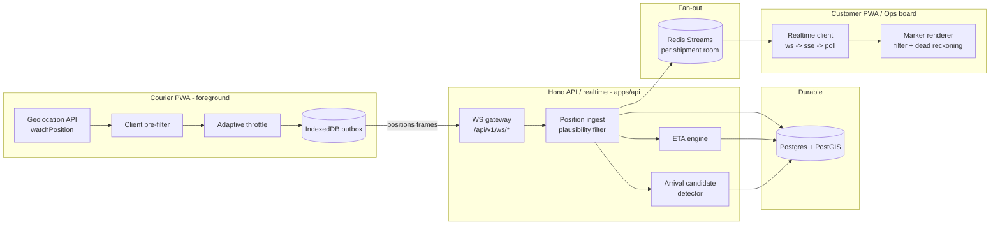
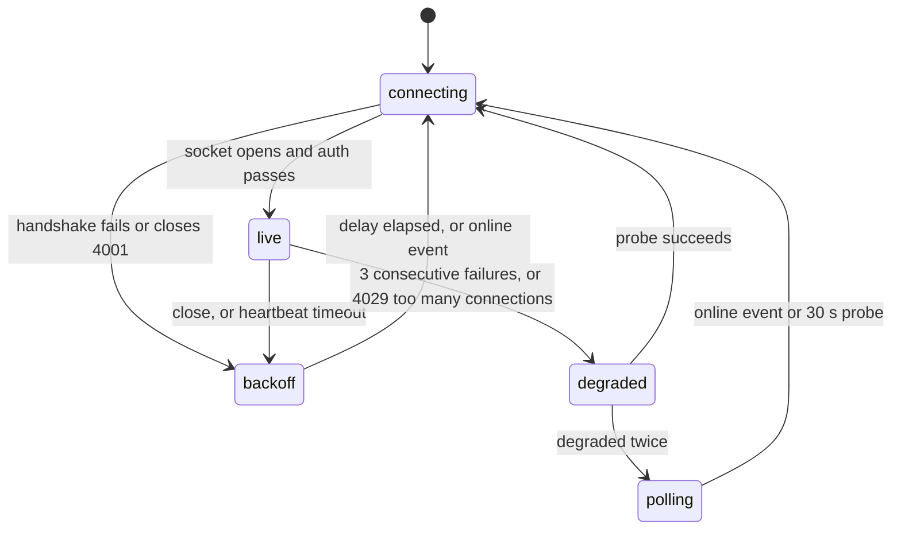
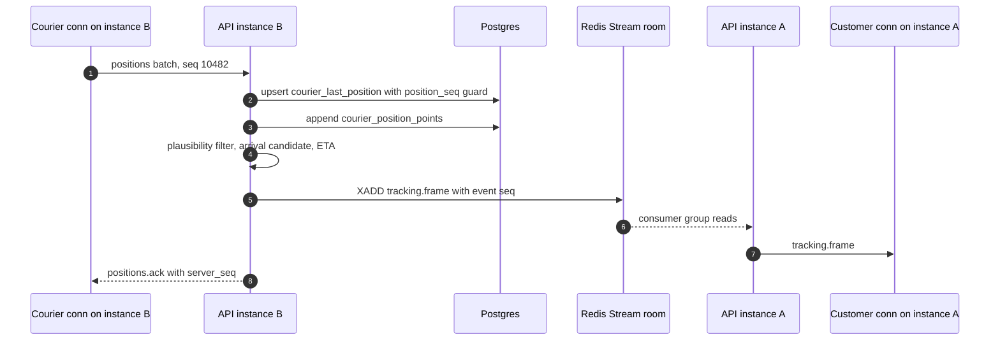
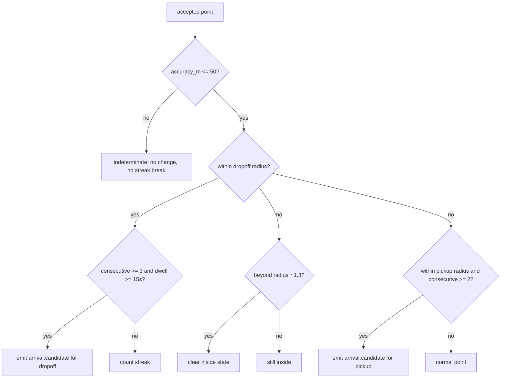
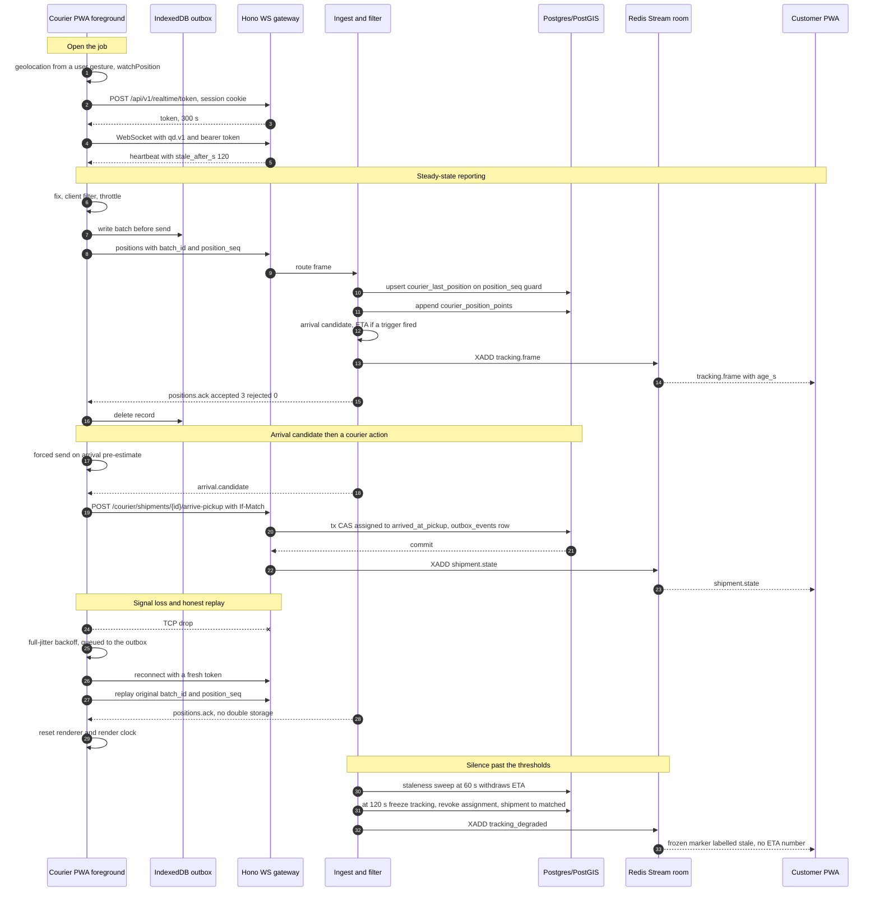

# QuickDrop - Realtime and Live Tracking

Status: pre-implementation design. Planning only; no application code exists as of 2026-10-05.

Sibling docs: [00-product-brief.md](./00-product-brief.md) · [01-tech-stack.md](./01-tech-stack.md) · [02-architecture.md](./02-architecture.md) · [03-data-model.md](./03-data-model.md) · [04-api-contract.md](./04-api-contract.md) · [06-frontend-architecture.md](./06-frontend-architecture.md) · [08-testing-strategy.md](./08-testing-strategy.md) · [DECISIONS.md](./DECISIONS.md) · [docs index](./README.md)

Version claims are taken verbatim from [../stack_report.md](../stack_report.md) and are not re-researched here. If a version is not in the report, it is not decided; raise it in [DECISIONS.md](./DECISIONS.md) rather than picking one.

> **Naming note.** [./README.md](./README.md) reserves `05-payments-and-ledger.md` and `06-dispatch-and-tracking.md` for other surfaces, and reserves `04-frontend-pwa.md` for the frontend. The filenames requested for this work are `05-realtime-and-tracking.md` and `06-frontend-architecture.md`, so the doc set now has two competing slots at `05` and `06` and no `04-frontend-pwa.md`. Filenames were left exactly as requested; reconciling the index is a decision for the index owner, tracked in §22.

---

## 1. Scope and the one non-negotiable premise

In scope:

- How the courier client samples, validates and reports position.
- How positions reach the API/realtime service, are stored, and are fanned out.
- How the server derives ETA, detects arrival candidates, and detects staleness.
- How consumers render a stable, forward-only, non-jittery marker.
- What happens when iOS, the network, GPS quality or a buggy client misbehave.

Out of scope, owned elsewhere: the dispatch and assignment algorithm ([02-architecture.md](./02-architecture.md) §6), money ([03-data-model.md](./03-data-model.md) §7), and the HTTP CRUD surface ([04-api-contract.md](./04-api-contract.md) §2).

### 1.1 The premise

> Guaranteed continuous background courier tracking on iOS is not achievable in a browser.

WebKit does not deliver continuous geolocation callbacks to a backgrounded or closed PWA, and there is no Background Sync API to compensate ([WebKit Geolocation](https://developer.apple.com/documentation/webkitjs/geolocation), [Web Push on iOS](https://webkit.org/blog/13878/web-push-for-web-apps-on-ios-and-ipados/), [Background Sync support](https://caniuse.com/background-sync), [report §2](../stack_report.md)). This is a hard platform limit, not a design choice, and it is already recorded as [ADR-0021](./DECISIONS.md#adr-0021--foreground-tracking-plus-server-side-staleness-detection) and assumption A-09 in [00-product-brief.md](./00-product-brief.md).

Three consequences follow, and they shape every section below:

1. The courier app must be **foreground and open** for the duration of a delivery. The courier UI states this rather than hiding it.
2. The server is the **source of truth** for "where is the courier now". Freshness is computed from `received_at` (server clock), never from the device clock.
3. `tracking` **never promises liveness**. Every read and every stream frame carries an age and a staleness verdict, so a client can render "delayed" without knowing whether it is on Android with a live socket, on iOS suspended, or on a 15-second poll ([04-api-contract.md](./04-api-contract.md) §10, consequence 1).

### 1.2 At a glance



Validate-and-persist is synchronous and must not fail a shipment because the router or the ETA engine is unhappy. ETA and arrival detection are derived and may lag by seconds without corrupting position history. Network I/O never happens inside a database transaction ([02-architecture.md](./02-architecture.md) §4, rule 3).

---

## 2. Canonical vocabulary and tables

This document owns no names. Everything below is fixed by the written siblings, and where this document previously disagreed with them the written sibling wins ([./README.md](./README.md) working rule).

### 2.1 Shipment states used by tracking

From [`03-data-model.md` §2.1](./03-data-model.md#21-shipment). Tracking only observes and reacts; it does not own these transitions.

| State | Who moves it here | Tracking relevance |
|---|---|---|
| `matched` | system dispatch | no courier yet, no tracking |
| `matching` | dispatch worker | offers in flight |
| `assigned` | courier accepts, CAS | courier en route to pickup; deadhead leg is live |
| `arrived_at_pickup` | **courier reports** | live tracking still expected |
| `picked_up` | courier, with proof | capture leg; now ETA is to dropoff |
| `in_transit` | courier starts delivery leg | the leg customers actually watch |
| `arrived_at_dropoff` | **courier reports** | ETA collapses to proof-of-delivery |
| `delivered` | courier, with a valid proof bundle | tracking ends |
| `returned`, `failed`, `cancelled` | courier / ops / system | tracking ends |
| `disputed` | customer or ops | tracking ends |

Courier-side states are separate: `assigned`, `en_route_pickup`, `at_pickup`, `en_route_dropoff` ([`03-data-model.md` §2.2](./03-data-model.md#22-courier)). A courier loses signal after 120 s and the staleness sweep moves them out of `assigned` ([02-architecture.md](./02-architecture.md) §5, race 5).

Note the deliberate consequence: `arrived_at_pickup`, `picked_up`, `in_transit` and `arrived_at_dropoff` are all entered by a **courier action**, not by geofence inference. §12 detects a *candidate* and prompts; it never writes the state.

### 2.2 Tables this design touches

Only the columns tracking depends on; full DDL is [`03-data-model.md` §4.2](./03-data-model.md#42-courier).

| Table | Role | Columns tracking uses |
|---|---|---|
| `courier_last_position` | hot, one row per courier, upserted per accepted point | `courier_id`, `position_geog`, `lat`, `lng`, `heading_deg`, `speed_mps`, `accuracy_m`, `recorded_at` (device clock), `received_at` (server clock, authoritative for staleness), `position_seq`, `source` |
| `courier_position_points` | append-only trail, monthly partitions on `recorded_at` | `courier_id`, `shipment_id`, `position_geog`, `heading_deg`, `speed_mps`, `accuracy_m`, `recorded_at`, `received_at`, `position_seq`, `batch_id`, with `UQ (courier_id, position_seq)` |
| `courier_profiles` | courier state and realtime token | `state`, `realtime_token_hash`, `realtime_token_expires_at`, `home_zone_id` |
| `shipments` | lifecycle and freshness | `state`, `version`, `tracking_frozen`, `eta_*` |
| `shipment_stops` | ordered legs the ETA walks | `sequence`, `role`, `geog`, `completed_at` |
| `outbox_events` | written in the same tx as any state change | `aggregate_type`, `aggregate_id`, `event_type`, `payload` |
| `consumer_inbox` | at-least-once dedupe for stream consumers | `consumer`, `event_id` |
| `idempotency_keys` | request-level replay protection | `key`, `request_hash`, `response_snapshot` |

There is no `realtime_dedupe`, `realtime_tickets`, `shipment_position_points`, `shipment_routes` or `shipment_eta_snapshots` table. Replay idempotency is `UQ (courier_id, position_seq)` plus `batch_id`; handshake auth is `courier_profiles.realtime_token_hash`; routes and ETAs live on `shipments` and `shipment_stops` and are recomputed, not cached in a bespoke table.

Retention: `courier_position_points` is hot for 90 days with no archive and is deleted at 90 days; `idempotency_keys` and `consumer_inbox` are 30 days ([`03-data-model.md` §8.3](./03-data-model.md#83-retention-schedule)). Every retention rule is a scheduled job that runs `FOR UPDATE SKIP LOCKED` in batches and reports its own deletion count to `audit_log`. The downsampled per-shipment polyline referenced by OQ-4 and ADR-0028 is still `Proposed` and is not yet in the schema.

---

## 3. Position capture on the courier client

### 3.1 `watchPosition` configuration

```ts
// apps/web/src/features/tracking/geolocation.ts
export type FixOptions = {
  enableHighAccuracy: boolean;
  maximumAge: number;
  timeout: number;
};

export const TRACKING_FIX_OPTIONS: FixOptions = {
  enableHighAccuracy: true,
  maximumAge: 5_000,
  timeout: 15_000,
};

export const WARMUP_FIX_OPTIONS: FixOptions = {
  enableHighAccuracy: true,
  maximumAge: 0,
  timeout: 30_000,
};
```

Per [Geolocation API (MDN)](https://developer.mozilla.org/en-US/docs/Web/API/Geolocation_API):

| Option | Value | Buys | Costs |
|---|---|---|---|
| `enableHighAccuracy` | `true` | fused GPS/Wi-Fi/cell fixes, which is what makes dense urban pickups usable | higher battery; silently degrades to IP geolocation on desktop Chrome (MDN) |
| `maximumAge` | `5_000` | lets the browser serve a cached fix rather than block | up to 5 s of start-up staleness, absorbed by the stale-timestamp rule (§4.2) |
| `timeout` | `15_000` | bounds the wait before `POSITION_UNAVAILABLE`-class errors | on poor GPS this produces recurring errors; treated as "no new fix", never fatal |

Lifecycle rules:

- Start `watchPosition` only when the courier session is active **and** tracking is enabled, from the job screen. Stop on route leave, sign-out, any terminal shipment state, and after 60 s in `document.visibilityState === 'hidden'`.
- Keep a single module-scoped `watchId`. Restart seeds from the last fix so the marker is warm across reconnects.
- The Geolocation watch continues while backgrounded in the hope that a browser still delivers; the system never relies on it. On return from `hidden`, force a send and reset the renderer (§13.5).

### 3.2 Permission UX

Permission is requested from a user gesture on the courier job screen, never on mount, after the app explains why. On denial the courier can still work; the shipment is flagged `tracking_degraded` and the UI shows a persistent strip with Try again and Open Settings. iOS does not re-prompt after a denial, so the Settings deep-link is the only real recovery path ([report §2](../stack_report.md)).

---

## 4. Validation and filtering

Filtering runs twice. The client filter saves radio wakeups and is an optimisation; **the server filter is authoritative** and is the only one protecting the data model. All thresholds live in `packages/core/src/tracking/plausibility.ts` so the server, the ops rule, and the tests read one constant set ([08-testing-strategy.md](./08-testing-strategy.md) §5).

### 4.1 Client pre-filter

Cheapest first:

1. `coords.accuracy > 150` m → drop.
2. `timestamp < lastAcceptedRecordedAt` → drop.
3. `abs(now - timestamp) > 120_000` ms → drop and record a `clock_skew` diagnostic.
4. Implied speed over the last accepted fix above the vehicle ceiling plus 40 m/s slack → drop.
5. Otherwise buffer into the throttle.

150 m is deliberately loose. The client's job is to shed useless fixes cheaply, not to enforce correctness.

### 4.2 Server plausibility filter

Every point that arrives is written to `courier_position_points` **only if accepted**. Rejected points are counted and logged, never stored, because storing rejected points would pollute the 90-day trail that support and dispatch read.

| Check | Rule | `reason_code` |
|---|---|---|
| Accuracy ceiling | `accuracy_m > 75` | `accuracy_too_low` |
| Accuracy validity | `accuracy_m` null, negative or non-finite | `accuracy_invalid` |
| Stale timestamp | `received_at - recorded_at > 60 s` | `stale_timestamp` |
| Future timestamp | `recorded_at - received_at > 120 s` | `future_timestamp` |
| Clock skew | `abs(recorded_at - received_at) > 120 s`, and the courier's skew is recorded | `clock_skew` |
| Duplicate or replayed | `position_seq <= courier_last_position.position_seq`, or a `(courier_id, position_seq)` conflict | `position_seq_replay` |
| Gap in sequence | `position_seq > last + 1` | accepted, but `seq_gap` is flagged for ops |
| Implausible speed | implied speed above the vehicle ceiling for a non-highway context | `geo_implausible` |
| No assignment | courier holds no accepted assignment for the shipment | `courier.not_assignment_holder` |
| Not currently tracking | shipment is not in a leg that expects position | `tracking_not_expected` |

Vehicle ceilings are the canonical `vehicle_type` values from [`03-data-model.md` §3](./03-data-model.md#3-enumerations), not an ad-hoc list. `bicycle` and `bicycle_cargo` and `ebike` get the tightest ceiling; `car` and `van` share the loosest; `motorcycle` sits between them. `geo_implausible` is the same code the API contract uses in its `positions.reject` example, where a 68.4 m/s implied speed is rejected against a 55 m/s non-highway ceiling ([04-api-contract.md](./04-api-contract.md) §8.1).

### 4.3 The two write paths, and why the guard is in SQL

An accepted point performs, in one transaction:

1. Upsert `courier_last_position` with `WHERE EXCLUDED.position_seq > courier_last_position.position_seq`. Two courier tabs or two devices streaming for one courier is handled by this predicate: the narrower stream's later write is rejected as stale ([02-architecture.md](./02-architecture.md) §5, race 8).
2. Append to `courier_position_points`, whose `UQ (courier_id, position_seq)` makes exactly-once storage a database property rather than an application convention.
3. Optionally emit a `tracking_degraded` marker if this point is the first after a silence.

The application is not the only thing enforcing idempotency. `UQ (courier_id, position_seq)` is.

### 4.4 Fusion

- `recorded_at` is stored raw and never trusted for ordering; `received_at` is the server clock and is what staleness uses.
- Heading: use the reported value when it is `0..359`, otherwise derive it from the last two accepted points, then smooth with a circular mean over three. Below 1 m/s the heading is held, because GPS noise otherwise spins the marker.
- Speed: EWMA over the last five accepted points, clamped to the vehicle ceiling. This is the effective speed the ETA uses.
- The trail stays raw. Smoothing is derived state and never overwrites evidence.

---

## 5. Adaptive throttling

### 5.1 Contract being refined

The committed contract is a 2-to-5-second batch interval or a 25 m movement trigger, whichever comes first, with a 20-point maximum per batch ([04-api-contract.md](./04-api-contract.md) §8.1, [02-architecture.md](./02-architecture.md) §4). This section keeps that contract intact and specifies the adaptive extension that sits on top of it.

Base rule, unchanged:

```
send when  (now - last_sent_at) >= T_base   OR   moved >= N_base
N_base = 25 m
T_base = 2 s at urban speeds, 5 s when slow or stationary
MAX_BATCH_POINTS = 20
```

### 5.2 Adaptive extension

Two inputs vary the thresholds: **fused effective speed** and **battery**.

| Speed bucket | Effective speed (m/s) | `N` (m) | `T` (s) | Rationale |
|---|---|---|---|---|
| `idle` | `< 2` | distance trigger disabled | 60 | stationary jitter is noise; a slow heartbeat keeps `last_seen_at` fresh for the dispatch pre-filter |
| `urban` | `2 .. 8` | 25 | 5 | the committed base case |
| `arterial` | `8 .. 20` | 50 | 4 | fewer fixes; dead reckoning covers the gap |
| `highway` | `> 20` | 100 | 4 | radio and battery are not worth 1 Hz |

| Battery state | `N` multiplier | `T` multiplier |
|---|---|---|
| charging | 1.0 | 1.0 |
| `level >= 0.5` | 1.0 | 1.0 |
| `0.2 <= level < 0.5` | 1.5 | 1.5 |
| `level < 0.2` | 2.5 | 3.0 |
| unknown (no Battery API) | 1.25 | 1.25 |
| reduced-motion or low-power hint available | 1.5 | 2.0 |

`navigator.getBattery()` is not available everywhere ([Battery Status API, MDN](https://developer.mozilla.org/en-US/docs/Web/API/Battery_Status_API)); absent it, the state is `unknown` and the conservative multiplier applies.

Bucket changes are hysteretic: moving to a looser bucket requires the boundary to be exceeded for three consecutive accepted points, moving to a tighter bucket takes one. Without this, `N` and `T` flap at a boundary and the send rate doubles for no reason.

### 5.3 Overrides that force a send

A point is sent immediately, ignoring `N` and `T`, when:

- it is the first accepted point after tracking starts or after a reconnect;
- the courier returns to `visible`;
- the courier crossed a client-estimated arrival boundary (§12), which saves a round trip even though the server still decides;
- accuracy improved by more than 40 percent **and** the courier moved more than `N / 2`;
- a courier action that carries a `shipment_id` is queued in the same tick;
- the courier taps "share my exact location" on the job screen.

### 5.4 Algorithm

```ts
// apps/web/src/features/tracking/throttle.ts
export type SendReason =
  | 'start' | 'interval' | 'movement' | 'override' | 'resume' | 'manual' | 'arrival' | 'replay';

export type ThrottleParams = { nMetres: number; tSeconds: number; distanceTrigger: boolean };

export function paramsFor(input: {
  vEff: number; battery: BatteryReading | null; previousBucket: SpeedBucket;
}): ThrottleParams {
  const bucket = bucketFor(input.vEff, input.previousBucket);
  const m = batteryMultiplier(input.battery);
  return {
    nMetres: Math.round(BASE[bucket].n * m.n),
    tSeconds: Math.round(BASE[bucket].t * m.t),
    distanceTrigger: bucket !== 'idle',
  };
}

export function decide(state: {
  lastSentAt: number | null;
  lastSentPoint: [number, number] | null;
  params: ThrottleParams;
  forced: boolean;
}, now: number, fix: CapturedPoint): { send: true; reason: SendReason } | { send: false } {
  if (state.forced) return { send: true, reason: 'override' };
  if (state.lastSentAt === null || state.lastSentPoint === null) return { send: true, reason: 'start' };
  if (now - state.lastSentAt >= state.params.tSeconds * 1000) return { send: true, reason: 'interval' };
  if (state.params.distanceTrigger) {
    const moved = haversineMeters(state.lastSentPoint, fix.location);
    if (moved >= state.params.nMetres) return { send: true, reason: 'movement' };
  }
  return { send: false };
}
```

Buffered points are never dropped silently. The tail point is retained and prepended to the next batch, capped at `MAX_BATCH_POINTS = 20`. When the cap forces a drop the frame carries `dropped_count` so the server can log continuity loss rather than assume a clean trail.

### 5.5 Worked example

E-bike courier, effective speed 6.2 m/s, battery 0.45, LTE, screen on.

1. 6.2 m/s is the `urban` bucket: `N = 25 m`, `T = 5 s`.
2. Battery 0.45 is the `0.2 .. 0.5` band: multipliers 1.5 and 1.5.
3. Effective `N = 38 m`, effective `T = 8 s`.
4. Fixes arrive at roughly 1 Hz with 8 to 20 m accuracy.
5. `t = 0`: send one point, reason `start`.
6. `t = 3.4 s`: moved 21 m, hold.
7. `t = 6.9 s`: moved 43 m, send at `>= 38 m`, reason `movement`, with the two retained tail points, 3 points in the frame.
8. The distance trigger dominates, because `38 m / 6.2 m/s = 6.1 s < 8 s`, so the effective cadence is about 6 s and never worse than 8 s.
9. Red light for 90 s: the bucket drops to `idle`, the distance trigger is disabled, and the heartbeat interval becomes `60 s * 1.5 = 90 s`. One frame per stop, which is exactly what the customer needs to be told and what keeps `courier_profiles` fresh for the PostGIS dispatch pre-filter.
10. Arrival boundary crossed: forced send, reason `arrival`, regardless of `N` and `T`.

---

## 6. Transport ladder

### 6.1 Endpoint map

Fixed by [04-api-contract.md](./04-api-contract.md) §1. All of these are **same-origin through the web BFF**; the browser never opens a cross-origin socket to the API host ([02-architecture.md](./02-architecture.md) §2.1).

| Direction | Primary | Fallback 1 | Fallback 2 |
|---|---|---|---|
| courier to server | `WS /api/v1/ws/courier` | `POST /api/v1/courier/positions` (batched, same schema) | same POST retried on foreground `online` |
| server to consumer | `WS /api/v1/ws/shipments/{shipment_id}` | `GET /api/v1/stream/shipments/{shipment_id}` (SSE) | `GET /api/v1/shipments/{shipment_id}/tracking?stale_after_s=120` |

Courier offers also have `GET /api/v1/stream/offers` as their SSE form and `WS /api/v1/ws/ops` carries the dispatch board and alert stream.

WebSocket is primary because courier to server is bidirectional and bursty. SSE is the fallback because it survives proxies that mishandle upgrades and needs no client library. Polling is last, and its cadence comes from the server: `poll_after_s` is `null` on a healthy socket and `15` on a frozen shipment, so the client does not invent a cadence ([04-api-contract.md](./04-api-contract.md) §2.9).

### 6.2 Ladder as a state machine



Only the realtime client knows which transport is in use. The rest of the app sees `connecting | live | degraded | offline`, so no component ever branches on "websocket or not".

### 6.3 Token handling, including the service-worker case

A service worker cannot read an `HttpOnly` cookie, and a browser `WebSocket` cannot set an arbitrary header ([WebSocket API, MDN](https://developer.mozilla.org/en-US/docs/Web/API/WebSocket)). The flow is fixed by [04-api-contract.md](./04-api-contract.md) §5.5:

1. A controlled page, which can read the cookie via `fetch`, calls `POST /api/v1/realtime/token`.
2. The API mints 32 random bytes, base64url, stores only a SHA-256 hash in `courier_profiles.realtime_token_hash` with a 300-second `realtime_token_expires_at`, and returns the value once.
3. The page passes it to the worker by `postMessage`. The worker keeps it **in memory only**, never in IndexedDB, Cache Storage or `localStorage`.
4. The socket is opened with the token as a subprotocol: `new WebSocket(url, ['qd.v1', 'bearer.' + token])`.
5. On expiry the server closes with `4001`; the client re-mints through a page message and reconnects.
6. `Sec-WebSocket-Protocol` is echoed as `qd.v1` only, so the bearer value never appears in a handshake response header.

The token is single-purpose, bound to `user_id` and `device_id`, and grants no REST access. A stolen token is worth 300 seconds of someone else's tracking feed, which is bounded and acceptable.

**The design consequence that matters:** the page must be able to open the socket itself when the worker has been terminated. iOS terminates service workers aggressively ([WebKit on service workers](https://webkit.org/blog/8090/workers-at-your-service/)), so a worker-only realtime path would be "works in Chrome, dead on iOS". The page is the primary opener; the worker is an opportunistic path. This is an addition to the contract flow and is listed in §21.

---

## 7. Wire protocol

The realtime protocol is specified in [04-api-contract.md](./04-api-contract.md) §8. This document adds the operational detail that spec intentionally leaves out.

### 7.1 Envelope rules

- `v` is the protocol version, currently `1`. An unknown `v` closes with `4002 unsupported_version`; the server accepts the two previous minor versions.
- `type` is the frame discriminator.
- `seq` is a per-connection monotonic counter. A frame whose `seq` is not greater than the last received is dropped, which kills reordered and duplicated client frames for free.
- `ts` is ISO-8601 UTC on the wire, never epoch milliseconds, and JSON field names are `snake_case` throughout ([04-api-contract.md](./04-api-contract.md) §9).
- Coordinates are `[lng, lat]`, GeoJSON order, everywhere.
- Maximum inbound frame 64 KB; a batch is at most 20 points.

### 7.2 Courier upstream

```json
{ "v": 1, "type": "positions", "seq": 10482, "ts": "2026-09-14T09:14:22.118Z",
  "data": { "batch_id": "8b1c2d3e-4f5a-4b6c-8d7e-6f5a4b3c2d1e",
            "reason": "movement",
            "points": [
              { "location": [-122.390512, 37.793881], "position_seq": 10481,
                "recorded_at": "2026-09-14T09:14:19.004Z",
                "accuracy_m": 11.5, "heading_deg": 74, "speed_mps": 4.1 },
              { "location": [-122.390498, 37.793902], "position_seq": 10482,
                "recorded_at": "2026-09-14T09:14:21.550Z",
                "accuracy_m": 10.2, "heading_deg": 76, "speed_mps": 4.3 }
            ],
            "battery": { "level": 0.45, "charging": false },
            "dropped_count": 0 } }
```

`position_seq` is required per point and is the reason replay is safe. It is monotonic per courier and is what makes `UQ (courier_id, position_seq)` sufficient. It is also the guard in the two-tabs race. **The worked example in [04-api-contract.md](./04-api-contract.md) §8.1 omits it**; adding it is amendment A1 in §21.

The counter is scoped to the **courier**, not to the device session. A courier who closes the app and reopens it, or who signs in on a second device, must continue from the durable high-water mark rather than restarting at zero: a reset counter is below `courier_last_position.position_seq`, so every subsequent point would be rejected as `position_seq_replay` and the courier would appear permanently offline. On app start the client reads the current `position_seq` for that courier and resumes above it; while offline it continues incrementing locally and lets the server reject anything that is not newer.

`batch_id` is client-generated and makes a resent batch idempotent at the batch level. `reason` is optional and feeds metrics only. `battery` and `dropped_count` are optional diagnostics and are never required by the server.

Replies are `positions.ack` with `{ batch_id, accepted, rejected, server_seq }` and `positions.reject` with `{ batch_id, rejected, reason_code, detail, action }`. `action: "discard_batch_do_not_resend"` tells the client to drop the batch rather than retry, which is the difference between a recoverable network error and a permanent validation failure.

### 7.3 Downstream

Consumer sockets at `WS /api/v1/ws/shipments/{shipment_id}` carry `tracking.frame` and `shipment.state`, plus an initial `snapshot`. The ops socket at `WS /api/v1/ws/ops` carries the same frames for many rooms plus dispatch alerts. Frame bodies follow the SSE examples in [04-api-contract.md](./04-api-contract.md) §8.2, extended with the fields in §21.

```json
{ "v": 1, "type": "tracking.frame", "seq": 7712, "ts": "2026-09-14T09:14:22.118Z",
  "data": { "shipment_id": "e91a7c34-...",
            "courier_id": "4e8a1b7c-...",
            "location": [-122.390498, 37.793902],
            "position_seq": 10482,
            "heading_deg": 76, "speed_mps": 4.3, "accuracy_m": 10.2,
            "recorded_at": "2026-09-14T09:14:21.550Z",
            "age_s": 1,
            "eta": { "seconds_to_dropoff": 458, "confidence": 0.72, "computed_at": "2026-09-14T09:14:22.118Z" },
            "map_match": { "snapped": true, "route_distance_m": 1840, "lateral_offset_m": 3.8 },
            "tracking_degraded": false } }
```

`age_s` and `tracking_degraded` are computed server-side so every consumer degrades in the same way, instead of each re-deriving staleness from its own clock.

### 7.4 SSE parity

```http
GET /api/v1/stream/shipments/e91a7c34-...?last_event_seq=7711 HTTP/1.1
Accept: text/event-stream
Cookie: __Host-qd.session_token=...
```

`id` is the event sequence, which is exactly what the client sends back as `last_event_seq`, so a reconnect replays the gap with no duplicates and no loss. `retry: 3000` sets the client interval. A `:heartbeat` comment every 20 s keeps intermediaries from timing the stream out. SSE is same-origin through the BFF, so no CORS header is needed. The courier upload direction still needs a bidirectional transport, which is why the courier path stays on WebSocket or the HTTP `POST /positions` fallback.

### 7.5 Close codes

| Code | Meaning | Client action |
|---|---|---|
| `4001` | token expired or unauthorized | re-mint via page message, reconnect |
| `4002` | unsupported protocol version | stop, surface as a client bug |
| `4003` | heartbeat timeout | reconnect with backoff |
| `4010` | realtime token expired | re-mint and reconnect immediately |
| `4029` | too many connections | drop to SSE, do not retry the socket blindly |
| `1013` | server overloaded, try again later | drop to SSE immediately |

---

## 8. Reconnect, replay and the offline outbox

### 8.1 Backoff

Full-jitter exponential backoff from 1 s to 30 s, as committed in [04-api-contract.md](./04-api-contract.md) §8.1:

```
attempt 1: sleep = random(0, min(30_000, 1_000 * 2^(n-1)))
```

The counter resets on any successfully processed frame. Every retry path is also triggered by `online` and `visibilitychange`, because Background Sync does not exist on iOS ([caniuse](https://caniuse.com/background-sync)).

### 8.2 Outbox

Every upstream frame is written to IndexedDB before transmission and deleted only on `positions.ack`. The record shape tracking needs:

```
outbox
  keyPath: "batch_id"
  records: { batch_id, kind, courier_id, shipment_id, payload,
             position_seq_high, created_at, attempts, last_attempt_at, last_error }
  index:   "byKindCreatedAt" on ["kind", "created_at"]
```

Ordering: batches drain in ascending `position_seq_high`, so replayed history can never contradict a later courier action. Courier state changes drain after the positions that predate them.

Retention: at most 2 000 position records and 72 hours. A courier who was offline for a day does not need a day's trail, and the server would reject all of it as `stale_timestamp` anyway. Drops are logged client-side and surfaced on the courier diagnostics route rather than vanishing.

The outbox is best-effort and never authoritative. On cold start the client refetches shipment state from the server before trusting anything local, and iOS may evict storage under pressure ([Apple Web Storage](https://developer.apple.com/documentation/webkitjs/working_with_web_storage)).

### 8.3 Replay sequence

1. Re-mint a token through a controlled page, connect, authenticate.
2. Subscribe downstream with `since_seq = 0` for a fresh view, or the last seen sequence when resuming.
3. Drain the outbox oldest first, replaying each batch with its **original `batch_id` and original `position_seq` values**.
4. On `positions.ack`, delete the record. On `positions.reject` with `action: "discard_batch_do_not_resend"`, delete it and increment a client diagnostic counter.
5. Re-seed the renderer (§13.5) and reset the render clock, because covariance accumulated across a minutes-long gap is meaningless.

### 8.4 Server handling of a replayed burst

A burst can carry hundreds of points spanning many minutes. The rules:

1. **Dedupe first.** `position_seq <= courier_last_position.position_seq` is rejected as `position_seq_replay`. This is what makes replay safe and is why `position_seq` is device-generated and never reused.
2. **Sort by `recorded_at` ascending inside the burst.** The client generated them in order and only the network shuffled them.
3. **Split by the upsert guard.** Points that pass the guard are ingested, published and used for ETA. Points that fail it are counted and discarded, never published. This is the mechanism that prevents a marker jumping backwards after a reconnect.
4. **Rate-limit the burst.** At most 500 points and 50 state actions per replay; excess is rejected and the client re-drains next cycle, so one courier's backlog cannot stall a gateway.
5. **Do not backfill ETA from old points.** ETA is computed from post-reconnect state. Old points exist for the trail and for support disputes.
6. **Signal a gap to consumers.** If the replay reveals a sequence gap older than 30 s, downstream consumers are told to resync rather than interpolate across a hole.

---

## 9. Fan-out and horizontal scale

### 9.1 All realtime state lives in Redis

Railway's load balancer does not guarantee affinity, so **no sticky sessions are required and none may be assumed** ([02-architecture.md](./02-architecture.md) §2.1). Concretely:

- Per-shipment replay is a **Redis Stream** keyed by shipment id, read by `last_event_seq`. This is why reconnecting to a different replica is a normal handled path rather than an incident ([Redis Streams](https://redis.io/docs/latest/develop/data-types/streams/)).
- Room membership is per-connection state in Redis, not in process memory. An instance that receives a publish it has no local subscriber for is a no-op.
- Redis is disposable. Every datum in it is reconstructible from Postgres ([02-architecture.md](./02-architecture.md) §2.1).

### 9.2 Publish path



### 9.3 Coalescing and backpressure

- Outbound fan-out is coalesced. [01-tech-stack.md](./01-tech-stack.md) ADR-4 commits to at most one message per second per room; this design uses **2 s per room** because the courier cadence is already 2 to 5 s and a 1 s floor cannot coalesce anything. This is a real conflict between two written documents and is amendment A3 in §21.
- Position updates below the movement threshold are not broadcast at all, per ADR-4.
- A slow consumer is coalesced toward the newest position plus the newest ETA and state, never truncated in a way that loses a transition.
- If coalescing cannot get under the queue cap, the socket is closed with `1013` so the client drops to SSE rather than growing unbounded memory.
- Inbound, a courier connection is capped at 30 frames per 10 s with `retryAfterMs`, and at 64 KB per frame.

### 9.4 Ordering

`seq` is per connection upstream and per room downstream. Ordering per shipment survives a reconnect because the Redis Stream is the single ordering authority; the ingest path reads the current room head before appending. Consumers must still handle a gap, because a Stream read can skip if a consumer lags, and §8.4 rule 6 covers it.

---

## 10. Server ingest pipeline

```
frame
  -> size and protocol check, unknown keys rejected
  -> parse with the Zod schema from packages/contracts
  -> sort points by recorded_at ascending
  -> per point: plausibility filter (packages/core/src/tracking/plausibility.ts)
  -> per accepted point: upsert courier_last_position, append courier_position_points
  -> arrival candidate detector (§12)
  -> ETA engine (§11), recompute only on triggers
  -> XADD to the shipment room stream
  -> deliver locally to connections on this instance
  -> enqueue derived work: shipment.eta_changed if it moved, ops activity
```

Failure isolation:

- An ETA or router failure never rolls back a position write.
- A persistence failure rejects the frame; the client keeps the outbox record and retries.
- The filter never throws. A malformed frame gets an error frame and a close.
- No network I/O inside a transaction ([02-architecture.md](./02-architecture.md) §4).

`tracking.frame` is deliberately **not** written to `outbox_events`. It is high-volume and effectively-once to storage already, because the upsert carries `position_seq` ([02-architecture.md](./02-architecture.md) §7.3).

---

## 11. ETA computation

### 11.1 Shape, not invention

The response shape is fixed by [04-api-contract.md](./04-api-contract.md) §2.9:

```json
"eta": { "pickup_at": "...", "dropoff_at": "...", "seconds_to_dropoff": 458,
         "confidence": 0.72, "computed_at": "..." }
```

`confidence` is a float in `[0, 1]`, not an enum. `seconds_to_dropoff` is an integer. There is no `p90_seconds` and no `eta.source` enum in the contract; if both are wanted they are additions (§21, A2), not replacements.

### 11.2 Route acquisition

On assignment, a routing job requests the ordered legs from `shipment_stops` and the courier's current position. Which router is undecided: [02-architecture.md](./02-architecture.md) assumes OSRM, [01-tech-stack.md](./01-tech-stack.md) lists Valhalla first, and OQ-3 owns the decision. Until it is closed, routing sits behind a provider interface in `packages/core/src/geo/routing.ts` with a haversine fallback, and no document names a default.

### 11.3 Progress, speed and blending

Each accepted point is map-matched onto the cached route geometry (`polyline6`, as the tracking response already declares), giving `route_distance_m` and `lateral_offset_m`. A lateral offset beyond 60 m means the courier is genuinely off the planned route, so that leg falls back to haversine and confidence drops.

```
v_eff      = clamp(EWMA effective speed, 1.5, 25)          m/s
v_road     = leg_duration_s / leg_distance_m
remaining  = leg_distance_m - route_distance_m

seconds    = 0.6 * (remaining / v_eff) + 0.4 * (remaining / v_road)
```

The 0.6 term keeps the ETA responsive to what the courier is actually doing; the 0.4 term stops a courier stopped at a red light from showing a four-minute ETA.

### 11.4 Confidence

```
sigma_rel = clamp(0.12 + 0.0004 * (remaining_m / 1000) + 0.25 * speed_cv, 0.10, 0.45)
p90       = seconds * (1 + 1.645 * sigma_rel)
confidence = clamp(1 - (sigma_rel - 0.10) / 0.35, 0, 1)
```

| `confidence` | Customer copy |
|---|---|
| `>= 0.72` | "Arriving in 12 min" |
| `0.45 .. 0.72` | "Arriving in 12 to 18 min" |
| `< 0.45` | "Arriving in 30 to 70 min, traffic unknown" |
| withdrawn (§13.6) | no number at all |

Never a bare countdown. The interval is what makes the estimate honest when the confidence is low.

### 11.5 Recompute triggers

Not every accepted point recomputes ETA. It recomputes on: a route becoming available, a state transition, an arrival candidate, remaining distance changing by 10 percent or 300 m, five minutes elapsing, or effective speed changing by 30 percent. A change of at least 120 s emits `shipment.eta_changed`, which is the notification threshold ([02-architecture.md](./02-architecture.md) §7.3).

### 11.6 No route, and no fix

With no route: `haversine(remaining) * circuity / v_eff`, with `circuity` between 1.15 and 1.55 depending on context, and confidence forced low.

With no route **and** no fix for 60 s, the ETA is **withdrawn** entirely rather than held. This is the two-tier staleness rule and it is the single most important honesty behaviour in the document: no frozen countdown, ever.

---

## 12. Arrival candidate detection

### 12.1 What this section is allowed to do

Geofence logic detects a **candidate**. It does not write shipment state.

This is a deliberate divergence from the earlier draft of this document, and it follows the written siblings: `assigned -> arrived_at_pickup`, `arrived_at_pickup -> picked_up`, `picked_up -> in_transit` and `in_transit -> arrived_at_dropoff` are all courier-authorised transitions requiring an accepted assignment ([`03-data-model.md` §2.1](./03-data-model.md#21-shipment)). Only `arrived_at_dropoff -> delivered` settles money, and it requires a valid proof bundle.

So the detector's job is to make the courier's action fast and correct, and to give the customer an early hint. It emits `arrival.candidate`, which:

- opens a pre-filled confirm sheet on the courier device;
- raises a hint on the customer view, worded as a hint;
- lets ops see a candidate on the board.

An auto-confirm timer is **not** in scope for v1, because a wrong auto-pickup is a support incident and a 60-second delay is not. Revisiting it is a product decision, not an implementation detail.

### 12.2 Radii and hysteresis

| Fence | Proposed radius | Enter requirement | Status |
|---|---|---|---|
| pickup | 250 m | 2 consecutive accepted points inside, both `accuracy_m <= 50` | **open**, needs product sign-off |
| dropoff | 150 m | 3 consecutive accepted points inside, all `accuracy_m <= 50`, plus 15 s dwell | **open**, needs product sign-off |

Finding a door in a dense urban block is the hard part, so pickup is wide; triggering early on delivery is expensive, so dropoff is tight. Both numbers are proposals and are listed as open in §22.

Three mechanisms stop flapping:

1. **Consecutive-count requirement.** One point inside is never enough.
2. **Exit band.** After entering, the fence is only exited past `radius * 1.3`. Between `radius` and `radius * 1.3` the courier still counts as inside.
3. **Accuracy gate.** A point with `accuracy_m > 50` is `indeterminate`: it neither enters nor exits and does not break a streak. A run of indeterminate points longer than 60 s resets the streak.

### 12.3 Detection flow



Every state change, whenever it does happen, goes through the one guarded writer path with a compare-and-swap on `shipments.version`, writes `outbox_events` in the same transaction, and notifies only after commit ([02-architecture.md](./02-architecture.md) §4).

---

## 13. Consumer-side rendering

The customer PWA and the ops board share one renderer; the board overrides only the thresholds. Implementation lives in `apps/web/src/features/tracking/` and is documented in [06-frontend-architecture.md](./06-frontend-architecture.md) §5.

### 13.1 Render clock, not render-on-arrival

The renderer keeps a monotonically increasing `renderClock` derived from frame timestamps, not from frame-arrival order. Every frame:

1. If `position_seq <= lastRenderedSeq`, drop it. This single rule removes the overwhelming majority of backward jumps, including anything that arrives after a reconnect.
2. Otherwise advance the render clock and re-seed the filter.
3. If `shipment.state.version < lastSeenVersion`, drop the state frame.
4. If `tracking_degraded` is true, stop dead reckoning regardless of local timers, because the server knows something the client does not.

### 13.2 Dead reckoning, with hard caps

Between frames the marker advances along the last bearing at effective speed, capped at both 20 s and 120 m. Past either cap it holds position and enters `coast`. On iOS frames can be minutes apart, and the caps are what stop the marker sailing off the map when a courier's app is backgrounded.

### 13.3 Smoothing

A **2-D constant-velocity Kalman filter** in a local east-north frame, state `[x, y, vx, vy]`, measurement model position-only.

- Process noise is a continuous white-noise acceleration tuned against real courier traces.
- Measurement covariance derives from reported accuracy: `R = max(accuracy_m^2, 4)`. A 50 m point barely moves the marker; a 5 m point snaps it.
- Heading is smoothed separately with a circular mean over three bearings and held below 1 m/s.
- **EMA fallback**: before two accepted points exist, or when the innovation exceeds `5 * accuracy_m` three times running (the filter diverged, usually after a teleport), the renderer falls back to `p = 0.25 * z + 0.75 * p` and reports `renderer: "ema"` for debugging.
- The filter runs on the display path only. Nothing it produces is ever sent upstream or written to the database.

### 13.4 Map matching

The displayed marker snaps to the cached route:

1. Build a segment index with cumulative distance and a bounding box once per route.
2. Project the filtered position onto the nearest segment each tick.
3. Snap only when `lateral_offset_m <= 60` and progress is forward or within 200 m of the previous snapped distance.
4. Beyond 60 m lateral offset, stop snapping and show the true filtered position; ops can render the route as a dashed alternative.
5. Snap the marker, never the data. The `location` in the payload stays raw.

A planar projection with segment iteration is enough at city scale; the sub-metre accuracy a full geo toolkit provides is not needed, so this is hand-rolled in `packages/core/src/geo/` and unit-tested.

### 13.5 Never move the marker backwards

Four independent guards, because this is the single most visible defect class:

1. **Sequence gate** (§13.1): drop anything not newer by `position_seq`.
2. **Progress gate**: when snapped, a decrease in `route_distance_m` beyond 25 m is a correction, rendered as a 250 ms lateral ease rather than a slide back along the polyline.
3. **Jump gate**: implied speed above 40 m/s between display updates is a correction: re-seed the filter, keep the render clock, flash the accuracy circle once.
4. **Re-anchor gate**: a point the server marked as a correction resets the filter to the new fix, leaves the render clock alone, and re-stamps `renderedAt`.

The renderer resets on: shipment change, route change, reconnect, and `visibilitychange -> visible` after a long background.

### 13.6 Two-tier staleness, and what it drives

This is the contractual heart of the document, and it is already stated as an acceptance criterion in [00-product-brief.md](./00-product-brief.md).

| Age of last accepted point | Renderer | Customer | Courier |
|---|---|---|---|
| `< 30 s` | full rate, dead reckoning active | normal tracking, ETA as a range | normal |
| `30 .. 60 s` | coast, dimmed accuracy circle | "Updating", wider ETA range, no countdown | "Keep QuickDrop open" nudge |
| `60 .. 120 s` | coast, ETA withdrawn | **"We have lost contact with your courier"**. Last known position, its timestamp, no ETA number | tracking-health banner, outbox depth |
| `> 120 s` | **frozen** at last known position | frozen marker clearly labelled stale, status text still authoritative, contact and support options | shipment flagged for ops |

The rule in one sentence: **at 120 s the marker freezes and says so.** A stale dot with a live-looking pulse is worse than an honest panel, because the customer makes plans based on a fiction.

Past 120 s the courier is swept out of `assigned`, the assignment is revoked and the shipment returns to `matched` for re-dispatch ([02-architecture.md](./02-architecture.md) §5, race 5). That is a dispatch consequence, and it is why staleness is server-side and not a client concern.

---

## 14. Map rendering

### 14.1 Basemap

Self-hosted vector tiles, no third-party tile requests: it keeps tracking working on a constrained mobile connection, avoids API-key dependence, and avoids shipping courier positions to a tile vendor. Tile pipeline, terms and licensing are OQ-3 and undecided, so the shape below is provider-agnostic.

- **Style** is a TypeScript function, not a checked-in JSON blob, so tile URLs come from environment config and colours come from design tokens.
- **Glyphs and sprites** are self-hosted too; a remote glyph endpoint is a render-time third-party dependency.
- **Attribution** is mandatory and non-collapsible, plus "Courier position is approximate".
- The tile provider is reached behind a small adapter so swapping it is a config change, not a rendering rewrite.

### 14.2 Layer stack

Bottom to top, with the reason each layer exists.

| # | Layer | Type | Purpose |
|---|---|---|---|
| 1 | `bg` | `background` | theme-aware land colour |
| 2 | `water`, `landuse` | `fill` | rivers, docks, parks |
| 3 | `road-casing-minor`, `road-minor`, `road-major` | `line` | roads, width by class |
| 4 | `road-label` | `symbol` | street names at high zoom |
| 5 | `building` | `fill` | light tint at high zoom only |
| 6 | `place-label` | `symbol` | neighbourhood names |
| 7 | `route-casing` | `line` | casing under the route |
| 8 | `route-travelled` | `line` | route already covered, reduced opacity |
| 9 | `route-remaining` | `line` | route ahead, accent colour |
| 10 | `geofence-pickup`, `geofence-dropoff` | `fill` | arrival candidate circles |
| 11 | `accuracy-circle` | `fill` | courier accuracy radius, interpolated on accuracy |
| 12 | `courier-halo` | `circle` | contrast ring behind the dot |
| 13 | `courier-dot` | `circle` | the marker |
| 14 | `courier-heading` | `symbol` | triangle, `icon-rotate` from heading |
| 15 | `courier-pulse` | `circle` | animated pulse, disabled under reduced motion |
| 16 | `marker-pickup`, `marker-dropoff`, `marker-label` | `symbol` | stop pins and labels |

All live layers are imperative source updates from the renderer, never React state, to keep React out of the frame path. Pickup and dropoff pins are GPU symbol layers rather than DOM markers, because DOM markers cost layout work on every map move. The one exception is the ops board's selectable marker, which is a DOM overlay for keyboard access.

### 14.3 Tile caching

| Layer | Strategy |
|---|---|
| Basemap tiles | CDN with `Cache-Control: public, max-age=31536000, immutable` on content-addressed paths |
| Glyphs and sprite | same, separate cacheable paths |
| Tiles seen in-session | service worker `CacheFirst`, bounded LRU, **full `200` responses only**; `206` partial responses are bypassed because caching a range response as a whole corrupts the archive |
| Route geometry | in-memory only, refetched per shipment, never persisted to Cache Storage |

The range-response rule is a correctness rule, not a performance one, and it belongs in the service-worker test suite ([01-tech-stack.md](./01-tech-stack.md) ADR-5).

---

## 15. End-to-end sequence



---

## 16. Platform limitations

Every row is a documented platform consequence. Sources: [report §2 and §7](../stack_report.md), [WebKit Geolocation](https://developer.apple.com/documentation/webkitjs/geolocation), [Web Push on iOS](https://webkit.org/blog/13878/web-push-for-web-apps-on-ios-and-ipados/), [Service workers on iOS](https://webkit.org/blog/8090/workers-at-your-service/), [iOS web storage](https://developer.apple.com/documentation/webkitjs/working_with_web_storage), [iOS installation](https://web.dev/learn/pwa/installation/#ios-installation), [Background Sync](https://caniuse.com/background-sync).

| Limitation | Impact | Mitigation | Residual risk |
|---|---|---|---|
| No continuous background geolocation in an iOS PWA | Courier stops reporting on background or lock; customer sees a frozen marker mid-delivery | foreground-only contract with a visible "keep QuickDrop open" state; two-tier staleness shows the customer "we have lost contact" instead of lying | **High**, and it will happen on most iOS deliveries. Accepted for v1 via ADR-0021 |
| Service workers terminated aggressively on iOS | A worker-only socket path is dead on arrival | the **page** opens the socket as the primary path; the worker is opportunistic only (§6.3) | Medium |
| No Background Sync | The outbox cannot self-drain while closed | drain on `online`, on `visibilitychange`, on connect, and on a foreground timer; register a sync handler only as an extra | Low |
| Storage eviction under pressure | Queued positions and cached tiles can vanish | outbox is best-effort and never authoritative; server state is refetched on cold start; `storage.persisted()` is checked where supported | Medium, and support-visible |
| No `beforeinstallprompt` on iOS | Cannot prompt for install | manual Add to Home Screen walkthrough, shown to couriers because tracking degrades in a Safari tab | Low |
| Web Push requires iOS 16.4+ and an installed PWA | Older iOS users get no push | in-app notification centre is authoritative; push is opportunistic | Medium |
| Variable GPS accuracy | Marker jumps, ETA wobbles | layered filters, accuracy-weighted filter covariance, confidence shown as a range | Low, degrades gracefully |
| Connections drop on handover and tab switch | Consumer streams stall | server-side staleness, SSE and polling fallbacks, `age_s` on every frame | Medium |

**Product decision to record before launch:** courier terms and courier-facing copy must state that tracking requires the app to stay open during a delivery. A thin native wrapper is the v2 answer, deferred behind [ADR-0006](./DECISIONS.md#adr-0006--pwa-only-no-native-app-for-v1). This is agreed now, not discovered after courier recruitment.

---

## 17. Degraded-state UX

### 17.1 Courier

| Situation | UI |
|---|---|
| Permission denied | persistent strip, "the customer cannot see you", Try again and Open Settings; the job stays workable |
| No fix for 60 s | "Finding your location" with last-fix age; past 120 s, "location unavailable, dispatch notified" plus Call dispatch |
| All points rejected | "Signal too weak for live tracking"; the courier keeps working, rejection counters appear on the diagnostics route |
| Degraded transport | small chip, "low bandwidth mode"; never blocks the job |
| Offline | "Your work is saved on this phone and syncs when you are back", outbox depth, last sync, Retry now, plus a plain list of what is **not** queued |
| Backgrounded during a delivery | on return, "we lost live tracking while QuickDrop was in the background" with the gap timestamp |
| Battery under 20 percent | silent; the throttle already handles it, and nagging costs battery |

### 17.2 Customer

| Situation | UI |
|---|---|
| Normal | live route, marker with heading and accuracy circle, status text primary, ETA as a range |
| 30 to 60 s | "Updating", dimmed accuracy circle, wider ETA range, no countdown |
| 60 to 120 s | "We have lost contact with your courier", last known position and its time, **no ETA number** |
| Past 120 s | frozen marker labelled stale, status text still authoritative, notify and contact options, ticket reference |
| Frozen transport | no visible difference for the customer beyond a slower marker; never expose "polling" |
| Courier lost but shipment unassigned | "we are arranging a replacement courier"; a dispatch state, not a tracking state |

The kill switch `flag_tracking_live` turns live tracking off entirely and the UI falls back to status plus last-known state plus a manually managed ETA. Honest degradation beats a wrong map ([11-launch-playbook.md](./11-launch-playbook.md)).

---

## 18. Tuning constants

One place, `packages/core/src/tracking/constants.ts`, so support, ops and tests cannot drift.

| Constant | Value | Owner |
|---|---|---|
| `MAX_CLIENT_ACCURACY_M` | 150 | client filter |
| `MAX_ACCEPTED_ACCURACY_M` | 75 | server filter |
| `STALE_TIMESTAMP_S` | 60 | server filter |
| `MAX_FUTURE_TIMESTAMP_S` | 120 | server filter |
| `STALE_ETA_WITHDRAW_S` | 60 | ETA and product |
| `STALE_TRACKING_LOST_S` | 120 | product, ops, dispatch |
| `BATCH_INTERVAL_MIN_S` / `_MAX_S` | 2 / 5 | contract |
| `BATCH_MOVEMENT_M` | 25 | contract |
| `MAX_BATCH_POINTS` | 20 | contract |
| `HEARTBEAT_INTERVAL_S` | 20 | API |
| `HEARTBEAT_MISSED_TO_CLOSE` | 2 | API |
| `REALTIME_TOKEN_TTL_S` | 300 | auth |
| `BACKOFF_MIN_MS` / `_CAP_MS` | 1 000 / 30 000 | client |
| `REPLAY_MAX_POINTS` / `_MAX_ACTIONS` | 500 / 50 | ingest |
| `OUTBOX_MAX_RECORDS` / `_RETENTION_H` | 2 000 / 72 | client |
| `FANOUT_COALESCE_MS` | 2 000 | fan-out, see A3 |
| `EXTRAPOLATION_MAX_S` / `_M` | 20 / 120 | renderer |
| `MAP_MATCH_MAX_OFFSET_M` | 60 | renderer |
| `JUMP_GATE_MPS` | 40 | renderer |
| `ETA_RECOMPUTE_MIN_PCT` / `_MIN_M` / `_MIN_S` | 10 / 300 / 300 | ETA |
| `ETA_NOTIFY_DELTA_S` | 120 | notifications |
| `ARRIVAL_PICKUP_M` / `_ENTER_N` / `_ACC_MAX_M` | 250 / 2 / 50 | proposed, open |
| `ARRIVAL_DROPOFF_M` / `_ENTER_N` / `_DWELL_S` / `_ACC_MAX_M` | 150 / 3 / 15 / 50 | proposed, open |
| `ARRIVAL_EXIT_FACTOR` | 1.3 | arrival detection |

---

## 19. Security and privacy

- **Least privilege.** A connection may only join a shipment it is entitled to: the customer of record, the courier holding the accepted assignment, or ops. Couriers see exactly the one shipment they hold an accepted assignment for ([04-api-contract.md](./04-api-contract.md) §9). A forbidden subscription is refused and counted; there is no wildcard outside ops.
- **Live position is personal data.** It is exposed only to the parties of a shipment and to ops. It never appears in logs, error messages, or analytics payloads. Application logs carry `shipment_id` and `courier_id` with coordinates redacted; the trail is read from Postgres.
- **Customer access to trails is downsampled**, not raw ([04-api-contract.md](./04-api-contract.md) §5.6).
- **Offers never carry customer PII.** Full details arrive only in the accept response; this is why the courier stream can be broadcast.
- **Token hygiene**: 300 s, single-purpose, bound to user and device, stored hashed, revocable by moving its expiry into the past, never written to a URL or a log line, and never echoed in a response header.
- **Frame validation**: every inbound frame is parsed with the shared Zod schema from `packages/contracts` and rejected at the frame level on unknown keys. No dynamic SQL from frame data; all writes are parameterised Drizzle queries ([Zod](https://zod.dev/)).
- **No money on the realtime path.** Realtime emits events; the ledger and Stripe work happen in the worker ([03-data-model.md](./03-data-model.md) §7).
- **Replay safety** is a database property (`UQ (courier_id, position_seq)`), not an application convention.

---

## 20. Observability

Prometheus metrics from the API and worker.

| Metric | Type | Why it exists |
|---|---|---|
| `realtime_connections{role,transport,state}` | gauge | live connections by role and transport |
| `realtime_connect_attempts{result}` | counter | surfaces proxy misconfiguration fast |
| `realtime_fallbacks{from,to}` | counter | how often consumers land on SSE or polling |
| `position_points_total{result,reason_code}` | counter | rejection mix; an `accuracy_too_low` spike is a device or environment signal |
| `position_reports_total{speed_bucket,reason}` | counter | proves the throttle is adaptive rather than fixed |
| `position_replay_points_total` | counter | offline replay volume per courier |
| `position_age_seconds{role}` | histogram | **the product metric**: how stale a live view actually is |
| `courier_stale_share` | gauge | share of live shipments whose courier position is older than 60 s. **The siblings disagree on the threshold**: [00-product-brief.md](./00-product-brief.md) §9 states a target under 5 percent and a warning above 12 percent; [09-infrastructure-and-cost.md](./09-infrastructure-and-cost.md) §11 alerts above 20 percent; [11-launch-playbook.md](./11-launch-playbook.md) gates alpha at under 25 percent, week 4 at under 20 percent and month 1 at under 15 percent. One number is needed, tracked as open question OQ-4c in §21 |
| `tracking_degraded_total` | counter | drives the ops board flag |
| `eta_source_total` | counter | rising fallback share means the router is unhappy |
| `ws_outbound_coalesced_total` | gauge | slow consumers |
| `room_stream_lag` | histogram | Redis Stream consumer lag; the early warning for a stalled board |

Alerts: `position_age_seconds` p95 above 60 s for 10 minutes; `courier_stale_share` above the reconciled threshold from OQ-4c (12 percent per [00-product-brief.md](./00-product-brief.md), 20 percent per [09-infrastructure-and-cost.md](./09-infrastructure-and-cost.md)); `tracking_degraded_total` rate above 2 per hour; `realtime_connect_attempts{result="upgrade_fail"}` above 1 percent; `room_stream_lag` above 5 s. Client telemetry is opt-in and coarse: transport transitions, point-accept rate, bucket distribution. **Coordinates are never uploaded as telemetry.**

---

## 21. Contract amendments this design requires

These are the places where this document needs a change in a written sibling. They are listed rather than silently absorbed, because [./README.md](./README.md) says the written doc wins and the discrepancy goes in the gap list.

| Ref | Change needed | Where | Why |
|---|---|---|---|
| A1 | Add required `position_seq` per point to the `positions` frame | [04-api-contract.md](./04-api-contract.md) §8.1 | the worked example omits it, but `UQ (courier_id, position_seq)` in [`03-data-model.md`](03-data-model.md) and the two-tabs race in [`02-architecture.md`](02-architecture.md) both depend on it. Without it, replay idempotency is not enforceable |
| A2 | Decide whether `tracking.frame` carries `eta.confidence` as a `[0,1]` float or an enum, and whether a p90 field exists | [04-api-contract.md](./04-api-contract.md) §8.2, §2.9 | the SSE example uses a float; this design wants a range, which needs either a p90 field or the float kept and the band derived client-side |
| A3 | Resolve the coalescing conflict: 1 s per room ([01-tech-stack.md](./01-tech-stack.md) ADR-4) versus 2 s per room (this document) | 01 and this document | at a 2-to-5 s courier cadence a 1 s floor coalesces nothing. Recommendation: amend ADR-4 to 2 s |
| A4 | State that the **page**, not only the service worker, opens the courier socket | [04-api-contract.md](./04-api-contract.md) §5.5 | iOS terminates workers aggressively; a worker-only path is not a shipped path |
| A5 | Add `age_s` and `tracking_degraded` to the downstream WebSocket `tracking.frame` on `WS /api/v1/ws/shipments/{shipment_id}` | [04-api-contract.md](./04-api-contract.md) §8.2, where the frame is defined for SSE only | the SSE frame already carries `age_s`; the socket frame must not be poorer, or the primary transport cannot render staleness. §8.1 is the courier upstream direction and does not describe this frame |
| A6 | Confirm `POST /api/v1/courier/positions` accepts the same body as the `positions` frame data, and document its idempotency and ack response | [04-api-contract.md](./04-api-contract.md) §1, route table | it is the courier fallback and the iOS-suspended path, and it is listed in the route table but its request schema, idempotency behaviour and ack shape are not specified the way the WebSocket `positions.ack` is. Without a written contract the fallback drifts from the socket path |
| A7 | Decide the downsampled shipment polyline | [DECISIONS.md](./DECISIONS.md) ADR-0028 is `Proposed` | 180-day downsampled polylines are referenced but no table or job owns them |

---

## 22. Open questions

Surfaced, not resolved. The full `OQ-1` to `OQ-11` list is in [02-architecture.md](./02-architecture.md) §9; these are the ones that bear on tracking.

| Ref | Question | Blocks | Owner |
|---|---|---|---|
| OQ-3 | Which routing binary ships (OSRM, Valhalla, GraphHopper) and which tile source under what terms | §11.2, §14 | Architecture, then a new DECISIONS entry |
| OQ-4 | iOS foreground-only acceptance criteria: is losing the stream acceptable to operations, and what is the customer-facing copy? Does it force a native wrapper? | the whole promise, the courier contract, courier retention | Product plus engineering, **before courier recruitment** |
| OQ-4b | Does `courier_position_points` need longer retention given foreground-only tracking leaves fewer points and less recoverable evidence | §2.2, ADR-0028 | Product plus legal |
| OQ-4c | What is the single `courier_stale_share` threshold? [00-product-brief.md](./00-product-brief.md) §9 says target under 5 percent and warning above 12 percent; [09-infrastructure-and-cost.md](./09-infrastructure-and-cost.md) §11 alerts above 20 percent; [11-launch-playbook.md](./11-launch-playbook.md) gates 25/20/15 percent across alpha, week 4 and month 1. An alert nobody pages on is not a guardrail | §20 metrics and alerts, the ops board flag in §17 | Product plus engineering, before alpha |
| Open | Arrival radii: 250 m pickup and 150 m dropoff are proposals, not decisions | §12.2 | Product and dispatch |
| Open | The unknown-battery multipliers (1.25 and 1.5) are guesses and need field calibration against real courier drain | §5.2 | Engineering, after the first 200 deliveries |
| Open | Ops room scale: is one socket with 40 live rooms within budget, or does the board need an aggregation channel | §9 | Engineering, measured not assumed |
| Open | `permessage-deflate` is off by default; it needs a CPU benchmark on the target instance before it is enabled | §7.1 | Engineering |
| Open | Filename collision: `05`/`06` are reserved in [./README.md](./README.md) for payments and dispatch, and `04-frontend-pwa.md` has no file. This document and [06-frontend-architecture.md](./06-frontend-architecture.md) use the requested names and leave the index unchanged | the doc index | Index owner |
| Open | Filename drift in existing cross-references: `08`, `10` and `11` link to `06-tracking-and-eta.md`, `09-frontend-and-pwa.md` and `10-testing-quality-and-security.md`, which do not exist on disk | link integrity across the set | Index owner |

---

## 23. Document index

| Section | Contents |
|---|---|
| [1. Scope and premise](#1-scope-and-the-one-non-negotiable-premise) | What this owns, and the iOS limit that shapes it |
| [2. Vocabulary and tables](#2-canonical-vocabulary-and-tables) | Canonical states, canonical tables, retention |
| [3. Capture](#3-position-capture-on-the-courier-client) | `watchPosition` configuration, permission UX |
| [4. Validation](#4-validation-and-filtering) | Client filter, server plausibility filter, the two write paths |
| [5. Throttling](#5-adaptive-throttling) | The 2-to-5 s / 25 m contract and the adaptive extension, worked example |
| [6. Transport](#6-transport-ladder) | Endpoint map, ladder, token and service-worker handling |
| [7. Wire protocol](#7-wire-protocol) | Envelope rules, courier upstream, downstream, SSE parity, close codes |
| [8. Reconnect and replay](#8-reconnect-replay-and-the-offline-outbox) | Backoff, outbox, replay, burst handling |
| [9. Fan-out](#9-fan-out-and-horizontal-scale) | Redis Streams, coalescing, backpressure, ordering |
| [10. Ingest](#10-server-ingest-pipeline) | Pipeline and failure isolation |
| [11. ETA](#11-eta-computation) | Contract shape, route acquisition, blending, confidence, triggers, withdrawal |
| [12. Arrival candidates](#12-arrival-candidate-detection) | What geofencing may and may not do |
| [13. Rendering](#13-consumer-side-rendering) | Render clock, dead reckoning, Kalman, map matching, no-backwards guards, staleness |
| [14. Maps](#14-map-rendering) | Basemap, layer stack, tile caching |
| [15. Sequence](#15-end-to-end-sequence) | One delivery, end to end |
| [16. Platform limits](#16-platform-limitations) | iOS and PWA rows with mitigations and residual risk |
| [17. Degraded UX](#17-degraded-state-ux) | What courier and customer see when things break |
| [18. Constants](#18-tuning-constants) | Every tunable in one table |
| [19. Security](#19-security-and-privacy) | Least privilege, PII, token hygiene, replay safety |
| [20. Observability](#20-observability) | Metrics, alerts, telemetry limits |
| [21. Amendments](#21-contract-amendments-this-design-requires) | The seven changes needed in written siblings |
| [22. Open questions](#22-open-questions) | What is still undecided and who owns it |

Companion documents: [03-data-model.md](./03-data-model.md) for the schema and state machines, [04-api-contract.md](./04-api-contract.md) for the wire and HTTP contracts, [02-architecture.md](./02-architecture.md) for containers, dispatch and the event catalogue, [06-frontend-architecture.md](./06-frontend-architecture.md) for how all of this reaches a screen, [08-testing-strategy.md](./08-testing-strategy.md) for how it is verified.