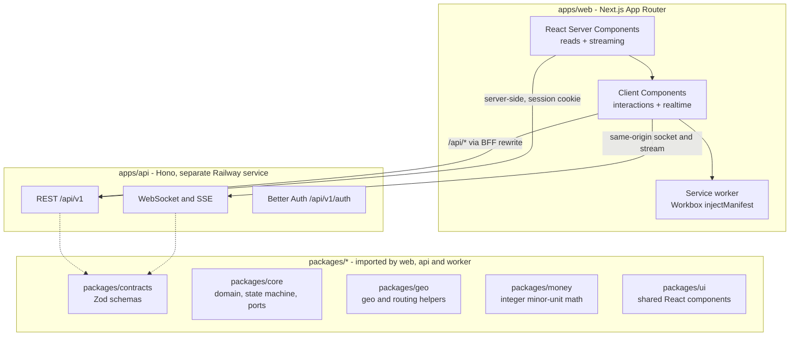

# QuickDrop - Frontend Architecture

Status: pre-implementation design. Planning only; no application code exists as of 2026-10-05.

Sibling docs: [00-product-brief.md](./00-product-brief.md) · [01-tech-stack.md](./01-tech-stack.md) · [02-architecture.md](./02-architecture.md) · [03-data-model.md](./03-data-model.md) · [04-api-contract.md](./04-api-contract.md) · [**05-realtime-and-tracking.md**](./05-realtime-and-tracking.md) · [08-testing-strategy.md](./08-testing-strategy.md) · [09-infrastructure-and-cost.md](./09-infrastructure-and-cost.md) · [DECISIONS.md](./DECISIONS.md) · [docs index](./README.md)

Version claims are taken verbatim from [../stack_report.md](../stack_report.md) and are not re-researched here. Launch locale, launch currency and the tile provider are **not** decided; see §12.

> **Naming note.** [./README.md](./README.md) reserves `04-frontend-pwa.md` for this surface and `05-payments-and-ledger.md` / `06-dispatch-and-tracking.md` for other surfaces. The filename requested for this work is `06-frontend-architecture.md`, so the `06` slot is contested and `04-frontend-pwa.md` has no file. Filenames were left exactly as requested; reconciling the index is a decision for the index owner.

---

## 1. Scope and shape

One Next.js codebase, one installable PWA, three role-routed surfaces: `/customer`, `/courier`, `/ops`. The API, realtime gateway and workers are a **separate Hono service** ([02-architecture.md](./02-architecture.md) §2.1). The Next app is a rendering and client-runtime layer, not a second backend.



Four rules the rest of this document depends on:

1. **The web container never writes shipment or ledger state.** It reads, renders, and proxies. Business rules for dispatch and money live in `apps/api` and `apps/worker` ([02-architecture.md](./02-architecture.md) §2.1).
2. **The browser only ever talks to one origin.** `next.config.ts` rewrites `/api/*` to the API origin, so session cookies are first-party and `SameSite` actually protects them ([Next.js rewrites](https://nextjs.org/docs/app/api-reference/config/next-config-js/rewrites), [04-api-contract.md](./04-api-contract.md) §5.1). There is no cross-origin client request anywhere in this app.
3. **Every wire type is defined once**, in `packages/contracts`, and consumed by both sides. Client and gateway validate against the same Zod schema, so a protocol change cannot drift into "works on web, 500s in the gateway".
4. **Nothing depends on the service worker staying alive.** iOS terminates workers aggressively ([WebKit on service workers](https://webkit.org/blog/8090/workers-at-your-service/)); the worker is a performance and offline-UX layer only ([01-tech-stack.md](./01-tech-stack.md) ADR-5).

### 1.1 Repository layout

Per [09-infrastructure-and-cost.md](./09-infrastructure-and-cost.md) §5.1, extended with the packages this document needs.

```
apps/
  api/            Hono REST + WebSocket + SSE      -> Railway service "api"
  worker/         BullMQ consumers                 -> Railway service "worker"
  ops/            Railway service definitions + deploy scripts
  web/            Next.js App Router PWA           -> Railway service "web"   <-- THIS DOC
packages/
  core/           domain logic, ports, state machine
  db/             Drizzle schema, migrations, seed
  ui/             shared React components
  contracts/      Zod schemas, the single wire source of truth
  auth/           session and role resolution shared by web and api
  geo/            geo helpers, routing provider interface
  money/          integer minor-unit arithmetic
  config/         eslint, tsconfig, vitest presets
infra/
  prometheus/  compose/  osrm/
```

`packages/ui` exists so shared components are not owned by the web app. When the ops console or any other surface needs them they import from the package, not from `apps/web`.

---

## 2. Route map

### 2.1 Next.js routes

```mermaid
flowchart TD
  root["/ root layout.tsx"]
  root --> pub["(public)"]
  root --> auth["(auth)"]
  root --> cust["(customer)"]
  root --> cour["(courier)"]
  root --> ops["(ops)"]
  root --> off["/offline"]
  root --> assets["/manifest.webmanifest, /sw.js"]

  pub --> P1["/ landing or role redirect"]
  pub --> P2["/install install education"]
  pub --> P3["/support"]

  auth --> A1["/sign-in  /sign-up  /verify"]
  auth --> A2["/forgot-password  /reset-password"]
  auth --> A3["/onboarding courier profile, vehicle, documents"]

  cust --> C1["/customer active and past shipments"]
  cust --> C2["/customer/new booking wizard"]
  cust --> C3["/customer/shipments/[shipmentId] LIVE TRACKING"]
  cust --> C4["/customer/shipments/[shipmentId]/details"]
  cust --> C5["/customer/shipments/[shipmentId]/receipt"]
  cust --> C6["/customer/addresses  /customer/settings  /customer/support"]

  cour --> R1["/courier today: jobs and availability"]
  cour --> R2["/courier/jobs/[shipmentId] job execution + LIVE GPS"]
  cour --> R3["/courier/earnings  /courier/availability"]
  cour --> R4["/courier/offline outbox inspector"]
  cour --> R5["/courier/settings"]

  ops --> O1["/ops dashboard KPIs and alerts"]
  ops --> O2["/ops/dispatch LIVE DISPATCH BOARD"]
  ops --> O3["/ops/shipments  /ops/shipments/[shipmentId]"]
  ops --> O4["/ops/couriers  /ops/couriers/[courierId]"]
  ops --> O5["/ops/incidents"]
  ops --> O6["/ops/ledger  /ops/pricing"]
```



### 2.2 Route table

Access is enforced twice: `middleware.ts` for a fast optimistic redirect based on cookie presence, and the role layout's server-side session check as the authoritative gate. Middleware must never be the only check.

| Route | Layout | Access | Rendering | Primary data | Notes |
|---|---|---|---|---|---|
| `/` | `app/layout.tsx` | public | Server | session role | Redirects by role; landing when signed out |
| `/install` | `app/(public)/layout.tsx` | public | Server shell + client card | `GET /api/v1/app/version` | Install education, iOS manual steps (§7) |
| `/support` | `app/(public)/layout.tsx` | public | Server | static | Referenced by the degraded tracking UI |
| `/sign-in`, `/sign-up`, `/verify` | `app/(auth)/layout.tsx` | public | Client form | `/api/v1/auth/{provider}` | Better Auth handlers, reached through the BFF so the cookie is first-party |
| `/forgot-password`, `/reset-password` | `app/(auth)/layout.tsx` | public | Client form | `/api/v1/auth/*` | Never reveals whether an account exists |
| `/onboarding` | `app/(auth)/layout.tsx` | authenticated | Client form + server save | `/api/v1/courier/profile`, `/documents`, `/vehicles`, `/connect/onboarding` | Courier only; `vehicle_type` is the canonical enum |
| `/customer` | `app/(customer)/layout.tsx` | `customer`, `ops` | Server list + client filters | `GET /api/v1/shipments` | Active first, history cursor-paginated |
| `/customer/new` | `app/(customer)/layout.tsx` | `customer` | Server shell + client wizard | `POST /api/v1/quotes`, `POST /api/v1/geocode` | Step in the URL: `?step=addresses&step=service&step=review&step=payment` (§5.2) |
| `/customer/shipments/[shipmentId]` | `app/(customer)/shipments/[shipmentId]/layout.tsx` | owner `customer`, `ops` | **Server shell + streamed sections + client map and stream** | `GET /api/v1/shipments/{id}` then WS or SSE | The tracking route; §4.3 |
| `…/[shipmentId]/details` | same | owner `customer`, `ops` | Server | `GET /api/v1/shipments/{id}/events` | Immutable history, RSC-heavy |
| `…/[shipmentId]/receipt` | same | owner `customer`, `ops` | Server | `GET /api/v1/shipments/{id}/receipt` | Money formatting only, never client arithmetic (§10.2) |
| `/customer/addresses` | `app/(customer)/layout.tsx` | `customer` | Server list + client form | `/api/v1/addresses` | `PATCH` and `DELETE` need `If-Match` |
| `/customer/settings` | `app/(customer)/layout.tsx` | `customer` | Client form | session, notifications | Push subscription registration lives here |
| `/courier` | `app/(courier)/layout.tsx` | `courier` | Server list + client toggle | `GET /api/v1/courier/shipments/active`, `/offers` | **Offline-first** (§6.4) |
| `/courier/jobs/[shipmentId]` | `app/(courier)/layout.tsx` | assigned `courier` | **Server shell + client tracker** | `/api/v1/courier/shipments/{id}` | Capture and throttle per [05](./05-realtime-and-tracking.md) §3 and §5 |
| `/courier/earnings` | `app/(courier)/layout.tsx` | `courier` | Server | `GET /api/v1/courier/earnings`, `/payouts` | Read-only over the ledger; `adjustment_minor` renders as an explicit red line |
| `/courier/availability` | `app/(courier)/layout.tsx` | `courier` | Client | `PUT /api/v1/courier/availability` | Optimistic and queueable (§6.4); `If-Match` required |
| `/courier/offline` | `app/(courier)/layout.tsx` | `courier` | Client | IndexedDB only | Outbox inspector, rejected-fix counters, "clear cache" |
| `/ops` | `app/(ops)/layout.tsx` | `ops` | Server KPIs + client feed | `/api/v1/ops/*` | |
| `/ops/dispatch` | `app/(ops)/layout.tsx` | `ops` | **Server shell + client board** | `GET /api/v1/ops/dispatch-board` + `WS /api/v1/ws/ops` | Keyboard operable (§9.5) |
| `/ops/shipments`, `/ops/shipments/[shipmentId]` | `app/(ops)/layout.tsx` | `ops` | Server + client drawer | `/api/v1/ops/shipments` | Force-assign and cancel need `If-Match` |
| `/ops/couriers`, `/ops/couriers/[courierId]` | `app/(ops)/layout.tsx` | `ops` | Server + client | `/api/v1/ops/couriers` | Detail includes the downsampled 24 h trail |
| `/ops/incidents` | `app/(ops)/layout.tsx` | `ops` | Server + client | `tracking_degraded` and failed jobs | Fed by [05](./05-realtime-and-tracking.md) §17 |
| `/ops/ledger`, `/ops/pricing` | `app/(ops)/layout.tsx` | `ops` | Server, read-only | `/api/v1/ops/ledger/*`, `/service-zones`, `/surge-rules` | Balances come from the API and are never summed client-side |
| `/offline` | `app/layout.tsx` | public | Server | none | Navigation fallback the worker serves (§6.2) |

Ids in the URL are `shipment_id` UUIDs. `public_ref` (`QD-7F3K9Q`) is the human-facing reference used in support copy and receipts, never as a route key ([04-api-contract.md](./04-api-contract.md) §0).

### 2.3 The BFF, not a route-handler backend

There are **no business route handlers in the Next app**. `next.config.ts` carries a single rewrite:

```ts
// next.config.ts
const API_ORIGIN = process.env.API_ORIGIN!; // https://api.internal

export default {
  output: 'standalone',
  async rewrites() {
    return [{ source: '/api/:path*', destination: `${API_ORIGIN}/api/:path*` }];
  },
};
```

Consequences the app must live with:

- `POST /api/v1/webhooks/stripe` reaches Stripe through the same hostname and the rewrite forwards the raw body unchanged, so there is no webhook handler to maintain in `apps/web`.
- `POST /api/v1/auth/{provider}` sets the session cookie on the app origin, which is the entire point of the topology.
- `GET /api/v1/app/version` is the build handshake the update banner uses (§7.4).
- Server-side fetches use `lib/server/apiFetch.ts`: server-only, 15 s budget, forward-only cookie session, `cache: 'no-store'` by default with explicit `next: { revalidate, tags }` at call sites ([04-api-contract.md](./04-api-contract.md) §6).
- The only Next-owned HTTP responses are `/manifest.webmanifest` and `/sw.js`, because both need build-time injection.

---

## 3. Folder structure

```
apps/web/
├─ app/
│  ├─ layout.tsx                 # <html>, lang/dir, theme bootstrap, providers, SkipLink
│  ├─ manifest.ts                # MetadataRoute.Manifest
│  ├─ globals.css                # Tailwind 4 entry: @import "tailwindcss"; @theme tokens
│  ├─ not-found.tsx  global-error.tsx
│  ├─ (public)/  layout.tsx  page.tsx  install/page.tsx  support/page.tsx
│  ├─ (auth)/    layout.tsx  sign-in/  sign-up/  verify/  forgot-password/  reset-password/  onboarding/
│  ├─ (customer)/
│  │  ├─ layout.tsx              # role guard + AppShell with bottom tab bar
│  │  ├─ page.tsx  new/  addresses/  settings/  support/
│  │  └─ shipments/[shipmentId]/
│  │     ├─ layout.tsx           # guard + Suspense shell + header + live region host
│  │     ├─ page.tsx             # streams one section per boundary
│  │     ├─ loading.tsx  error.tsx  not-found.tsx
│  │     └─ details/  receipt/
│  ├─ (courier)/
│  │  ├─ layout.tsx              # role guard + OfflineBar + UpdateBanner
│  │  ├─ page.tsx  earnings/  availability/  offline/  settings/
│  │  └─ jobs/[shipmentId]/page.tsx
│  ├─ (ops)/
│  │  ├─ layout.tsx              # role guard + OpsShell with side rail
│  │  └─ page.tsx  dispatch/  shipments/  couriers/  incidents/  ledger/  pricing/
│  ├─ offline/page.tsx
│  └─ sw[.]js/route.ts           # serves the compiled worker at /sw.js, Service-Worker-Allowed: /
│
├─ components/
│  ├─ ui/                        # role-agnostic kit; token-only; no domain imports
│  ├─ layout/                    # AppShell, BottomTabBar, OpsShell, PageHeader, SkipLink, ConnectionChip, UpdateBanner
│  ├─ map/                       # MapLibre wrapper; domain-blind; renders what it is handed
│  │  ├─ MapCanvas.tsx           # owns the Map instance; imperative API via context
│  │  ├─ layers/buildQuickDropStyle.ts   # StyleSpecification factory
│  │  ├─ layers/liveLayers.ts    # the layer stack from [05](./05-realtime-and-tracking.md) §14.2
│  │  └─ tileProvider.ts         # OQ-3 adapter; the only file that knows the tile vendor
│  ├─ tracking/                  # shared by /customer and /ops; identical state vocabulary
│  │  ├─ TrackingSurface.tsx     # map + status + ETA composition, props-driven
│  │  ├─ CourierTracker.tsx      # /courier only: permission UX, throttle state, battery chip
│  │  ├─ StatusBadge.tsx  EtaPanel.tsx  ProgressBar.tsx  StaleBanner.tsx  StatusTimeline.tsx
│  │  └─ DispatchBoard.tsx       # /ops only: grid, keyboard model, live rows
│  ├─ customer/  courier/  ops/  # role-only composition; never import each other
│
├─ features/
│  ├─ tracking/                  # the live tracking feature, per [05](./05-realtime-and-tracking.md)
│  │  ├─ geolocation.ts  throttle.ts  fixFilter.ts
│  │  ├─ connection.ts           # transport ladder: ws -> sse -> poll
│  │  ├─ sseClient.ts  pollClient.ts
│  │  ├─ renderer.ts  kalman.ts  deadReckoning.ts  mapMatch.ts  staleness.ts
│  │  └─ useTrackingStream.ts
│  ├─ booking/  offers/  earnings/  dispatchBoard/
│
├─ lib/
│  ├─ api/        client.ts  queryKeys.ts  apiError.ts  idempotencyKey.ts
│  ├─ server/     apiFetch.ts  session.ts  env.ts  logger.ts  cache.ts
│  ├─ idb/        client.ts  outbox.ts  prefs.ts  blobs.ts
│  ├─ i18n/       messages/en.ts  index.ts  paths.ts
│  ├─ formatters/ currency.ts  dateTime.ts  distance.ts  duration.ts
│  ├─ hooks/      # React-only hooks
│  └─ utils.ts  result.ts
│
├─ stores/                       # Zustand client state. Nothing that belongs in the URL, the query cache or IndexedDB.
│  ├─ trackingStore.ts           # transportState, renderClock, lastFrameSeq, staleness
│  ├─ courierSessionStore.ts     # availability optimistic value, pending flush queue
│  ├─ opsBoardStore.ts           # viewport, selection, keyboard cursor, layer toggles
│  ├─ outboxStore.ts             # mirror of IndexedDB depth for badges
│  └─ installStore.ts            # install prompt capture, dismissals
│
├─ service-worker/
│  ├─ sw.ts                      # Workbox source
│  ├─ routes.ts                  # route-class registry, the single source of truth for §6
│  ├─ messaging.ts               # SKIP_WAITING, RELOAD_CLIENTS, MINT_REALTIME_TOKEN
│
├─ styles/        globals.css  tokens.css  themes.css  utilities.css
├─ tests/         e2e/  unit/  a11y/
├─ public/        icons/  fonts/   # map glyph fonts only; UI uses the system stack
├─ next.config.ts  middleware.ts  tsconfig.json  biome.json  package.json
└─ README.md
```

### 3.1 Import discipline

- `components/ui/**` may import only `lib/utils`, `lib/formatters` and `styles/tokens`. A `no-restricted-imports` lint rule forbids it from importing `lib/api`, `features/**`, `packages/core` domain code or any role folder. That one rule is what keeps the kit reusable.
- `components/map/**` is shared but **domain-blind**: it renders whatever GeoJSON it is handed. `components/tracking/**` composes the map with status and ETA semantics and is shared by `/customer` and `/ops` because both need identical vocabulary.
- Role folders never import each other. If two roles need something, it moves to `components/tracking` or `components/ui`.
- Design tokens have exactly one definition, `styles/tokens.css`. `packages/core` may export business constants and state labels but never colours.

---

## 4. Server and Client Component boundaries

### 4.1 Rules

| Rule | Detail |
|---|---|
| Default to Server | A component that renders data and has no interactivity is a Server Component. RSC ships no JavaScript |
| `"use client"` only for | event handlers, effects, browser APIs (`geolocation`, `navigator`, `serviceWorker`, `matchMedia`, `Battery`, `IntersectionObserver`), or a store subscription |
| Push the directive down | The leaf that needs interactivity takes it, not the page. `TrackingSurface.tsx` is a client component receiving a serialisable `initial` prop |
| Never re-fetch what an RSC fetched | Pass it down. A duplicate fetch is how a tracking page ends up showing two different ETAs |
| Server Actions for form mutations | Progressive enhancement, works without JS, and one place for idempotency keys |
| TanStack Query owns client-initiated reads and mutations | Especially anything that must work offline (§5.3) |
| No browser globals at module scope | A module imported by both an RSC and a client component must not touch `window` at import time |
| Three intentional boundaries, not three hundred | `TrackingSurface`, `CourierTracker`, `DispatchBoard`; everything else follows the leaf rule |

### 4.2 Boundary map

| Concern | RSC | Client | Why |
|---|---|---|---|
| Route chrome, headers, role shell, bottom tabs | yes | — | must paint immediately, needs no JS |
| Shipment status text (initial) | yes | hydrated for live updates | server-rendered first paint; the live region replaces its text without re-rendering the shell |
| Live map (`MapCanvas`) | — | **yes** | MapLibre needs `window`, WebGL and a canvas. Renders from props and stream frames only |
| Map style | built in a shared pure module | imported by the client component | testable and token-driven without shipping a JSON blob |
| Courier tracker | — | **yes** | `navigator.geolocation`, `navigator.getBattery()`, IndexedDB writes ([05](./05-realtime-and-tracking.md) §3, §5) |
| ETA panel | initial value yes | live value yes | first paint server-rendered, later values from `tracking.frame` frames ([05](./05-realtime-and-tracking.md) §11) |
| Timeline, details, receipt | yes | — | immutable history |
| Ops dispatch board | shell + initial rows | **yes** | keyboard model, live rows and selection are client state; initial rows stream in so the board is never empty on arrival |
| Booking wizard | shell + quote | **yes** | multi-step, URL-persisted, live pricing |
| Forms | — | yes, submitted to a Server Action | client validation with the shared Zod schema; the action is the mutation boundary |
| Session reads | yes | — | `lib/server/session.ts` is server-only; the client receives a serialisable user object as props |
| Anything reading a live stream | — | yes | sockets and streams are client transports |

### 4.3 Streaming on the tracking page

`app/(customer)/shipments/[shipmentId]/layout.tsx` renders the header, the status text and the live-region host immediately, then streams the rest. `loading.tsx` matches the final layout so there is no shift.

```tsx
// app/(customer)/shipments/[shipmentId]/page.tsx
export default async function TrackingPage({
  params,
}: {
  params: Promise<{ shipmentId: string }>;
}) {
  const { shipmentId } = await params;
  return (
    <>
      <StatusRegion shipmentId={shipmentId} />
      <Suspense fallback={<EtaPanelSkeleton />}>
        <EtaSection shipmentId={shipmentId} />
      </Suspense>
      <Suspense fallback={<MapSkeleton />}>
        <MapSection shipmentId={shipmentId} />
      </Suspense>
      <Suspense fallback={<CourierCardSkeleton />}>
        <CourierCardSection shipmentId={shipmentId} />
      </Suspense>
      <Suspense fallback={<TimelineSkeleton />}>
        <TimelineSection shipmentId={shipmentId} />
      </Suspense>
    </>
  );
}
```

One boundary per section, not one per page: a single page-level boundary gives an all-or-nothing paint, which is exactly what a tracking page must not have.

- Never `await` a slow dependency in the layout above the boundaries.
- Tag every fetch (`next: { tags: ['shipment', id] }`) so a state transition can `revalidateTag` and refresh quickly.
- `error.tsx` per segment: a failed route fetch shows an inline "map unavailable" card, not a broken page.
- The map section must never block the status text. A customer needs "your parcel is on the way" even when tiles are slow.

---

## 5. State management

### 5.1 Four tiers, and why

| Tier | Owned by | Examples | Rationale |
|---|---|---|---|
| **URL state** | `searchParams` / `pathname` | wizard step, tracking shipment id, board filters (`status`, `zone`, `q`, `sort`, `selected`), courier day | shareable, back-button correct, survives reload and a cold start from a saved shortcut, and is the only tier that survives storage eviction |
| **Server state** | **TanStack Query v5** | shipments, quotes, jobs, earnings, ops rows, board rows | cache, dedupe, background refetch, stale-while-revalidate, optimistic mutation and offline persistence from one library with one mental model |
| **Client state** | **Zustand 5** | transport state, render clock, availability, board selection and cursor, outbox depth, install prompt | small, no context ceremony, selector subscriptions that do not re-render the tree, trivially resettable per surface |
| **Imperative, outside React** | renderer refs | marker coordinates, filter covariance | the marker is not React state at all (§5.4) |

**Neither library is pinned.** The research report carries no version for either. Adopting TanStack Query v5 and Zustand 5 is a proposal, not a decision, and needs a [DECISIONS.md](./DECISIONS.md) entry in Iteration 0 before `pnpm add` (§12).

Explicitly not used, and why:

- **Redux Toolkit.** No cross-cutting write-heavy workflow needs a single reducer graph or time-travel devtools. Most "app state" here is URL or server state; the genuinely local state is one boolean and one snapshot.
- **Jotai or Recoil.** Fine alternatives. Zustand is proposed because it can hold a **mutable, non-reactive** field via `subscribeWithSelector` plus a plain ref, which is what a frame-rate marker path needs. If the marker ever moves to a WebGL overlay, revisit the choice.
- **React Context for data.** Context re-renders the whole subtree on value change, which is precisely wrong for a marker moving several times a second.

### 5.2 Per-flow decisions

| Flow | Tiers | Implementation |
|---|---|---|
| **Booking form** | URL (step) + client (draft) + server (submission) | the step lives in `?step=` so Back works and a shared link resumes. Field values are **not** in the URL: addresses in a URL leak into history and analytics. The draft lives in Zustand, mirrored to `idb/prefs` debounced at 400 ms. Validation uses the shared Zod schema per step. Submission is a Server Action calling `POST /api/v1/shipments` with an `Idempotency-Key` derived from a client action id |
| **Live tracking** | client (Zustand + imperative renderer) | a live position is a stream, not server state in the TanStack Query sense. `trackingStore` holds `{ transportState, renderClock, lastFrameSeq, lastPositionSeq, staleness, clockOffsetMs }`. The marker position is a **mutable ref inside the renderer**, so React never re-renders on a position change. `tracking.frame` frames feed the renderer directly ([05](./05-realtime-and-tracking.md) §13). TanStack Query covers only the initial shipment, route and courier fetch, plus invalidation when a transition was missed offline. `lastFrameSeq` guards duplicates and a gap triggers a resync |
| **Courier availability** | server state + optimistic client | availability is server-owned and read by the assignment query ([03-data-model.md](./03-data-model.md)), so it cannot live only on the client. `PUT /api/v1/courier/availability` is a TanStack mutation with optimistic write and rollback, carries `If-Match`, and is also queued when offline because it is not money-affecting (§6.4) |
| **Ops dispatch board** | URL (filters, selection) + Zustand (viewport, cursor, layers) + TanStack Query (rows, KPIs) | filters and the selected shipment are URL state so a dispatcher can paste a link to a colleague and a saved shortcut deep-links correctly. Rows use `placeholderData: keepPreviousData`, because a board that blanks on every poll is unusable. Live position per row arrives on **one** `WS /api/v1/ws/ops` connection into `opsBoardStore`, not from 40 queries. Viewport mode (`fitBounds` vs `follow`) is local. The keyboard cursor is local and resets when the row set changes |
| **Offer accept/decline** | server only, never queued | accepting a job you cannot see is an operational hazard, and offers are TTL-bound server state. The UI disables it offline with an explanation |

### 5.3 Query keys and cache policy

```ts
// lib/api/queryKeys.ts
export const qk = {
  shipment:        (id: string) => ['shipment', id] as const,
  shipmentTracking:(id: string) => ['shipment', id, 'tracking'] as const,
  shipmentEvents:  (id: string) => ['shipment', id, 'events'] as const,
  shipmentReceipt: (id: string) => ['shipment', id, 'receipt'] as const,
  myShipments:      (cursor?: string) => ['shipments', 'me', cursor ?? 'first'] as const,
  quote:            (id: string) => ['quote', id] as const,
  addresses:        () => ['addresses'] as const,
  courierActive:    () => ['courier', 'shipments', 'active'] as const,
  courierEarnings:  (range: string) => ['courier', 'earnings', range] as const,
  courierPayouts:   () => ['courier', 'payouts'] as const,
  dispatchBoard:    (f: OpsFilters) => ['ops', 'dispatch-board', f] as const,
  opsShipments:     (f: OpsFilters) => ['ops', 'shipments', f] as const,
  opsCouriers:      (f: OpsFilters) => ['ops', 'couriers', f] as const,
};
```

| Setting | Value | Why |
|---|---|---|
| `staleTime` | 15 s tracking-adjacent, 60 s ops rows, 5 min earnings | ops rows are expensive and tolerate staleness; earnings change slowly |
| `refetchOnWindowFocus` | `false` on live routes, `true` elsewhere | the stream owns live routes; refetching on focus fights the socket |
| `retry` | 2, exponential backoff, same `Idempotency-Key` | matches the BFF retry policy ([04-api-contract.md](./04-api-contract.md) §6) |
| persistence | `@tanstack/query-sync-storage-persister` over a hand-rolled IndexedDB adapter | the persisted cache holds addresses and shipment history; too much for a 5 MB synchronous `localStorage` store |
| `gcTime` | 24 h for shipment lists, 7 days for addresses, 0 for tracking | tracking is streamed, not cached |

### 5.4 Why the marker is not in React

| Layer | Holds | Rate |
|---|---|---|
| React state | status text, ETA, staleness banner, list rows | on change, seconds |
| Zustand (`trackingStore`) | transport state, clock offset, sequence, staleness | on frame, 1 to 5 s |
| Renderer ref | marker coordinates, filter covariance | every animation frame |
| MapLibre `setData` | the rendered GeoJSON | 20 to 60 fps |

`useSyncExternalStore` subscribes the few components that must react to staleness; everything else reads through the renderer's subscription API. This is the difference between a smooth map and a janky one on a mid-range Android phone.

---

## 6. Offline and caching

The service worker is hand-rolled on Workbox, built with `workbox-build` in **`injectManifest` mode** as a separate step, never by a bundler plugin, and `next.config.ts` sets `output: 'standalone'` ([01-tech-stack.md](./01-tech-stack.md) ADR-5). Serwist stays available as a swap if the `injectManifest` integration proves painful; decide that in Iteration 0, not later.

iOS terminates workers aggressively ([WebKit on service workers](https://webkit.org/blog/8090/workers-at-your-service/)), so **no correctness may depend on the worker being alive**.

### 6.1 Build and version handshake

1. `apps/web/service-worker/sw.ts` is the Workbox source, sitting beside `app/`, `components/` and `lib/` because the web app has no `src/` directory.
2. `pnpm sw:build` runs `workbox-build injectManifest` against the Next build output, producing a revision-keyed worker bundle. The compiled artefact is **not** written into `public/`: anything in `public/` is served as a static file by Next.js and would bypass the route handler in step 4, which is the only place that can set the required headers. It is written to a build directory that `sw[.]js/route.ts` streams from.
3. A build assertion fails the build if the injected revision does not match the current Next build id. A bad revision can serve a stale shell indefinitely, and that has to be a build failure rather than a field incident.
4. The worker is served by the route handler at `app/sw[.]js/route.ts`, which exists purely so the response can carry `Service-Worker-Allowed: /` and `Cache-Control: no-cache`. The `[.]` escape is required: a folder literally named `sw.js` is read by Next.js as the file extension `.js`, and a folder named `sw` would serve the worker at `/sw`, which fails the same-origin and scope checks the registration requires.
5. Registration happens from a client component after `load`.

### 6.2 Route classes

| Class | Contents | Strategy |
|---|---|---|
| **Precache** | build manifest assets, icons, `/offline`, the auth and install shells | `PrecacheRoute` at install; cache name `qd-precache-{BUILD_ID}` |
| **Static assets** | `/_next/static/**`, icons | `CacheFirst`, hashed filenames, effectively immutable |
| **Map tiles, glyphs, sprites** | tile provider paths | `CacheFirst`, bounded LRU, **full `200` responses only** (§6.7) |
| **Documents** | `/customer/**`, `/courier/**`, `/ops/**` | `NetworkFirst`, 3 s timeout, then cache, then `/offline` |
| **API reads** | `/api/v1/**` GET | §6.3 |
| **API writes** | every non-GET | `NetworkOnly`, never cached, never queued by the worker |
| **Realtime** | `/api/v1/ws/**`, `/api/v1/stream/**`, `/api/v1/realtime/token` | explicitly denied; the worker must not intercept |

There is no Background Sync registration in the routing table, because iOS Safari does not support it ([caniuse](https://caniuse.com/background-sync)). If `'sync' in registration` is ever true it is registered as an opportunistic extra, never as the only drain path. The drain happens on `online`, on `visibilitychange`, on socket connect and on a foreground timer.

### 6.3 Per-endpoint policy

| Endpoint | Strategy | Cache | Note |
|---|---|---|---|
| `GET /api/v1/shipments` | `NetworkFirst`, 3 s | 30 entries / 24 h | `NetworkFirst` rather than `StaleWhileRevalidate` because a stale shipment list is misleading |
| `GET /api/v1/shipments/{id}` | `NetworkFirst` | 50 / 24 h | |
| `GET /api/v1/shipments/{id}/tracking` | `NetworkFirst` | 20 / 5 min | this is the **polling** path, not a stream; caching it is what lets a frozen shipment render offline |
| `GET /api/v1/shipments/{id}/events` | `CacheFirst`, 10 min | 50 / 30 d | immutable once written |
| `GET /api/v1/addresses` | `StaleWhileRevalidate` | 20 / 7 d | stable list |
| `GET /api/v1/courier/shipments/active`, `/offers` | `CacheFirst`, 5 min | 10 | "cached today's route"; must survive a tunnel |
| `GET /api/v1/quotes/{id}` | `NetworkOnly` | — | quotes expire in 10 minutes; a cached quote is a wrong quote |
| `GET /api/v1/courier/earnings`, `/payouts` | `NetworkFirst` | 10 / 24 h | money reads are never stale-served without a visible timestamp |
| `GET /api/v1/ops/**` | `NetworkFirst`, 2 s | 20 / 15 min | ops staleness is visible and labelled |
| every `POST` / `PUT` / `PATCH` / `DELETE` | `NetworkOnly` | — | queueing is the app outbox's job, never the worker's |
| `/api/v1/ws/**`, `/api/v1/stream/**`, `/api/v1/realtime/token` | `NetworkOnly`, denied | — | |

Never cached, always: any response carrying a session cookie that might be replayed, any 4xx or 5xx, and any ops HTML beyond a single cached fallback copy.

### 6.4 The courier app offline design

Per queued action:

```
queued (IndexedDB)  --flush-->  inflight  --ack-->  done (deleted)
                          \--nack(retryable)--> backoff (attempts++, scheduledAt = now + backoff)
                          \--nack(final)-----> dead (kept, surfaced in /courier/offline)
```

| Action | Queueable | Notes |
|---|---|---|
| Position batch | **yes** | the core case. Written before send, deleted on `positions.ack`, replayed with the **original `batch_id` and `position_seq`** ([05](./05-realtime-and-tracking.md) §8) |
| `arrive-pickup`, `pickup`, `arrive-dropoff` confirmations | **yes** | optimistic UI: the badge changes instantly with a "pending sync" chip that clears on ack. Each carries `If-Match` with the version it was rendered against, so a stale replay gets `412` rather than silently overwriting |
| Delivery proof (photo, signature) | **yes, size-gated** | blobs go to IndexedDB keyed by client action id and the outbox record references the blob. Capped at 20 queued proofs and 50 MB with an explicit "waiting to upload" state |
| Availability | **yes** | optimistic; must flush before the courier takes another job |
| Note to dispatch | **yes** | |
| Offer accept or decline | **no, explicitly blocked** | accepting a job you cannot see is an operational hazard; disabled offline with an explanation |
| **Anything money-affecting** | **never** | payout and tax forms, refund or adjustment requests, card capture, dispute evidence, OTP verification. These fail loudly and immediately with "you are offline and this cannot be completed offline". A queued money write that later fails is a reconciliation incident ([03-data-model.md](./03-data-model.md) §7) |

The courier surface contains no money mutations at all, because customers pay at booking. That is what makes the last row easy to honour.

Optimistic rules: render the optimistic state with a `pending` visual and a "will sync" chip, **never** claim success, and keep queue depth visible in a persistent `OfflineBar`. Above 500 queued records, say "tracking is behind" rather than silently discarding, because iOS may evict storage at any time ([Apple Web Storage](https://developer.apple.com/documentation/webkitjs/working_with_web_storage)).

### 6.5 Storage under eviction

- `navigator.storage.persist()` is requested once after a courier's first completed job; the outcome is reported on `/courier/offline` ([Storage quotas, MDN](https://developer.mozilla.org/en-US/docs/Web/API/Storage_API/Storage_quotas_and_eviction_criteria)).
- Every read path that touches the outbox refetches authoritative state from the API first, then reconciles. The outbox is a hint queue, never truth.
- A `storage.persisted() === false` warning is shown to couriers on iOS, because a silently evicted outbox is the hardest bug to explain to a support agent.

### 6.6 IndexedDB

```ts
// lib/idb/client.ts - one database, versioned, feature-detected
const DB_NAME = 'quickdrop';
const DB_VERSION = 1;  // bump and add an upgrade handler per change; never drop a store in the field

export const STORES = {
  outbox:        { keyPath: 'batch_id',          indexes: ['byKindCreatedAt', 'byShipment', 'byScheduledAt'] },
  shipmentCache: { keyPath: 'shipment_id',       indexes: ['byUpdatedAt', 'byCustomer'] },
  jobCache:      { keyPath: 'shipment_id',       indexes: ['byDate'] },
  proofBlobs:    { keyPath: 'client_action_id',  indexes: ['byShipment'] },
  prefs:         { keyPath: 'key',               indexes: [] },
  renderClock:   { keyPath: 'shipment_id',       indexes: [] },  // survives reload; prevents marker rewind
} as const;

type OutboxRecord = {
  batch_id: string;          // uuid, client-generated; makes replay idempotent
  client_action_id: string;  // idempotency key for a courier action
  kind: 'positions' | 'shipment_action' | 'availability' | 'proof' | 'note';
  courier_id: string;
  shipment_id: string | null;
  position_seq_high: number; // monotonic; preserves replay order
  payload: unknown;          // validated with the shared Zod schema before insert
  blob_refs: string[];
  created_at: number;
  scheduled_at: number;
  attempts: number;
  last_attempt_at: number | null;
  last_error: { code: string; retryable: boolean } | null;
};

type RenderClockRecord = { shipment_id: string; last_frame_seq: number; last_position_seq: number };
```

Rules: outbox payloads are validated with the same Zod schema before insert, because a corrupt record must never reach the gateway. Writes batch into one transaction per flush cycle. Every read uses an index, never a full scan. `prefs` carries install dismissals, wizard drafts, theme and accessibility preferences.

`renderClock` persisting across reloads is a small thing with a large payoff: it is what stops a marker from visibly rewinding when a courier's phone reloads the job page.

### 6.7 Tiles and range requests

Vector tile archives are fetched with HTTP `Range` headers. Caching a `206 Partial Content` response as if it were a whole entry corrupts the archive. The worker therefore caches full `200` responses and passes `206` straight through, and the build assertion fails if a runtime route can capture a range request ([Service Worker API, MDN](https://developer.mozilla.org/en-US/docs/Web/API/Service_Worker_API)).

### 6.8 Offline behaviour per surface

| Surface | Offline behaviour |
|---|---|
| `/offline` | always precached. Explains the loss, offers Retry and a link to `/support` |
| `/customer` | last shipments from the persisted query cache with a "showing saved shipments" banner; pull to refresh revalidates |
| `/customer/new` | the wizard loads; autocomplete and live pricing **fail visibly** with an inline notice, and submission is blocked with a clear message rather than failing at the API |
| `/customer/shipments/[id]` | renders from cache with the last known position and the `StaleBanner`. **Never claims live tracking** while offline ([05](./05-realtime-and-tracking.md) §17) |
| `/courier` | **full offline operation for the day**: job list, addresses, notes, expected sequence |
| `/courier/jobs/[id]` | job details, status actions with optimistic UI, geolocation, queueing. The only route where writes happen offline |
| `/courier/offline` | always reachable; a client component reading IndexedDB with no network need |
| `/ops/**` | network-first only. A dispatcher who loses connectivity sees "live updates paused, reconnecting" and the last board snapshot, with no write actions |

---

## 7. PWA install and update UX

### 7.1 Manifest

`app/manifest.ts` is a route handler so build versions can be injected:

```ts
import type { MetadataRoute } from 'next';

export default function manifest(): MetadataRoute.Manifest {
  return {
    name: 'QuickDrop',
    short_name: 'QuickDrop',
    description: 'On-demand courier pickups with live tracking',
    start_url: '/?source=pwa',
    scope: '/',
    display: 'standalone',
    orientation: 'portrait-primary',
    background_color: '#ffffff',
    theme_color: '#0b5fff',
    lang: process.env.NEXT_PUBLIC_DEFAULT_LOCALE ?? 'en',
    dir: 'ltr',
    categories: ['business', 'productivity', 'utilities'],
    icons: [
      { src: '/icons/icon-192.png',          sizes: '192x192', type: 'image/png', purpose: 'any' },
      { src: '/icons/icon-512.png',          sizes: '512x512', type: 'image/png', purpose: 'any' },
      { src: '/icons/icon-512-maskable.png', sizes: '512x512', type: 'image/png', purpose: 'maskable' },
      { src: '/icons/icon-mono-512.png',     sizes: '512x512', type: 'image/png', purpose: 'monochrome' },
    ],
    shortcuts: [
      { name: 'Track a parcel', url: '/customer' },
      { name: "Today's jobs",  url: '/courier' },
      { name: 'Dispatch board', url: '/ops/dispatch' },
    ],
  };
}
```

Required and optional members follow [MDN Web App Manifest](https://developer.mozilla.org/en-US/docs/Web/Manifest): `name`, `short_name`, `start_url`, `display`, `icons`, `theme_color`, `background_color`, `scope`, plus `lang`, `dir`, `description`, `categories`, `shortcuts`. `prefer_related_applications` is deliberately omitted because no native app is planned ([ADR-0006](./DECISIONS.md#adr-0006--pwa-only-no-native-app-for-v1)).

Maskable icons draw inside the 80 percent safe zone with a full-bleed background so an adaptive-icon mask never clips the letterform. `theme_color` is also emitted as `<meta name="theme-color">` with light and dark media variants. iOS needs `apple-touch-icon` at 180x180 without transparency and `apple-mobile-web-app-capable`, and iOS ignores manifest icons for the home screen ([PWA installation on iOS](https://web.dev/learn/pwa/installation/#ios-installation)).

`lang` comes from configuration, not a hard-coded `en-GB`. The launch locale is an open decision (§12).

### 7.2 Install prompt capture

```ts
// hooks/useInstallPrompt.ts -> stores/installStore.ts
interface BeforeInstallPromptEvent extends Event {
  prompt(): Promise<void>;
  userChoice: Promise<{ outcome: 'accepted' | 'dismissed' }>;
}

useEffect(() => {
  const onPrompt = (e: Event) => {
    e.preventDefault();
    setPromptEvent(e as BeforeInstallPromptEvent);
  };
  window.addEventListener('beforeinstallprompt', onPrompt);
  window.addEventListener('appinstalled', onInstalled);
  return () => {
    window.removeEventListener('beforeinstallprompt', onPrompt);
    window.removeEventListener('appinstalled', onInstalled);
  };
}, []);
```

| Platform | Behaviour |
|---|---|
| Android, Chrome, Edge | `beforeinstallprompt` fires. Show a dismissible `InstallBanner` with **Install** and **Not now**; persist the dismissal and do not show again for 90 days |
| iOS Safari | **no event is fired.** Detect via `/iP(hone|ad|od)/` plus `navigator.standalone`, then route to `/install` with explicit Share to Add to Home Screen steps. The copy explains why: "Add QuickDrop to your Home Screen so live tracking keeps working when you switch apps" |
| Already installed | `navigator.standalone === true` or a `display-mode: standalone` match hides all install UI |
| Desktop | `beforeinstallprompt` in Chromium; the banner targets the courier layout only |

User-agent sniffing is a known-weak pattern, so the manual `/install` page is always linked as the fallback for everyone.

### 7.3 Install education

| Surface | Trigger | Content |
|---|---|---|
| `/install` | manual, from the banner fallback, linked from `/courier/settings` | platform steps, the iOS 16.4 push requirement ([Web Push on iOS](https://webkit.org/blog/13878/web-push-for-web-apps-on-ios-and-ipados/)), and a data-safety summary: location only while tracking a job |
| `/courier` | after the second completed job, once | "Add to Home Screen so you can track deliveries with one tap" |
| `UpdateBanner` | whenever a new build is waiting (§7.4) | "New version available, reload" |

### 7.4 Update flow

1. `pnpm sw:build` produces the versioned worker (§6.1). Registration happens after `load`, with `registration.update()` every 60 minutes and on `visibilitychange -> visible`.
2. **The in-app version banner is authoritative, not the worker.** The shell payload carries `GET /api/v1/app/version`; if it differs from the stored build id, `UpdateBanner` appears regardless of worker state, because iOS may have terminated the worker and no update event will ever fire.
3. A new worker installs, waits, and does **not** auto-activate.
4. Reload posts `{ type: 'SKIP_WAITING' }`. The worker calls `self.skipWaiting()` and broadcasts `{ type: 'RELOAD_CLIENTS' }`.
5. `controllerchange` clears the query cache, resets `trackingStore`, then `router.refresh()`. `clientsClaim()` is used **only** on the skip-waiting message: an automatic claim would swap assets under a running map mid-delivery.
6. If a courier is mid-delivery with an unsent outbox, the reload is deferred until the outbox drains or 60 s pass. Duplicate frames would be harmless anyway because `batch_id` and `position_seq` make replay idempotent, so this is belt and braces.

```ts
// components/layout/AppShell.tsx
navigator.serviceWorker.addEventListener('controllerchange', () => {
  queryClient.clear();
  useTrackingStore.getState().reset();
  router.refresh();
});
```

---

## 8. Design system

Tailwind CSS with CSS-first configuration and one token file. No colour values in a JS config, no hard-coded hex in a component.

### 8.1 Tokens

```css
/* styles/tokens.css */
@import "tailwindcss";
@theme {
  --color-brand-50:  oklch(0.97 0.02 258);
  --color-brand-600: oklch(0.55 0.19 258);   /* theme_color */

  --color-surface-0: oklch(1 0 0);
  --color-surface-1: oklch(0.985 0.003 258);
  --color-surface-2: oklch(0.96 0.005 258);
  --color-line-strong: oklch(0.85 0.006 258);
  --color-line-soft:   oklch(0.93 0.004 258);
  --color-ink-strong:  oklch(0.22 0.01 258);
  --color-ink:         oklch(0.42 0.01 258);
  --color-ink-muted:   oklch(0.58 0.01 258);

  /* one token per canonical shipment state, see 03-data-model.md section 2.1 */
  --color-state-requested:        var(--color-ink-muted);
  --color-state-quoted:           var(--color-ink-muted);
  --color-state-awaitingPayment:  var(--color-ink-muted);
  --color-state-matched:          var(--color-ink-muted);
  --color-state-matching:         var(--color-ink-muted);
  --color-state-assigned:         oklch(0.62 0.14 245);
  --color-state-arrivedAtPickup:  oklch(0.62 0.14 245);
  --color-state-pickedUp:         oklch(0.58 0.17 150);
  --color-state-inTransit:        oklch(0.58 0.17 150);
  --color-state-arrivedAtDropoff: oklch(0.58 0.17 150);
  --color-state-delivered:        oklch(0.52 0.16 150);
  --color-state-returned:         oklch(0.55 0.12 300);
  --color-state-failed:           oklch(0.55 0.21 25);
  --color-state-cancelled:        var(--color-ink-muted);
  --color-state-disputed:         oklch(0.60 0.19 330);
  --color-state-live:             oklch(0.55 0.19 258);

  --spacing: 0.25rem;

  --font-sans: ui-sans-serif, system-ui, -apple-system, "Segoe UI", Roboto, sans-serif;
  --text-xs: 0.75rem;  --text-sm: 0.875rem;  --text-base: 1rem;
  --text-lg: 1.125rem; --text-2xl: 1.5rem;  --text-4xl: 2.25rem;
  --leading-tight: 1.2;  --leading-normal: 1.5;

  --radius-sm: 6px; --radius-md: 10px; --radius-lg: 16px; --radius-full: 9999px;

  --duration-fast: 120ms; --duration-base: 200ms; --duration-slow: 320ms;
  --ease-out: cubic-bezier(0.16, 1, 0.3, 1);
  --ease-in-out: cubic-bezier(0.65, 0, 0.35, 1);

  --shadow-sheet: 0 -8px 24px oklch(0 0 0 / 0.12);
  --shadow-card: 0 1px 2px oklch(0 0 0 / 0.06), 0 4px 12px oklch(0 0 0 / 0.04);
}

@media (prefers-reduced-motion: reduce) {
  *, *::before, *::after {
    animation-duration: 0.01ms !important;
    transition-duration: 0.01ms !important;
  }
}
```

Colour is only ever consumed as a token. Status is also expressed as a `data-status` attribute so a badge renders correctly without colour (§8.5). The reduced-motion block is global so no component can forget it.

### 8.2 Theming

| Concern | Decision |
|---|---|
| Modes | `data-theme="light" | "dark"` on `<html>`; `system` is the default and `prefers-color-scheme` drives it before first paint via an inline script in the root layout, so there is no flash |
| User override | stored in `prefs.theme`, exposed in both settings pages. **System stays the default**: courier phones are outdoors in daylight |
| Persistence | `localStorage` for theme only, because it is needed pre-paint and is small. Everything else in IndexedDB |
| Map style | `buildQuickDropStyle({ mode })` returns the light or dark `StyleSpecification`; swapping styles re-registers live sources and re-seeds the renderer ([05](./05-realtime-and-tracking.md) §13.5) |
| Tile provider | resolved through `components/map/tileProvider.ts`, the only file that knows the vendor. OQ-3 is undecided, so no provider is hard-coded here |
| `theme-color` meta | emitted with light and dark media variants so the iOS status bar matches |

### 8.3 Component inventory

Shared kit in `packages/ui` and `components/ui`: `Button` (variants `primary | secondary | ghost | danger`, sizes `sm | md | lg`), `Input`, `Textarea`, `Select`, `Checkbox`, `Radio`, `Sheet` (bottom sheet on mobile, dialog on desktop), `Dialog`, `Toast` (with `aria-live`), `StatusBadge`, `Skeleton`, `EmptyState`, `ErrorState`, `OfflineState`, `Chip`, `Timeline`, `Tabs`, `Tooltip`, `Menu`, `Avatar`, `NumberStepper`, `Rating`, `SignaturePad`, `CameraCapture`, `Stepper`, `LiveRegion`, `VisuallyHidden`, `SkipLink`.

| Flow | Components |
|---|---|
| Customer booking | `Stepper`, `AddressForm`, `AddressAutocomplete`, `ServiceSelector`, `DateTimeSlotPicker`, `PriceSummary`, `PaymentSheet`, `Sheet` |
| Customer tracking | `TrackingSurface`, `MapCanvas`, `StatusBadge`, `EtaPanel`, `ProgressBar`, `StaleBanner`, `StatusTimeline`, `CourierCard` |
| Courier job | `CourierTracker`, `JobCard`, `StatusActions`, `ProofCapture`, `NavigationButton`, `OfflineBar`, `BatteryChip`, `OutboxPanel` |
| Ops dispatch | `DispatchBoard`, `OpsSideRail`, `KpiTile`, `AssignDialog`, `IncidentTable`, `FilterBar`, `Drawer` |

### 8.4 Motion

| Token | Use |
|---|---|
| `--duration-fast` 120 ms | hover, focus ring, badge change |
| `--duration-base` 200 ms | sheet and drawer transitions |
| `--duration-slow` 320 ms | route draw-in, marker re-anchor tween |
| `--ease-out` | anything entering |
| `--ease-in-out` | anything reversible |

The courier marker's movement is **not** a CSS animation; it is driven by the Kalman filter and dead-reckoning loop ([05](./05-realtime-and-tracking.md) §13). The pulse layer respects `prefers-reduced-motion`. Position updates in the ops board's dense list never animate.

### 8.5 Status badge semantics

Colour is never the sole carrier of meaning. Every badge has an icon, a text label and a `data-status` attribute. The state column is the **canonical `shipment_state` enum** ([`03-data-model.md` §2.1](./03-data-model.md#21-shipment)); this table maps it to copy and must not invent names.

| `shipment_state` | Customer label | Token | Icon | Live-region announcement |
|---|---|---|---|---|
| `requested` | Finding a courier | `state-requested` | clock | "Searching for a courier" |
| `quoted` | Quote ready | `state-quoted` | tag | "Your quote is ready" |
| `awaiting_payment` | Waiting for payment | `state-awaitingPayment` | card | "Waiting for payment" |
| `matched` | Finding a courier | `state-matched` | clock | "Searching for a courier" |
| `matching` | Contacting couriers | `state-matching` | radio | "Contacting nearby couriers" |
| `assigned` | Courier on the way to pickup | `state-assigned` | user | "Your courier is on the way to the pickup address" |
| `arrived_at_pickup` | Courier at pickup | `state-arrivedAtPickup` | map-pin | "Your courier has arrived at the pickup address" |
| `picked_up` | Picked up | `state-pickedUp` | package-check | "Your parcel has been picked up" |
| `in_transit` | On the way to drop-off | `state-inTransit` | truck | "Your parcel is on the way" |
| `arrived_at_dropoff` | Courier at drop-off | `state-arrivedAtDropoff` | map-pin | "Your courier has arrived at the drop-off address" |
| `delivered` | Delivered | `state-delivered` | check | "Your parcel has been delivered" |
| `returned` | Returned to sender | `state-returned` | undo | "Your parcel is being returned to the sender" |
| `failed` | Delivery failed | `state-failed` | alert | "Delivery failed. Our team is looking into it" |
| `cancelled` | Cancelled | `state-cancelled` | x | "This shipment was cancelled" |
| `disputed` | Under review | `state-disputed` | scale | "This delivery is under review" |

Three non-shipment badges exist for the tracking surface: `live` (streaming), `degraded` (SSE or polling, or stale past 30 s), and `lost` (stale past 120 s). They map one-to-one to the `StaleBanner` states and the two-tier staleness rules ([05](./05-realtime-and-tracking.md) §13.6).

---

## 9. Accessibility

Target: **WCAG 2.2 level AA**, verified in CI with axe plus keyboard-only journey tests on both Chromium and WebKit ([08-testing-strategy.md](./08-testing-strategy.md), [ADR-0018](./DECISIONS.md#adr-0018--webkit-runs-in-ci-from-day-one)).

### 9.1 Commitments

| Criterion | Commitment |
|---|---|
| 1.4.3 Contrast (Minimum) | all text at least 4.5:1; ramps authored in OKLCH with documented pairs, checked by a unit test over both themes |
| 1.4.11 Non-text Contrast | focus rings, control borders, map markers and the accuracy circle at 3:1 against their background |
| 1.4.1 Use of Colour | status is always icon plus text plus colour; nothing is colour-only |
| 2.1.1 / 2.1.2 Keyboard | every function reachable and operable by keyboard; the map has a full list alternative |
| 2.4.7 Focus Visible | a 2 px focus ring on every interactive element, never removed |
| 2.4.11 Focus Not Obscured (2.2) | sticky headers, `OfflineBar` and the bottom tab bar never cover the focused element; verified in the keyboard test and auto-hidden on scroll |
| 2.5.7 Dragging Movements (2.2) | every drag gesture has a single-pointer alternative: zoom buttons, an explicit recentre and close, and a Refresh button |
| 2.5.8 Target Size (Minimum) (2.2) | every target at least 24x24 CSS px, with 44x44 as the mobile default |
| 3.2.6 Consistent Help (2.2) | the help affordance sits in the same position on every surface |
| 3.3.7 Redundant Entry (2.2) | the wizard never asks for an address it already holds |
| 3.3.8 Accessible Authentication (2.2) | no cognitive-functionality test in sign-in; OTP offered alongside password |
| 2.3.3 Animation from changes | reduced motion honoured globally; the map pulse and route draw-in are the only non-essential animations |
| 4.1.2 Name, Role, Value | custom widgets expose correct roles and state including `aria-expanded`, `aria-selected`, `aria-current` |

### 9.2 The map is a secondary presentation

A map is unusable with a screen reader, so the hierarchy is text first, map second:

1. The map container is `aria-hidden="true"` and `role="presentation"` with a visually hidden caption. No map control is in the tab order.
2. A sibling text panel carries **everything** the map shows: status, courier location in words, ETA range with confidence, addresses, remaining distance, and a timestamped "last updated".
3. `<SkipLink href="#shipment-status">Skip the map</SkipLink>` is the first focusable element on the tracking page.
4. Every map interaction has a button equivalent: `Recentre`, `Zoom in`, `Zoom out`, `Follow courier`, and a `List` toggle that swaps the map for a plain steps list. Dragging is never the only way to do anything.
5. Location in words is derived, not invented: "near the ferry building, heading south-east, about 3.2 km from the drop-off", from the same filtered position already in the payload. Never a bare compass bearing.

### 9.3 Live regions

| Region | `aria-live` | Used for | Rules |
|---|---|---|---|
| `#shipment-status` | `polite` | state changes | one sentence, no jargon, no ETA re-announcement; debounced at 500 ms so a burst collapses into one announcement |
| `#tracking-eta` | `off` by default, `polite` on opt-in | ETA range changes | re-announcing ETA every few seconds would be hostile; even when opted in, only on 5-minute band changes |
| `#connection` | `polite` | transport changes, "connection lost", "back online" | says the thing the user must know, once |
| `#urgent` (courier only) | `assertive` | job assigned, proof upload failed, outbox full | reserved for interruptions, maximum two per minute |
| toasts | `polite` | form results, sync confirmations | never the only report of a state change; the badge text changes too |

Implementation is one `LiveRegion` per surface with an `announce(message, politeness)` API writing to a visually hidden element. Never `document.title` juggling for status: it is not announced reliably and it hijacks the tab.

### 9.4 Focus management on transitions

| Transition | Behaviour |
|---|---|
| wizard step change | focus moves to the step heading (`tabIndex={-1}`); the previous step's fields leave the DOM |
| booking to confirmation | focus to the new shipment's `<h1>`; the success banner is `role="status"` |
| sheet opened (proof capture, courier card) | focus trapped, `aria-modal="true"`, restored to the trigger on close |
| board row to detail drawer | focus moves into the drawer heading; `Esc` closes and restores focus to the originating row |
| offline bar appearing | never steals focus; announced through `#connection` instead |
| route change within `/ops/dispatch` | focus is **preserved**: an SPA navigation must not reset the keyboard cursor to the document start |

`useFocusTrap` is a small hand-rolled hook (scope, `Esc`, restore on close, inert background) rather than a dependency, and `template.tsx` is deliberately unused so focus is not reset on every navigation.

### 9.5 Keyboard-only operation of the dispatch board

`role="grid"` with a roving `tabindex`: one tab stop for the whole grid, arrow keys inside it.

| Key | Action |
|---|---|
| `Tab` / `Shift+Tab` | leave the grid, or enter it if focus was outside |
| Arrow keys | move the cell cursor; `Home`/`End` to row ends, `Ctrl+Home`/`Ctrl+End` to grid ends |
| `PageUp` / `PageDown` | move a viewport of rows |
| `Enter` | open the detail drawer |
| `Space` | pin or unpin (the pinned set is URL state) |
| `A` | open the assign dialog for the focused shipment |
| `F` | toggle follow-courier on the focused shipment's map |
| `M` | toggle the map entirely |
| `/` | focus the filter search field |
| `?` | open the shortcut help dialog |
| `Esc` | close the topmost layer and restore focus |

Rows use `role="row"` with `aria-rowindex` against a known `aria-rowcount`, cells use `role="gridcell"` with `aria-colindex`. The ETA cell is text, not colour. Live position updates are announced only for the **focused** row, throttled to one announcement per 30 s, because a board updating every few seconds must not spam a screen reader. `aria-busy` is set on the grid during a refetch. A real `<table>` view with sortable headers exists for dispatchers who prefer it, and the board is fully usable with the map absent.

---

## 10. Localisation and formatting

### 10.1 Scope

One locale at launch, but **no string is hard-coded in a component**. All copy lives in `lib/i18n/messages/en.ts` as a nested typed dictionary, so `t('tracking.stale.lost')` is type-checked and a missing key is a compile error. A later locale is a mechanical change rather than a rewrite. The launch locale itself is undecided (§12).

### 10.2 Numbers, money, dates

```ts
// lib/formatters/currency.ts - minor units in, formatted string out, never arithmetic
export const formatMoney = (amountMinor: number, currency: string, locale: string) =>
  new Intl.NumberFormat(locale, { style: 'currency', currency }).format(amountMinor / 100);

// lib/formatters/dateTime.ts
export const formatDateTime = (iso: string, timeZone: string, locale: string) =>
  new Intl.DateTimeFormat(locale, { dateStyle: 'medium', timeStyle: 'short', timeZone })
    .format(new Date(iso));
```

| Concern | Rule |
|---|---|
| Money | always `Intl.NumberFormat` with the **shipment's** currency, always integer minor units on the wire ([03-data-model.md](./03-data-model.md) §7). Never floats, never client arithmetic. `adjustment_minor` is rendered as an explicit red line, because a courier who cannot see a deduction treats it as a bug ([04-api-contract.md](./04-api-contract.md) §2.10) |
| Dates and times | the user's IANA timezone from the profile, the shipment's timezone for pickup windows, 12 or 24 hour per locale. The slot picker shows the timezone abbreviation when it differs from the user's |
| Durations | `Intl.RelativeTimeFormat` for "in 12 minutes"; a `formatDuration` helper renders ranges from the ETA confidence band ([05](./05-realtime-and-tracking.md) §11.4) |
| Distances | `Intl.NumberFormat` with `style: 'unit'` and the locale's unit system. The source is metres; no rounding above 100 m, one decimal below 1 km |
| Coordinates | never shown raw. "3.2 km away" or an address. Raw coordinates appear only in an ops debug view |
| Freshness | relative time **plus** an absolute time on hover and focus, so "2 minutes ago" is never the only record |
| Form input | accepts only the locale's separators; parsing strips both |

### 10.3 Address entry

| Layer | Implementation |
|---|---|
| Model | structured fields in the shared Zod schema: `line1`, `line2`, `city`, `region`, `postal_code`, `country_code`, `lat`, `lng`, `place_id`, plus a display `formatted`. These are the `addresses` columns ([03-data-model.md](./03-data-model.md)) |
| Autocomplete | against `POST /api/v1/geocode`, which is our own proxy with a rate limit protecting the upstream. That keeps keystrokes off a third party and removes the API-key surprise |
| Manual entry | always available and first in the tab order. Autocomplete is a convenience, never a gate: geocoders fail on new buildings |
| Pick on map | optional tap-to-pin with reverse geocode and a draggable pin |
| Validation | the shared Zod schema with a small per-country pattern table; coordinates required before submission; `place_id` stored so the API can re-validate |
| Countries | the launch country is undecided (§12). Multi-country adds a picker, per-country formats and a courier-timezone rule |
| Courier surface | read-only structured display with one-tap Call and Navigate. Navigating hands off to an external maps app, which stops tracking, so the UI warns "tracking pauses while the navigation app is open" ([05](./05-realtime-and-tracking.md) §16) |

### 10.4 RTL readiness

So a first RTL market needs no rewrite:

- `lang` and `dir` come from the root layout, derived from the active locale rather than hard-coded.
- Only **logical** properties and utilities in components: `ms-`, `me-`, `ps-`, `pe-`, `start`, `end`, `text-start`, `border-s`. Zero `ml-`, `mr-`, `left`, `right`; a lint rule enforces it.
- Directional icons mirror via a `dir`-driven transform, never a hard-coded chevron.
- Numbers, currency, dates and distances all come from `Intl`, which is direction-aware.
- The map is geometrically direction-agnostic; label placement follows `text-field` with no hard-coded anchor.
- `tests/a11y/rtl.spec.ts` runs critical journeys under `dir="rtl"` with a pseudo-locale to catch hard-coded text and fixed widths.
- Sequencing and progress are expressed with position, not arrows, so a timeline reads correctly in both directions.

---

## 11. Testing surface for this app

The toolchain is already decided in [08-testing-strategy.md](./08-testing-strategy.md); this section only records what the web app must supply.

| Suite | Tool | Must cover |
|---|---|---|
| unit | **Vitest** | throttle table and hysteresis, Kalman convergence and EMA fallback, dead-reckoning caps, staleness bands, formatters, token contrast over both themes |
| component | **Testing Library** + Vitest | each `components/ui` primitive, `StatusBadge` across all 15 states, live-region announcements, `OfflineBar` and `UpdateBanner` |
| integration | **MSW** | the BFF rewrite path, `Idempotency-Key` propagation, `If-Match` on versioned writes, RFC 9457 error rendering, `409` reconciliation |
| e2e | **Playwright, `chromium` and `webkit`** | the golden path end to end; courier offline mid-route asserting a forward-only path and the connection-lost state; install flow; worker update flow; ops board keyboard-only operation |
| a11y | axe + Playwright | every surface, both themes, plus a keyboard-only journey and an `rtl` pass |

Rules that keep this suite honest:

- **No `.only` in a diff.** CI rejects it as a hard failure.
- The courier-offline E2E is the test that catches iOS tracking regressions, and it must not be skipped ([08-testing-strategy.md](./08-testing-strategy.md) E4).
- Geolocation is scripted, never real, in CI. Real-device field measurement is a manual lane ([DECISIONS.md](./DECISIONS.md) ADR-0021).
- The worker's cache policy is asserted directly: a build must fail if a runtime route can capture a range request, and if the injected revision does not match the build id.

---

## 12. Open questions and required decisions

### 12.1 Decisions needed before implementation

| Ref | Item | Consequence if unresolved | Owner |
|---|---|---|---|
| D1 | **Pin TanStack Query and Zustand.** The report carries no version for either. This document proposes v5 and v5. | no package can be added, so no state layer can be built | Engineering, Iteration 0 |
| D2 | **Launch locale and currency.** Affects the manifest `lang`, address formats, timezone defaults and the money locale | these get hard-coded and become a migration | Product |
| D3 | **Tile provider and terms (OQ-3).** `components/map/tileProvider.ts` is the seam; nothing else may name a vendor | the map layer gets built against the wrong contract | Architecture |
| D4 | **Routing provider (OQ-3).** OSRM, Valhalla or GraphHopper | the courier leg rendering and the ETA fallback cannot be built | Architecture |
| D5 | **Geocoding upstream.** `POST /api/v1/geocode` proxies something; which something, and under what terms | autocomplete cannot ship, and manual-only entry becomes mandatory | Architecture |
| D6 | **i18n framework.** Typed dictionary now, `next-intl` only when a second locale is committed | low risk either way | Engineering |
| D7 | **Turbopack versus webpack.** The report flags custom worker integration under Turbopack as unverified. The `workbox-build` step is bundler-agnostic, but dev-mode worker registration still needs verification against the pinned Next version | a broken dev loop in week one | Engineering |
| D8 | **Phone and postal validation libraries** versus pattern tables for the launch country | a wrong phone number is a failed delivery | Engineering |
| D9 | **Better Auth mount location.** [02-architecture.md](./02-architecture.md) §2.1 gives the web container "Better Auth sign-in and OTP entry", while [04-api-contract.md](./04-api-contract.md) §1.6 mounts the handlers on the API at `/api/v1/auth/*`. This document follows the API mount reached through the BFF, because that is what makes the cookie first-party | cookie domain confusion, which is a security bug not a styling one | Engineering with Architecture |

### 12.2 Notes, not questions

- The document filename collides with the `06` slot reserved in [./README.md](./README.md), and `04-frontend-pwa.md` has no file. Left as requested.
- The launch-playbook flag `flag_tracking_live` has a UI consequence worth stating here: turning it off removes live updates and the UI shows status, last-known state and a manually managed ETA. Honest degradation beats a wrong map ([11-launch-playbook.md](./11-launch-playbook.md)).

---

## 13. Document index

| Section | Contents |
|---|---|
| [1. Scope and shape](#1-scope-and-shape) | Containers, the four governing rules, repository layout |
| [2. Route map](#2-route-map) | Next routes, access control, and the BFF rewrite |
| [3. Folder structure](#3-folder-structure) | Where everything lives, and the import rules that keep it honest |
| [4. Component boundaries](#4-server-and-client-component-boundaries) | RSC versus client, and streaming on the tracking page |
| [5. State management](#5-state-management) | Four tiers, per-flow decisions, query policy, and why the marker is not React state |
| [6. Offline and caching](#6-offline-and-caching) | Worker build, route classes, endpoint policy, outbox, eviction, IndexedDB, range requests |
| [7. PWA install and updates](#7-pwa-install-and-update-ux) | Manifest, prompt capture, education, update handshake |
| [8. Design system](#8-design-system) | Tokens, theming, inventory, motion, badge semantics for all 15 states |
| [9. Accessibility](#9-accessibility) | WCAG 2.2 commitments, map as secondary presentation, live regions, focus, board keyboard model |
| [10. Localisation](#10-localisation-and-formatting) | Dictionary approach, money and time rules, addresses, RTL readiness |
| [11. Testing surface](#11-testing-surface-for-this-app) | What each suite must cover |
| [12. Open questions](#12-open-questions-and-required-decisions) | Nine decisions that block implementation |

Companion documents: [04-api-contract.md](./04-api-contract.md) for every endpoint and payload this app calls, [05-realtime-and-tracking.md](./05-realtime-and-tracking.md) for the tracking feature this app renders, [01-tech-stack.md](./01-tech-stack.md) for the worker and UI decisions, [08-testing-strategy.md](./08-testing-strategy.md) for the wider verification plan.