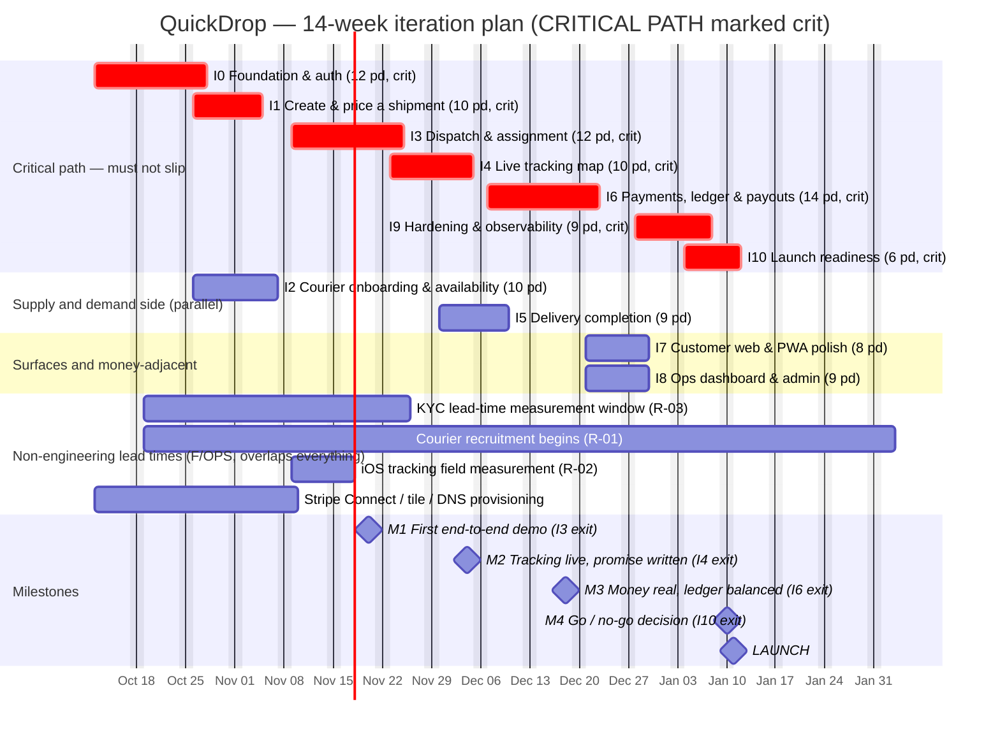

# 07-roadmap.md — QuickDrop Iteration Plan

**Status:** Planning only (pre-implementation). This document owns the iteration count and per-iteration Definition of Done.

**Last updated:** 2026-10-05  
**Related documents (existing on disk):**
- [README.md](./README.md) — docs index and reading order
- [00-product-brief.md](./00-product-brief.md) — MoSCoW stories, assumptions, personas
- [01-tech-stack.md](./01-tech-stack.md) — pinned versions and rejected alternatives
- [DECISIONS.md](./DECISIONS.md) — running ADR log
- [02-architecture.md](./02-architecture.md) — containers, dispatch, race conditions
- [03-data-model.md](./03-data-model.md) — ER, state machines, double-entry ledger
- [04-api-contract.md](./04-api-contract.md) — endpoints, authz, idempotency, rate limits
- [05-realtime-and-tracking.md](./05-realtime-and-tracking.md) — position streaming, throttling, ETA, iOS limits
- [06-frontend-architecture.md](./06-frontend-architecture.md) — routes, state, offline, service worker, a11y
- [08-testing-strategy.md](./08-testing-strategy.md) — test pyramid, load targets, CI gating
- [09-infrastructure-and-cost.md](./09-infrastructure-and-cost.md) — Compose, CI/CD, migrations, observability, cost
- [10-risk-register.md](./10-risk-register.md) — 26 risks, top-5 deep dives, assumptions register
- [11-launch-playbook.md](./11-launch-playbook.md) — go/no-go, phased rollout, rollback, incidents
- [stack_report.md](../stack_report.md) — read-only pinned stack research
- [AGENTS.md](../AGENTS.md) — house style rules

> **How to use this document:** Treat each iteration as a demoable vertical slice that cuts through `web/`, `api/`, `data/`, `worker/`, `infra/`, and `test/`. Do not read this as a "models first" or "API first" plan. The table of iterations below is the high-level view; details follow in later sections. Cross-links are to files that exist on disk, and every cross-reference in the doc set has been repointed at the twelve canonical filenames; see [the doc index](./README.md#document-index).

---

## 1. Planning assumptions for the schedule itself

The schedule is built around concrete constraints from the plan. Where assumptions are load-bearing, they are marked **OPEN** if not yet validated.

| ID | Schedule assumption | Rationale | Impact if wrong |
|---|---|---|---|
| SA-01 | **Team size 2–4 engineers.** If team is 1 person, runway is not 14 weeks. If team is 6, some parallelism can increase but coordination cost rises. | Matches [10-risk-register.md § Owners](10-risk-register.md#how-to-read-this-register) (F, ENG-A, ENG-B, ENG-C, OPS roles mapped to 2–4 engineers). | 1-person: iterate slower, cut scope more aggressively, accept longer runway. 6-person: add coordination overhead, reduce per-person bus factor risk but increase integration surface. |
| SA-02 | **One city at launch, one timezone, one operating region.** | Matches [00-product-brief.md A-01](00-product-brief.md#1-assumptions). Keeps dispatch to a single-radius problem. | Multi-region forces per-region zones, pricing tables, courier eligibility — pushes parts of later work to v2. |
| SA-03 | **~14-week runway (pre-seed).** | Stated in [10-risk-register.md](10-risk-register.md) (top risks, "14 weeks is not enough" — R-20). Iterations I0–I10 cover ~14 calendar weeks of effort with controlled overlap. | If runway drops below 12 weeks, cut Must items first (not polish). If runway grows, pull Should items from deferred list. |
| SA-04 | **Pre-seed, not venture-funded at scale.** | Cost model targets modest scale ([09-infrastructure-and-cost.md](09-infrastructure-and-cost.md), ~$253/mo month 1, ~$3,559/mo month 6 with contingency). | Large burn rate changes the "move fast but measure margin" constraint ([10-risk-register.md R-09](10-risk-register.md#r-09--cost-creep-and-negative-contribution-margin-per-delivery)). |
| SA-05 | **iOS PWA reality is foreground-first.** Continuous background tracking on iOS Safari is not achievable in a browser ([stack_report.md §2](../stack_report.md#2-pwa--ios-constraints), [WebKit Geolocation](https://developer.apple.com/documentation/webkitjs/geolocation)). | Drives staleness handling, heartbeat, installed-PWA measurement, and a native-wrapper contingency (R-02). | If continuous background becomes a compliance requirement, v1 cannot satisfy it; native wrapper (Capacitor) for courier app becomes necessary. |
| SA-06 | **Launch city and currency undeclared.** *placeholder* — affects pricing, Stripe fees, zones. | [AGENTS.md § Known blockers](../AGENTS.md#known-blockers-as-of-2026-10-06) calls this out. Fares in [00-product-brief.md](00-product-brief.md) are illustrative USD. | Currency affects Stripe fee math and ledger; city affects legal classification (R-04). These must be pinned before or at I2 (pricing) and before I6 (payouts). |

---

## 2. Iteration methodology

The governing philosophy: **every iteration is a demoable vertical slice** that cuts through every layer (UI → API → DB → worker), never a horizontal "build all models" phase.

### Rules an iteration must satisfy

1. **Demoable vertical slice.** The iteration produces something a real user can try: e.g. quote → book → assign → track → complete for a minimal happy path. No "schema freeze" iteration that cannot be demoed.
2. **Cut through layers.** Each iteration touches `web/`, `api/`, `data/`, `worker/`, `infra/`, `test/` as appropriate. Layer-by-layer builds are disallowed.
3. **User-value oriented.** Each iteration maps to MoSCoW stories from [00-product-brief.md](00-product-brief.md) (use the IDs present there: `C-x` customer, `K-x`/`R-x` courier, `O-x` ops as written in the brief). Where the brief uses a different courier prefix (e.g. `US-Rx`), the roadmap preserves that scheme and notes it in context.
4. **Falsifiable DoD.** Exit criteria include tests, observability, and security checks; "done when code compiles" is insufficient.
5. **Concurrency and correctness first.** Race-safety (optimistic locking / `SELECT ... FOR UPDATE SKIP LOCKED`), idempotency, illegal state transitions → `409`, and money never as float are enforced from the first money-bearing slice (I6) and respected earlier where relevant.
6. **iOS reality baked in.** Staleness detection, heartbeat, installed-PWA measurement, and offline queue behavior are considered from the first tracking slice (I4) onward (per SA-05).
7. **Small, time-boxed.** Target **1–2 weeks** per iteration. Effort given in person-days with confidence (S/M/L). Person-day totals must be internally consistent with the gantt.

### Explicit anti-patterns avoided

- **Big-bang integration.** No "integrate everything at the end" — integration is part of each vertical slice.
- **Layer-by-layer builds.** No "first all models, then all endpoints, then UI". Each slice crosses layers.
- **"90% done" iterations.** If manual QA script cannot run end-to-end on staging (or local dev stack once I0 lands), the iteration is not done.
- **Iteration scope creep.** New requirements go through the change control process (defined in final section); they do not silently expand the current iteration.

### What counts as an iteration

An iteration counts when it can be **demonstrated** by running the Manual QA script for that iteration against a working environment (local via docker compose once I0 provides it, or staging once pipeline exists). The demo must show the vertical slice working end-to-end.

### Table of iterations at a glance

| ID | Name | Goal (demoable outcome) | Person-days (est.) | Confidence | Dependencies |
|---|---|---|---|---|---|
| I0 | Foundation & auth | Repo bootstrap, pnpm workspaces, local dev (Postgres+PostGIS+Redis), CI, schema baseline, Better Auth for all roles, deploy pipeline to staging. Retire TS 7.0 build risk and SW-with-Next build risk early. | 10–14 | M | None |
| I1 | Create & price a shipment | Address entry, geocode, zone check, distance/quote, price breakdown locked (no payment yet). Demo: quote → show locked price. | 8–12 | M | I0 |
| I2 | Courier onboarding & availability | Courier profile, KYC stub + Stripe Connect onboarding start (measure real lead time), go online/offline, position reporting. Demo: courier comes online and reports position. | 8–12 | M | I0 |
| I3 | Dispatch & assignment | PostGIS candidate search, ranking with fairness, offer/accept, double-dispatch prevention, customer notification. Demo: quote→book→offer→accept end-to-end. | 10–14 | M | I1, I2 |
| I4 | Live tracking map | MapLibre, WS position stream + fan-out, customer/courier views, ETA with staleness UI, heartbeat, installed-PWA tracking. Demo: moving dot, staleness withdrawn when stale. | 8–12 | M | I3 |
| I5 | Delivery completion | Pickup/delivery confirmation, proof of delivery, full state machine enforced, custody transfer, failure paths. Demo: happy path to delivered. | 8–10 | M | I4 |
| I6 | Payments, ledger & payouts | Stripe Connect separate charges/transfers, integer minor units, hand-rolled double-entry ledger (DB-enforced balance), idempotency keys, reconciliation hooks, payout batch. Demo: pay → ledger balanced → payout recorded. | 12–16 | M | I5, I2 |
| I7 | Customer web experience & PWA polish | Full customer journey polish, manifest, offline queue behavior, install UX (iOS manual Add-to-Home-Screen), a11y pass. Demo: installed PWA UX. | 7–10 | M | I6 |
| I8 | Ops dashboard & admin | Dispatch board, live map of all shipments/couriers, force-assign/reassign, refunds/disputes, user management, audit trail. Demo: ops can resolve exception end-to-end. | 8–11 | M | I6 |
| I9 | Hardening, security & observability | Rate limiting, audit logs, error tracking, metrics, load testing (500 viewers per shipment), security review, ledger 100% coverage gate, webhook idempotency/order tolerance. Demo: load test report + green gates. | 7–11 | M | I7, I8 |
| I10 | Launch readiness | Staging soak, go/no-go checklist, phased rollout rehearsal, rollback rehearsal, support tooling, beta validation (AOV, KYC funnel), final sign-off. Demo: launch rehearsal complete. | 5–8 | M | I9 |

**Totals (person-days):** **91–130 person-days** across 11 iterations (I0–I10) — the sum of the per-iteration low and high estimates above, which are the authoritative figures. Targets ~14 calendar weeks with deliberate overlap on independent work.

**Committed estimate for capacity planning: 109 person-days** (I0 12, I1 10, I2 10, I3 12, I4 10, I5 9, I6 14, I7 8, I8 9, I9 9, I10 6). Against 2 engineers × 14 weeks × 5 days = 140 available person-days, that is roughly **78% utilisation**, leaving ~22% unallocated. That unallocated portion is the deliberate reserve required by the runway-overrun mitigation in [10-risk-register.md R-20](10-risk-register.md#1-risk-register). It is the schedule's only slack; it is not a licence to add scope. At 3 engineers the same plan finishes in about 10–11 weeks with more review capacity, not more features.

> **Naming note for task lists below.** [00-product-brief.md](00-product-brief.md) §8 numbers its stories `US-C1`–`US-C8` (customer), `US-R1`–`US-R7` (**courier** — the prefix is `R` for "rider/courier", not `K`), and `US-O1`–`US-O4` (ops). This roadmap uses that scheme verbatim, so there is no `C-x`/`K-x`/`O-x` mapping to invent. Any place below that says "courier" and shows `US-Rx` is the courier surface. Table and column names named in task lists are reconciled against [03-data-model.md](./03-data-model.md) at the start of each iteration; where a name here has not yet been written down it is marked *to confirm*.

---

## 3. I0 — Foundation & auth

**Goal:** A new engineer can clone the repo, run `pnpm dev` against a local Postgres/PostGIS/Redis, sign in as any of the four roles, and see a deploy land on staging — all inside one working day.

This is bootstrap, not features. Its most important product is **knowledge**: it retires the two upstream risks that could invalidate the whole build before a single feature is written.

- **User stories covered:** US-C1 (partially — the auth substrate only; no customer UI polish). No other story; I0 is infrastructure. Stories US-R1/US-O2 depend on the session/role model delivered here.
- **Scope — In:**
  - pnpm workspace with `web/`, `api/`, `worker/`, `data/`, `infra/`, `test/` packages; TypeScript 7.0.2, Node v24.19.0 pinned in `.nvmrc` and `packageManager`.
  - Local stack: Postgres + PostGIS + Redis via `docker compose` (`infra/compose/docker-compose.yml`).
  - Drizzle 0.45.3 + postgres.js 3.4.9 migrations generated from [03-data-model.md](./03-data-model.md): users, sessions, addresses, courier profile, `shipments`, quotes, offers, and the shipment/courier state-machine enum types.
  - Better Auth 1.7.7 wired to our own Postgres session store, roles `customer` / `courier` / `ops` / `admin`, role claims enforced server-side per [02-architecture.md](./02-architecture.md).
  - CI on every push: typecheck, lint, unit tests, `pnpm install --frozen-lockfile`, `pnpm audit`, migration-apply against an ephemeral PostGIS service.
  - Deploy pipeline `web` + `api` + `worker` to Railway staging, per [09-infrastructure-and-cost.md](./09-infrastructure-and-cost.md).
  - Two **timeboxed investigations** that gate the plan (see below).
- **Scope — Out:** any customer or courier feature; payments (I6); dispatch (I3); service-worker runtime caching (spike only in I0, full implementation I7); production deploys.
- **Task breakdown by layer:**

| Layer | Task |
|---|---|
| `infra/` | `docker compose` file for PostGIS 3.x + Redis; `.env.example` with no secrets; Railway staging services `quickdrop-web`, `quickdrop-api`, `quickdrop-worker`; CI workflow `.github/workflows/ci.yml`; deploy workflow gated on `main` |
| `data/` | Drizzle schema for `users`, `sessions`, `accounts`, `addresses`, `couriers`, `shipments` (state enum only, no business logic); first migration `0000_baseline.sql`; `ST_DWithin` smoke query test against PostGIS |
| `api/` | Hono 4.13.13 app with request-id middleware, Zod 4.6.5 body parsing, `/healthz` and `/v1/me`; Better Auth mount with roles plugin; session revocation on role change |
| `web/` | Next.js 15.5.27 App Router skeleton with role-routed shells `/customer`, `/courier`, `/ops`; React 19.3.0 + Tailwind 4.3.3 base layout; login page hitting Better Auth |
| `worker/` | BullMQ 6.3.11 queue bootstrap against Redis, one no-op job to prove enqueue/consume, structured logger with address/phone/coordinates **scrubbed** (R-08) |
| `test/` | Vitest unit tests for auth role resolution; one Playwright smoke test: log in as `ops`, land on `/ops` |
| — | **Spike A (1 day):** TypeScript 7.0 programmatic-API compatibility with the Next.js build path. Outcome is a written verdict: usable, unusable-then-pin-5.x-for-build-only, or wait for 7.1. **Decision recorded in [DECISIONS.md](./DECISIONS.md) before I0 closes.** |
| — | **Spike B (0.5 day):** hand-rolled Serwist/Workbox service worker registered from a Next.js 15.5.27 build output. Outcome: does the SW survive `next build` + Turbopack, and is the cache keyed per-scope? |

- **Deliverables:** green CI on the first commit (never retrofitted); a runnable `pnpm dev`; `docker compose up` giving a PostGIS database with the baseline schema applied; three staging URLs; two written spike verdicts recorded as ADRs; a `ROLE -> surface` route-guard used by every later iteration.
- **Manual QA script:**
  1. `pnpm install --frozen-lockfile` on a clean clone — completes with no warnings that fail CI.
  2. `docker compose -f infra/compose/docker-compose.yml up -d` — Postgres reports `postgis` extension present.
  3. `pnpm db:migrate` — baseline migration applies; `pnpm db:seed` creates one user per role.
  4. `pnpm dev` — open `/customer`, log in as the seeded customer, see the customer shell.
  5. Log out; log in as `ops`, land on `/ops`. Attempt to open `/ops` as `courier` — redirected, no content flash.
  6. `curl /healthz` on the API returns `200` with the build SHA; the same on the Railway staging URL.
  7. Open the API logs and confirm no session token, address, or coordinate appears in plain text.
  8. Trigger the CI workflow on a scratch branch; confirm typecheck, lint, tests, audit, and PostGIS migration step all ran.
- **Exit criteria / definition of done:**
  - `pnpm typecheck && pnpm lint && pnpm test` green on the first pushed commit.
  - Role guard enforced server-side, proven by a test that a `customer` token is rejected by `/v1/ops/*` with `403` — not just a client-side redirect.
  - CI fails on a deliberately broken test (verify the gate is real, once, by hand).
  - `pnpm audit` blocking; `pnpm install --frozen-lockfile` is what CI runs.
  - Baseline migration applies to an empty database **and** is idempotent when re-run against a populated one.
  - Structured logging emits a request id on every request and scrubs PII; a test asserts the scrubber.
  - Two spike verdicts written up; Spike A's outcome is recorded in [DECISIONS.md](./DECISIONS.md) with the version actually chosen.
  - **Observability bar:** staging emits structured logs and a heartbeat metric; Sentry DSN wired for `api` and `web`.
- **Effort:** **12 person-days** (range 10–14, confidence **M** — the two spikes are the variance).
- **Dependencies:** none upstream. **Carry-over risk:** R-13 (TypeScript 7.0 programmatic API, explicitly named as a named check in [stack_report.md §7](../stack_report.md#7-open-questions)); the Next.js + service-worker integration, which is an *OPEN* item in [stack_report.md §7](../stack_report.md#7-open-questions). **If Spike A fails, I0 grows by up to 3 person-days** and every iteration inherits a build-tooling constraint — hence it is first.

---

## 4. I1 — Create & price a shipment

**Goal:** A signed-in customer enters two addresses and parcel dimensions, and sees a server-computed, itemised, expiring price — with no payment taken and nothing booked.

- **User stories covered:** US-C2 (Must, quote and breakdown), the addressing half of US-C3 (Must, without the payment half), US-C1 (Must, draft preserved for an unverified session).
- **Scope — In:**
  - `/customer/shipment/new` multi-step form: pickup address, drop-off address, parcel dimensions and weight.
  - Server-authoritative geocoding of both addresses; service-zone polygon check per [00-product-brief.md A-20](00-product-brief.md#1-assumptions).
  - `POST /v1/quotes` returning quote id, component breakdown, courier-payout component, surge multiplier, currency, and a validity window — per [04-api-contract.md](./04-api-contract.md).
  - Quote expiry enforced server-side; `quote_expired` is a specific error, not a generic failure.
  - Draft shipment persistence so an unverified or interrupted session resumes.
  - Rounding and basis-point arithmetic in integer minor units only.
- **Scope — Out:** payment, booking, dispatch, any courier involvement, surge computation beyond reading a static multiplier from config (thresholds are **OPEN**, [00-product-brief.md Q3](00-product-brief.md#11-open-questions-carried-forward)), scheduled delivery, multi-stop, map-based address pinning (A-03 says address-based is primary).
- **Task breakdown by layer:**

| Layer | Task |
|---|---|
| `data/` | `quotes` table: id, customer_id, pickup/drop geocode, routed distance, component amounts in minor units, currency, multiplier, valid_until, status enum (`valid`/`expired`/`consumed`); partial index on `valid_until` for the expiry sweep; `service_zones` polygon table with a seed fixture for the launch zone *placeholder* |
| `api/` | `POST /v1/quotes` (Zod 4.6.5 schema for the body, all amounts integer); `GET /v1/quotes/:id`; quote-expiry sweep job input; rate limit per [04-api-contract.md](./04-api-contract.md) |
| `worker/` | `quotes:expire` BullMQ repeat job flipping `valid` → `expired`; `routing:distance` job wrapping the routing binary to compute and cache routed pickup→drop distance per quote |
| `web/` | `/customer/shipment/new` steps 1–3; `Intl.NumberFormat` price formatting while the stored value stays an integer; explicit component rows (booking, distance, handling, oversize, priority, after-hours) from the [00-product-brief.md §9.1](00-product-brief.md#91-customer-facing-fee-components) table; `draft_shipments` resume path |
| `test/` | Golden-path quote test; expired-quote rejection test; **oversize parcel** test asserting the specific limit that was exceeded; out-of-zone address test; "client cannot invent a price" test (a price sent by the client is ignored) |
| — | Open question Q1 (cancellation fee schedule by stage, A-16) is closed here or the iteration does not exit. |
- **Deliverables:** a customer who signs in can get a correct, itemised, expiring quote and can leave and come back; a `quotes` table with fixture zones; a working routed-distance cache.
- **Manual QA script:**
  1. Sign in as a customer, open `/customer/shipment/new`.
  2. Enter a pickup address inside the seeded zone and a drop-off address 4 km away; enter dimensions/weight within A-05 limits.
  3. Submit — the response shows base, distance, handling, any surcharge, the surge multiplier, the courier-payout component, and the total, all labelled and in currency minor units. No bare number anywhere.
  4. Confirm the number does not change if you reload, and that the quote shows an expiry time.
  5. Wait out the validity window (or set a 5-second window in a test env) and attempt to use the quote — you get `quote_expired` and an offered fresh quote, not a generic error.
  6. Enter an address outside every seeded zone — you get a specific "outside our service area" message naming the zone.
  7. Enter a parcel exceeding every vehicle class's limit — you are told which limit was exceeded and offered a split into multiple orders.
  8. Enter an un-geocodable address — a specific, actionable error.
  9. Start the flow, sign out, sign back in — the draft is preserved.
  10. Attempt to book (there is no button) and confirm no `shipments` row was created.
- **Exit criteria / definition of done:**
  - Every US-C2 acceptance criterion has an automated test, including the "server-authoritative price" criterion.
  - No float appears anywhere in the money path: a lint rule or test asserts all amounts are integers.
  - Quote is idempotent on re-request within the validity window (same quote id, no duplicate rows).
  - **Observability bar:** metric `quotes_created` and `quote_expired_rate` emitted; the expiry sweep job is visible in the queue dashboard with no dead-letter entries.
  - Zone fixtures are seedable in one command so I3 and I8 can reuse them.
  - Manual QA script above passes end to end on a fresh environment.
- **Effort:** **10 person-days** (range 8–12, confidence **M** — geocoding provider quality and routing-binary choice are both undecided).
- **Dependencies:** I0. **Carry-over risk:** launch city and currency are undeclared (SA-06), so zone fixtures and the currency column are *placeholder*; swapping currency later is a migration plus a re-run of the quote golden tests. **OPEN:** which routing binary ships (OSRM / Valhalla / GraphHopper) — wrapped behind one `routing` port so the choice costs one adapter, not a rewrite.

---

## 5. I2 — Courier onboarding & availability

**Goal:** A courier can sign up, complete a stubbed KYC step, grant location, go online, and appear on a map as available — with a first real Stripe Connect onboarding attempt already in flight.

This iteration carries the single most schedule-critical non-code task in the plan: **the first courier's KYC lead time is measured here, eight weeks before launch**, per [10-risk-register.md R-03](10-risk-register.md#r-03--courier-kyc-and-payout-onboarding-lead-time-and-failure-rate).

- **User stories covered:** US-R1 (Must, availability and tracking-health visibility), US-R7 (Must, partially — an earnings statement showing zero is better than a 404).
- **Scope — In:**
  - `/courier/onboarding`: profile (name, vehicle class per A-08), KYC document capture stub, T&C acceptance, Connect onboarding **start** against Stripe test mode.
  - Availability toggle `available` / `unavailable` / `break`, refusing `available` without a successful location fix.
  - Position reporting: one `POST /v1/courier/positions` batch endpoint with an idempotency key per batch, `installed_device_id`, `display_mode` reported so installed-PWA share is measurable from day one.
  - Courier header showing one of `Live — updated Ns ago`, `Tracking degraded — foreground only`, `Offline — N queued updates`, `Unavailable`.
  - Audit-logged availability changes.
- **Scope — Out:** offer/accept (I3), routing and navigation (I4), earnings statements with real data (I6/I7), dispute of payout discrepancy (I6), the hard `payouts_enabled` gate (I6 — but the field is read from I2 onward and shown in the UI as "not yet enabled").
- **Task breakdown by layer:**

| Layer | Task |
|---|---|
| `data/` | `couriers` table: profile, vehicle class, `status` enum, `availability` enum, `stripe_account_id`, `charges_enabled`, `payouts_enabled`, `last_position_geog geography(Point,4326)`, `last_seen_at`; GiST index on position; partial index on `(status, last_seen_at)` per [stack_report.md §4](../stack_report.md#4-geospatial-find-nearest-available-courier); `courier_documents` stub table with a retention flag |
| `api/` | `POST /v1/courier/onboarding`; `POST /v1/courier/connect/onboarding-session` (Stripe Express, test mode); `PATCH /v1/courier/availability`; `POST /v1/courier/positions` (batch, idempotent, plausibility-rejects an implausible jump); `GET /v1/courier/me` |
| `worker/` | `positions:normalise` job applying accuracy filtering and rejecting speed > max; `couriers:freshness` sweep marking couriers whose `last_seen_at` is older than the freshness window |
| `web/` | `/courier/onboarding/*` steps; `/courier` shell with the availability toggle; the four-state tracking-health header; IndexedDB queue `infra/`-free client module `web/src/lib/position-queue.ts` writing batches on `visibilitychange` and `online` (no Background Sync — unavailable on iOS Safari, [caniuse](https://caniuse.com/background-sync)) |
| `test/` | Position batch idempotency test (same key twice, one row); implausible-jump rejection test; availability-refused-without-fix test; `display_mode` reporting test |
| — | **R-02 field measurement (1 day, non-code-adjacent):** 5–10 real couriers on real iPhones, 7 days, recording observed position intervals foreground vs backgrounded. The verdict decides the customer-facing tracking promise **and** whether a Capacitor native wrapper is needed. Decided at the end of I2, not week 12. |
| — | First Stripe Connect onboarding attempt with a real courier, in test mode first then live if the account allows. Median lead time recorded here; target < 3 days per R-03 trigger. |
- **Deliverables:** a courier who can register, be shown as onboarding-in-progress, go online, and stream a position that lands in Postgres with a GiST index; a measured KYC lead time and a measured iOS cadence distribution; both written up in the iteration review.
- **Manual QA script:**
  1. Sign in as a courier, open `/courier/onboarding`, complete the profile and accept T&C.
  2. Start the Connect onboarding session — a Stripe-hosted session opens; return to the app and confirm the state shows "under review", with `charges_enabled = false`.
  3. Grant location permission. Toggle to `available` — confirm it is refused if you revoke permission first, and that the refusal states why.
  4. Toggle to `available` with a successful fix — the header shows `Live — updated 1s ago` and updates every few seconds.
  5. Move the device (or use a location-spoofing test harness) — positions arrive, and a 500 km instant jump is rejected server-side with a logged reason.
  6. Go offline. Confirm the header reads `Offline — N queued updates` and the count rises.
  7. Go back online — the queue flushes **in order**, and the batch count in the DB matches what the client queued.
  8. In another browser profile, `curl` the positions endpoint twice with the same `Idempotency-Key` — exactly one batch stored.
  9. Inspect the DB — `last_position_geog` is populated and `ST_DWithin` against the seeded zone returns this courier.
  10. Change availability several times; confirm every change is in the audit log with actor and timestamp, and that no phone number or coordinate appears in any log line.
- **Exit criteria / definition of done:**
  - A courier cannot be shown as `available` to dispatch without a position newer than the freshness window — enforced in SQL, tested.
  - Position batches are idempotent and order-preserving on replay after eviction.
  - The tracking-health header has four states and never renders a stale position as live; every displayed position carries its age (AGENTS.md rule 5).
  - **Measured artifacts:** KYC lead-time number and iOS cadence distribution both written down with sample size. A roadmap that ships without these two numbers has not closed I2.
  - The hard `payouts_enabled` gate on live work is at least stubbed and asserted in a test that is currently expected to fail-deny, so I6 flips it on.
  - **Observability bar:** `courier_position_rate` (per minute, per courier), `courier_stale_share`, and `display_mode` distribution emitted. **Note:** the `courier_stale_share` alert threshold is one of the known cross-document disagreements ([AGENTS.md § Known blockers](../AGENTS.md#known-blockers-as-of-2026-10-06)) — this iteration emits the metric and picks the 20% value from [10-risk-register.md R-02](10-risk-register.md#r-02--ios-pwa-background-location-limits-undermine-the-tracking-promise) as the provisional threshold, flagged **OPEN** for reconciliation.
- **Effort:** **10 person-days** (range 8–12, confidence **M**).
- **Dependencies:** I0. Runs **in parallel with I1** — the two touch disjoint tables and endpoints, which is the only deliberate parallel pair in this plan. **Carry-over risk:** R-03 (KYC lead time) and R-02 (iOS tracking) are both *measured* here; if either measures badly, I4, I7, and I10 all change shape. R-26 (account takeover) requires session revocation on courier status change, built here.

---

## 6. I3 — Dispatch & assignment

**Goal:** A booked shipment is matched to a courier and the customer is told — the first true end-to-end demo, quote through offer through acceptance.

**Critical path.** This iteration is the technical centre of gravity of the product ([00-product-brief.md §2](./00-product-brief.md#2-problem-statement)). A slip here pushes tracking, completion, and everything downstream.

- **User stories covered:** US-C3 (Must, the non-payment half), US-R2 (Must, offer/accept), US-C4 (partially — the status transition, not the map).
- **Scope — In:**
  - `POST /v1/shipments` taking a `quoteId` and an `Idempotency-Key`, creating exactly one shipment; state `payment_pending` → `booked` **without** a real charge (a placeholder authorisation, clearly labelled — the money path lands in I6).
  - `dispatch:shipment:<id>` BullMQ job: PostGIS candidate search with `ST_DWithin` + freshness + vehicle capability, then ranking with the fairness ageing term.
  - Dispatch ladder: rounds with 20–60 s TTL, gate widening up to 12 km, then a broadcast round, then an ops-exception path.
  - `POST /v1/courier/offers/:id/accept` — idempotent, first acceptance wins, `409 offer_already_resolved` thereafter, expired offers rejected.
  - Double-dispatch prevention in the database: conditional `UPDATE ... WHERE status = 'expected' RETURNING`, `FOR UPDATE SKIP LOCKED` in the candidate query, partial unique index on active assignment.
  - Customer notification that a courier is assigned; courier notification on release.
  - `outbox` rows written in the same transaction as the state change, published only after commit.
- **Scope — Out:** payments (I6), live positions and ETA (I4), proof of delivery (I5), ops board (I8 — but the manual-assign escape hatch and exception-queue *entry* are built here, because without them a dispatch bug during I4–I7 stops all delivery). No surge computation, no zone editing.
- **Task breakdown by layer:**

| Layer | Task |
|---|---|
| `data/` | `shipments` state enum per [03-data-model.md](./03-data-model.md); `shipment_offers` with `expires_at` and outcome enum; `dispatch_events` append-only; partial unique index guaranteeing one active assignment per shipment and one active job per courier; `BEFORE UPDATE` trigger rejecting illegal transitions; `outbox` table; `assignments` with optimistic `version` column |
| `api/` | `POST /v1/shipments`; `GET /v1/shipments/:id`; `POST /v1/courier/offers/:id/accept`; `POST /v1/courier/offers/:id/decline`; `GET /v1/courier/offers` (list for the courier) |
| `worker/` | `dispatch:shipment:<shipmentId>` — ladder rounds, TTL 20–60 s, widening gate to 12 km, broadcast fallback; `notify:shipment-assigned`; `outbox:publish` poller that runs **after** commit only |
| `web/` | `/customer/shipments/[id]` showing state, courier assigned, timeline entries; `/courier/offers` card with pickup, drop-off, distance, payout breakdown in minor units, and a **server-timestamped** countdown |
| `test/` | **Two-worker race test** asserting exactly one assignment; illegal-transition test asserting `409`; offer-expiry test; accept-twice test; broadcast-round test; concurrent cancel-vs-accept test; `FOR UPDATE SKIP LOCKED` behaviour under a contended queue |
| — | The 14 race conditions in [02-architecture.md](./02-architecture.md) each map to a test in `test/integration/dispatch/`; the mapping is a reviewed artefact, not an aspiration. |
- **Deliverables:** quote → book → offer → accept working with real race-safety; a fairness-aged candidate ranking; a customer notification; an ops-exception record when the ladder exhausts.
- **Manual QA script:**
  1. Sign in as a customer, get a quote, submit the booking twice in under a second with the same `Idempotency-Key` — exactly one shipment exists.
  2. Confirm the shipment state is `booked` and the state timeline shows the transition with a timestamp.
  3. Bring two couriers online inside the zone, one closer and one further out; wait for the offer.
  4. The closer courier receives the offer card with pickup, drop-off, straight-line and routed distance, payout breakdown, and a countdown.
  5. Hard-reload the courier's phone — the countdown resumes from the **server** time; change the device clock by ten minutes and confirm the countdown does not extend.
  6. Accept the offer. Confirm the shipment moves `offer_pending` → `assigned` and the customer is notified.
  7. Press accept again on the same offer — `409 offer_already_resolved`, no second assignment.
  8. Run the race test suite (`pnpm test integration:dispatch`) — including the two-workers-one-shipment case.
  9. Take the closest courier offline mid-ladder; confirm the ladder widens rather than failing, and the customer sees a "finding you a courier" state rather than a silent hang.
  10. Exhaust all rounds; confirm an exception-queue record exists and the manual-assign path is reachable.
- **Exit criteria / definition of done:**
  - **A double-assign is impossible with two workers racing** — proven by an integration test, not by a code review comment (AGENTS.md rule 3, R-18).
  - Every illegal state transition returns `409` with the machine's legal set named (AGENTS.md rule 4).
  - Offer acceptance is idempotent and TTL-expiry is server-authoritative.
  - The fairness ageing term is in the ranking and `courier_offer_wait_p95` by distance decile is emitted so R-06 is measurable from day one.
  - Outbox rows exist for every state change and none are published for a rolled-back transaction.
  - **Observability bar:** metrics `dispatch_time_to_assign` (p50/p95), `offers_sent`, `offer_acceptance_rate`, `courier_offer_wait_p95`; job latency and queue depth on the dispatch queue; every dispatch decision logs the candidate set size and the winning score.
  - **Manual-dispatch escape hatch exists** (`dispatch_mode = manual`) even though the ops UI is I8 — R-01 mitigation 3 requires a human fallback available before public launch.
- **Effort:** **12 person-days** (range 10–14, confidence **M** — the concurrency proof is the variance; budget for it explicitly rather than discovering it).
- **Dependencies:** I1 and I2. **Carry-over risk:** R-18 (concurrency integrity) and R-06 (dispatch starvation/unfairness) are both first exposed here. If the ladder TTL tuning is wrong we will not know until I4–I5 real traffic.

---

## 7. I4 — Live tracking map

**Goal:** The customer watches a courier move toward them on a real map, with an ETA that is withdrawn rather than frozen the moment tracking degrades.

- **User stories covered:** US-C4 (Must, the whole story minus handoff to completion), US-R3 (Must, navigate to pickup), US-R1 (partially, tracking-health in the courier's own view).
- **Scope — In:**
  - MapLibre GL JS 6.12.0 rendering from self-hosted vector tiles; a minimal fixed style, low maximum zoom, tiles cached for the courier's current zone.
  - WebSocket server in the Hono `api` service: rooms `courier:<courierId>` and `shipment:<shipmentId>`; 2 s update throttle; one connection per room.
  - SSE fallback, then 5 s polling fallback, transparently, with no user-facing error.
  - ETA from server-side routing, map-matched, smoothed; `etaConfidence` field; **withdrawn to `null` past 60 s of silence**, assignment revoked past 120 s and the shipment returned to dispatch with an ops flag.
  - Courier-side heartbeat every 30–60 s on a live shipment and a non-dismissible "keep QuickDrop open" state when backgrounded on a live job.
  - Order timeline in the customer view with timestamped status entries.
  - `display_mode` reporting already built in I2 surfaced as an ops metric.
- **Scope — Out:** map-first address input (A-03), offline route caching beyond the courier's current zone, multi-leg optimisation, any claim about background tracking that the I2 measurement did not support.
- **Task breakdown by layer:**

| Layer | Task |
|---|---|
| `data/` | `courier_positions` time-series table with retention/downsampling policy; `shipment_eta` cache keyed by shipment and leg; `tracking_events` for the timeline; read the 120 s revocation path as a state transition (`assigned` → `offer_pending`) with its own audit entry |
| `api/` | WS upgrade + room join authorisation (`GET /v1/shipments/:id/stream`); `GET /v1/shipments/:id/route` returning a server-computed, per-leg cached polyline — the client never calls a routing provider; `GET /v1/shipments/:id/eta`; SSE endpoint at the same path with `Accept: text/event-stream` |
| `worker/` | `eta:refresh` on significant position change or interval; `positions:decay` marking staleness; `tracking:revoke` firing the 120 s revocation; `tiles:prestyle` build job producing the fixed style JSON |
| `web/` | `web/src/lib/realtime.ts` — WS with exponential backoff, SSE fallback at 5 s, polling at 5 s, cached last-known position rendered **with its timestamp** and a "reconnecting" state; `MapLive` component with courier dot, accuracy circle, and route polyline; `StaleEta` component that renders the withdrawn state; courier `TrackHealth` banner; `/customer/shipments/[id]/track` and the shareable tracking link |
| `test/` | Staleness-withdrawal test asserting `etaConfidence: 'unavailable'` past 60 s and **no numeric ETA rendered**; 120 s revocation test; WS→SSE→polling fallback test; reconnect-storm dedupe test; reconnect renders cached position with age; route-cache test; map-marker-accuracy test |
| — | **The product promise is written from the I2 measurement**, not from the platform docs. If measured foreground cadence is unusable, the native-wrapper contingency (R-02) is triggered now, at week 6, not in week 13. |
- **Deliverables:** a moving courier dot a customer can watch; an ETA that is honest under degradation; a courier map that keeps working when tiles fail; the tracking promise text itself, evidence-backed.
- **Manual QA script:**
  1. Book and assign a shipment (from I3), open `/customer/shipments/[id]/track` — the tracking view opens automatically on the shareable link too.
  2. The view shows courier position, name/vehicle, status, distance remaining, and an **ETA with a range**, not a single precise time.
  3. Move the courier device — the dot moves smoothly and the ETA updates; note the update interval.
  4. Background the courier app on a real iPhone for two minutes — the courier sees the non-dismissible "keep QuickDrop open" state.
  5. Stop sending positions for 60 s — the customer ETA is **withdrawn** and the view says contact was lost. Confirm no countdown is still ticking anywhere on screen.
  6. Continue to 120 s — the assignment is revoked, the shipment returns to dispatch, and an ops flag is raised.
  7. Kill the network on the customer side — the client reconnects with backoff, renders the cached last-known position **with its timestamp**, and shows a reconnecting indicator.
  8. Force WebSocket to be unavailable — the client falls back to SSE within ~5 s with no user-facing error; block SSE too and confirm 5 s polling.
  9. Break tile requests — a visible "map unavailable" panel appears while position streaming, ETA, and (later) proof capture keep working.
  10. As courier, switch to "no navigation, keep tracking" mode — the stream continues unchanged.
- **Exit criteria / definition of done:**
  - **No UI path renders a stale position as live** — enforced by component test and by the withdrawn-ETA test (AGENTS.md rule 5, R-02).
  - Update throttle is 2 s and one connection per room holds under load; `websocket_connections_per_replica` emitted (R-10).
  - Fallback chain (WS → SSE → polling) is automatic, tested, and silent to the user.
  - The customer-facing tracking promise in the UI copy matches the I2 measurement; a written note states what was measured and what is therefore claimed.
  - **Observability bar:** `courier_position_rate`, `courier_stale_share`, `fan_out_latency_p95`, WS reconnect rate per courier, `eta_error_p50/p90` versus eventual actual arrival.
  - Courier guidance about iOS background limits is in-product, non-blaming, and testable — not documentation.
- **Effort:** **10 person-days** (range 8–12, confidence **M**).
- **Dependencies:** I3. **Carry-over risk:** R-02 (highest-impact residual risk), R-10 (connection cost multiplier), and the unresolved **map tile provider** ([AGENTS.md § Known blockers](../AGENTS.md#known-blockers-as-of-2026-10-06)) — self-hosting is pinned but the free tier is non-commercial, so a paid plan is implied. Provision the tile host in I0/I1, not here.

---

## 8. I5 — Delivery completion

**Goal:** The parcel moves from booked to delivered with an auditable proof record, and the shipment state machine is enforced end to end by the database rather than by application checks.

- **User stories covered:** US-R4 (Must, pickup confirmation), US-R5 (Must, proof of delivery), US-R6 (Must, failed delivery), US-C5 (partially, cancellation stages and fees).
- **Scope — In:**
  - `POST /v1/shipments/:id/pickup` — photo, geofence check against the pickup address, customer pickup code when the order has one; geofence refusal shows distance and offers a flagged "mark arrived at address" override.
  - `POST /v1/shipments/:id/delivery` — photo, recipient name **or** `recipient_absent` flag with reason, drop pin inside the drop-off geofence; proof immutable once accepted.
  - `POST /v1/shipments/:id/fail` — the fixed enumerated reason set from US-R6, photo mandatory except for `vehicle_failure`; relay-call attempt recorded before `recipient_absent` is allowed.
  - Custody transfer in the operational ledger: customer → courier at pickup, courier → customer at delivery. Custody entries carry no money (per [00-product-brief.md §9.4](00-product-brief.md#94-unit-economics-invariants-to-enforce-in-code) rule 4).
  - `courier_payable` created at delivery acceptance, **not yet transferred** (I6).
  - Cancellation flow with stage-dependent fees, `409`-guarded, idempotent.
  - Proof media stored in object storage with an expiry consistent with the dispute window (**OPEN**, [00-product-brief.md Q5](00-product-brief.md#11-open-questions-carried-forward)).
- **Scope — Out:** money movement and payouts (I6), disputes and refunds (I6/I8), ratings and tips (I7), return-to-sender as a priced leg (**OPEN**, Q4).
- **Task breakdown by layer:**

| Layer | Task |
|---|---|
| `data/` | `shipment_proof` table, append-only via trigger, with server-side device metadata (timestamp, coarse accuracy) and client timestamp marked advisory; `custody_events`; `shipment_cancellations` with stage, fee in minor units, actor; FK from pickup proof to drop-off proof; the `BEFORE UPDATE` transition trigger extended across the whole machine |
| `api/` | `POST /v1/shipments/:id/arrive`; `/pickup`; `/delivery`; `/fail`; `POST /v1/shipments/:id/cancel`; all idempotent and all returning `409` on illegal transitions; proof media upload to object storage with content-type and size validation |
| `worker/` | `notify:pickup-confirmed`, `notify:delivered`; `proof:retention` sweep; `rewards`-shaped placeholder job recording `courier_payable` for I6 to consume |
| `web/` | Courier pickup flow: camera capture, geofence result with distance, code entry with limited retries; delivery proof form; failure-reason picker with the relay-call attempt step; customer timeline showing custody and proof; cancellation dialog showing stage, fee in minor units, and resulting refund **before** confirmation |
| `test/` | Proof-required validation tests; geofence refusal and flagged-override test; code-retry-exhaustion creates an exception rather than proceeding; idempotent duplicate delivery returns the original result; illegal transitions return `409` across the full matrix; cancellation-fee-by-stage test; geofence-tamper test (position replayed from a different city is rejected) |
| — | **Open question Q2** (is the customer pickup code Must or Should, A-18) is closed here. Build the code field; whether it is required is a one-line config decision once closed. |
- **Deliverables:** a shipment reaching `delivered` with immutable proof and a custody chain; the failure path with a customer next step inside 30 minutes; cancellation priced by stage.
- **Manual QA script:**
  1. Take a live shipment to pickup; confirm the pickup request is refused when you are outside the geofence, with the distance shown.
  2. Use the "mark arrived at address" override from outside the geofence — confirm it succeeds **and** that the order is flagged for ops review.
  3. Confirm pickup with a photo and the code; enter a wrong code twice — the attempt count is shown and exhausting the retries creates an ops exception rather than letting you proceed.
  4. Confirm pickup correctly — custody transfers customer → courier and the customer is notified.
  5. Deliver: submit with a recipient name, a photo, and a drop pin inside the geofence — the shipment reaches `delivered`.
  6. Submit the exact same delivery again — the original result is returned, no second proof row, no second payable.
  7. Attempt to edit an accepted proof — refused; corrections require an ops adjustment with an audit entry.
  8. Report a failure on a second shipment using `recipient_absent` — confirm the relay-call attempt was required and recorded first, then that the courier's active job cleared and an exception-queue item appeared.
  9. Cancel a third shipment at each of the three stages and confirm the fee shown before confirmation matches what is charged and ledgered, and that a repeated cancel does not double-refund.
  10. Cancel a post-pickup shipment — the UI states in plain language that the parcel is **not** reversed, and offers a route to ops.
- **Exit criteria / definition of done:**
  - **The state machine is enforced by the database.** An application bug cannot produce an illegal transition; the trigger rejects it and the API returns `409`.
  - Proof is immutable; every correction path is an audited ops adjustment.
  - Custody ledger is complete for every shipment and carries no money entries.
  - `courier_payable` is created exactly once per delivered shipment, with a unique constraint as the proof.
  - `recipient_absent` cannot be submitted without a recorded relay attempt.
  - **Observability bar:** metrics `pickup_geofence_refusal_rate`, `delivery_success_rate`, `failed_delivery_reasons` (by reason), `cancellation_rate` split pre-assign/mid-route, `code_retry_exhaustion_count`.
  - Proof-media retention is a tested job, not a comment, even though the exact window is **OPEN**.
- **Effort:** **9 person-days** (range 8–10, confidence **M** — the geofence and code-retry UX is where the time goes).
- **Dependencies:** I4. **Carry-over risk:** R-05 (fraud: GPS spoofing, refund abuse) and R-23 (refund abuse) are both substantially built or foreclosed here. R-22 (support capacity) is reduced by geofence confirmation and recipient notification, which is why they are in this iteration rather than I7.

---

## 9. I6 — Payments, ledger & payouts

**Goal:** Real money moves — a customer is charged, the ledger balances to zero, a courier is paid from the ledger rather than from a second calculation, and three-way reconciliation runs daily.

**Critical path.** The ledger is hand-rolled by design (see [stack_report.md §6](../stack_report.md#6-money-correctness)), it is the highest-failure-severity subsystem, and it cannot be retrofitted onto a working booking flow without touching every layer. R-17 and R-19 both sit here.

- **User stories covered:** US-C3 (Must, the payment half), US-C4 (partially, the receipt), US-C7 (Should, tips through the same ledger path), US-O4 (Must, refund and adjustment from the ledger), US-R7 (Must, statements and the payout schedule).
- **Scope — In:**
  - Stripe Connect **separate charges and transfers**, platform charge to the customer then transfer to the connected account. Pinned API version, asserted by a unit test.
  - PaymentIntent on `POST /v1/shipments` replacing the I3 placeholder; `payment_pending` → `booked` only on `payment_intent.succeeded`.
  - Hand-rolled double-entry ledger: `ledger_accounts`, `ledger_transactions`, `ledger_entries` with integer minor amounts and a `currency` sibling column. **A deferred constraint trigger rejects an unbalanced transaction at commit**, so service-code bugs cannot corrupt it.
  - Append-only enforcement by trigger: no `UPDATE`, no `DELETE` on ledger rows; corrections are reversing entries only.
  - Idempotency key on every money write, unique in the database; reuse with a different payload hash is rejected.
  - Webhook spool-and-process: raw-body signature verification, handlers keyed on `stripe_event_id` with a unique index, tolerant of out-of-order arrival (assert against current state, not a sequence number), unknown event types 200-ed and logged.
  - `PaymentGateway` port so an SDK or Accounts v2 shape change touches one module (R-07).
  - Courier earnings statement with per-job lines, running balance, pending balance, next transfer date; weekly transfer batch keyed on `(courier_id, settlement_period)`.
  - The hard gate: **no courier takes a live shipment until `charges_enabled` AND `payouts_enabled` are both true**, enforced in the API (R-03 mitigation 3).
  - Daily three-way reconciliation job producing **a number**, not a dashboard; non-zero delta pages a human as SEV1.
  - Payout holds on active dispute and on integrity flags.
- **Scope — Out:** Stripe Connect onboarding UX beyond what I2 stubbed (real docs collection is I8), subscriptions, COD (A-04 — it breaks the ledger and stays out), multi-currency (A-11), dispute **workflow UI** (I8).
- **Task breakdown by layer:**

| Layer | Task |
|---|---|
| `data/` | `ledger_accounts` (customer liability, platform revenue, platform fee, courier payable, Stripe clearing, tips payable, cancellation-fee revenue); `ledger_transactions` + `ledger_entries` with `CHECK (amount_minor <> 0)`, a deferred constraint trigger asserting debits = credits per transaction, and append-only triggers; unique index on `idempotency_key`; `stripe_events` unique on `stripe_event_id`; `payout_periods`; `refunds` with a `CHECK` that cumulative refunds never exceed the capture |
| `api/` | `POST /v1/shipments/:id/confirm` (PaymentIntent, idempotent); `POST /v1/webhooks/stripe` (raw body, signature, spool to queue, return 200 fast); `POST /v1/ops/refunds` with authority cap and reason code; `GET /v1/courier/earnings`; `POST /v1/courier/earnings/:id/dispute`; `GET /v1/ops/reconciliation` |
| `worker/` | `webhooks:process` (idempotent handlers, out-of-order tolerant); `payouts:batch` weekly, ledger-derived totals only; `reconcile:daily` three-way, emits a delta number and pages on non-zero; `ledger:sweep` nightly full-balance check across every transaction; `ledger:retention` |
| `web/` | Customer payment step using `@stripe/stripe-js` 10.0.0 with the **locked quote**, the itemised receipt (reference, addresses, distance, components, surge, payout basis, payment timestamp), and the failure path that holds the quote for 10 minutes; courier earnings screen; ops refund dialog showing the **resulting ledger effect before confirmation** |
| `test/` | **Ledger money-scenario suite** at 100% coverage of ledger code — the only absolute coverage gate in the repository, and it fails CI below 100%; unbalanced-insert rejection test; "called twice" test per money path; `Idempotency-Key` reuse with a different payload rejected; duplicate webhook no-op; out-of-order webhook no-op; unknown event type 200-ed; signature-failure test with future-timestamp tolerance; double-payout prevented by unique constraint; refund-cannot-exceed-capture test; reconciliation against synthetic fixtures |
| — | **Two-person rule on money changes** (R-12): ENG-A authors, ENG-B reviews, F approves any manual money correction path. Non-negotiable. |
- **Deliverables:** a balanced ledger with database-enforced invariants; a real charge and a real transfer; a daily reconciliation number; an earnings statement a courier can trust; a 100% coverage gate on ledger code that has actually failed the build once to prove it works.
- **Manual QA script:**
  1. Complete a booking with a Stripe test card — the shipment reaches `booked` only after `payment_intent.succeeded`, and the receipt shows every component from the I1 quote.
  2. Pay with a declining card — the shipment stays in `payment_pending`, the quote is held, and no ledger transaction is written for money never received.
  3. Double-tap the pay button and replay the webhook by hand — exactly one shipment, one ledger transaction, one `stripe_events` row.
  4. Try to commit an unbalanced ledger transaction directly in psql — the deferred constraint trigger rejects it at commit.
  5. Attempt `UPDATE` and `DELETE` on a ledger entry — both refused.
  6. Reuse an `Idempotency-Key` with a different payload — rejected with a clear error.
  7. Deliver a shipment and inspect the ledger: `courier_payable` created once, balanced transaction, linked to the shipment.
  8. Run `pnpm test ledger` and confirm the coverage gate reports 100% on ledger paths; then introduce a deliberate untested branch and confirm CI goes red.
  9. Run the payout batch — the total matches the ledger-derived figure to the minor unit, and re-running the batch creates no second transfer.
  10. As ops, issue a partial refund with a reason — the dialog showed the ledger effect first, the refund is idempotent on resubmit, and a full refund of an already-fully-refunded order is refused.
  11. Run `reconcile:daily` against synthetic fixtures — it produces a delta of exactly zero and pages when you corrupt a fixture.
- **Exit criteria / definition of done:**
  - **The database rejects an unbalanced transaction at commit.** This is the single highest-leverage decision in the money design (R-17) and it is proven by a test, not a convention.
  - Ledger rows are append-only; corrections only by reversing entry.
  - 100% coverage on ledger code, enforced as a failing CI gate.
  - Every money write carries a database-unique idempotency key.
  - Webhooks are idempotent, order-tolerant, signature-verified, and unknown-event-tolerant.
  - Payout totals are **ledger-derived and never independently recomputed**.
  - Nightly full-ledger sweep returns zero rows; daily three-way reconciliation returns delta zero.
  - The `payouts_enabled` gate is enforced in the API and tested.
  - **Observability bar:** `reconciliation_delta` (paging on non-zero), `ledger_unbalanced_count` (must be 0), `payout_failure_count`, `webhook_processing_p95`, `webhook_lag_max`, `refund_rate`, `contribution_margin_per_delivery` in minor units.
  - Stripe API version is pinned and asserted in a test (R-07).
- **Effort:** **14 person-days** (range 12–16, confidence **M**; the scenarios suite is not compressible and I widened the top of the range from the 10–14 planning figure rather than pretend otherwise).
- **Dependencies:** I5 (needs `courier_payable` and delivery to exist), plus I2's Connect onboarding. **Carry-over risk:** R-17, R-19, R-21 (webhook ordering), R-07 (Accounts v2). **Open questions:** launch currency must be pinned before this iteration starts — a currency change after ledger rows exist is a migration plus a re-run of every scenario test. *placeholder:* Stripe fee figures are not hard-coded.

---

## 10. I7 — Customer web experience & PWA polish

**Goal:** A first-time sender can install QuickDrop to their home screen, book a delivery end to end without reading documentation, and see an honest order status the whole way.

- **User stories covered:** US-C6 (Should, notifications), US-C7 (Should, rating and tip), plus the polish half of US-C1, US-C2, US-C3, US-C4, US-C5.
- **Scope — In:**
  - Web App Manifest with `name`, `short_name`, `start_url`, `display: standalone`, multiple icon sizes including maskable, `theme_color`, `background_color`, `scope`, `lang`, `description` ([MDN](https://developer.mozilla.org/en-US/docs/Web/Manifest)).
  - Hand-rolled Serwist/Workbox service worker, built from the Next.js build output per the I0 Spike B verdict. **Runtime caching and offline resilience only — it enforces nothing** (AGENTS.md rule 2).
  - iOS install UX: a manual Add to Home Screen walkthrough, since `beforeinstallprompt` never fires on iOS Safari ([web.dev](https://web.dev/learn/pwa/installation/#ios-installation)).
  - Customer order history list, saved addresses, reschedule-free order lifecycle, receipt access.
  - Notifications: permission requested with an in-product rationale **at a moment of user intent** (after order creation), Web Push where supported (installed PWA on iOS 16.4+, [WebKit](https://webkit.org/blog/13879/web-push-for-web-apps-on-ios-and-ipados/)), email fallback, deduplicated per order per event type.
  - Rating 1–5 with a required reason for 1–2, and tips from a fixed set at quote currency, settling through the I6 ledger path. One rating per order, unique constraint.
  - Accessibility pass: every live-tracking state as text not colour alone, ETA ranges announced, full keyboard reachability, focus management across the multi-step form, `prefers-reduced-motion` respected on the moving dot.
  - Courier position/proof replay on reconnect from IndexedDB; critical reads server-authoritative on cold start because iOS may evict storage ([Apple Web Storage](https://developer.apple.com/documentation/webkitjs/working_with_web_storage)).
- **Scope — Out:** native app, full offline mode for couriers, loyalty points, business invoicing, public API, multi-stop.
- **Task breakdown by layer:**

| Layer | Task |
|---|---|
| `web/` | `web/public/manifest.webmanifest` with maskable icons; `web/src/sw/service-worker.ts` Serwist routes (precache app shell, runtime-cache tiles for the active zone, network-first for API); install walkthrough component with iOS-specific branch; `/customer/orders` history; saved addresses; rating and tip components; notification permission rationale component |
| `api/` | `POST /v1/shipments/:id/rating` with unique-per-shipment constraint returning the existing rating on a second attempt; `POST /v1/shipments/:id/tip`; `PATCH /v1/me/addresses`; push subscription registration and a `notifications` send path with per-order per-event deduplication |
| `worker/` | `notifications:send` with the quiet-event class (position movement never notifies) and dedupe key `(shipment_id, event_type)`; `email:send` fallback chain push → email → in-app |
| `test/` | Axe/Playwright accessibility suite with zero critical violations on `/customer/*`; manifest field test asserting every required key; service-worker cache-version test; **a test that kills the service worker mid-session and asserts no invariant breaks** (the "SW is an optimisation" rule, made executable); offline cold start re-syncs order state from the server; storage-eviction simulation with a cleared IndexedDB; push-permission-denied path proves email actually works |
| `infra/` | Icon generation into `web/public/icons/` including a maskable variant; Lighthouse budget in CI (a perf budget regression fails the build) |
| — | In-app help-centre articles for the top support categories written **during** the build, per R-22 — they are a deliverable of this iteration, not a post-launch task. |
- **Deliverables:** an installable PWA on a real iPhone home screen; a full customer journey with no support contact needed; an accessibility suite at zero critical violations; help articles published.
- **Manual QA script:**
  1. On a real iPhone, open QuickDrop in Safari — the manual Add to Home Screen walkthrough appears with iOS-accurate steps; install it.
  2. Launch from the home screen icon — opens in `standalone`, correct theme colour, no Safari chrome.
  3. Check the manifest in DevTools — every required field present including a maskable icon.
  4. Book a shipment start to finish on the installed PWA, including payment, with no error.
  5. Grant notification permission when prompted after order creation — receive the "courier assigned" push. Decline it on a second device and confirm the email actually arrives.
  6. Trigger a reconnect storm (toggle network rapidly) — confirm you are not spammed with duplicate notifications.
  7. Go fully offline in the courier app mid-position-report — confirm queued updates survive, then flush in order on reconnect.
  8. Kill the service worker mid-session (DevTools or an OS-level kill) and confirm order state, money, and transitions are all still correct — nothing depended on the worker staying alive.
  9. Clear site data to simulate iOS storage eviction, reload — the app re-syncs critical state from the server and shows no phantom orders.
  10. Navigate the whole customer journey with keyboard only and with VoiceOver on — no colour-only status, ETA ranges announced, focus never lost.
  11. Rate and tip a delivered order — tip appears in the courier's next earnings statement; rating twice returns the original.
- **Exit criteria / definition of done:**
  - Installs and launches on a real iPhone home screen; manifest complete; no third-party map or geocoding API key required in the client.
  - Accessibility: zero critical violations on `/customer/*`; every tracking state available as text.
  - **The service worker is provably an optimisation.** Killing it, disabling it, or corrupting its cache leaves every invariant intact — proven by the SW-death test.
  - Cold start after storage eviction shows server-truth state with no phantom or missing orders.
  - Notifications deduplicate per order per event type and degrade through the documented chain.
  - Performance budget enforced in CI.
  - **Observability bar:** `pwa_install_prompts_shown`, `pwa_install_completed`, `notification_permission_granted` (rate), `notification_delivery_fallback_used` (by chain), `sw_controlled_pageviews` (should be high but its **absence must never be an error**).
- **Effort:** **8 person-days** (range 7–10, confidence **M**).
- **Dependencies:** I6 (tips settle through the ledger). Runs **in parallel with I8** — the two touch disjoint surfaces (`/customer` vs `/ops`) and disjoint routes. **Carry-over risk:** R-02 (installed-PWA share is the strongest predictor of tracking quality — if the install rate is low here, the courier-side promise is in trouble), R-10 (SW caching of tiles interacts with tile-plan quota, R-25), R-08 (PII must never enter the SW cache or a log).

---

## 11. I8 — Ops dashboard & admin

**Goal:** A dispatcher can answer "where is QD-4821?" in seconds, fix anything manually with an audit trail, and move money with a defined authority — without an engineer.

- **User stories covered:** US-O1 (Must), US-O2 (Must), US-O3 (Must), US-O4 (partially, the UI half), plus real Connect document collection for couriers (R-03).
- **Scope — In:**
  - `/ops` dispatch board: active orders with status, age in state, promised window, courier, ETA, and flag set (late, stale tracking, unassigned, exception); URL-encoded shareable filters; WebSocket updates with a connection indicator and honest data age on disconnect.
  - Single map of all shipments and couriers with status colour, vehicle class, and minutes since last position.
  - Manual assign and reassign: ranked candidate list with distance, current load, acceptance rate, active job count; reassignment requires courier acknowledgement of release; forced release needs an explicit reason; forced reassignment penalises neither courier.
  - `dispatch_mode = manual` flag as the R-01 floor.
  - Exception queue: unassigned past threshold, stale tracking, failed deliveries, cancellations, disputes, payout anomalies; age, SLA remaining, evidence required; claimable and reassignable with a **single-writer constraint**, not hope; SLA breach counts daily.
  - Refunds and adjustments via the I6 endpoints with the refund-authority matrix (per-order and daily caps); disputes with evidence and SLA; resolution options each writing a balanced idempotent transaction.
  - Courier KYC document collection, `requirements` chase list with a 24 h SLA, and manual bank-transfer fallback for the first cohort reconciled through ledger reversals.
  - User management: roles, suspension, session revocation, zone configuration; **audit log on every ops read of PII**.
  - Pricing and surge configuration view (**OPEN** whether ops may edit live or only zones, [00-product-brief.md Q10](00-product-brief.md#11-open-questions-carried-forward)).
- **Scope — Out:** multi-city, ops bulk actions, demand forecasting, rating-based dynamic pay, cross-zone route optimisation.
- **Task breakdown by layer:**

| Layer | Task |
|---|---|
| `data/` | `ops_audit_log` append-only with actor, timestamp, before/after state, reason; `exception_items` with SLA due, claim owner, resolution, evidence links; `role_grants`; `zone_config`; `refund_authority` limits per role |
| `api/` | `GET /v1/ops/shipments` (filtered, paginated); `GET /v1/ops/map/snapshot`; `POST /v1/ops/shipments/:id/assign` and `/reassign` (forced release requires reason); `POST /v1/ops/exceptions/:id/claim` with single-writer constraint; `POST /v1/ops/exceptions/:id/resolve`; `POST /v1/ops/couriers/:id/payout-adjustment`; `POST /v1/ops/flags/dispatch-mode`; `POST /v1/ops/zones` |
| `worker/` | `exceptions:sla` tick emitting breach counts; `kys:chase` daily list of stalled onboardings; `audit:pii-access` recorder; `payout-anomaly:detect` |
| `web/` | `/ops` board with virtualised rows, flag chips, filter bar; `/ops/map`; `/ops/exceptions` with SLA colour and claim button; `/ops/ledger` showing every money movement with actor, amount, direction, provider reference; `/ops/couriers/[id]` onboarding progress with `requirements` status; `/ops/zones`; `/ops/users`. Usable at 1440×900 with no horizontal scroll, operable to 1024×768 |
| `test/` | Single-writer claim test (two dispatchers, one winner); forced-release-without-reason rejected; refund beyond authority cap refused; audit-log-before/after completeness test; PII-read audit test; board disconnect shows data age not "live"; `dispatch_mode = manual` end-to-end test — an order assigned entirely by hand |
| — | Refund-authority limits close **OPEN** Q9 here; if unresolved, ship a conservative default cap and flag it, do not ship an uncapped refund button. |
- **Deliverables:** a working control surface; the manual-dispatch floor in production configuration; the exception queue that R-01, R-15, and R-22 all depend on; a real courier onboarded end to end with a measured lead time.
- **Manual QA script:**
  1. Open `/ops` with 10 active shipments and 6 couriers — the board and the map agree; each order shows status, age in state, promised window, courier, ETA, and flags.
  2. Apply filters for stale-tracking orders — the URL updates and is shareable; paste it into a second browser and the same view loads.
  3. Disconnect the ops network — the board shows the **age of the data**, not a live-looking stale list.
  4. Open an unassigned order past threshold — a ranked candidate list appears with distance, load, acceptance rate, and active job count.
  5. Force-assign a courier who has an active job — refused without a forced-release reason; supply the reason and confirm the audit record captures actor, before/after, and reason.
  6. Toggle `dispatch_mode = manual` and run a whole shipment with zero automated dispatch — it works end to end.
  7. Open the exception queue — every category appears with age, SLA remaining, and required evidence; two dispatchers claim the same item and only one wins.
  8. Try to close an exception without a reason — refused.
  9. As a limited-authority dispatcher, try to refund above your cap — refused. As the authorised role, refund and confirm the ledger effect preview matched the outcome.
  10. Open a courier's onboarding record — `requirements` status is visible; move the item to the chase list and confirm the SLA clock starts.
  11. Read a customer's full address from an order detail — confirm an audit entry was written with your identity and the time.
- **Exit criteria / definition of done:**
  - Ops can resolve any exception type without an engineer, and every resolution carries a reason and an audit record.
  - `dispatch_mode = manual` is a tested, documented, one-flag floor — the R-01 insurance policy.
  - Claiming is single-writer **by database constraint**, proven by a concurrent test.
  - Refunds are capped by role and every money movement is visible with actor, amount, direction, and provider reference.
  - Every ops read of PII is audited (R-08).
  - The board never presents stale data as live.
  - **Observability bar:** `ops_actions_total` by action, `exception_sla_breach` daily count, `manual_assign_rate` (a rising trend means the algorithm is failing), `kys_median_days_to_enabled` (the R-03 headline number), `refunds_by_authority`.
  - Real courier onboarding measured end to end, with the funnel converted per cohort.
- **Effort:** **9 person-days** (range 8–11, confidence **M**).
- **Dependencies:** I6 (money actions), I4/I5 (map and exceptions). Runs **in parallel with I7**. **Carry-over risk:** R-12 (key-person dependency) is worst here — if one person knows the ops console, the business stops when they take leave; the mitigation is a written runbook plus every action available via the API, not just the UI. R-01 (cold start) mitigation 3 lands in this iteration, which means it is **late**; the `dispatch_mode` flag itself was stubbed in I3 and this iteration makes it operable.

---

## 12. I9 — Hardening, security & observability

**Goal:** The system is proven to hold under load and attack, and we can see it doing so — every gate that [08-testing-strategy.md](./08-testing-strategy.md) requires is green before we invite anyone outside the company.

**Critical path.** This is the last iteration that can add a surprise. Anything it discovers either fits in its remaining days or becomes a launch blocker in I10.

- **User stories covered:** none directly. This iteration discharges the **testing and security obligations attached to** US-C1 through US-O4. Every Must story's acceptance criteria are executed here at volume.
- **Scope — In:**
  - **Rate limiting** on auth, quotes, booking, positions, and webhooks per [04-api-contract.md](./04-api-contract.md) — including 5 OTP requests per number per hour and 10 per IP per hour (US-C1 AC).
  - Full audit-log sweep: append-only enforcement verified by attempting illegal operations, not by reading the schema.
  - Error tracking with PII scrubbing proven by a test that asserts no address, coordinate, phone, or token reaches Sentry (R-08).
  - Metrics and dashboards from [09-infrastructure-and-cost.md](./09-infrastructure-and-cost.md): contribution margin per delivery, `courier_stale_share`, `dispatch_time_to_assign`, `websocket_connections_per_replica`, queue depth, reconciliation delta.
  - **Load testing:** 500 concurrent viewers on a single shipment (L2 in [08-testing-strategy.md](./08-testing-strategy.md)), plus the concurrency and chaos suites — worker killed mid-job, two dispatchers claiming one exception, duplicate webhook delivery.
  - Nightly invariant sweep asserting no duplicate assignment exists.
  - Security review: authz matrix audited against [04-api-contract.md](./04-api-contract.md), IDOR sweep on every customer/courier-scoped endpoint, dependency and OSV scanning, secret scanning, session revocation behaviour (R-26), step-up auth for money-moving and account recovery.
  - Retention jobs run for real: courier positions 90 days, addresses 24 months, logs 30 days (R-08), each a tested job.
  - **Reconciliation of the three `courier_stale_share` thresholds** that currently disagree across documents ([AGENTS.md § Known blockers](../AGENTS.md#known-blockers-as-of-2026-10-06)) — this is a documentation-and-config defect and it is closed here or the alert fires on three different numbers.
- **Scope — Out:** performance work that is not on a measured hot path; multi-region failover (R-16 is **Accepted** for launch); native app; anything that is a v2 feature.
- **Task breakdown by layer:**

| Layer | Task |
|---|---|
| `api/` | Rate-limit middleware per route with per-account and per-IP buckets; authz assertion on every endpoint matching the [04-api-contract.md](./04-api-contract.md) matrix; request-size and content-type limits on proof uploads |
| `worker/` | `invariants:sweep` nightly; `chaos:worker-kill` nightly; `retention:positions`, `retention:addresses`, `retention:logs`; alert routing for reconciliation delta and ledger imbalance |
| `infra/` | k6 load profile for 500 viewers on one shipment and for the booking funnel; Railway replica limits per service as a blast-radius bound; workspace usage limit at 5× modelled spend with headroom (a hard limit takes all workloads offline, R-10); dashboards from the metric list above |
| `test/` | Every Must acceptance criterion executed at least once end to end; concurrency suite green under contention; IDOR sweep; PII-in-telemetry test; secret scan; step-up auth test; audit-log immutability test |
| — | Written security review with findings and owners. Findings rated Critical or High **block launch** and enter [11-launch-playbook.md](./11-launch-playbook.md) §1 as open go/no-go blockers. |
- **Deliverables:** green load tests with numbers, a security review with zero unowned findings, retention running in production, all three alert thresholds reconciled, and a CI configuration where every gate from [08-testing-strategy.md](./08-testing-strategy.md) is enforced and provably fails when broken.
- **Manual QA script:**
  1. Run `pnpm load:viewers` — 500 concurrent viewers on one shipment; confirm `websocket_connections_per_replica` stays under threshold and fan-out p95 is inside budget.
  2. Confirm the SSE fallback engages when connections exceed the per-replica cap, with no user-visible error.
  3. Kill a worker mid-job — the BullMQ retry completes the job exactly once; the nightly invariant sweep finds no duplicate assignment.
  4. Run two dispatchers claiming one exception concurrently — one winner, one `409`.
  5. Replay a Stripe webhook twice, out of order, and with an unknown event type — no-ops, logged, `200`.
  6. Attempt an IDOR: use a customer token to read another customer's shipment, a courier token on another courier's earnings, and an ops token where ops is required — all `403`.
  7. Trigger a deliberate error with an address and a coordinate in the payload — confirm Sentry receives neither.
  8. Exceed the OTP rate limit — 6th request per number per hour is refused with a clear message.
  9. Run the retention jobs with an aged fixture set — positions older than 90 days deleted, addresses redacted beyond 24 months, logs trimmed at 30 days.
  10. Attempt to alter an audit row and a ledger row — both refused.
  11. Reconcile a `courier_stale_share` threshold across [02-architecture.md](./02-architecture.md), [05-realtime-and-tracking.md](./05-realtime-and-tracking.md), and [08-testing-strategy.md](./08-testing-strategy.md); confirm the alert now fires on one number.
- **Exit criteria / definition of done:**
  - 500 viewers on one shipment holds; the test result is recorded with numbers, not adjectives.
  - Chaos suite green: worker killed mid-job, double webhook, concurrent claim.
  - Zero unowned Critical or High security findings.
  - IDOR sweep clean across every customer-, courier-, and ops-scoped endpoint.
  - Retention running as scheduled jobs with observable deletions.
  - All three `courier_stale_share` thresholds reconciled to one value and the disagreement closed in the docs.
  - Every CI gate proven to fail when deliberately broken — once, by hand, each.
  - **Observability bar:** every metric on the launch dashboard has a live source, an alert threshold with an owner, and a runbook link. A metric with no alert is a log, not a metric.
- **Effort:** **9 person-days** (range 7–11, confidence **M** — load-test result size is the variance; a discovered leak here is unbounded).
- **Dependencies:** I7 and I8. **Carry-over risk:** R-05 (fraud detectors need calibration against real data before they auto-act — this iteration ships them as alerts only, per R-05), R-16 (**Accepted**, not mitigated), R-10.

---

## 13. I10 — Launch readiness

**Goal:** We have run a real delivery on staging under load, walked the go/no-go checklist from [11-launch-playbook.md](./11-launch-playbook.md), rehearsed a rollback, and can say yes or no with evidence.

- **User stories covered:** none new. This iteration validates the whole set and closes the metrics loop.
- **Scope — In:**
  - Staging soak: continuous operation for a minimum of 72 hours with real courier activity, monitored.
  - Full go/no-go checklist walked item by item with evidence attached; any unclosed blocker is named, owned, and dated.
  - Phased rollout rehearsal: zone-limited soft launch, booking gates per zone (`>= 8` available couriers, 30-minute median time-to-assign), status page, in-app broadcast to couriers.
  - Rollback rehearsal: deploy rollback, migration rollback, feature-flag kill switch (`dispatch_mode = manual`, bookings paused per zone, courier registration paused), and the "rebuild elsewhere" runbook per R-16.
  - PITR restore drill against the declared RTO.
  - Support tooling and runbooks: deploy, restore, kill switches, on-call rotation with no single point of knowledge (R-12).
  - Beta validation of the load-bearing assumptions: AOV, KYC funnel conversion, contribution margin, cancellation and failure rates, tracking staleness share, installed-PWA share.
  - **R-01 launch preparation:** at least 60 couriers recruited in a 3–5 km zone before any public booking opens; demand seeded with founder-delivered shipments.
  - Final courier agreement, indemnity insurance, and published privacy policy with a working data-subject deletion process (R-04, R-08, R-24).
- **Scope — Out:** new features of any kind. If a feature is not finished, it ships **disabled** behind a flag (R-11 mitigation 3).
- **Task breakdown by layer:**

| Layer | Task |
|---|---|
| `infra/` | Zone booking gate logic driven by real supply metrics; status page; feature-flag service for every gated behaviour; Railway usage limit and alert verified |
| `worker/` | `go-nogo:check` job assembling the checklist state from live data; `soak:report` summarising the 72-hour window; `ops:onboarding-sla` running at 24 h |
| `api/` | `POST /v1/flags/:flag` audited toggles; booking gate enforcement on `POST /v1/shipments`; per-zone pause endpoint |
| `web/` | `/customer/service-status` banner; `/ops/go-no-go` checklist view with evidence links; `/ops/flags` kill-switch panel, every toggle audited with actor and reason |
| `test/` | Rehearsal test: kill switch exercised for real, bookings refused when supply is below the gate, restored when supply recovers; migration rollback on a seeded database |
| — | Go/no-go sign-off meeting with F, ENG-A, ENG-B, OPS. Decision recorded with the checklist, the evidence, and the dissent. |
- **Deliverables:** a signed go/no-go decision; a rehearsed rollback with timings; 72 hours of soak evidence; courier supply at the R-01 target; assumption-validation numbers for AOV, KYC conversion, contribution margin, and tracking staleness.
- **Manual QA script:**
  1. Walk the [11-launch-playbook.md](./11-launch-playbook.md) §1 checklist end to end; for each item, show the evidence and the owner. Name every unclosed blocker out loud.
  2. Confirm courier supply: count available couriers in the launch zone; compare against the 60-courier target and the zone gate.
  3. Seed five real shipments delivered by hand on staging; watch each through booking, dispatch, tracking, proof, ledger, and payout.
  4. Flip `dispatch_mode = manual` and complete a delivery with zero automated dispatch.
  5. Pause bookings in the zone; confirm `POST /v1/shipments` is refused with a customer-facing explanation and the status page reflects it.
  6. Lower the supply below the gate threshold and confirm new bookings are refused automatically; raise it and confirm they resume.
  7. Rehearse a deploy rollback to the previous release; measure elapsed time against the declared RTO.
  8. Rehearse a migration rollback on a seeded copy; confirm no data loss and no ledger damage.
  9. Run the PITR restore drill from last night's backup; confirm the restored system passes the nightly ledger sweep with zero rows.
  10. Kill a production-like instance mid-job in the soak environment; confirm the BullMQ retry completes once and no customer sees a stuck shipment.
  11. Read the assumption numbers: AOV, KYC conversion, contribution margin, cancellation rate, stale-tracking share, installed-PWA share. Compare each to its trigger in [10-risk-register.md](10-risk-register.md).
  12. Hold the go/no-go. Record the decision, the evidence, and any dissent in writing.
- **Exit criteria / definition of done:**
  - 72 hours of continuous soak with no SEV1 and no unrecovered SEV2.
  - Rollback rehearsed end to end, with a measured time against the declared RTO.
  - Every kill switch exercised for real and audited.
  - Courier supply at or above the R-01 threshold in the launch zone **before** any public booking opens.
  - Every go/no-go blocker closed or explicitly accepted in writing by F with a date.
  - Assumption numbers produced for AOV, KYC conversion, contribution margin, cancellation rate, tracking staleness, installed-PWA share.
  - No single person is the only one who can deploy, restore, or run on-call (R-12).
  - **The product promise matches the measurement.** If iOS tracking was poor, the customer-facing copy says so. This is a launch blocker, not a copy tweak.
- **Effort:** **6 person-days** (range 5–8, confidence **M**).
- **Dependencies:** I9. **Carry-over risk:** R-20 (runway overrun) is decided here and not before — the earlier iterations all end with a shippable product behind flags, so an overrun costs features, not the launch. R-01 is the risk most likely to block the go/no-go, and it is **not an engineering risk**: no amount of code fixes a zone with eight couriers.

---

## 14. Schedule — Mermaid Gantt

All dates are ISO `YYYY-MM-DD`. The calendar starts **2026-10-12** (Monday of week 1) and runs 14 weeks to **2027-01-10**. Effort totals match §2: **109 committed person-days**.

**Critical path:** I0 → I1 → I3 → I4 → I6 → I9 → I10. I2, I5, I7, I8 have float and can absorb slippage without moving the launch date.

**Calendar arithmetic:** 14 weeks × 5 working days × 2 engineers = 140 person-days available. Committed demand is 109 person-days (§2), leaving 31 person-days of reserve. The two parallel pairs (I1‖I2, I7‖I8) are what make the 14-week calendar fit; if only one engineer is available, see §2 SA-01 and §19.

---

## 15. Critical path analysis

Four iterations actually set the launch date. Everything else can slip by a week without moving `LAUNCH`.

### I0 — Foundation & auth (12 pd)

**Why critical.** Every subsequent iteration depends on a working repo, a migration path, a CI gate, a deploy pipeline, and a role model. I0 also owns the two upstream experiments — TypeScript 7.0 programmatic-API compatibility with the Next.js build, and service-worker integration with the Next.js build output — both of which are named **OPEN** in [stack_report.md §7](../stack_report.md#7-open-questions). If either fails, it is cheapest to discover in week 1 and most expensive to discover in week 9.

**Single mitigation.** Run both spikes in week 1 as timeboxed experiments with a written verdict, and record the TypeScript outcome in [DECISIONS.md](./DECISIONS.md) before I0 closes. Budget the fallback explicitly: if the TS 7.0 compiler API is unusable, pin TypeScript 5.x **for the build step only** while keeping 7.0.2 for typechecking in the editor — a two-version setup is ugly and cheap, whereas a blocked toolchain is neither.

### I3 — Dispatch & assignment (12 pd)

**Why critical.** It is the technical centre of gravity of the product and the first true end-to-end demo. It owns the hardest correctness problem in the plan: a double-assign must be impossible with two workers racing. That proof is integration-level work, not application-level, and it is the single most likely place in the plan to discover that the concurrency design in [02-architecture.md](./02-architecture.md) needs to change. Discovery after I6 would mean re-cutting money and notification code.

**Single mitigation.** Write the two-worker race test and the illegal-transition matrix **first, before** the offer/accept endpoints, and make them the merge gate. If the test fails after the implementation, the test is correct and the implementation is wrong; never the reverse. Budget the full 12 days rather than the optimistic 10.

### I6 — Payments, ledger & payouts (14 pd)

**Why critical.** The ledger is hand-rolled by design, carries the highest failure severity (R-17), and is the one subsystem that cannot be added late without touching every layer above it. It also owns the reconciliation loop, the payout batch, and the `payouts_enabled` gate that R-03 depends on. Money correctness failures do not degrade gracefully — they are found by customers or by Stripe.

**Single mitigation.** Enforce the balance with a **deferred database constraint trigger** rather than application checks, and land the 100%-coverage gate on ledger code in the same iteration, not after. If the ledger slips, the launch slips; there is no partial-money version of this product that is worth shipping.

### I10 — Launch readiness (6 pd)

**Why critical.** It is where the go/no-go is decided, and it is where the non-engineering risks (R-01 cold start, R-03 KYC throughput, R-04 classification) are actually resolved or discovered. Six days of soak, rollback rehearsal, and sign-off cannot be compressed, because compressing them means launching without evidence.

**Single mitigation.** Start the non-engineering clocks in week 3, not in I10 — courier recruitment (R-01), the first real KYC attempt (R-03), and the iOS tracking field measurement (R-02) all appear in the gantt as long parallel tracks. By I10 the answer is a measured number, not an open question. If the answer is bad, the decision is to narrow the launch zone or delay public launch, both of which need lead time we only have because we started early.

---

## 16. Iteration boundaries — what is deliberately deferred

Scope discipline is explicit here so that a future request can be answered with a citation rather than an argument (R-11).

| Deferred feature | Why not now | Picks up in |
|---|---|---|
| Scheduled / recurring deliveries | Slot-allocation model; A-06 keeps v1 on-demand only | v2 item 1 |
| Customer subscription ("QuickDrop Pass") | Deferred revenue recognition complicates the contribution-margin guardrail; designed for now ([00-product-brief.md §9.3](00-product-brief.md#93-subscription-option-v2-designed-for-now)) | v2 item 2 |
| Return-to-sender as a priced courier leg | **OPEN** (Q4); needs a custody leg and a new fare | v1.1 |
| Multi-stop orders with per-leg custody | A-07 — custody attribution degrades | v2 item 4 |
| Surge pricing automation beyond a config-driven multiplier | Thresholds and hysteresis are **OPEN** (Q3); R-15 says use operational levers, not surge, for v1 | v1.1, after Q3 closes |
| Native courier app (Capacitor wrapper) | Only justified if the I2 measurement shows foreground tracking is also unusable | Conditional on R-02 / assumption A-03, decided at I2 exit |
| Business / corporate accounts, monthly invoicing | No v1 demand evidence | v2 item 6 |
| Public merchant API | Needs key management, quotas, versioning policy | v2 item 7 |
| Rating-based dynamic pay | Would couple pay to ratings and create a grievance surface | v2 |
| Loyalty points | No v1 value | v2 |
| Cash on delivery | A-04 — breaks ledger integrity, needs a `cash_in_transit` account | Not planned |
| Multi-city / cross-city zones | A-01 — one city at launch | Post-launch |
| Full offline mode for couriers | Background Sync unavailable on iOS Safari | v2, coupled to native app |
| Ops bulk actions | Cuts from the R-20 pre-agreed cut list | v1.1 |
| Drop-off photos at pickup (dual-camera capture) | In the R-20 pre-agreed cut list | v1.1 |
| Multi-region failover | R-16 **Accepted** for launch | At the multi-city decision |

**The R-20 pre-agreed cut list, in cut order:** drop-off photos → multi-stop → ratings → ops bulk actions → notifications (email fallback only) → courier earnings dispute UI. F pre-agrees the order; the cut happens without a discussion at the time.

---

## 17. Change control

### Triaging a new requirement

Every new request must name the iteration it displaces. "Not now, here is why" is a complete answer (R-11). Triage in this order:

1. **Does it protect an invariant or a launch blocker?** If yes, it enters the current iteration and something leaves. If no, step 2.
2. **Is it a Must story not yet covered, or an acceptance criterion of a covered story?** If yes, it enters the current iteration; leaving it out means the story is not actually covered and the iteration DoD was dishonest.
3. **Is there slack in the current iteration?** Check actual person-days burned against committed, including the unallocated reserve. If the remaining reserve is under 10%, no.
4. **Otherwise it goes to the next iteration, or the deferral table in §16, or it is declined.** Write it into one of those two places. Do not leave it in a conversation.

### What triggers a scope cut

- Two consecutive iterations at or over 100% of committed effort.
- Any carry-forward item unaddressed for two consecutive iterations (R-20 trigger).
- A critical-path iteration exceeding its estimate by more than 20%.
- Any Critical or High security finding in I9.
- The go/no-go checklist has open blockers at week 12 — cut scope immediately, not at the meeting.

### Definition of "iteration complete"

An iteration is complete when **all** of the following are true, and none of them is negotiable:

1. The Manual QA script runs end to end, by a human, on a clean environment, and passes.
2. Every exit criterion is satisfied, with test names or metrics cited as evidence.
3. The code is merged and the CI gates are green.
4. Anything **not** done is written into the carry-over list with a named owner and a named destination iteration. A carry-over item without a destination is a scope cut, not a carry-over.
5. Actual person-days are recorded against the estimate, and a variance over 20% is explained in writing.

**Anti-zombie rule:** carry-over is capped at **one** iteration. An item carried twice is either promoted into the next iteration's committed scope, or cut and written into §16. This exists because the failure mode in a 14-week plan is not a missed feature — it is a half-finished feature that quietly consumes the runway while everyone believes the plan is on track (R-20).

---

## 18. Dependencies and sequencing risks

| # | External dependency | Lead time | Start when | Mitigation |
|---|---|---|---|---|
| D-1 | **Stripe Connect approval for courier payouts** (R-03) | Unknown; R-03 trigger is median > 3 days, failure rate assumed 20–30% | **Week 3**, with the first recruited courier — not I6 | Pre-fill KYC at recruitment; validate bank-account name matching then; recruit 60 for a 60-courier target; keep a manual bank-transfer fallback for the first cohort reconciled through ledger reversals; ops chase list at 24 h SLA; hard `payouts_enabled` gate so an unapproved courier never takes a live shipment. **This is the single longest-lead item in the plan.** |
| D-2 | **Map tile hosting** (R-25, and a known blocker: self-hosted pinned but the free tier is non-commercial) | Provisioning days; commercial terms longer | **Week 1**, during I0 | Self-host a Protomaps `.pmtiles` fallback; ship a small fixed style with low maximum zoom; cache tiles in the service worker for the courier's active zone; decide the commercial provider before public launch, not after the first invoice |
| D-3 | **Domain, DNS, TLS** | Hours to days | **Week 1**, during I0 | Buy early; keep a documented "rebuild elsewhere" runbook covering DNS and TLS (R-16) |
| D-4 | **Routing binary (OSRM / Valhalla / GraphHopper)** | Self-hosted: hours. Hosted: terms and cost | **Week 3**, during I1 | Wrapped behind one `routing` port so the choice is one adapter; haversine fallback is already required for the velocity-projection ETA path |
| D-5 | **Apple PWA caching and service-worker behaviour changes** (R-02) | Unpredictable; iOS evicts storage and terminates workers aggressively ([WebKit](https://webkit.org/blog/8090/workers-at-your-service/)) | Continuous, monitored from I2 | Treat IndexedDB as a cache only; every critical read is server-authoritative on cold start; the SW-death test in I7 makes the "optimisation only" rule executable; re-check the [stack_report.md §2](../stack_report.md#2-pwa--ios-constraints) constraints at every iteration boundary |
| D-6 | **Apple Web Push availability on iOS** (installed PWA, iOS 16.4+) | Product-version dependent | I7 | Documented fallback chain: push → email → in-app; email must be proven working, not assumed |
| D-7 | **Courier recruitment and courier availability** (R-01) | Weeks; 60 couriers in a 3–5 km zone | **Week 3**, in parallel with I1/I2 | Zone-limited soft launch with booking gates; seed demand with founder-delivered shipments; `dispatch_mode = manual` as the floor; a courier who cannot be paid is not supply |
| D-8 | **Legal: courier classification, licensing, privacy policy, data-subject deletion** (R-04, R-08, R-24) | Weeks | **Week 1**, because a city has not been chosen yet and the answer depends on it | Jurisdiction-specific advice before launch; structure to reduce reclassification risk (couriers set their own hours, decline offers, use their own equipment, are paid per delivery); **no schedules, shift minimums, or performance penalties in code** |
| D-9 | **Payment ledger vs erasure tension** (R-24) | Design-time only | I6 schema design | The ledger stores references and amounts, not personal data; `subject_ref` becomes a tombstone on erasure; personal data lives in separately erasable tables |
| D-10 | **Railway single-provider concentration** (R-16) | **Accepted** for launch | I9 | Nightly logical dumps to a second bucket in a **different provider** — the only layer that survives account-level failure — plus a rehearsed PITR restore |

---

## 19. How to use this roadmap

### For the solo developer (one engineer)

The 14-week calendar does not hold for one person. Do not attempt to run I1 and I2 in parallel, and do not attempt all eleven iterations.

- **Run a reduced plan:** I0 → I1 → I2 → I3 → I4 → I5 → I6 → I10, and **merge I7, I8, I9 into a single hardening pass** at the end. Ops tooling collapses to a SQL console plus runbooks; the customer PWA polish collapses to the manifest and install walkthrough; rate limiting, audit, and metrics collapse to the minimum launch bar defined in [11-launch-playbook.md](./11-launch-playbook.md).
- **Realistic calendar: 22–26 weeks** for the reduced set at the same per-iteration effort. That is the honest number; do not compress it by pretending effort scales down with the team.
- **Drop order if time runs short:** drop-off photos → ratings → notifications beyond email → in-app messaging → ops bulk actions. Never drop the ledger's database-enforced balance, the `payouts_enabled` gate, or the reservation proof in dispatch.
- **Start the non-engineering clocks in week 3 regardless.** Courier recruitment and the first KYC attempt are the longest-lead items and they do not need an engineer.

### For the team lead (2–4 engineers)

- **Own the parallel pairs explicitly.** I1‖I2 and I7‖I8 are the only deliberate concurrency in the plan. They are safe because the tables and endpoints are disjoint. Do not add a third parallel pair; the integration surface is what kills short schedules, not the parallelism.
- **Enforce the two-person rule** on the ledger (R-12): ENG-A authors money changes, ENG-B reviews, F approves manual correction paths. If you skip this, the bus factor for the money subsystem is one person.
- **Run the iteration review as written.** Actual person-days against estimate, variance over 20% explained, carry-over items given a destination or cut. No retro without numbers.
- **Watch the four critical-path iterations yourself** (I0, I3, I6, I10). Escalate at 80% burn, not at 100%.
- **Do not let the unallocated 31 person-days get spent on features.** It is reserve for R-20. If it is genuinely surplus at week 9, pull a **Should** item forward (US-C6 notifications, US-C7 rating/tip) — not a §16 v2 item.

### For reporting to stakeholders

- **Lead with the two milestones, not the iteration list.** M1 (2026-11-20, first end-to-end demo: quote → book → offer → accept) and M4 (2027-01-10, go/no-go) are the two dates that mean something to a non-engineer.
- **Be explicit about what is not decided.** Launch city, currency, and tile provider are open. Any date commitment that assumes them is softer than it looks.
- **State the iOS tracking position honestly and early.** Guaranteed continuous background courier tracking on iOS Safari is not possible in a browser. We will deliver foreground-live tracking plus server-side staleness detection, and the product promise is written to match what we measure — not to match what competitors claim.
- **Report the marketplace risk in courier numbers, not engineering numbers.** 60 couriers in a 3–5 km zone before public bookings open is the go/no-go criterion. If recruitment is behind at week 9, the launch date moves; that is a business decision and should be surfaced early rather than in week 13.
- **Show margin alongside volume.** Contribution margin of roughly $2.14 per delivery at a $12.00 AOV is the constraint that decides whether this is a business. *placeholder* until the first 100 real shipments.
- **Never report a build as passing without a green CI run on the commit in question.** No exceptions for investor-facing reports.

---

## 20. Sequencing of open questions

The open questions inherited from [stack_report.md §7](../stack_report.md#7-open-questions), [00-product-brief.md §11](00-product-brief.md#11-open-questions-carried-forward), and [AGENTS.md § Known blockers](../AGENTS.md#known-blockers-as-of-2026-10-06) are **carried forward, not resolved by this document**. Each is assigned an iteration that owns closing it.

| Open question | Closed by | Why there | Consequence if it slips |
|---|---|---|---|
| TypeScript 7.0 programmatic-API compatibility with Next.js build plugins | **I0** (Spike A) | Must be known before any build plugin exists; a named check in [stack_report.md §7](../stack_report.md#7-open-questions) | Build tooling pinned to 5.x for build only; every iteration inherits the constraint |
| Service-worker integration with the Next.js build (Serwist/Workbox) | **I0** (Spike B), fully in **I7** | The spike is cheap; the full build is a PWA concern | PWA caching slips; correctness unaffected because the SW enforces nothing |
| Node 26 LTS entering 2026-10-28 | **I0**, then monitored at every boundary | 14.19.0 is Active LTS to 2028-04-30; Node 26 is not urgent during this plan | None during v1; a deliberate upgrade decision, not a forced one |
| Better Auth stability after the Vercel acquisition | **I0** (1-day check) | We self-host it, so the blast radius is our own database | If the roles plugin fails, a thin custom session layer is roughly 3 days (assumption A-05) |
| Stripe Connect Accounts v2 transition | **I0** (pin the API version), closed in **I6** | Pinning is trivial; adopting v2 semantics is not | We stay on the pinned version and read the changelog each iteration (R-07) |
| **iOS background-tracking acceptance criteria** | **I2** (field measurement) — product decision at I2 exit | The promise must be written from measurement, and the measurement is cheap | If measured foreground cadence is also unusable, the Capacitor native wrapper becomes necessary and must be scoped by week 6, not week 13 |
| Courier payout / KYC onboarding lead time | **I2** (first attempt), funnel closed in **I8** | R-03 mitigation 1: start eight weeks before launch | If median > 7 days, narrow the courier cohort or delay public launch |
| **Launch city and currency** | **I1** (city + zones) and **I6** (currency in ledger) | Zones need a city; the ledger needs a currency before rows exist | Fares in [00-product-brief.md §9](00-product-brief.md#9-pricing-and-monetisation-sketch) stay illustrative; every pricing test re-runs |
| Map tile provider (self-hosted pinned, free tier non-commercial) | **I0** (self-hosted provisioning), closed in **I4** (style and caching), commercial decision before public launch | Courier navigation is operationally load-bearing (R-25) | Self-hosted Protomaps `.pmtiles` fallback keeps us running; tile cost becomes a margin line |
| Which routing binary ships | **I1** (first call into the `routing` port) | One adapter either way | Haversine/velocity fallback covers ETA if routing is unavailable |
| Courier position upload transport (WebSocket vs. batched POST) — `Proposed` in [DECISIONS.md](./DECISIONS.md) | **I2** (batched POST proven) and **I4** (WebSocket primary) | Both are needed; the ADR covers the production transport | I2 ships with a working upload path regardless, so nothing is blocked |
| Cancellation fee schedule by stage (A-16, Q1) | **I1** | Pricing iteration | I5 cancellation cannot be priced |
| Surge multiplier thresholds and hysteresis (Q3) | **I1** config-only; **I8** ops configurability | v1 reads a bounded multiplier from config; automation waits for measured data | Surge stays at 1.0x, which is fine — R-15 says use operational levers in v1 |
| Is the customer pickup code Must or Should (A-18, Q2) | **I5** | Execution iteration | Field is built either way; only the required-vs-optional flag waits |
| Proof-media retention and dispute window (Q5) | **I5** | Legal input needed; the job ships regardless | Retention job runs with a conservative default |
| Return-to-sender as a priced leg (Q4) | Deferred — v1.1 | v2 item 3 | Explicitly not in v1 |
| Do couriers see customer details before acceptance (Q7) | **I3** | Affects the offer payload | Can ship with the conservative answer: reveal after assignment, or masked contact only |
| Ops refund authority limits (Q9) | **I8** | Ops iteration | Ship a conservative default cap and flag it; never an uncapped refund button |
| Can ops edit pricing/surge live, or only zones (Q10) | **I8** | Ops iteration | Ship zone-only editing |
| `courier_stale_share` alert threshold disagreement (5/12% vs 20% vs 25/20/15%) | **I2** emits the metric; **I9** reconciles the three documents | The metric exists from I2; the disagreement is closed before launch | An alert firing on three different numbers is worse than no alert |

---

## 21. Related documents

See the [document index](./README.md) for reading order. This document is the owner of the iteration count and the per-iteration Definition of Done; every other document defers to it on schedule questions and defers to its own self on everything else. Where a number appears in two places — an estimate here, a cost in [09-infrastructure-and-cost.md](./09-infrastructure-and-cost.md), a threshold in [08-testing-strategy.md](./08-testing-strategy.md) — the owning document wins and this one carries a link rather than a copy.